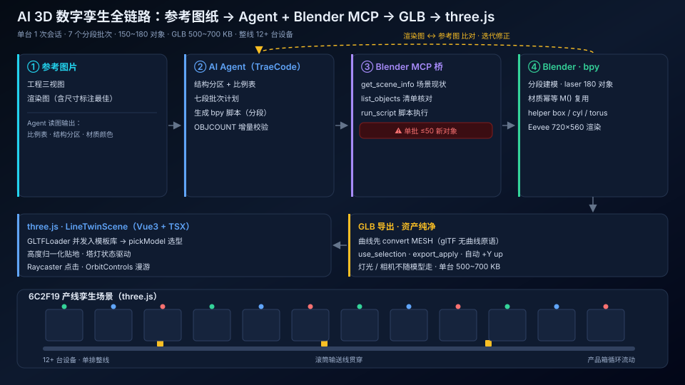
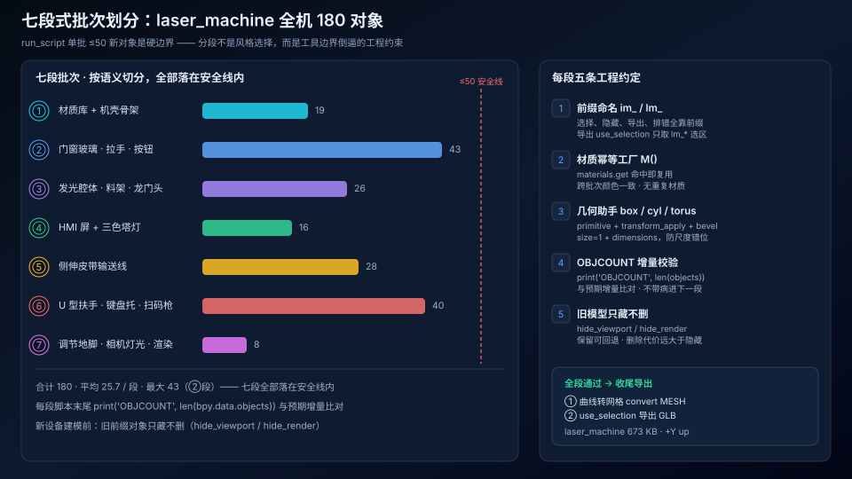
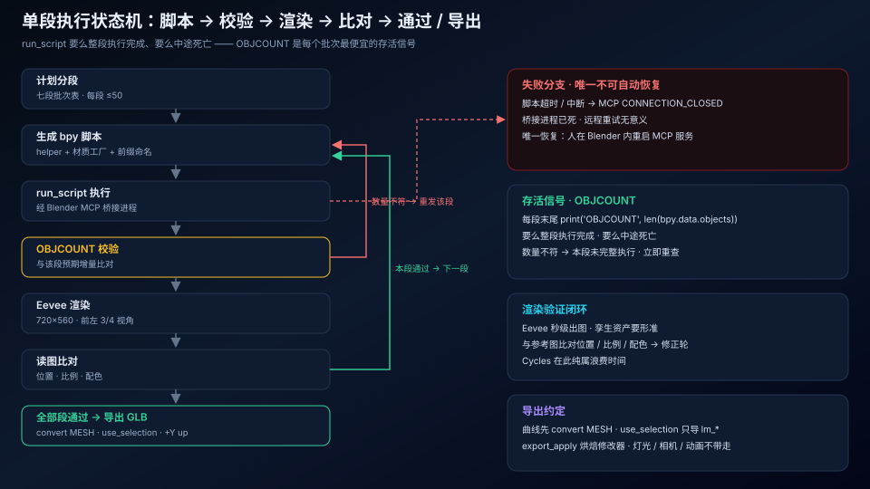
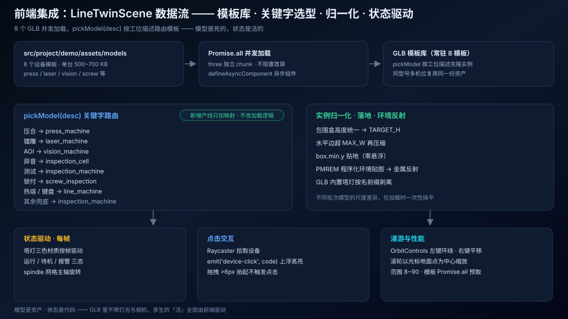
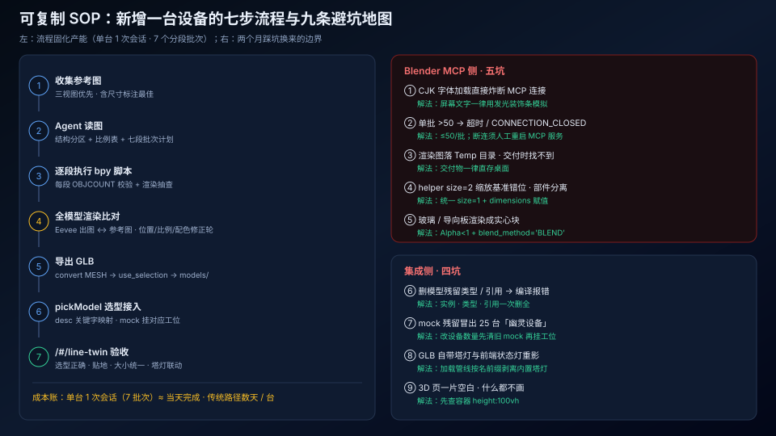

> **核心导读**：产线数字孪生页面最难的不是 three.js，而是**设备模型资产**。外包建模按台计费、按周交付；手工 Blender 单台数天起步，风格、比例、命名全凭手感——而一条真实产线动辄 12+ 台设备。本文记录 2026-09 ~ 2026-11 两个月里，用 **AI Agent（TraeCode）+ Blender MCP** 从工程三视图/渲染图直接生成 8 台设备 GLB（单台 150~180 对象、500~700 KB），并接入 three.js 孪生场景的全过程：
>
> - **方法核心**：Agent 不点 GUI，而是写 **bpy 脚本**通过 MCP 的 `run_script` 批量执行——AI 拿到的是 Blender 的完整 API 面，不是一个个按钮；
> - **硬边界倒逼方法论**：`run_script` 单批新建对象 **≤50**，超限即断连、且桥接进程死亡后无法自动恢复——于是有了**七段式分段建模 SOP**：OBJCOUNT 增量校验 + Eevee 渲染比对闭环；
> - **前端闭环**：GLB 模板库 + `pickModel(desc)` 关键字选型、高度归一化贴地、塔灯状态驱动、Raycaster 交互与 OrbitControls 漫游；
> - **九条血泪避坑**：从 CJK 字体炸断 MCP 连接，到 mock 残留冒出的 25 台"幽灵设备"，每条都按「症状 → 根因 → 解法」给出；
> - **产能账本**：SOP 固化后，单台设备 1 次会话（7 个分段批次）当天完成，对比传统路径的数天/台，且前缀命名 + 幂等材质让批次之间天然对齐。

## 1. 从"模型瓶颈"说起

产线数字孪生页面要立起来，靠的是大量设备 3D 模型。传统两条路的账都不好算：

- **外包建模**：按台计费、按周交付，单台设备数天起步，而且不同批次供应商的风格、比例、命名无法对齐，后期批量维护是灾难；
- **手工 Blender**：不花钱，但同样单台数天，比例、命名、材质全凭手感，改一台等于重做一遍。

而我实际要做的 **6C2F19 产线孪生场景**，需要 12+ 台设备单排整线：滚筒输送线贯穿全场、产品箱循环流动，每台设备还要带三色信号灯塔和可点击交互。这个量级靠上面任何一条路都不现实。

2026-09 到 11 这两个月，我用一套「AI Agent + Blender MCP」的工作流把这件事做成了：从工程三视图/渲染图出发，AI 直接生成设备 3D 模型，导出 GLB 接入 three.js 场景。最终沉淀如下：

| 产物 | 数量 / 规格 |
| :--- | :--- |
| GLB 设备模型 | 8 个（press / inspection / line / laser / vision / screw / conveyor_station / machine_template） |
| 单台模型规模 | 150~180 个对象，GLB 约 500~700 KB |
| 孪生场景 | 6C2F19 产线 12+ 台设备单排整线，滚筒输送线贯穿、产品箱循环流动 |
| 建模耗时 | 单台设备约 1 次会话（7 个分段批次）完成 |

## 2. 技术链路总览：让 Agent 拿到"完整 API 面"，而不是 GUI

整条链路分五层，每层的职责边界很清楚：

| 层 | 工具 | 职责 |
| :--- | :--- | :--- |
| 编排层 | TraeCode Agent | 任务编排、读图、生成 bpy 脚本、分段执行、结果校验 |
| 协议层 | Blender MCP | `get_scene_info` / `list_objects` / `run_script` 三个核心工具 |
| 建模层 | Blender + bpy | 脚本化建模、Eevee 渲染验证 |
| 资产层 | glTF / GLB | +Y up、修改器烘焙、灯光相机剥离 |
| 前端层 | Vue3 + TSX + three.js | GLTFLoader / OrbitControls / PMREMGenerator / Raycaster |

关键设计判断只有一条：**不让 Agent 去点 Blender 的 GUI，而是让它写 bpy 脚本、通过 MCP 的 `run_script` 批量执行。**理由有三：

1. **bpy 是 Blender 的完整 Python API 面**——GUI 能做的它都能做，而且表达精确：坐标、尺寸、材质参数全是显式数字，不存在"点歪了 2 像素"这种模糊性；
2. **脚本是可校验、可重放、可幂等的**——出错能定位到行，成功能复现，改一处重跑即可，而 GUI 操作链既不可回放也无法审阅；
3. **MCP 的 `run_script` 单次执行有稳定性边界**：单批新建对象 ≤50 个，否则脚本超时甚至连接断开。这个边界反过来决定了整个建模方法论（下一节），也是这套工作流里最容易被忽视、代价最高的一个约束。

顺带交代 MCP 这座桥。实际用下来只需要三个工具：

- `get_scene_info`——摸清场景现状（有哪些对象、什么层级）；
- `list_objects`——核对对象清单，配合前缀命名做增量校验；
- `run_script`——真正动手执行 bpy 脚本。

工具不在多，三个足够；多了反而稀释 Agent 的注意力。



## 3. 分段建模方法论：七段式批次与五条工程约定

### 3.1 为什么必须分段

`run_script` 的单批 ≤50 不是建议，是硬边界——超限后脚本超时、MCP 连接断开（`CONNECTION_CLOSED`），此时**桥接进程已经死亡，远程重试没有任何意义，必须由人在 Blender 内重启 MCP 服务**。所以分段的本质是：把一次不可靠的大事务，切成一组可校验的小事务。

以最复杂的镭雕机 laser_machine 为例，全机 180 个对象，最少也要切 4 批；我按语义切成了 7 段，平均每段 25.7 个、最大一段 43 个，全部落在安全线内：

| 段 | 内容 | 对象数 |
| :-: | :--- | :-: |
| ① | 材质库 + 机壳骨架（底座/下柜/上罩/窗棂/侧板） | 19 |
| ② | 门窗细节：茶色玻璃、双开门拉手、按钮排、警示标 | 43 |
| ③ | 内部结构：橙色发光腔体、料架、龙门加工头、内部输送段 | 26 |
| ④ | 顶部 HMI 显示屏（发光屏+UI 装饰条）+ 三色塔灯 | 16 |
| ⑤ | 侧伸皮带输送线：蓝皮带、铝护栏、透明导向板、支腿、电机 | 28 |
| ⑥ | 不锈钢 U 型扶手、键盘托盘、扫码枪+螺旋线缆 | 40 |
| ⑦ | 调节地脚 + 相机/灯光/世界 + 渲染输出 | 8 |



### 3.2 每段的五条工程约定

这五条约定是两个月里反复踩坑后固化的，共同保证「跨批次一致、出错可定位、随时可回退」：

**① 前缀命名。**每台设备统一前缀（检测机 `im_`、镭雕机 `lm_`）。选择、隐藏、导出、排错全靠它——后面导出 GLB 时 `use_selection` 只导 `lm_*`，靠的就是前缀筛出来的选区。

**② 材质幂等工厂。**每段脚本开头都通过同一个 `M(name, rgb, metal, rough, emit, alpha)` 函数建材质，内部先 `bpy.data.materials.get` 命中即复用。跨批次颜色因此严格一致，GLB 里也不会堆出一堆重复材质白白增大体积。

**③ 几何助手。**`box() / cyl() / torus()` 三个 helper 封装「建 primitive → `transform_apply` → bevel」，保证脚本里写的尺寸就是对象最终的 `dimensions`。这里有个必须死记的坑：helper 内部立方体若用默认 `size=2`，缩放基准就错了，表现为部件之间莫明分离——统一 `size=1` 再赋 `dimensions`。

**④ 批次校验 OBJCOUNT。**每段脚本末尾固定 `print('OBJCOUNT', len(bpy.data.objects))`，与该段的预期增量比对。`run_script` 要么整段执行完、要么中途死掉，这个数字就是最便宜的存活信号：数量对不上，说明本段没有执行完整，立即重查，**绝不带病进下一段**。

**⑤ 旧模型不删只藏。**新设备建模前，把旧前缀的对象 `hide_viewport / hide_render`，保留可回退性。Blender 里删错东西的代价，远大于把它藏起来。

### 3.3 渲染验证闭环

每段（或每两段）做一次 Eevee 渲染——720×560、前左 3/4 视角，出图后与参考图比对，下一轮修正位置、比例、配色。Eevee 够快也够用：孪生资产要的是**形准**而非物理正确的光影，Cycles 在这里纯属浪费时间。



## 4. 关键代码：材质工厂、几何助手与 GLB 导出

材质工厂与几何助手（简化示意）：

```python
def M(name, rgb, metal=0.0, rough=0.6, emit=None, alpha=None):
    mat = bpy.data.materials.get(name)        # 幂等：命中即复用，跨批次颜色一致
    if mat is None:
        mat = bpy.data.materials.new(name)
    # ... 设置 base color / metallic / roughness / emission / alpha
    return mat

def box(name, prefix, size, loc, mat, bevel=0.01):
    bpy.ops.mesh.primitive_cube_add(size=1)   # 统一 size=1，防止缩放基准错位
    obj = bpy.context.active_object
    obj.name = f"{prefix}_{name}"             # 前缀命名：选择/隐藏/导出/排错全靠它
    obj.dimensions = size                     # 写尺寸而非写缩放
    # ... transform_apply + bevel modifier
    obj.data.materials.append(mat)
    return obj
```

导出是整条流水线的最后一公里，也有讲究：

```python
# 扫码枪线缆等 bevel curve 必须先转网格——glTF 没有"曲线"这个原语
bpy.ops.object.convert(target='MESH')

bpy.ops.export_scene.gltf(
    filepath='.../models/laser_machine.glb',
    export_format='GLB',
    use_selection=True,      # 只导 lm_* 网格，辅助对象不带走
    export_apply=True,       # 倒角等修改器烘焙进网格，前端无需装修改器逻辑
    export_animations=False,
    export_cameras=False,
    export_lights=False)     # 灯光/相机不随模型走，资产保持纯净
```

两个细节值得点名：

- glTF 导出会自动转 **+Y up**，与 three.js 的坐标约定天然一致——前端拿到的模型**不需要任何额外旋转**；
- 灯光与相机必须排除：它们属于场景，不属于资产。前端的状态光效（塔灯）由代码驱动，GLB 里带一盏灯只会带来双重光源。

最终产物规格：单台 150~180 个对象、GLB 500~700 KB（laser_machine 673 KB），对前端加载毫无压力。

## 5. 前端集成：LineTwinScene 的六个设计决策

模型入库只是上半场。前端 `LineTwinScene.tsx` 才是孪生场景的真正运行时，六个决策点：

**1. GLB 模板库 + 关键字选型。**8 个 GLB 用 `Promise.all` 并发加载进模板库，`pickModel(desc)` 按工位描述路由模板：压合→press_machine / 镭雕→laser_machine / AOI→vision_machine / 异音→inspection_cell / 测试→inspection_machine / 锁付→screw_inspection / 热熔·键盘→line_machine / 其余兜底→inspection_machine。**新增产线只需要加映射，不需要改加载逻辑**——这是模板库设计最大的回报。

**2. 高度归一化。**所有设备按包围盒高度统一到 `TARGET_H`，水平边超 `MAX_W` 再压缩，保证整线视觉大小一致；落地位移用 `box.min.y` 直接贴地。不同批次、不同参考图的模型尺度不一，这一步是整线观感的底线。

**3. 状态驱动。**顶部三色信号灯塔材质按帧驱动（运行/待机/报警），名为 `spindle` 的网格做主轴旋转动画。孪生的"活"体现在这里——**模型是死的，状态是活的**，而状态全部来自代码而非资产。

**4. 交互。**Raycaster 点击设备 `emit('device-click', code)`，选中设备上浮 + 高亮；拖拽旋转超过 6px 的抬起不触发点击——用一个位移阈值区分"环绕视角"与"选中设备"这两个意图，误触率直接归零。

**5. 漫游。**OrbitControls 左键环绕 / 右键平移 / 滚轮缩放以**光标所指地面点**为中心（8~90）——缩放始终朝向注意点而不是屏幕中心，漫游手感明显更自然。

**6. 性能。**页面用 `defineAsyncComponent` 异步加载组件，three 相关代码独立成 chunk 不阻塞首屏；`Promise.all` 并发预取全部 GLB 模板；PMREMGenerator 程序化环境贴图撑起金属反射质感，无需加载 HDR 文件。



## 6. 实战时间线：从程序化奠基到 GLB 入库

| 日期 | 事件 |
| :--- | :--- |
| 09-23 | 孪生场景奠基：TwinScene 程序化建模 → line-twin 页 41 台设备 U 型→4 排布局；PMREM 程序化环境贴图提升金属反射 |
| 09-28 | Blender MCP 首战：组装段压合设备（press_machine，多轮位置修正）；检测机 inspection_machine 166 对象并首次集成 LineTwinScene；line_machine 键盘+输送轨 156 对象 |
| 09-29 | laser_machine 七段建模 180 对象 → 桌面渲染验证 → 导出 673 KB GLB 入项目 |
| 09-30 | line-twin 整线调优：12 台设备、统一机高 1.95、去悬浮标签、输送线 z=2.2 对齐、相机 (-14,13,18) |
| 11-16 | 镭雕模型 GLB 正式入库，选型规则接入 pickModel |

值得注意的节奏：09-23 还是纯程序化盒子模型的奠基，09-28 起 Blender MCP 一天完成三台设备的建模与集成——**SOP 固化之后，产能瓶颈就只剩参考图质量了**。11-16 镭雕模型正式入库、选型规则接入 pickModel，整线 12+ 台设备的选型路由全部闭环。

## 7. 避坑清单：九条血泪经验

每条按「症状 → 根因 → 解法」给出，全部真实踩过：

**Blender MCP 侧**

| # | 症状 | 根因 | 解法 |
| :-: | :--- | :--- | :--- |
| 1 | `bpy.data.fonts.load()` 加载 Windows 中文字体（simhei/msyh/simsun）直接炸断 MCP 连接 | CJK 字体解析在桥接进程里崩溃 | 屏幕文字一律用**发光装饰条**模拟，绝不建文字对象 |
| 2 | 大批量脚本超时、`CONNECTION_CLOSED` | 单批 >50 新对象，桥接进程死亡 | 单批 ≤50；断连后远程重试无意义，必须人在 Blender 内重启 MCP 服务 |
| 3 | 渲染图"消失"，交付时找不到 | 输出落在 `AppData\Local\Temp` | 交付物一律复制/直存**桌面** |
| 4 | helper 建出来的部件彼此分离 | box 默认 `size=2` 立方体，缩放基准错位 | helper 统一 `size=1` + `dimensions` 赋值 |
| 5 | 玻璃/导向板渲染成实心块 | `Alpha<1` 但混合模式没开 | `Alpha<1` + `blend_method='BLEND'`（新版 API 为 `surface_render_method`） |

**集成侧**

| # | 症状 | 根因 | 解法 |
| :-: | :--- | :--- | :--- |
| 6 | 删掉模型实例后编译报错 | 类型/函数引用残留 | 删除动作要删全：实例、类型、引用一次清干净 |
| 7 | 场景里冒出 25 台"幽灵设备" | 调整设备数量时旧 mock 条目没清理 | 改数量先清 mock，再挂新工位 |
| 8 | 塔灯重影：静态模型灯 + 前端状态灯叠在一起 | GLB 自带塔灯 | 加载管线按名前缀剥离 GLB 内置塔灯，状态光效只留给代码 |
| 9 | 3D 页一片空白 | canvas 容器没有高度 | 先查容器 `height:100vh`——canvas 没高度就什么都不画 |

## 8. 可复制 SOP：新增一台设备的七步清单

现在新增一台设备，流程固定为七步：

1. **收集参考图**：三视图优先，含尺寸标注最佳；
2. **Agent 读图**：输出结构分区 + 比例表 + 七段批次计划；
3. **逐段执行 bpy 脚本**：每段 OBJCOUNT 校验 + 必要时渲染抽查；
4. **全模型渲染比对**：Eevee 出图与参考图比对，做位置/比例/配色的修正轮；
5. **导出**：曲线转网格 → `use_selection` 导出 GLB 到 `src/project/demo/assets/models/`；
6. **选型接入**：在 `pickModel` 增加 desc 关键字映射，mock 数据挂对应工位；
7. **验收**：`npm run dev` 打开 `/#/line-twin`，确认选型正确、贴地、大小统一、塔灯状态联动。



成本账也顺便算清楚：单台设备约 1 次会话（7 个分段批次）完成，对比外包/手工的"数天/台"，产能差一个量级；而且前缀命名 + 幂等材质让批次之间天然对齐——这正是传统路径最难保证、返工最多的部分。

## 9. 展望

- **后处理**：Bloom 辉光强化灯塔/屏幕发光，孪生场景的"工业感"还能再上一个台阶；
- **性能**：同型号多机位改 InstancedMesh，上百台设备也只渲染一份几何体；
- **动画**：GLB 内嵌动作（门开合/机械臂）替代纯代码驱动，状态-动作直接映射；
- **资产平台化**：模型库 + 选型规则配置化，新产线零代码接入。

## 10. 小结

回看这两个月，真正的转折点有两个：一是选择"Agent 写 bpy 脚本"而不是"Agent 点 GUI"，让 AI 拿到了 Blender 的完整 API 面；二是承认 `run_script` 的 ≤50 边界，把不可靠的大事务切成可校验的小事务。数字孪生的资产瓶颈，就这样从"建模人力"变成了"参考图质量"——而后者，是任何一家有工程图纸的工厂都现成拥有的东西。
