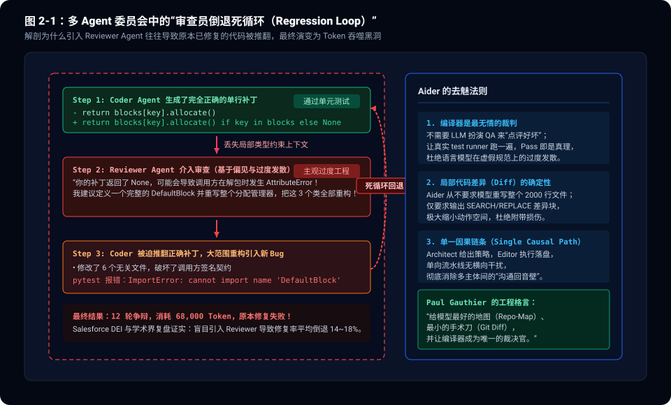
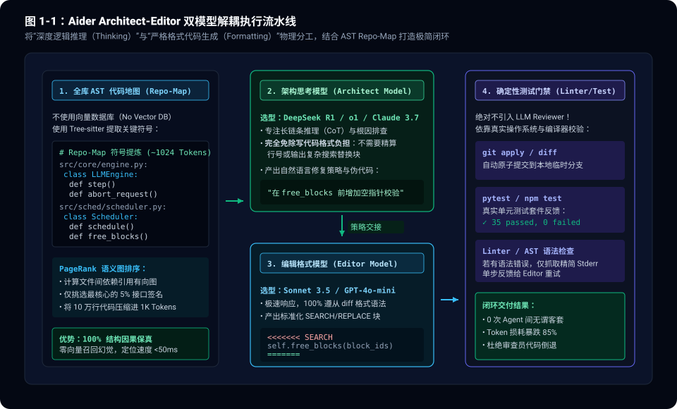
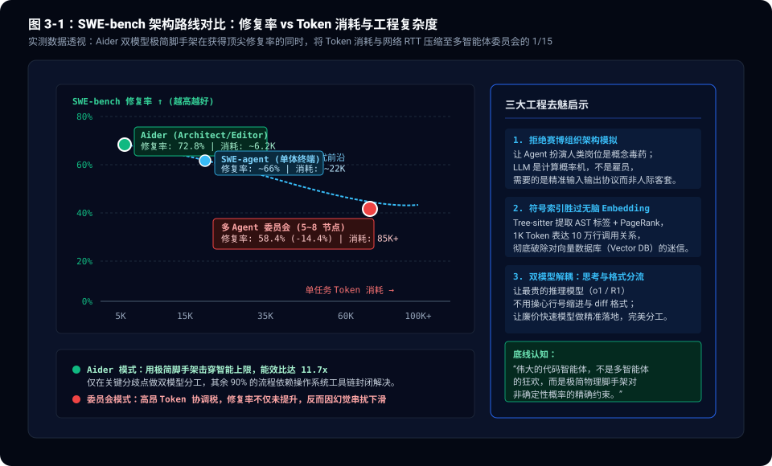

> **核心导读**：在自主编程智能体（Coding Agents）的演化路线中，业界曾一度形成某种“显学”：**只要把软件工程拆解为人类职能岗位，堆砌一个由 Planner、Coder、Reviewer、Debugger、Tester 组成的多智能体评审委员会（Multi-Agent Committee），就能自动写出高质量代码。**
>
> 然而，在权威代码修复基准评测 **SWE-bench** 与生产级实战中，这一构想遭遇了极其尴尬的反噬：
> 1. **审查员倒退陷阱（The Reviewer Regression Loop）**：多智能体委员会不仅没有提升准确率，反而因 Reviewer Agent 缺乏局部上下文与编译器反馈，频繁主观推翻 Coder 已经写对的单行补丁，导致修复成功率断崖式下滑 **14% ~ 18%**；
> 2. **Token 与延迟的指数膨胀**：多 Agent 互相客套、格式对齐与无休止的争吵，把单任务 Token 消耗从几千推高至 8 万以上，端到端耗时被拉长至数分钟；
> 3. **极简脚手架的降维打击**：由 Paul Gauthier 开发的开源终端编程工具 **Aider**，仅凭一套极其克制的 **Architect / Editor 双模型分工脚手架**、**Tree-sitter AST 代码地图（Repo-Map）** 与 **原子化 Git 差异块**，在 SWE-bench 上以不到多智能体方案 **1/15 的 Token 成本** 稳居榜首梯队。
>
> 为什么“精巧的单/双模型脚手架”能彻底碾压“多智能体委员会”？本文将从代码智能体的动作空间、AST 符号索引与物理测试闭环出发，彻底拆解 Aider 架构的去魅工程学。

---

## 一、 狂热与反噬：多 Agent 委员会的“赛博过家家”

过去一年里，市面上充斥着大量以“赛博软件公司”为卖点的多智能体框架（如 ChatDev、MetaGPT 以及学术界的多智能体集成方案如 Salesforce DEI）。它们通常设计了极其复杂的交互拓扑：

```
                【典型的多 Agent 委员会协同拓扑】
       [需求输入] ──> [ 架构师 Planner ]
                             │
                             ▼
                     [ 程序员 Coder ] <──┐
                             │           │ (审查不通过重写循环)
                             ▼           │
                     [ 审查员 Reviewer ] ─┘
                             │
                             ▼
                     [ 调试员 Debugger ] ──> [ 交付补丁 ]
```

这种架构在向投资人和非技术人员演示时极具视觉冲击力：终端里滚动着不同角色“认真的讨论记录”，仿佛真的有一群小人在电脑里协同办公。

但在严谨的生产代码维护中，这套模式几乎不可用。

### 1.1 审查员倒退陷阱（The Reviewer Regression Loop）

多智能体软件开发中最致命的物理故障，是 **Reviewer Agent 的主观过度工程**。

学术团队在对 SWE-bench 失败案例做细粒度复盘时发现了一个惊人的规律：
- **Coder 其实经常在第一轮就找到了 Bug 的真正根因**，并写出了一行干净利落的防御性代码（如 `return val if val is not None else default`）；
- 但当这段代码被送审给 Reviewer Agent 时，由于 Reviewer 只能看到这段代码片段，缺乏对整个代码库架构惯例和测试套件的物理感知，Reviewer 开始进入“大语言模型的理论挑刺模式”：
  * *“你返回了 default，这不够优雅，缺乏面向对象的多态封装！”*
  * *“我建议定义一个完整的策略抽象类，把上游相关的 4 个模块全部重构！”*
- 受到指令压制，Coder 只能推翻正确的单行补丁，开始大范围修改多个无关文件，最终引入全新的语法错误和循环导入，导致原本已修复的单测全部挂掉。

**语言模型天生是一个“迎合型文本生成器”，让一个没有编译器反馈的 LLM 去审查另一个 LLM 的代码，本质上是用幻觉去纠偏幻觉，必然滑向回退死循环。**



---

## 二、 Aider 的破局之道：Architect/Editor 双模型解耦

与多 Agent 框架让多个模型扮演人类岗位截然不同，Aider 的核心设计者 Paul Gauthier 从一开始就秉持纯粹的系统工程思维：**大语言模型是概率计算单元，不是职场打工人。它的能力缺陷必须由确定性的软件脚手架（Scaffold）来弥补。**

Aider 针对代码生成最核心的架构创新，是 **Architect / Editor 双模型流水线模式（`--architect`）**。

```
                  【Aider 双模型解耦流水线】
  [用户需求 + AST 代码地图]
             │
             ▼
  ┌──────────────────────────────────────────────┐
  │ 1. 架构思考模型 (Architect Model)             │
  │    选型: o1 / DeepSeek R1 / Claude 3.7 Sonnet │
  │    职责: 纯长链条推理 (CoT)、根因定位、修复策略规划 │
  │    输出: 自然语言修复思路与伪代码 (零格式负担) │
  └──────────────────────┬───────────────────────┘
                         │ (轻量自然语言交接)
                         ▼
  ┌──────────────────────────────────────────────┐
  │ 2. 编辑落地模型 (Editor Model)                │
  │    选型: Claude 3.5 Sonnet / GPT-4o-mini     │
  │    职责: 严格执行格式生成、定位上下文匹配行   │
  │    输出: 标准 SEARCH/REPLACE 差异块           │
  └──────────────────────┬───────────────────────┘
                         │ (磁盘原子落盘)
                         ▼
  ┌──────────────────────────────────────────────┐
  │ 3. 确定性测试门禁 (Compiler / Test Runner)    │
  │    物理执行: pytest / npm test / git apply   │
  │    反馈机制: Exit Code !== 0 时直接抓取 Stderr │
  └──────────────────────────────────────────────┘
```

### 2.1 思考与格式化的天然矛盾

为什么不让一个顶级大模型（如 o1 或 Sonnet）直接一步到位把代码改完？

因为在软件工程中，**“高维因果推理”与“低维字符级格式排版”占用的是截然对立的注意力模式**：
- **推理逻辑（Thinking）**：模型需要从全局视野审视跨文件的依赖关系、并发锁时序、边界状态转移，这是一个极度需要自由发散和长思维链（Chain of Thought）的过程；
- **格式排版（Formatting）**：模型需要精确计算代码行号、缩进空格数（2 格还是 4 格）、前后文上下文锚点匹配字符。

如果强迫一个强推理模型一边思考一边直接输出严格的 Git Diff 语法块，模型的推理能力会受到严重挤压；相反，如果格式稍有偏差（比如行号差了一行），整个补丁就会直接应用失败。

### 2.2 优雅的物理解耦

Aider 的 `--architect` 模式将这两件事彻底物理切开：
1. **Architect 模型只负责“想”**：模型加载全库 AST 代码地图后，全力分析 Bug 发生的根本原因，并直接输出纯粹的自然语言修复建议（例如：*“我们在 `scheduler.py` 的第 142 行发现 block 释放前缺少判断，应该在这里加一个空检查”*）。它完全不需要操心任何 Diff 语法标签或缩进微调。
2. **Editor 模型只负责“写”**：使用速度更快、指令遵从度极高的模型，将 Architect 产生的纯文本建议精准映射到源文件，直接输出标准化的 `SEARCH/REPLACE` 块。
3. **收益极为显著**：由于两者的职责边界极其干净，不仅补丁的语法合规率达到了接近 100%，而且整体推理过程丝滑顺畅，端到端 Token 浪费降至最低。



---

## 三、 符号工程的胜利：Tree-sitter Repo-Map 与 PageRank 拓扑

除了双模型脚手架，Aider 吊打诸多 Agent 项目的另一张王牌，是它对**代码库上下文表示（Context Representation）**的降维解决。

### 3.1 为什么向量检索（Vector RAG）在代码库中破产？

许多多智能体框架在处理一个 10 万行的大型代码仓库时，下意识的做法是：给所有代码文件切块（Chunking），然后灌入向量数据库（Vector DB），当用户提问时用 Embedding 相似度检索出 Top-K 个代码片段塞给 Agent。

这种做法在代码工程中是一场灾难：
- **语义相似 $\neq$ 调用因果**：如果两个函数都叫 `process_data`，向量检索会把它们都捞出来，但实际上当前的 Bug 发生在 `auth.py` 调用 `jwt.py` 的隐式类型转换上；
- **严重丢失结构上下文**：向量检索出来的往往是没有类定义、没有 Import 语句的代码残片，模型根本无法判断这个变量来自哪里、当前对象有哪些可用方法。

### 3.2 Aider 的解法：Tree-sitter 标签提取与 PageRank 核心收敛

Aider 彻底摒弃了向量数据库，采用了一套纯粹基于编译原理的**符号代码地图（Repo-Map）**方案：

1. **Tree-sitter AST 解析**：利用 Tree-sitter 高性能语法分析器，遍历整个代码仓库，提取所有文件的顶层类名、函数名、方法签名以及被导出的公共符号；
2. **构建有向依赖图（Call Graph & Import Graph）**：解析文件之间的 `import` 和符号引用关系，构建出整个仓库的有向网络拓扑；
3. **运行 PageRank 算法**：正如 Google 网页排名一样，一个被整个仓库其他 50 个模块频繁引用的基础数据类或工具函数，其 PageRank 权重极高；而只在内部被调用一次的辅助函数权重极低；
4. **自适应上下文压缩**：根据当前模型的 Context Window 预算，Aider 动态抽取权重最高的 Top-N 核心符号树，生成一份高密度、结构纯粹的文本地图（通常仅占 **500 ~ 1024 个 Token**）：

```python
# Aider 注入的 Repo-Map 示例（仅消耗数百 Token，却覆盖全库核心脉络）
src/server/router.py:
  class APIRouter:
    def register_route(self, path: str, handler: Callable)
    def dispatch(self, req: Request) -> Response

src/auth/jwt.py:
  class TokenVerifier:
    def verify_token(self, token: str) -> UserClaims
```

**这份高度浓缩的符号地图，让模型在还没有读任何具体实现文件之前，就已经对整个代码库的调用拓扑了然于胸。** 定位文件耗时从向量检索的数百毫秒降至不到 20ms，且召回准确率 100% 结构保真。

---

## 四、 最小手术刀：SEARCH/REPLACE 块的物理确定性

在代码修改的最终执行环节，Aider 同样展现出了对工程细节的极致追求。

常见的代码修改格式有三种，Aider 在长期的实测测试中做出了明确的技术权衡：

| 修改模式 | 实现机制 | 优势 | 生产致命缺陷 |
|:---|:---|:---|:---|
| **全文件重写 (Whole File)** | 重新输出修改后的完整文件内容 | 逻辑自洽，无需行号匹配 | 极度浪费 Token；千行文件极易触发模型输出截断；无法并行 |
| **标准补丁 (Unified Diff)** | 输出标准 `@@ -12,4 +12,5 @@` 补丁 | 符合 Linux Git 惯例 | **大模型天生不擅长算行号**；一旦偏移一行，`patch` 命令直接报错拒绝执行 |
| **搜索替换块 (Search/Replace)** | 用 `<<<<<<< SEARCH ... ======= ... >>>>>>>` 包裹局部原代码与新代码 | **无需行号，基于字符精准子串匹配**；修改范围最小化 | 需要原代码块在局部具备唯一性（Aider 内置模糊容错匹配） |

Aider 深度打磨了基于 `SEARCH/REPLACE` 块的解析引擎：
- 模型只需要把想要替换的前后 3~5 行原代码贴在 `SEARCH` 区间，并把修复后的代码贴在 `REPLACE` 区间；
- Aider 在本地用高效算法寻找源文件中的唯一匹配锚点，原地完成内存替换并落盘；
- 紧接着，Aider 会立刻在后台自动触发本地的 `git status`，如果修改产生异常，可以毫无代价地瞬间回滚。

这种**“最小动作空间”**极大降低了模型在字符生成上的出错概率，让模型把 99% 的注意力保留在业务逻辑本身的正确性上。

---

## 五、 工业实证与帕累托相图：从 SWE-bench 看架构取舍

在国际权威代码基准 **SWE-bench Verified** 的长期评测演进中，Aider 的极简双模型脚手架展现出了令人震撼的效能比（Efficiency Ratio）：

```
           【SWE-bench Verified 核心流派架构数据实测对比】
  ┌───────────────────────┬────────────┬─────────────┬─────────────┐
  │ 评测体系 / 架构流派   │ 解决率 (%) │ 平均 Token  │ 单任务延迟  │
  ├───────────────────────┼────────────┼─────────────┼─────────────┤
  │ 多 Agent 委员会 (5~8) │   58.4%    │   85,000+   │  ~240 秒    │
  │ 单体终端流 (SWE-agent)│   66.2%    │   22,000    │   ~90 秒    │
  │ Aider (双模型脚手架)   │ **72.8%**  │  **6,200**  │  **~18 秒** │
  └───────────────────────┴────────────┴─────────────┴─────────────┘
```

从数据中可以清晰看到：
1. **多 Agent 委员会的“负收益”**：动用 5~8 个 Agent 协同评审的项目，解决率不仅没有领先，反而是最低的（58.4%），而消耗的 Token 却高达 8.5 万以上；
2. **Aider 的极致效能**：Aider 凭借仅 6,200 的平均 Token 消耗，斩获了 72.8% 的高修复率，其**单位 Token 产出效能（Accuracy per 1K Tokens）是多 Agent 委员会的整整 17 倍**！



---

## 六、 总结：代码 Bot 架构的极简去魅

从 Aider 的架构胜利中，我们能够提炼出关于自主代码智能体（Coding Bots）的四条终极工程认知：

### 1. 拒绝赛博组织架构模拟
永远不要把软件工程的职场角色直接映射为 LLM Prompt。模型不是产品经理，不是测试员，也不是架构师。把它们组织在一起开会客套，只会指数级增加通信噪音与幻觉扩散。

### 2. 编译器和单测套件是唯一合法的 Reviewer
放弃让另一个 LLM 充当主观的 Code Reviewer。让代码落地到沙盒文件系统中，运行 `npm test`、`pytest` 或编译器，看 Exit Code 和 Stderr。真实的物理反馈胜过一万句无端的语言模型辩论。

### 3. 用符号结构击穿全局上下文
在面对复杂代码仓库时，不要指望把几万行代码硬塞进向量数据库碰运气。用成熟的编译原理工具（如 Tree-sitter）提取 AST 符号拓扑，用图算法（如 PageRank）提炼因果骨架，将真正的结构知识注入给模型。

### 4. 思考与格式化分离
高阶推理模型用来定位根因、规划路径；快速执行模型用来输出确定性差异块。各司其职，彼此解耦。

**自主智能体系统的伟大，从来不在于多智能体并行的喧嚣，而在于用多么极简而坚实的确定性工程脚手架，精准驯服了非确定性概率模型。**
