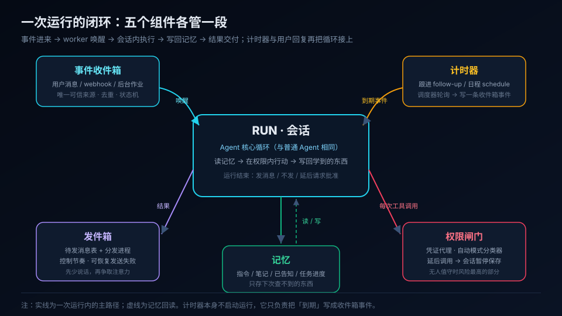
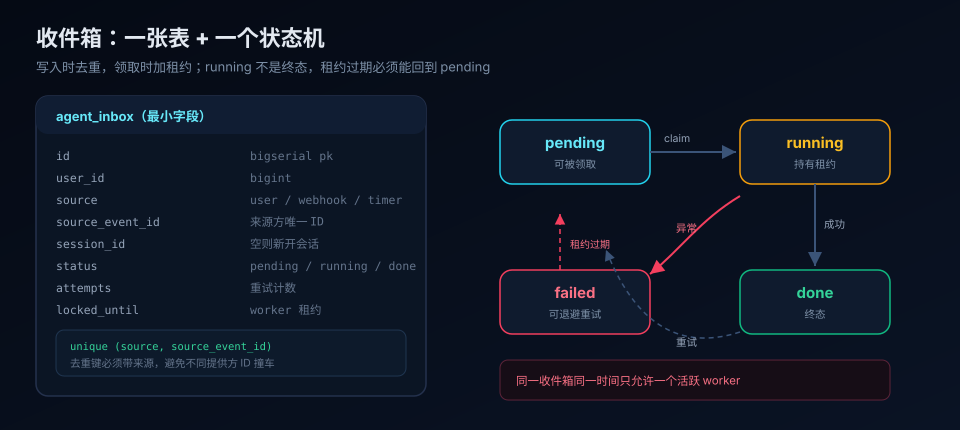
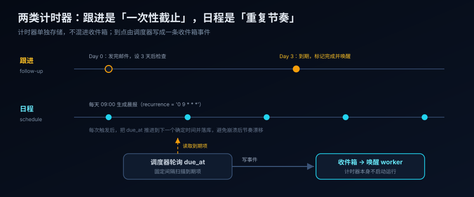
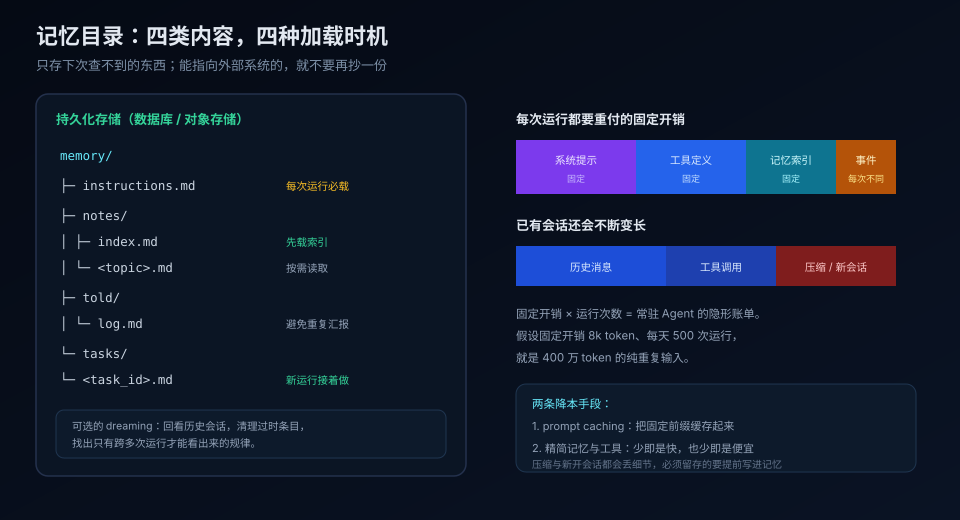
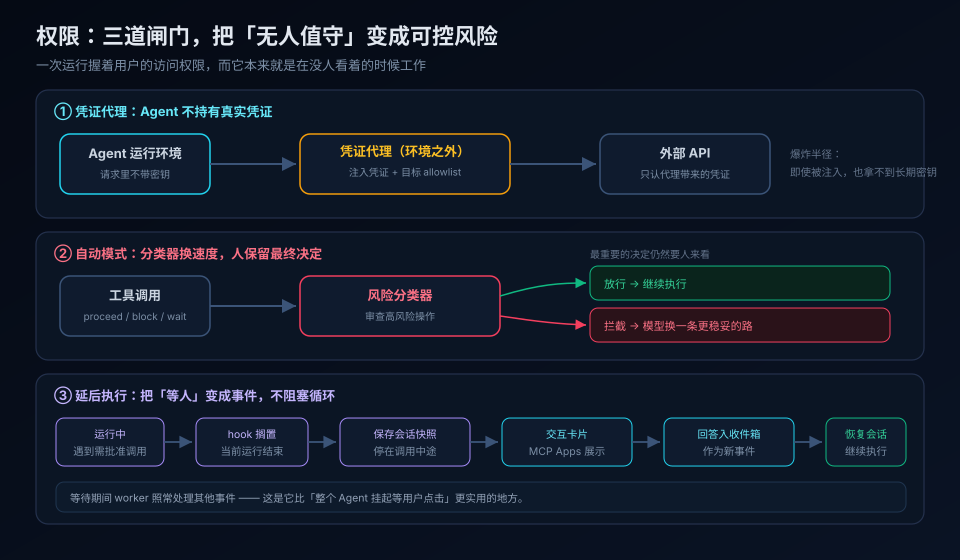
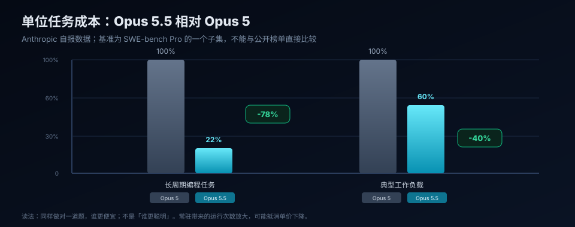
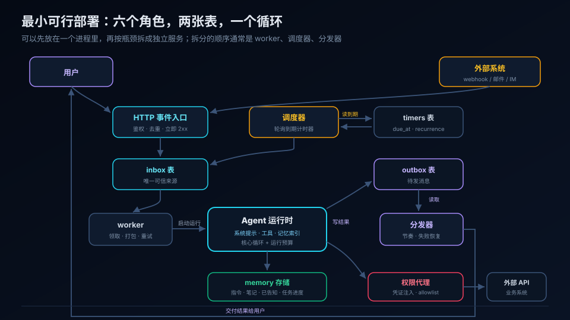

> **核心导读**：Anthropic 应用 AI 团队在 2026 年 11 月 13 日发布了《Building always-on agents》，回答一个很具体的问题：怎么把「你问一句、它答一句」的 Agent，改造成「没人盯着也能持续推进任务」的常驻 Agent。文章给出的答案不是更强的模型，而是五个外围组件：**事件收件箱、计时器、记忆、权限、发件箱**。
>
> 这篇文章做三件事：第一，把原文的架构逐层拆开，讲清每个组件为什么存在、少了它会坏在哪；第二，补上原文没展开的工程细节——表结构、幂等键、worker 租约、上下文预算、权限闸门；第三，指出这份指南刻意留白或语焉不详的地方。所有来自 Anthropic 的数字与结论都会标注来源；我的补充会明确写成「工程建议」，不混在原文里。

---

## 一、先校准概念：always-on 不是「一直在线」

这是全文最容易被误读的一点，也是原文开篇就强调的：**常驻 Agent 绝大部分时间在休眠**。

它不会 7×24 小时占着 GPU 空转。真实工作方式是：

1. 某个事件到达（用户消息、webhook、定时任务）；
2. Agent 被唤醒，执行一次**运行（run）**：接收事件、完成任务、把发生过的事情存下来；
3. 运行发生在**会话（session）**里——会话就是消息与工具调用的完整记录；
4. 运行结束，Agent 重新休眠，等待下一个事件。

所以「always-on」描述的是一种**使用体验**：你随时丢一个任务过去，它接得住、记得住、会自己跟进；而不是一个常驻进程的资源占用状态。原文的定义是「有状态（stateful）且主动（proactive）」：跨会话管理上下文，并且在无人监督时自行采取行动。

底层仍然是和其他 Agent 一样的核心循环（core loop），这一点承接 Anthropic 更早的《Building effective agents》。真正不同的是**外围架构**：谁决定它什么时候醒来、哪些状态要跨运行保留、结果怎么交回给用户。

### 为什么现在才值得做

原文把可行性归因于两个模型侧变化：

- **判断力更好**：更能理解用户意图，也更清楚什么时候该停下来向人确认；
- **智能更便宜**：长周期任务受益最大。原文给出的数字是：在一项长周期编程基准上，Opus 5.5 每完成一个任务的成本比 Opus 5 低 **78%**；在典型工作负载上低 **40%**。

这两个数字需要加一个注脚：它们是 Anthropic 自己报告的，基准是 **SWE-bench Pro 的一个子集**，两代模型的解题比例大致相当，子集成绩不能和公开榜单直接比较。原文配套的成本文档写明了这一点。引用时可以把它当作「方向性证据」，不要当作独立复现的结论。

---

## 二、五组件总览：一次运行到底经过哪些环节

把原文的五个组件串起来，一次完整的运行是这样的：



拆开看，每个组件只回答一个问题：

| 组件 | 回答的问题 | 缺失后的典型故障 |
|---|---|---|
| 事件收件箱 Inbox | 什么时候该醒？事件从哪来？ | webhook 并发触发两次运行、进程崩溃丢事件 |
| 计时器 Timers | 没人发消息时，怎么自己跟进？ | 任务停在「等对方回复」，永远不再推进 |
| 记忆 Memory | 上一次运行干到哪了？ | 每次醒来都从零开始，重复劳动或重复提问 |
| 权限 Permissions | 无人值守时，哪些动作可以自己做？ | 要么步步等人（失去常驻意义），要么越权操作 |
| 发件箱 Outbox | 结果怎么交给用户？ | 把全过程流式推给用户，变成骚扰；或该说的没说 |

原文有一句话很关键：这些组件单独看都不新，很多团队早就用「队列 + 定时任务」拼出过类似系统。它真正有价值的地方，是**把每个部件的职责划清楚**，并给出了一套可以照着搭的最小结构。

下面逐个拆。

---

## 三、事件收件箱：把混乱的触发源收束成单一事实源

### 3.1 为什么不能「谁触发谁调用」

多数 Agent 只在用户发消息时运行。常驻 Agent 还会被 webhook、定时任务、后台作业触发。最直觉的做法是让每个来源直接调用 Agent，但这会同时引入两个问题：

- **并发冲突**：两个事件同时到达，可能启动两次互相冲突的运行，同时改同一份状态；
- **事件丢失**：进程在运行中崩溃，事件没有持久化，就永远丢了。

原文的解法是标准的**收件箱模式（inbox pattern）**：所有来源先把事件写进收件箱，再由 worker 领取处理。最简单的版本只有三部分：

1. 一份持久化的事件列表，通常是一张数据库表；
2. 一个负责写入的处理端点，通常是一个 HTTP 接口；
3. 一个从列表读取事件的 worker，通常是后台服务。



### 3.2 原文给出的六条硬规则

这部分是全文最可直接落地的内容，逐条列出来：

1. **尽快确认收到**。有些 webhook 提供方会把慢响应当作失败并重试。处理端点先返回 2xx，把耗时检查留到运行阶段。
2. **收件箱是唯一可信的事件来源**。worker 被唤醒后先从收件箱拉取最新事件；这样它中途挂掉，新的 worker 还能重试同一条事件。
3. **同一个收件箱同一时间只应有一个活跃 worker**，避免重复干活或互相覆盖。
4. **运行中途来了新事件，有三种处理策略**：推到下一轮、并入当前这轮、或者中断当前运行后重新开始。原文没有替你做选择——这个选择会直接影响产品手感。
5. **worker 应把待处理事件打包**。比如用户连发几条消息，合并成一次运行，只回复一次。
6. **接续先前工作的事件要回到原会话**，比如用户的回复；其他事件则新开会话。

另外两条实现细节：每条事件要记录状态；用来源方提供的唯一标识做**去重**。原文建议先给每个用户各开一个收件箱，需要更高并行度时再拆分。

### 3.3 工程补充：把「建议」变成可执行的 schema

原文没有给代码。下面是我按它的描述补的最小实现，用 PostgreSQL 举例——这不是 Anthropic 的官方实现，只是把上述规则翻译成约束：

```sql
create table agent_inbox (
  id            bigserial primary key,
  user_id       bigint not null,
  source        text   not null,          -- user / webhook / timer / system
  source_event_id text not null,          -- 来源方唯一 ID，用于去重
  session_id    uuid,                     -- 为空则新开会话
  payload       jsonb  not null,
  status        text   not null default 'pending', -- pending/running/done/failed
  attempts      int    not null default 0,
  available_at  timestamptz not null default now(),
  locked_by     text,
  locked_until  timestamptz,
  created_at    timestamptz not null default now(),
  unique (source, source_event_id)
);

create index on agent_inbox (user_id, status, available_at);
```

worker 领取事件时用 `select ... for update skip locked`，并写入 `locked_until` 作为租约。这样即使 worker 崩溃，租约过期后事件会被重新领取；配合 `attempts` 可以做退避和死信。

三个容易踩的坑：

- **去重键要包含来源**。不同 webhook 提供方的 ID 可能撞车，`unique(source, source_event_id)` 比单独一个 `event_id` 稳。
- **状态机要允许失败重试**。`running` 不是终态；租约过期必须能回到 `pending`，否则一次崩溃就永久卡死。
- **打包要在领取时做**。先按 `user_id` 取出同一会话的待处理事件，合并 payload，再启动一次运行；不要等运行到一半再去查。

---

## 四、计时器：主动性的真正来源

收件箱解决「事件来了怎么办」，计时器解决「事件没来怎么办」。原文把计时器分成两类：

- **跟进（follow-up）**：Agent 给自己定的截止时间。比如发完一封邮件，三天后去看看对方有没有回复。
- **日程（schedule）**：按固定节奏重复的任务。比如每天早上的简报。



### 4.1 计时器不是「定时直接跑 Agent」

原文特别强调：计时器要**单独存放在持久化存储里**，通常是另一张表。原因很直接——收件箱里只应放「已经可以处理」的事件；一个还没到期的计时器如果混在收件箱里，worker 要么误处理，要么得额外判断。

计时器自己也不会启动运行。真正的工作方式是：

1. 一个**调度器（scheduler）**按固定间隔轮询到期的计时器；
2. 对跟进类，标记为完成；对日程类，把到期时间推进到下一次；
3. 往收件箱里写一条事件，唤醒 worker。

原文说调度器可以自己写，也可以用现成的**持久化执行引擎（durable execution engine）**。这句话信息量不小：它意味着计时器的核心难点不是「定时」，而是「**至少触发一次，且不重复触发**」。自己写轮询当然可以，但要处理进程重启、时钟漂移、任务堆积和重复触发。

### 4.2 工程补充：计时器表的两个关键字段

```sql
create table agent_timers (
  id           bigserial primary key,
  user_id      bigint not null,
  kind         text not null check (kind in ('follow_up','schedule')),
  due_at       timestamptz not null,
  recurrence   text,                    -- 仅 schedule 使用，如 '0 9 * * *'
  payload      jsonb not null,
  status       text not null default 'active', -- active/done/cancelled
  last_fired_at timestamptz,
  created_at   timestamptz not null default now()
);

create index on agent_timers (status, due_at);
```

两个字段值得强调：

- `last_fired_at` 是做**幂等**的抓手。调度器写收件箱事件时，把 `timer_id + due_at` 作为 `source_event_id`，这样即使轮询重复执行，也不会产生两条事件。
- `recurrence` 只是描述，不要在执行时动态推算「下一次」。触发后立刻把 `due_at` 推进到下一个确定时间并落库，避免调度器崩溃后节奏漂移。

---

## 五、记忆：只存下次查不到的东西

常驻 Agent 要经历很多次互不相连的运行，前后的连续性全靠记忆。原文给了一条非常好用的经验法则：

> **记忆里只放 Agent 以后查不到的东西。** 信息已经存在问题跟踪系统这类地方的，只存一个指向它的链接。

这句话应该直接写进团队约定。它同时防住了两种病：记忆膨胀，以及记忆与外部系统不一致。

### 5.1 四类记忆，四种加载策略

原文把要保存的内容分成四类，每类的生命周期和加载方式都不同：

| 类型 | 内容 | 存放方式 | 加载策略 |
|---|---|---|---|
| 用户指令 | 对 Agent 行为的长期要求 | 单独成文 | **每次运行开始时必载** |
| 用户笔记 | 角色、偏好、纠正过的地方 | 一个文件起步，内容多了拆小文件 | 先载索引，需要细节再读具体文件 |
| 已告知内容 | 避免重复提问或重复汇报 | 单独成文，或由 worker 载入最近几条 | 按需 |
| 任务进度 | 每项任务做完了什么、还剩什么 | 每项任务一个进度文件 | 新运行照着接着做 |

原文提到，Claude Code 的自动记忆（auto memory）和 Messages API 的 memory tool 都是用**文件目录**实现的。放到常驻 Agent 上，这些目录应该映射到数据库或对象存储——这样 worker 停掉了，记忆还在。

还有一个可选的整理过程叫 **dreaming**：回看过去的会话，清理过时条目，找出只有跨多次运行才能看出来的规律。原文只点到为止，把细节留给了 11 月 6 日的《The components of agent memory》。



### 5.2 上下文预算：常驻 Agent 的隐形账单

原文这一段很容易被略过，但它决定了单位经济模型：

- 每次运行开始前，Agent 都要加载**系统提示、工具定义、记忆文件**。这笔初始开销每次都有；
- 新会话的成本 = 这笔固定开销 + 触发事件；
- 已有会话还要带上之前运行的消息和工具调用，会话会一直长到触发**压缩（compaction）**；
- 压缩和「新开会话」都会丢细节，所以必须保留的内容要在运行过程中先写进记忆。

工程上的推论：**记忆不是越多越好，工具也不是越多越好**。假设固定开销是 8k token，一天运行 500 次，就是 400 万 token 的纯重复输入；即使命中提示缓存，也仍然有缓存写入、存储和延迟成本。原文的建议是保持精简并用提示缓存（prompt caching），但没有给具体的预算公式——这需要按你的运行频率自己算。

### 5.3 工程补充：记忆的 provenance 与防污染

原文没有展开记忆安全，但这是常驻 Agent 的真实风险面：webhook 内容、网页抓取结果、第三方 API 返回都可能被写入记忆，下一次运行再被读出来，形成**跨运行的提示注入**。

我的建议是给每条记忆加三个字段：`source`（谁写的）、`confidence`（模型推断还是用户明说）、`expires_at`（何时失效）。用户明说的偏好可以直接生效；模型从网页里总结出来的「事实」，写入前要降权，读取时要标注来源。dreaming 阶段优先清理低置信度、长期未被引用的条目。

---

## 六、权限：无人值守时风险最高

原文把权限称为 always-on Agent **风险最大的部分**，理由只有一句：一次运行握着用户的访问权限，而它本来就是在没人看着的时候工作。

每次调用工具，Agent 都要在三件事里选一件：自己继续、直接拦下、等人批准。组件和其他 Agent 没有区别，原文特别强调了三种做法。



### 6.1 凭证保管：Agent 不该拿到真实凭证

推荐做法是在 Agent 的运行环境**之外**放一个代理，由代理把凭证注入要发出的请求；Agent 自己发出的请求里不带真实凭证。原文说这和 Agent SDK 安全部署文档里的凭证管理建议一致。

这条的价值在于缩小爆炸半径：即使模型被提示注入诱导，把「它能看到的东西」全部外发，也拿不到长期有效的密钥。工程上还可以再加一层：代理按目标域名和 HTTP 方法做 allowlist，把「能发请求」细化为「只能向这几个地址发这几类请求」。

### 6.2 自动模式：用分类器换速度，但保留人的最终决定

常驻 Agent 不能每一步都等人点头，否则就退化成聊天机器人。Claude Code 的 **auto mode** 用一个分类器审查风险较高的操作，拦下它认为危险的部分，让模型换一条更稳妥的路走。

原文的措辞很谨慎：**最重要的决定仍然要人来看**。这句话应该被理解为架构约束，而不是免责声明——分类器是降噪器，不是授权主体。

### 6.3 延后执行的工具调用：不阻塞循环的审批

这是全文最巧妙的一个设计。在 Claude Code 里，可以用 hook 先把某次工具调用**搁下**，等用户补充信息。放到常驻 Agent 上，流程是：

1. 运行中遇到需要批准或补充信息的调用；
2. 当前运行结束，会话停在这次调用的中途并**保存**；
3. 请求通过 MCP Apps 做成交互卡片展示给用户；
4. 用户的回答作为**新事件回到收件箱**；
5. 新运行恢复保存的会话，继续执行。

关键在于第 2 步和第 5 步之间：worker 并没有被卡住，它照常处理其他事件。相比「整个 Agent 挂起、干等用户点击」，这个设计把「等人」从阻塞操作变成了事件驱动。

---

## 七、发件箱：交付结果，而不是直播过程

普通 Agent 会把推理、工具调用和答案一路流式推给用户。常驻 Agent 大部分工作在后台完成，用户看到的应该是**结果和少量细节**，而不是每一步的过程。

原文把一次运行的结局归纳为三种：

1. 往发件箱发一条消息；
2. 判断没什么需要发；
3. 用延后执行的工具调用去请求许可或补充信息。

多数情况下，有一个直接给用户发消息的工具就够了。只有需要**控制发送节奏**，或者希望 Agent 能从发送失败中恢复时，才需要正式的发件箱：一张存放待发消息的表，加一个分发进程（dispatcher）。

发送频率要单独调。发太多会打扰用户，发太少又会漏掉用户该知道的事。原文的建议是用评测找平衡点，并且给了一个明确的产品取向：**先让 Agent 少说话，再一点点争取用户更多的注意力**。很多团队恰好反过来，一上线就推送得很频繁。

---

## 八、把成本账算清楚：78% 和 40% 该怎么读



原文用两个数字论证「现在值得做常驻 Agent」：

- 长周期编程基准：每完成一个任务的成本低 **78%**；
- 典型工作负载：低 **40%**。

引用时至少要带上三个限定：

1. **厂商自报**。Anthropic 没有在原文里给出完整的测量方法；
2. **基准是 SWE-bench Pro 的子集**，且两代模型的解题比例大致相当——也就是说，这是「同样做对一道题，谁更便宜」，不是「谁更聪明」；
3. **不能与公开榜单直接比较**。子集的绝对分数没有意义，只有相对成本有参考价值。

对做产品的人来说，真正该算的是另一笔账：**常驻带来的运行次数放大**。一个每天被唤醒 200 次的 Agent，即使单次成本下降 78%，总成本也可能高于一个每天只被调用 20 次的聊天式 Agent。省钱的不是模型单价，而是「每次运行只做必要的事」——这正是收件箱打包、记忆精简、上下文缓存存在的意义。

---

## 九、最小可行实现：把五个组件装进一个进程

如果把原文的架构压到最小，一个可运行的版本需要六个角色：



1. **事件入口**：HTTP 端点，负责鉴权、去重、写入收件箱，立即返回 2xx；
2. **worker**：领取事件、合并同会话待处理项、启动运行；
3. **Agent 运行时**：加载系统提示、工具定义、记忆索引，执行核心循环；
4. **调度器**：轮询计时器，把到期项写入收件箱；
5. **权限代理**：注入凭证、执行 allowlist、拦截高危调用；
6. **分发器**：读取发件箱，按节奏把消息交给用户。

一个 worker 主循环的伪代码大致如下（工程建议，不是原文代码）：

```python
while True:
    events = inbox.claim_batch(
        user_id=current_user,
        lease_seconds=300,
        limit=20,
    )
    if not events:
        sleep(poll_interval)
        continue

    session_id = events[0].session_id or sessions.create()
    merged = merge_payloads(events)          # 连发消息合并成一次运行

    try:
        with run_budget(tokens=budget, wall_clock=timeout):
            result = agent.run(
                session_id=session_id,
                event=merged,
                memory=memory.load_index(user_id),
                tools=policy.filtered_tools(user_id),
            )
        memory.write_back(result.learnings)   # 先落记忆，再交付
        outbox.enqueue(result.message)
        inbox.mark_done(events)
    except DeferredCall as d:
        sessions.save(session_id, d.snapshot)  # 会话停在调用中途
        approvals.request(d)                   # 等回答变成新事件
        inbox.mark_done(events)
    except Exception as e:
        inbox.mark_failed(events, e)           # 租约过期后可重试
```

这份伪代码里，有三个决定原文没有替你做的选择：

- **打包粒度**：按用户打包，还是按会话打包？按用户简单，但不同任务的上下文会混在一起；
- **运行中途的新事件**：推下一轮、并入当前、还是中断重来？原文把选择留给开发者；
- **失败后的语义**：重试整次运行，还是从会话快照恢复？前者简单但可能重复副作用，后者精确但实现复杂。

---

## 十、这份指南没有回答的问题

原文是一份架构说明，不是一份生产运维手册。以下是我认为它在落地时会遇到的空白，按风险排序：

1. **多租户隔离**。原文建议「先给每个用户各开一个收件箱」，但没有讨论收件箱、记忆、凭证在租户之间的隔离边界，以及一个用户的事件洪峰如何不影响其他人。
2. **可观测性**。没有提 run 级别的追踪：一次运行花了多少 token、调了哪些工具、为什么被权限层拦下、失败重试了几次。没有这些数据，成本优化和故障定位都无从谈起。
3. **记忆投毒**。如前所述，跨运行的提示注入是常驻架构特有的攻击面，原文只在权限部分提了「提示注入检查放到运行过程中」，没有展开记忆层的防护。
4. **dreaming 的具体算法**。什么时候触发、清理标准是什么、如何避免把有用的低频记忆删掉，都留给了另一篇文章。
5. **发送频率的评测方法**。原文说「用评测找平衡点」，但没说评测集怎么构造、指标是打开率还是用户反馈、冷启动阶段用什么先验。
6. **成本上限与熔断**。没有讨论单个用户、单个任务的预算上限，以及超限后是降级、暂停还是转人工。

这些不是苛责。一份 14 分钟阅读量的架构文章不可能覆盖生产细节；但团队在立项时应该把它们列进设计评审，而不是等上线后再补。

---

## 十一、谁该做 always-on，谁不该

最后给一个直接的判断表。不是所有产品都需要常驻 Agent，强行上马只会把复杂度翻倍：

| 场景 | 建议 | 理由 |
|---|---|---|
| 用户提问 → 立即回答 | 普通 Agent 足够 | 没有跨会话状态，收件箱和计时器都是负担 |
| 固定时间跑一次报表 | 定时任务 + 单次 Agent 调用 | 用不上收件箱、记忆和发件箱 |
| 任务需要跨天跟进（销售线索、工单、研究） | 值得做 always-on | 计时器和记忆是刚需 |
| 多个事件源会并发触发（webhook、邮件、IM） | 必须做收件箱 | 否则并发冲突和丢事件是必然 |
| 无人值守且握有用户权限 | 先做权限层，再做常驻 | 凭证代理和延后审批是上线门槛 |
| 需要主动向用户汇报 | 先做发件箱的节奏控制 | 否则上线即骚扰 |

如果只能先落地一个组件，原文作者的判断和我一致：**先做收件箱**。它是唯一可信的事件来源，决定了系统能不能扛住 webhook 重试和并发事件；而且它不依赖模型能力，是纯工程问题，最容易验证。

第二个该做的是**权限**。不是因为它最酷，而是因为它是唯一一个「做错了会直接造成真实损失」的组件。

---

## 参考资料

- Anthropic, William Hu, *Building always-on agents*, Claude Platform Best practices, 2026-11-13：<https://claude.com/resources/articles/building-always-on-agents>
- Anthropic, *Building effective agents*（核心循环的起点）
- Anthropic, *The components of agent memory*（2026-11-06，dreaming 的展开）
- Anthropic, *How we built Claude Code auto mode*（2026-03-25，分类器方案）
- Claude Docs, Agent SDK 安全部署与凭证管理、prompt caching、compaction、hooks（延后工具调用）、MCP Apps
- Lee Robinson, *How do always-on, proactive agents work?*, Stanford CS146S 讲座（可对照的工程视角）
