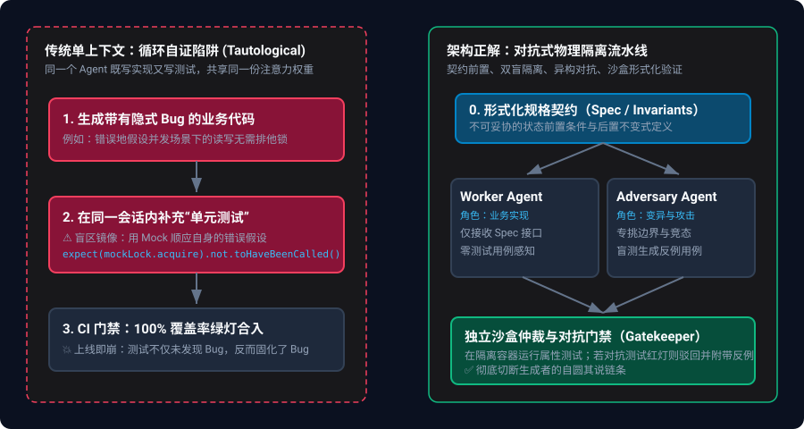
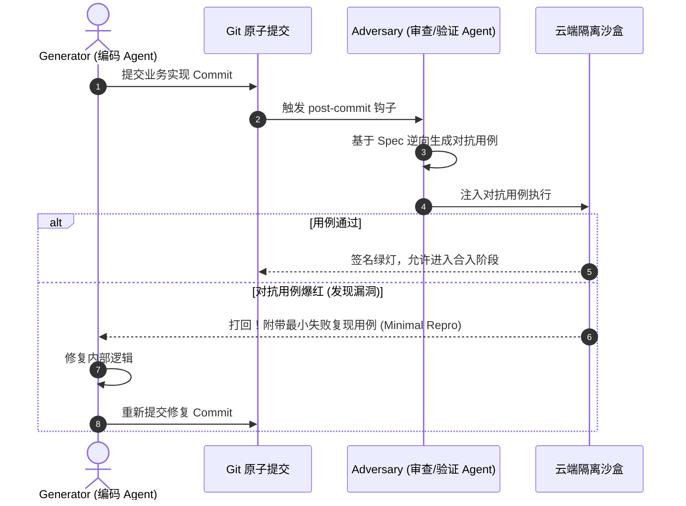

> **核心导读**：在自主编程 Agent（Ticket-to-PR / SWE-bench 模式）席卷工程界的同时，无数团队在生产环境遭遇了相同的冷水：Agent 提交的代码测试覆盖率 100% 全绿，但一上线就触发状态撕裂、并发死锁或静默数据损坏。本文解构“单上下文自证式测试”的底层成因，并给出工业级解法——基于前置契约、双盲对抗与沙盒隔离的物理隔离验证架构。

---

## 一、 绿灯背后的废墟：单上下文的“循环自证陷阱”

在当今的 AI 辅助研发流程中，最常见的指令模式往往是这样：

```text
"请为 UserService 实现并发扣减积分逻辑，并补充完整的单元测试保证覆盖率。"
```

当这套指令丢给同一个 Agent 并在单一会话上下文中执行时，灾难其实已经注定。



### 1.1 认知盲区的镜像投射（Tautological Testing）

大语言模型的推理本质是基于上下文 Attention 权重的自回归补全。当模型在一个上下文窗口中完成了业务代码编写，它的注意力分布已经极度倾斜于自己刚刚写下的逻辑与前提假设。

紧接着让它“写单元测试”时，它所做的事情并非**客观验证业务规范**，而是**为刚刚写出的代码做合理化自圆其说（Rationalization）**：

1. **缺陷顺从**：如果业务代码里把分布式锁的超时重试错误地写成了静默返回 `false`，它写测试时就会自然而然地 `expect(result).toBe(false)`。
2. **Mock 滥用与幻觉遮蔽**：为了跑通测试，Agent 会倾向于构造极度迎合实现的 Mock 对象。它 Mock 掉了底层真实的 IO 行为与网络竞态，把一个在真实并发下必死无疑的代码，硬生生在 Mock 环境下刷出 100% 的 Branch Coverage。

这种测试被称为**自证式重言测试（Tautological Tests）**——测试代码的唯一作用是证明“这段代码做到了它自己想做的事”，却完全脱离了“系统实际需要它做的事”。

### 1.2 工业界翻车案例复盘

近期在 X 上关于某自主编程 Agent 生产事故的复盘中，典型场景触目惊心：

| 故障现象 | 单上下文 Agent 编写的单元测试 | 生产环境真实崩溃原因 |
|:---|:---|:---|
| **转账事务脏读** | Mock 数据库连接，测试在单一同步时序下断言余额一致 | 真实高并发下行级锁粒度不足，多个 Worker 产生竞态条件 |
| **消息重复消费** | 显式注入已去重的内存队列作为测试 Stub | 忽略了 Kafka rebalance 期间的 at-least-once 交付语义 |
| **Token 权限逃逸** | 测试用例仅针对正常 Payload 格式进行字段匹配断言 | 未测试畸形 JSON、多重反序列化和空字符注入 |

**结论很残酷：由代码编写者在同一上下文内补全的测试，不仅无法拦截 Bug，反而给不合格的代码盖上了官方认证的“安全戳”。**

---

## 二、 破局第一步：规格契约与“双盲”物理隔离

要消灭自证陷阱，最根本的工程原则是：**切断编写者与验证者的注意力共享链路**。

```
              ┌─────────────────────────────┐
              │  不可变规格契约 (Spec / RFC)  │
              └──────────────┬──────────────┘
                             │
              ┌──────────────┴──────────────┐
              ▼                             ▼
   ┌────────────────────┐        ┌────────────────────┐
   │  Generator Agent   │        │  Adversarial Agent │
   │   (业务代码实现)    │        │   (对抗性测试编写)  │
   │  · 零感知测试实现   │        │  · 零感知内部代码   │
   └──────────┬─────────┘        └──────────┬─────────┘
              │                             │
              └──────────────┬──────────────┘
                             ▼
              ┌─────────────────────────────┐
              │ 独立沙盒执行与对抗仲裁       │
              └─────────────────────────────┘
```

### 2.1 契约驱动（Spec-First）先于代码

任何代码实现前，唯一能跨上下文共享的资产只有**形式化规格（Spec）**。规格必须严格定义：
- **前置不变式（Pre-conditions）**：输入参数的强校验范围与类型守卫。
- **后置状态不变式（Post-invariants）**：系统在操作前后的守恒关系（如资金借贷平衡）。
- **异常契约（Error Envelopes）**：不可恢复错误的标准抛出规范。

业务 Agent 只能读取 Spec，不能预知对抗测试的边界用例；验证 Agent 同样只能读取 Spec，不能偷看业务 Agent 的内部私有方法实现（严格黑盒/灰盒验证）。

---

## 三、 对抗性验证流水线的设计与落地

在真实架构中，如何将“验证隔离”工程化？我们提炼出三大核心模块：

### 3.1 异构模型对抗（Adversarial Agent）

避免同质化模型共有的先验盲区，最佳实践是在实现端与验证端部署不同架构或厂商的模型：
- **Generator（业务实现）**：采用对复杂工程脚手架与长指令依从度高的大模型（如 Claude 3.5 Sonnet）。
- **Adversary（变异与边界攻击）**：采用专门经过对抗微调或侧重形式化推理的模型（如 GPT-o1 / DeepSeek-R1），专门负责：
  - 生成边缘畸形数据（Malformed inputs、Boundary values）。
  - 构造时序颠倒调用（Race condition simulation）。
  - 执行**变异测试（Mutation Testing）**：故意对业务逻辑注入语法变异（如把 `>` 改为 `>=`，把 `&&` 改为 `||`），如果所有测试依然通过，则判定验证套件无效，驳回 PR。

### 3.2 异步提交审查与 Rebuttal 辩论机制

参考开源社区前沿方案（如挂载于 Git post-commit 的审查机制），工作流不应当是一锤子买卖，而是一个双向闭环：



这种机制逼迫 Generator Agent 必须面对真实的“失败用例”，而不是自己编造的假想用例。

### 3.3 拒绝纯 Mock：沙盒容器内的属性测试（Property-Based Testing）

传统的 Example-based 测试（“输入 1 预期输出 2”）最容易被 Agent 作弊式迎合。验证 Agent 应当被要求编写**基于属性的测试（Property-Based Testing，如 fast-check / Hypothesis）**：

```typescript
// 示例：转账模块属性测试——强制要求在隔离容器内运行真实并发测试
import { test, fc } from '@fast-check/vitest';

test.prop([
  fc.record({
    initialBalanceA: fc.integer({ min: 1000, max: 10000 }),
    initialBalanceB: fc.integer({ min: 1000, max: 10000 }),
    transfers: fc.array(
      fc.record({
        from: fc.constantFrom('A', 'B'),
        to: fc.constantFrom('A', 'B'),
        amount: fc.integer({ min: 1, max: 500 }),
      }),
      { minLength: 10, maxLength: 50 }
    ),
  }),
])('任何乱序转账操作必须满足资金守恒全局不变式', async ({ initialBalanceA, initialBalanceB, transfers }) => {
  const ledger = await createIsolatedLedger({ A: initialBalanceA, B: initialBalanceB });

  // 并发打散执行
  await Promise.all(transfers.map((tx) => ledger.transfer(tx.from, tx.to, tx.amount)));

  const finalBalanceA = await ledger.getBalance('A');
  const finalBalanceB = await ledger.getBalance('B');

  // 全局不变式：系统资金总和恒等于初始资金总和
  expect(finalBalanceA + finalBalanceB).toBe(initialBalanceA + initialBalanceB);
});
```

在这种断言面前，任何 Agent 试图通过 Mock 或静态分支作弊都将无所遁形。

---

## 四、 总结与架构反思

在构建自主化、无人值守的软件工厂进程中，我们越早抛弃对“单模型全包全览”的幻想，系统就能越早走向成熟：

1. **别让出卷人自己答卷**：写代码的 Agent 与写测试的 Agent 在上下文中必须彻底斩断。
2. **测试覆盖率不是挡箭牌**：自证环境下的 100% 覆盖率往往意味着 0% 的抗风险能力；变异得分与对抗反例才是硬指标。
3. **隔离沙盒是底线基础设施**：所有的对抗测试必须在独立沙盒容器中跑出真实状态变更，任何脱离实际运行时的纯静态断言都是空中楼阁。
