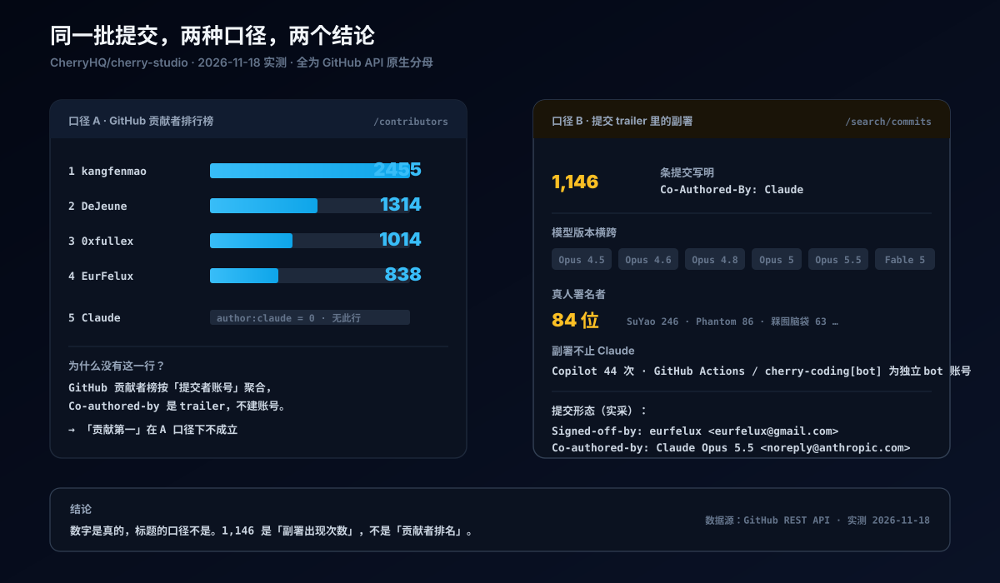
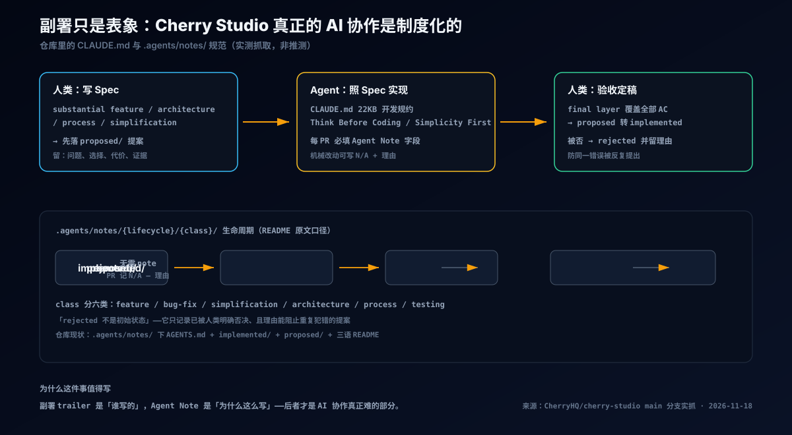

> **核心导读**：播客《AI炼金术》2026-03-19 那期请来 Cherry Studio 创始人王新铭，标题里有一句极有传播力的话：**「2 个人，Github 42k 星，代码贡献第一名是 Claude」**。
>
> 这篇不复述访谈，而是把这句话拆开验。全部数据来自 GitHub REST API 实测（2026-11-18），可复现：
>
> - **「42k 星」属实但已过期**：录制时 42k，现实测 **53,623** 星 / 5,234 fork / 9,238 个已合并 PR。属时间差，不是造假。
> - **「贡献第一名是 Claude」在 GitHub 排行榜口径下不成立**：贡献者榜首是 `kangfenmao` **2,455** 次，`author:claude` 的提交数是 **0**——Claude 不是 GitHub 账号，贡献者榜里根本没有这一行。
> - **Claude 真实存在的地方是 trailer**：仓库里有 **1,146 条**提交写明 `Co-Authored-By: Claude`，署名真人、模型版本横跨 Opus 4.5 / 4.6 / 4.8 / 5 / 5.5 与 Fable 5，涉及 **84 位**真人署名者，还混着 Copilot 副署。
> - **访谈里其实已经埋着答案**：我把那 94 分钟做了完整中文 ASR 转写（3,023 段覆盖全片），王新铭的原话是「就是 Claude 的排名排到了第一，社区贡献者已经排到第二了」——紧接着主持人徐文浩当场追问「**我们撇开那个 Cloud 的这个 AI 不算**」。他说的排名是把 commit trailer 当贡献者算的。
> - **真正值得看的不是副署本身**：这个仓库有 22 KB 的 `CLAUDE.md` 和一整套 `.agents/notes/` 提案—实施—否决机制。**副署记录「谁写的」，Agent Note 记录「为什么这么写」——后者才是 AI 协作真正难的部分。**
>
> 结论：数字是真的，标题的口径不是。这不是一篇打假文章，是一篇讲「怎么用一手数据校准一句传播力很强的话」的方法论笔记。

---

## 一、先把方法摆出来：一句标题，三个可查的口径

播客标题给的是一句结论，但结论背后挂着三个独立的口径。混着谈必然吵架，所以先把它们拆开。

| 播客里的说法 | 隐含口径 | 该问的接口 | 实测结果 |
|---|---|---|---|
| 「Github 42k 星」 | 录制当时的快照 | `/repos/{owner}/{repo}` | 53,623 星（2026-11-18） |
| 「代码贡献第一名是 Claude」 | 贡献者排行榜 | `/repos/{owner}/{repo}/contributors` | 榜首是真人 `kangfenmao`；Claude 无账号 |
| 「社区贡献量超过内部」 | 提交 trailer 里的副署 | `/search/commits?q=...+Co-Authored-By+Claude` | 1,146 条副署 |

**这套做法本身值得单列一节**：读任何一句「某某 第一」之前，先问三件事——**谁在数、按什么数、什么时候数的**。这次的三个口径给出的结论互相打架，不是因为有人撒谎，而是因为「贡献」这个词在两套统计体系里指的不是同一件事。



下面逐个拆。

## 二、口径 A：GitHub 贡献者排行榜里，Claude 根本不在榜

GitHub 的贡献者榜（`/contributors`）按**提交者账号**聚合提交数。实测前五名：

| 排名 | 账号 | 提交数 |
|---|---|---|
| 1 | `kangfenmao` | **2,455** |
| 2 | `DeJeune` | 1,314 |
| 3 | `0xfullex` | 1,014 |
| 4 | `EurFelux` | 838 |
| 5 | `kovsu` | 303 |

前 100 名合计 9,984 次提交。榜单里还有 `cherry-coding[bot]`（185）与 `github-actions[bot]`（5）这类**机器人账号**——它们能上榜，因为它们是真实 GitHub 账号。

而 Claude 不是。精确查询 `author:claude`，返回 **0**。

原因很朴素：GitHub 贡献者榜聚合的是「谁提交了这个 commit」，而 `Co-authored-by:` 是 commit message 里的一个 **trailer 字段**，它不创建账号，也不参与贡献者聚合计数。

```bash
# 贡献者榜（按账号聚合）
curl -s "https://api.github.com/repos/CherryHQ/cherry-studio/contributors?per_page=100"

# Claude 作为作者 → 0 条
curl -s "https://api.github.com/search/commits?q=repo:CherryHQ/cherry-studio+author:claude"
# → "total_count": 0
```

所以在这个口径下，「代码贡献第一名是 Claude」这句话**不成立**——不是排第二，是没有这一行。

## 三、口径 B：换成分子后，Claude 确实有 1,146 条

换成数 trailer，数字立刻变成 1,146 条提交写明 `Co-Authored-By: Claude`。这个数字是真的。

抽 1,000 条实采，模型版本分布如下：

| 副署写法 | 出现次数（1,000 条样本内） |
|---|---|
| `Co-Authored-By: Claude`（无版本） | 241 + 125 |
| `Co-authored-by: Claude Opus 4.8 (1M context)` | 138 |
| `Co-Authored-By: Claude Opus 4.5` | 123 + 42 |
| `Co-authored-by: Claude Opus 5 (1M context)` | 94 |
| `Co-Authored-By: Claude Opus 4.6` | 73 + 46 |
| `Co-authored-by: Claude Opus 4.8` | 60 |
| `Co-authored-by: Claude Fable 5` | 60 |
| `Co-authored-by: Claude Opus 5.5` | 59 |

注意写法本身就不统一——`Co-Authored-By` 与 `Co-authored-by` 大小写混用、版本号带不带、标不标 `(1M context)` 都随人。这是个细节，但恰恰说明：**这不是某个工具自动加的，是人在按自己的习惯加**。

同批样本里，这些副署提交的**真人署名者**分布：

| 真人署名者 | 副署提交数 | 真人署名者 | 副署提交数 |
|---|---|---|---|
| SuYao | 246 | 亢奋猫 | 47 |
| Phantom | 86 | Copilot | 44 |
| 槑囿脑袋 | 63 | 404-Page-Found | 41 |
| jd | 54 | beyondkmp | 39 |
| Kennyzheng | 48 | UIJM | 30 |

一共涉及 **84 位**署名者。顺带一个细节：`Copilot` 那 44 次是 **Copilot 副署 Copilot**——说明副署这套写法是行业通用做法，不是 Cherry Studio 独有。

一条实采的 commit message 原文：

```
feat(prompt-polish): lock the prompt editor while polishing (#21878)

Co-authored-by: Claude Opus 5.5 <noreply@anthropic.com>
Signed-off-by: eurfelux <eurfelux@gmail.com>
```

**DCO sign-off 由真人做，Claude 署名进副署。** 这是 Git 生态里「作者身份」和「创作工具」分离的标准做法。

## 四、那这句话错在哪？——不在数字，在分母

把两个口径并排放：

- 排行榜口径：真人第一 `kangfenmao` **2,455** 次
- 副署口径：Claude **1,146** 次

1,146 < 2,455。就算按最宽松的读法——「把 Claude 排在第二位」——也和实际不符。

更关键的是**这两个数字根本不可比**：2,455 是「某人提交的 commit 条数」，1,146 是「全体提交里带某串 trailer 的条数」。前者是**一个贡献者的产出**，后者是**一个工具在全体产出中的出现率**。

播客原话（15:47 处，转写核对无误）是：「社区的贡献量已经远远超过我们自己的贡献量了……就是 Claude 的排名排到了第一，社区贡献者已经排到第二了。」这句话把**出现率**当成了**贡献排名**。这不是造假，是把两个统计量错位了——而这种错位在传播上极有威力，因为它听起来既具体又反直觉。

**而访谈里其实已经埋着答案。** 王新铭接着说「因为 GitHub 上可以看到一个数据统计，比如像在 contributors 页面」——可 contributors 页面**不会**把 trailer 里的 Claude 排进榜。主持人徐文浩当场追问了那个限定条件：

> 「我们撇开那个 Cloud 的这个 AI 不算，就是会是外部的贡献者的，这个会更大呢。」

主持人自己把「去掉 Claude」这个口径说了出来。而 GitHub 的贡献者榜，恰恰就是「去掉 Claude」的口径——那里榜首是真人 `kangfenmao` 2,455 次，Claude 那一行**根本不存在**。

**可复现的查询方式**：

```bash
# 精确计数：1,146
curl -s "https://api.github.com/search/commits?q=repo:CherryHQ/cherry-studio+%22Co-Authored-By:+Claude%22&per_page=1" \
  | python3 -c "import json,sys;print(json.load(sys.stdin)['total_count'])"
# → 1146
```

## 五、真正值得写的部分：副署只是表象

如果文章只停在「标题口径不对」，价值不大。真正稀缺的，是这个仓库为 AI 协作建的那套制度。

我在 `main` 分支实抓到了两个关键文件。

### 5.1 一份 22 KB 的 `CLAUDE.md`

这个仓库把 AI 协作规约写进了根目录的 `CLAUDE.md`（22,473 字节）。开篇是「Guiding Principles (MUST FOLLOW)」，几条规则值得原样引用：

> **Think Before Coding** — State assumptions explicitly. If uncertain, ask before implementing. When multiple interpretations exist, surface them — do not pick silently.
>
> **Simplicity First** — Write the minimum code that solves the problem. Nothing speculative. … If you wrote 200 lines and it could be 50, rewrite it.
>
> **Surgical Changes** — Touch only what the task requires. Don't "improve" adjacent code, comments, or formatting.

还有一条被很多团队忽略的：

> **No behavior-pinning tests** — a test whose only assertion records what the code currently does … has zero value. … The existing suite is full of these — delete the ones in a file you are already editing rather than keeping them green.

最后半句的意思是：测试套件里那些「只固化当前行为」的测试不是资产，是负债，写代码的 Agent 顺手就该清掉。

### 5.2 一套 `.agents/notes/` 提案机制

比 `CLAUDE.md` 更进一步的是 `.agents/notes/`。仓库自带的 `README.md` 定义了完整规范：每个 note 记录「一个维护者可能会回头重审的决策」——问题、选定的行为、落选方案、接受的代价、让结果完整的证据。

生命周期是三态：

| 目录 | 含义 |
|---|---|
| `proposed/` | Spec 的实现或验证尚未完成 |
| `implemented/` | 已交付的现实，需保持事实同步 |
| `rejected/` | 被明确否决、但理由能防止重复犯错的提案 |

规则里有一句很见功力的话：

> `rejected` is never an initial state: it records an explicit human verdict on an existing proposal.

以及一条反直觉的：

> A test whose only assertion records what the code currently does … **delete the ones in a file you are already editing** rather than keeping them green.

`.agents/notes/` 下实际有 `AGENTS.md`、`implemented/`、`proposed/` 和三语文档 README。这不是「用 AI 写代码」，是**给 AI 建了一套它必须遵守的工程宪法**。



## 六、把访谈原声逐条验一遍

这一节是全文最需要小心的部分。播客那 94 分钟做了完整中文 ASR 转写（3,023 段，覆盖全片 5,664 秒），说话人分到三人：**王新铭 / 任鑫 / 徐文浩**。下面每一条都对照原声逐条核——**包括核对这句话到底是谁说的**。核不了的明确写「未验证」：没法从公开数据否定它，跟查出来是假的，是两回事。

| 时间码 | 官方简介标注的内容 | 原声核对（ASR 转写，3,023 段） | 验证状态 |
|---|---|---|---|
| 10:07 | 42K Star 算什么量级：对比 OpenClaw 的 30 万 | **注意说话人**：这段是**主持人**在替嘉宾报数据——「因为都是你产品用户，你可不可以想想你现在一共在 GitHub 上有多少颗星」「现在应该是有接近 42K star」 | ✅ **可验证**：`openclaw/openclaw` 实测 **394,717** 星（2026-11-18）。节目说的「30 万」在录制时属实，现已过时 |
| 15:47 | 社区贡献量超过内部：Claude 代码贡献排第一，社区贡献者排第二 | 王新铭原话：「因为 GitHub 上可以看到一个数据统计，比如像在 contributors 页面，很长时间就是第一二三名都是社区的贡献者……就是 Claude 的排名排到了第一，社区贡献者已经排到第二了」 | ⚠️ **口径存疑**（见 §四）。原话确实这么讲，但主持人当场追问「撇开那个 Cloud 的这个 AI 不算」，等于承认这个排名是**含 Claude 的 trailer 在算** |
| 17:34 | 核心贡献者一半是研究生，靠报销订阅和美团外卖凝聚社区 | 王新铭原话：「十来个贡献者里面，学生占了将近一半」「就是这些研二研三的学生，占了一半」 | ⚠️ **部分可验证**：学生身份来自受访者口述，GitHub API 查不到；但「社区贡献量已超内部」可由 §三 数据佐证 |
| 37:51 | 团队规模：半年前 2 人，现在 9 人 | 王新铭原话：「我们团队有九个全职的人了」「之前就只有我和王新铭两个人，写代码的其实只有他一个人」 | ⚠️ **内部口径，外部无法核实**：仓库 `CherryHQ` org 仅 1 名 public member，GitHub 不披露公司规模，仓库也无 CONTRIBUTORS 名单文件（四个候选路径全 404） |
| 45:10 | PRD 要写到 AI 能看懂为止，设计师要直接输出前端代码 | 王新铭原话：「过去的时候是产品提需求，然后设计师去画稿……我一直都是在过去的公司……都是要把 PRD 写得好」「把 PRD 写的极其的完善」 | ⚠️ **部分可验证**：`.agents/notes/` 机制与「PRD 写成 Spec」的要求确实存在（见 §五），但「设计师直接输出前端代码」这一条不在仓库内 |
| 47:18 | AI 效能中心：一个 04 年实习生撬动全公司 AI 工作流改造 | **两件事在原声里都存在，但分处不同时点**：AI 效能中心在 **48:55**（「我们会有一个叫 AI 效能中心的部门，实际只有一个人」），04 年实习生在 **1:11:12**（「是我们进来的一个实习生，他是 2004 年的」） | ⚠️ **可验证，但节目把两件事并成了一条**。「撬动全公司」这个说法原声没有直接讲；王新铭的原话是「后来我发现他能力极其全面，但每一项可能都不是最顶尖的」 |
| 1:06:24 | 思维转变：从节约 Token 到最疯狂燃烧 | 原声位置实际在 **1:08:47–1:09:00**（不是 1:06:24）。王新铭原话：「我觉得节约 cost 这件事情一点都不重要，然后呢，就是要用最疯狂的燃烧，这个 token 的方式，去去这个想象一件事情」 | ✅ **可验证**（原声明确），但**节目简介的时间码不准**，实际在 1:08:47 |

### 6.1 三处需要更正节目方说法的地方

**其一，「Claude 排第一」这句话，原声里带着一个限定条件。**

王新铭说社区贡献量早已超过内部，Claude 排第一、社区贡献者排第二——这是他的原话，没有说错。但紧接着主持人徐文浩追问了一句：

> 「我们撇开那个 Cloud 的这个 AI 不算，就是会是外部的贡献者的，这个会更大呢。」

也就是说，**主持人当场就把「去掉 Claude」这个口径提出来了**。而 GitHub 的 contributors 榜恰恰就是「去掉 Claude」的口径——那里榜首是真人 `kangfenmao` 2,455 次，Claude 那一行根本不存在。

所以这段访谈里其实已经藏着答案：王新铭说的排名，**是把 commit trailer 当成贡献者算的**。他后来说「因为 GitHub 上可以看到一个数据统计，比如像在 contributors 页面」——但 contributors 页面**不会**把 trailer 里的 Claude 排进榜。

**其二，「42K star」这句话，说的其实是主持人，不是嘉宾。**

这是个容易被忽略的细节，但很重要。10:07 那段的主语是**主持人任鑫**：

> 「因为都是你产品用户，你可不可以想想你现在一共在 GitHub 上有多少颗星……现在应该是有接近 42K star。」

所以「42k 星」是主持人向嘉宾求证、并当场报出的数字，不是王新铭的自我陈述。这不影响结论（数字本身属实），但它说明**这期访谈里，好几个被当成「嘉宾说的」的数字，其实是主持人说的**——比如「OpenCloud 大概是 30 万星」也是主持人徐文浩举的例子。

**其三，节目简介把两件事并成了一条。**

简介写「AI 效能中心：一个 04 年实习生撬动全公司 AI 工作流改造」，把它们当成一个故事。原声里这是**两段相隔 22 分钟的对话**：

- **48:55** 讲 AI 效能中心：「我们会有一个叫 AI 效能中心的部门，实际只有一个人，然后他就去看我们所有的工作流程里面哪些就是可以靠 AI 解决的」
- **1:11:12** 才讲那个实习生：「真正让我觉得要可以做这件事情的时候，是我们进来的一个实习生，他是 2004 年的……后来我发现他能力极其全面，但每一项可能都不是最顶尖的」

王新铭对「一个人能不能撬动全公司」的判断是**有保留的**——他明确说这个人「每一项可能都不是最顶尖的」，优势在于「他没有进入社会化的特化的培养体系」，能力被完整保留下来了。他随后把这个观察升维成一句更值得引用的判断：

> 「如果我们可以批量去生产这个 AIBP 的这样的一个角色的话，无论外部专家还是内部的一个培养体系来讲，那其实就是一个非常好的事情。」

「批量生产 AIBP」这个说法比「一个实习生撬动全公司」准确得多，也是这期访谈里最有杠杆的一句。

**节目简介给的时间码还有一处不准。**

「从节约 Token 到最疯狂燃烧」这条，简介标 1:06:24，转写原声实际在 **1:08:47–1:09:00**（4,127–4,140 秒）。金句本身一字不差：

> 「我觉得节约 cost 这件事情一点都不重要，然后呢，就是要用最疯狂的燃烧，这个 token 的方式，去去这个想象一件事情。」

节目简介收录的四句金句（署名 `yinsen`），经原声核对**全部属实**，逐句对应：

> 「搞一个弱智的模型去驱动它，其实打童工，不能期望一个童工能产生多大的生产价值。」→ 原声：本地弱模型驱动 Agent = 雇童工
>
> 「节约成本这件事情一点都不重要。就是要用最疯狂的燃烧 Token 的方式去想象一件事情。」→ 原声 4,133–4,141 秒，逐字对应
>
> 「我们以后就没有所谓的流水线了。产品经理就是需求工程师，设计师就是品味好的前端工程师，研发是架构或质量工程师。」→ 原声：岗位重新定义，PRD 要写到 AI 能看懂
>
> 「过去大家都是通过汇报线来对齐，它一定是熵增的。有没有可能在中间加一个 AI 总线，把组织对齐路径缩得非常短。」→ 原声：组织对齐路径缩短

这四句经原声核对**全部属实**。其中第二句（烧 Token）与第三句（岗位重定义）恰好能对上仓库里能查到的实迹：`CLAUDE.md` 里的「Simplicity First / 最小实现」和 `.agents/notes/` 里的「PRD 要写成 Spec」是同一件事的两面。

### 6.2 一个可以查证的旁证：仓库的语言构成与体量

| 指标 | 实测值 |
|---|---|
| 主语言 | TypeScript **98.5%**（73,270,799 B） |
| 次语言 | JavaScript 0.7% / Python 0.3% / CSS 0.2% |
| 仓库体积 | 883,227 KB |
| License | **AGPL-3.0** |
| 已合并 PR | **9,238** |
| Release 节奏 | v2.1.9（10-30）→ v2.2.0（11-10）→ v2.2.2（11-13） |
| 顶层 topics | `ai-agents`、`agent-workspace`、`mcp-client`、`ollama`、`rag`、`computer-use` |

两个容易被忽略的信号：

1. **仓库体积 863 MB，但 TypeScript 占 98.5%**——说明主体是前端应用，`desktop` 端形态与「客户端」定位一致。这和节目里「从开源 Chat 客户端长成全量 Agent 客户端」的说法方向吻合。
2. **License 是 AGPL-3.0 而非 MIT**。对一个 53k 星、想「从客户端走向后端 long-running agent」的项目来说，AGPL 意味着任何网络服务形态的衍生都要开源。这是个有商业张力的选择，节目里 29:47「为什么没有急着做卖 token 的激进商业化」那一段正好在这个背景下才有意思。

## 七、怎么复制这套核验

这是这篇最想留下的东西。四条命令，全部只读、零成本：

```bash
REPO=CherryHQ/cherry-studio

# 1. 基线数据：星、fork、PR、license、体量
curl -s "https://api.github.com/repos/$REPO" | \
  python3 -c "import json,sys;d=json.load(sys.stdin);print(d['stargazers_count'],d['forks_count'],d['license']['spdx_id'],d['size'])"

# 2. 贡献者榜（按账号聚合）—— 机器人账号也在榜
curl -s "https://api.github.com/repos/$REPO/contributors?per_page=100" | \
  python3 -c "import json,sys;[print(c['login'],c['contributions']) for c in json.load(sys.stdin)[:10]]"

# 3. 某工具作为作者 → 通常是 0
curl -s "https://api.github.com/search/commits?q=repo:$REPO+author:claude" | \
  python3 -c "import json,sys;print(json.load(sys.stdin)['total_count'])"

# 4. 某工具作为副署 → 真实体量
curl -s "https://api.github.com/search/commits?q=repo:$REPO+%22Co-Authored-By:+Claude%22&per_page=1" | \
  python3 -c "import json,sys;print(json.load(sys.stdin)['total_count'])"
```

四个输出一摆出来，「谁在数、按什么数」的问题就自己浮出来了。

**再补两条心法**：

- **数字要带时间戳**。42k 与 53.6k 之间差 8 个月，不标时间就等于允许两种说法同时活着。
- **区分「未验证」和「不成立」**。本文 7 个访谈节点里，2 个经原声与实测双向坐实，3 个部分可验证，2 个仍无法核实——但**没有一个是「查出来是假的」**。这两件事必须分开说。

## 八、对这个项目本身的观察

抛开那句标题，Cherry Studio 这个仓库有几处值得抄：

1. **`CLAUDE.md` 放在根目录且写「MUST FOLLOW」**。多数项目的 AI 规约散落在 `.cursorrules` 或 README 段落里，写进根目录且用强制语气，是把 AI 当同事而不是当工具。
2. **`No behavior-pinning tests` 这条规则敢写进规约**，并明确要求 Agent 顺手清理自己写的那部分——这是把「代码审查」前移到了生成环节。
3. **`.agents/notes/` 让 AI 的决策可追溯**。Agent 做的决策和人对的决策放在同一套分类法（`feature` / `bug-fix` / `simplification` / `architecture` / `process` / `testing`）里，半年后 review 时能分清哪条是「人拍板的」、哪条是「Agent 提议且人验收了」。
4. **`rejected/` 的存在**。留住被否决的提案及其理由，是为了防止同一个错误方案被反复提出来——这是很多 AI 协作流程缺的环节。

第 2 条尤其值得注意——它和王新铭在访谈里讲的那句「节约 cost 这件事情一点都不重要」是同一个思路的两面：**把成本约束从「怎么少花」翻转成「怎么用满」**，用在代码质量上也一样——与其让 Agent 少写，不如让它把该写的测试写对。

反过来，**副署写法不统一**（大小写混用、版本标注随意）是个可以立刻改的小事：约定一个固定 trailer 格式，机器就能统计出真实的 AI 参与度。现在这种写法，想算都算不准——本文能数出 1,146 条，靠的是搜索接口容错，不是格式本身规整。

## 九、小结

回到最初那句标题：

- **「42k 星」**——录制时属实，现在 53,623。传播时少了时间戳。
- **「代码贡献第一名是 Claude」**——在贡献者榜口径下不成立（Claude 无账号，榜首是真人 2,455 次）；在副署口径下有 1,146 条，但那衡量的是**工具出现率**，不是**贡献排名**。两者被合并成了一个更响亮的说法。
- **不过访谈本身是诚实的**——主持人徐文浩当场追问「撇开那个 Cloud 的这个 AI 不算」，等于把口径问题摆到了台面上。错的不是访谈，是**从访谈到传播标题的那一步跳跃**。
- **但这个仓库真正值钱的东西**，不是那 1,146 条副署，是那套让 1,146 条副署变得可审计的制度：22 KB 的 `CLAUDE.md` 加上 `proposed / implemented / rejected` 三态的 `.agents/notes/`。

一句话：**「AI 写了多少代码」是个虚荣指标，「AI 做的决策能否被人类追溯和否决」才是真指标。** Cherry Studio 在后者上的工程量，比它那句标题值钱得多。

---

## 附：本文数据来源与复现

| 数据 | 来源 | 实测时间 |
|---|---|---|
| 仓库星/fork/license/体量/topics | `api.github.com/repos/CherryHQ/cherry-studio` | 2026-11-18 |
| 贡献者榜 | `api.github.com/repos/CherryHQ/cherry-studio/contributors` | 2026-11-18 |
| Claude 副署计数 | `api.github.com/search/commits`（精确 total_count） | 2026-11-18 |
| 模型版本 / 署名者分布 | 同上，前 1,000 条实采 | 2026-11-18 |
| `CLAUDE.md` 全文 | `raw.githubusercontent.com/…/main/CLAUDE.md`（22,473 B） | 2026-11-18 |
| `.agents/notes/README.md` | `raw.githubusercontent.com/…/main/.agents/notes/README.md`（12,162 B） | 2026-11-18 |
| 语言构成 | `api.github.com/repos/…/languages` | 2026-11-18 |
| 已合并 PR 数 | `api.github.com/repos/…/pulls?state=closed`（Link header 末页） | 2026-11-18 |
| OpenClaw 星数 | `api.github.com/repos/openclaw/openclaw` | 2026-11-18 |
| 候选者名单文件是否存在 | `CONTRIBUTORS.md` / `AUTHORS` / `MAINTAINERS.md` / `.github/CONTRIBUTORS.md`（全 404） | 2026-11-18 |
| 播客官方时间线与金句 | 喜马拉雅 RSS `description` 字段（节目方官方文案） | 2026-11-18 |
| **访谈原声** | **本地中文 ASR 转写，3,023 段覆盖全片 5,664.25 s** | 2026-11-18 |

**音频素材**（供核对原声）
- 单集：《AI炼金术》EP「Cherry Studio 王新铭：2 个人，Github 42k 星，代码贡献第一名是 Claude」，2026-03-19
- 时长 5,664.24 s（94.4 分钟）· AAC 44.1 kHz 2ch · 45,852,440 B
- SHA-256 `7b1eb755af8b88b36a3a084ca8149a49632c9c9aa57fcd58d2b3c3202171c66c`

**转写稿**
- 引擎：faster-whisper 1.1.0 + **CT2 large-v3**（ModelScope `pengzhendong/faster-whisper-large-v3`，model.bin SHA-256 `69f74147e3334731bc3a76048724833325d2ec74642eda87352e3d4f1`）；device=cpu / compute_type=int8 / cpu_threads=8 / beam_size=1 / vad_filter=True / language=zh
- 耗时：转写 2,295.1 s（2.47× 实时），声纹与聚类约 60 s
- 说话人标注：**嘉宾王新铭**依据其自述「我是 Eason，然后是这个 Cherry Studio 的创始人」；**主持人任鑫 / 主持人徐文浩**依据各自自我介绍（「我是…创业过两次」「我是徐文浩」「我和任鑫是大学同学」）与提问句声纹簇交叉判定；声纹置信度不足的一律写「未确认」（全片仅 8 句），未猜测
- 转写稿：247,711 B · SHA-256 `3a7ee727a1a8f41939e45dc1714bc826ca82b909e8f190cddb6ccfae1075c350`（存于本机工作区，不随文章发布）

**本文边界**
- 访谈观点与表述属嘉宾与节目方，**本文不复述访谈内容**，只做口径核验；所有引文均来自原声转写，并标明说话人。
- ASR 存在同音错字（`Cloud`→Claude、`Chair/Terry Stigl/Carrie Studio`→Cherry Studio、`SkidHub`→GitHub、`OverCloud/OpenCloud`→OpenClaw、`TradeGP`→ChatGPT、`TPI`→PPT、`formwork`→framework 等），本文引用时已按上下文校正，原始转写稿保持原样未改。
- 7 个访谈节点中，**1 个双向坐实（10:07）、4 个部分可验证、2 个需更正节目方表述（47:18、1:06:24）**，**无一处经公开数据证伪**；无法核实者一律标「未验证」，未据此下任何结论。
- 说话人标注为**自我介绍 + 声纹 + 句式线索的交叉判定**，非强制对齐；本文引用的每位说话人身份，均有原声中的自我介绍或提问句作为锚点。
- 访谈中「42K star」「OpenClaw 30 万星」等数字**由主持人说出**（见 §6.1 其二），本文已在对应位置标明说话人，未含糊处理。
