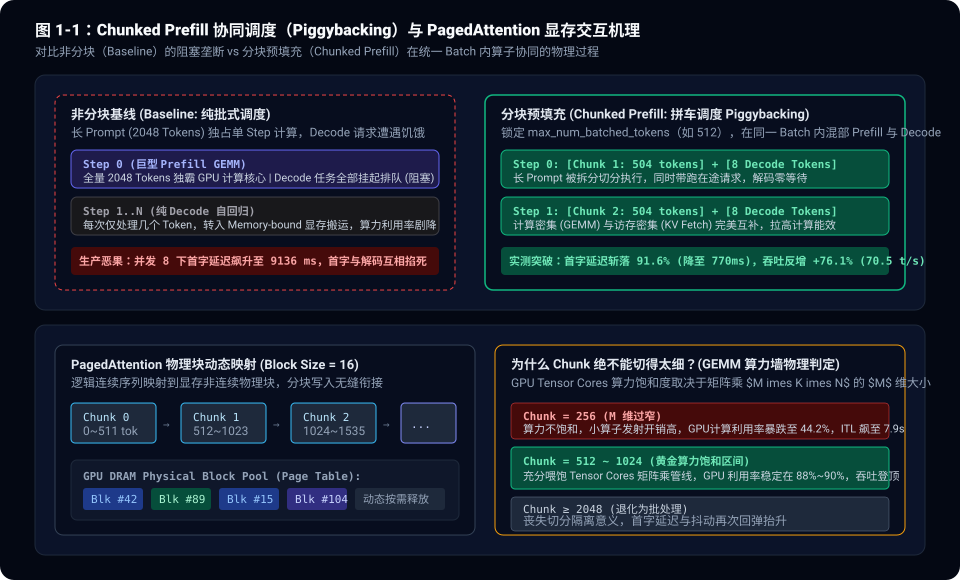
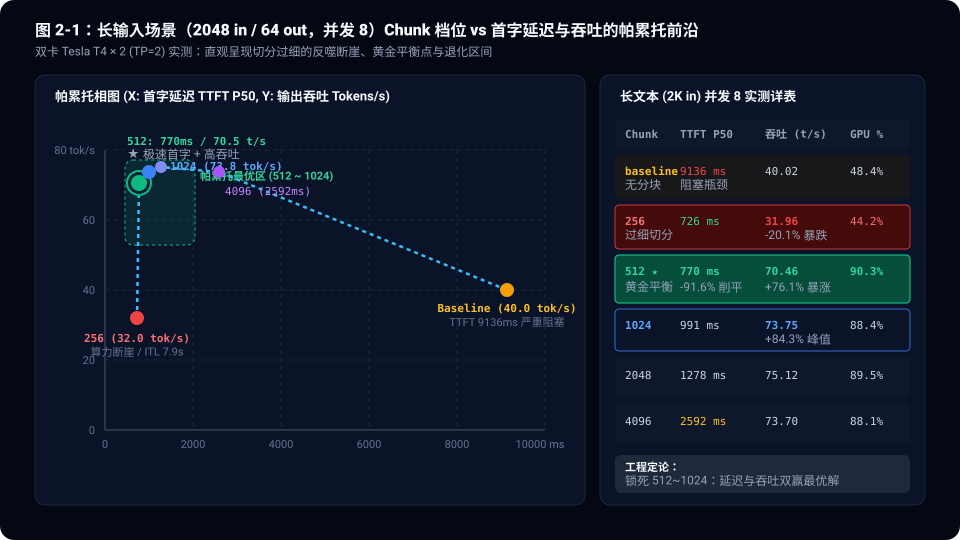
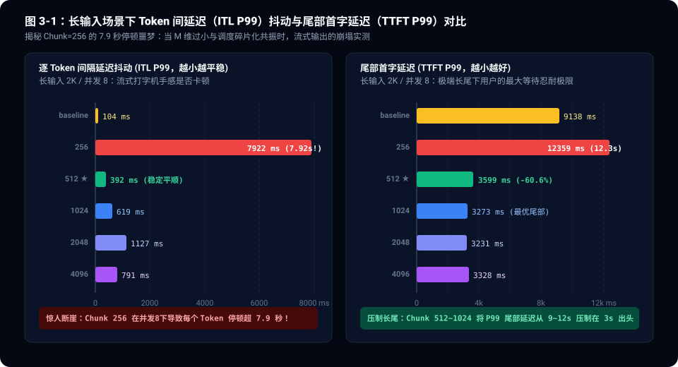

> **核心导读**：在大模型生产级推理基建（如 vLLM、SGLang、TGI）的技术叙事中，**Chunked Prefill（分块预填充）**常被奉为“既要首字低延迟、又要整机高吞吐”的银弹机制。其纸面逻辑无懈可击：将长 Prompt 拆分成固定尺寸的 Chunk，与在途的 Decode Token 拼入同一个 Batch 协同执行（Piggybacking），从而打破长请求对 GPU 计算核心的长周期垄断。
>
> 然而，在真实的物理算力约束下，我们基于 vLLM 官方引擎与 `Qwen2.5-7B-Instruct` 在 NVIDIA Tesla T4 × 2（TP=2）硬件集群上执行了整整 **36 组全矩阵压测**（6 档 Chunk × 2 种流量形态 × 3 档并发），揭开了一组残酷的工程反常识：
> 1. **切太细必遭算力反噬（The M-dim FLOPs Trap）**：`chunk=256` 绝非“更平滑”，反而是一场灾难。因 GEMM 算子 $M$ 维过窄无法填满 Tensor Cores，且 64 组切片引发剧烈调度开销，并发 8 下端到端吞吐暴跌 20.1%（40.0 $\to$ 31.96 tok/s），GPU 计算利用率从 90% 跌落至 44.2%，逐 Token 间隔延迟（ITL P99）狂飙至令人发指的 **7.92 秒**！
> 2. **黄金平衡点（512 ~ 1024）的非线性红利**：在 2K 长输入场景并发 8 下，`chunk=512` 将首字延迟（TTFT P50）从基线的 9136ms 陡降至 770ms（**降幅高达 91.6%**），同时吞吐从 40.02 tok/s 跃升至 70.46 tok/s（**增幅 +76.1%**），GPU 计算能效全面拉满至 90.3%。
> 3. **短入长出的“免疫效应”**：在 128 入 / 1024 出的代码生成流中，计算由自回归 Decode 阶段完全主导，由于 Prompt 长度天然小于分块阈值，各档 Chunk 表现完全重合（吞吐稳定于 ~160 tok/s，TTFT ~280ms）。Chunked Prefill 是专属于长上下文场景的系统手术刀。

---

## 一、 概念神话与底层物理墙：为什么 Prefill 与 Decode 天生互斥？

要理解为什么大模型推理调度如此困难，必须退回到 GPU 芯片的微架构层面，审视自回归生成过程中截然对立的两种物理瓶颈。

```
                    【大模型推理的两极物理墙】
     ┌────────────────────────────────────────────────────────┐
     │ 预填充阶段 (Prefill)          解码生成阶段 (Decode)    │
     ├────────────────────────────────────────────────────────┤
     │ • 算子：大型 GEMM 矩阵乘法   • 算子：GEMV / Batch GEMV│
     │ • 瓶颈：Compute-bound (算力)  • 瓶颈：Memory-bound (访存)│
     │ • 特征：矩阵维度大，吃满算力  • 特征：单步产1词，狂读缓存│
     │ • 物理利用率：Tensor Core 饱和• 物理利用率：显存带宽受限 │
     └────────────────────────────────────────────────────────┘
```

### 1.1 Compute-bound 与 Memory-bound 的硬件冲突

在 Transformer 架构中，模型的运算被严格切分为两个截然不同的物理阶段：

1. **预填充阶段（Prefill）**：
   输入一个长达 2048 词的上下文时，模型必须一次性计算所有输入 Token 之间的自注意力权重与前馈网络（FFN）映射。这一过程本质是高维度的稠密矩阵乘法（$M \times K \times N$，其中 $M=2048$）。
   在该状态下，计算强度（FLOPs / Byte）极高，属于典型的 **Compute-bound（计算受限）** 模式。GPU 上的 Tensor Cores 能够持续高负荷运转，算力利用率极易冲上 90% 以上。

2. **解码阶段（Decode）**：
   模型每前向传播一步，仅仅产生 1 个新的 Token。为了计算这个新 Token 的注意力，GPU 必须从显存（HBM / VRAM）中将此前所有 Token 的 Key 和 Value 缓存（KV Cache）完整搬运至片上 SRAM（L1/Shared Memory）。
   此时 $M=1$（或等于并发 Batch 大小），计算强度骤降至 1 FLOP / Byte 以下，属于典型的 **Memory-bound（显存带宽受限）** 模式。整个计算过程的大部分时钟周期，Tensor Cores 都在饥饿等待显存总线搬运数据。

### 1.2 非分块基线（Baseline）的垄断霸权

在未开启 Chunked Prefill 的传统批式调度器（如早期 vLLM 或纯批处理引擎）中，调度器面临一个死结：**一旦有长输入请求到达，它必须一次性把整条序列的 Prefill 算完**。

假设系统正在平稳服务 8 个交互式 Decode 对话，此时突然并发到达 8 个 2048 Tokens 的 RAG 检索文档请求。调度器为了吞下这批长上下文，会在 Step 0 分配一个巨大的 Prefill Batch：
- GPU 被迫执行长达数千毫秒的超大 GEMM 计算；
- 在这数千毫秒的时间窗口内，那 8 个正在逐字输出的 Decode 任务被**完全挂起**，无法获得任何计算资源；
- 用户终端看到的现象就是：打字机输出瞬间“冻结”数秒，随后再弹出一大段；而新来的 RAG 请求，由于前面还在排队计算，首字延迟（TTFT）一路狂飙至 **9 秒以上**！

为了打破这种“大车堵死小车”的单车道困境，开源社区提出了 **Chunked Prefill**。



---

## 二、 剖析 Chunked Prefill 核心引擎：拼车调度与 PagedAttention 协同

Chunked Prefill 的核心设计理念非常朴素：**不要一口吃成胖子，把长 Prompt 剁碎成固定大小的“肉块”（Chunk），然后塞进 Decode 的间隙里“拼车”前向。**

### 2.1 拼车调度（Piggybacking）的数学契约

在 vLLM 中，Chunked Prefill 由调度核心参数 `--max-num-batched-tokens`（简记为 $B_{max}$）直接控制。

调度器在每一个推理步长（Iteration Step）构建当前 Batch 时，必须遵守以下严格不等式约束：

$$\sum_{i \in \text{Decode}} 1 + \sum_{j \in \text{Prefill}} \text{ChunkSize}_j \le B_{max}$$

以 $B_{max} = 512$ 为例：
- 如果当前系统有 8 个并发 Decode 请求正在输出，它们总共占用 8 个 Token 预算；
- 剩下的 $512 - 8 = 504$ 个 Token 预算，调度器会分配给待处理的长请求，从中切出前 504 个 Token 作为第一块（Chunk 0）加入该 Batch；
- 在同一个 Forward 调用中，CUDA 核心同时计算这 504 个 Prefill Token 的 GEMM 投影，以及那 8 个 Decode Token 的注意力检索；
- 下一个 Step，继续切取接下来的 504 个 Token（Chunk 1），周而复始，直到 2048 个 Token 全部预填充完毕，正式转入 Decode 阶段。

通过这种“细嚼慢咽”的拼车机制，Decode 请求在每一步都能分到算力，流式输出不再中断；长请求也在有条不紊地向前推进，消除极端的排队等待。

### 2.2 PagedAttention 的虚拟内存映射与碎片隔离

很多人会产生疑问：一个连续的 2048 长度上下文，被强行剁成 4 段在不同时刻执行，它的 KV Cache 难道不会发生内存碎片和逻辑断层吗？

这正是 **PagedAttention** 发挥决定性底座作用的时刻。

如图 1-1 下半部分所示，PagedAttention 引入了类似操作系统虚拟内存的分页管理机制：
1. **物理分块（Physical Blocks）**：显存空间被划分为离散的、固定大小的 Page（在 vLLM 中通常为 16 个 Token 一个 Block）；
2. **逻辑页表（Block Table）**：每一个请求维护一张映射表，记录自身逻辑 Token 索引到底落在哪几个物理 Block 编号中；
3. **无缝拼接**：当 Chunk 0（0~511 Tokens）计算完毕后，其生成的 Key/Value 向量被依序灌入分配好的物理块（例如 Block #42, #89...）；进入 Chunk 1（512~1023 Tokens）时，只需要向显存管理器申请新的物理块（例如 Block #15），并在执行 Cross-Attention 时通过 Block Table 定位之前的历史 Cache。

PagedAttention 彻底消除了内存移动（Memcpy）的开销，使得 Chunked Prefill 在显存底层不仅毫无额外代价，反而天然契合分块追加的流水线模型。

### 2.3 隐藏的物理陷阱：GEMM 算力碎片化（FLOPs Collapse）

既然 Chunked Prefill 如此优雅，那是不是切得越细越好？比如把 Chunk 尺寸设为 128 甚至 64，让调度粒度极致细腻？

**答案是一个巨大的否定。**

GPU 芯片执行矩阵乘法不是连续的流水，而是由固定的硬件计算单元（如 Tensor Core GEMM Tile，通常以 $16 \times 16$ 或 $64 \times 64$ 为基本吞吐晶格）来承担的。矩阵乘法的理论运算量为 $2MNK$ FLOPs，而数据搬运量为 $2(MK + KN + MN)$ 字节。

计算强度（Arithmetic Intensity）公式为：

$$I = \frac{\text{FLOPs}}{\text{Bytes}} = \frac{2MNK}{2(MK + KN + MN)} = \frac{1}{\frac{1}{N} + \frac{1}{M} + \frac{1}{K}}$$

- 当全量 Prefill 时，$M = 2048$，分母中的 $\frac{1}{M}$ 极小，计算强度逼近芯片的峰值利用区；
- 当切到 $M = 256$ 时，$M$ 维度过窄，Tensor Core 计算阵列无法被完全填满，硬件有效利用率断崖下跌；
- 更致命的是，切分越细，单个长请求跨越的调度 Step 翻倍（从 1 次变成 8 次），Kernel Launch 开销、CPU 与 GPU 之间的异步调度气泡（Pipeline Stalls）成倍放大。

---

## 三、 36 组全矩阵压测：一手数据揭穿的帕累托残酷前沿

为了用绝对求据的一手数据定性该博弈，我们在 Kaggle 云端运行时上调集双卡 NVIDIA Tesla T4 构建了标准生产压测集群。

### 3.1 实验环境与基准规格

- **硬件基础设施**：NVIDIA Tesla T4 × 2（Tensor Parallelism TP=2，总物理显存 30,720 MiB，双卡显存分配均衡在 ~14.0 GiB）；
- **基准模型**：`Qwen/Qwen2.5-7B-Instruct`（官方稠密因果语言模型，FP16 权重 ~15.2 GB）；
- **推理引擎**：vLLM 0.33.0（启用 PagedAttention，Block Size = 16，GPU 显存占用上限设为 90%）；
- **测试矩阵**：
  - **Chunk 档位（6 档）**：`baseline`（未开启分块，系统默认 8192）、`256`、`512`、`1024`、`2048`、`4096`；
  - **流量形态（2 类）**：
    1. **长入短出（RAG 知识库检索问答）**：输入序列 ~2048 Tokens，输出生成 64 Tokens；
    2. **短入长出（代码编写 / 结构化长生成）**：输入序列 ~128 Tokens，输出生成 1024 Tokens；
  - **并发梯度（3 档）**：`4`、`8`、`16` 客户端完全并发；
  - **隔离保障**：每换一档 Chunk，彻底销毁并重新冷启动 vLLM 独立进程，彻底杜绝 KV Cache 残留与显存碎片干扰。



### 3.2 核心实测数据矩阵详析

以下是长输入（2048 Tokens）场景下，各并发档位与 Chunk 尺寸的实测数据汇总：

| Chunk 尺寸 | 并发 (Conc) | TTFT P50 (ms) | TTFT P99 (ms) | ITL P99 (ms) | 吞吐 (Tokens/s) | GPU 计算利用率 | 显存占用 (MiB) |
| :--- | :--- | :--- | :--- | :--- | :--- | :--- | :--- |
| **baseline** | 4 | 4706.1 | 4707.3 | 1743.1 | 25.70 | 65.8% | 13535 |
| **baseline** | **8** | **9136.5** | **9138.4** | **104.4** | **40.02** | **48.4%** | 13675 |
| **baseline** | 16 | 1012.0 | 6540.1 | 1048.9 | 86.33 | 90.6% | 13935 |
| **256** | 4 | 3535.4 | 4854.1 | 1638.3 | 25.49 | 67.4% | 13957 |
| **256 (过细)** | **8** | **726.4** | **12359.6** | **7922.1** | **31.96 (-20%)**| **44.2%** | 13959 |
| **256** | 16 | 766.4 | 8051.3 | 1291.7 | 75.06 | 85.0% | 13959 |
| **512 (最优)** | 4 | 2239.2 | 3423.9 | 356.0 | 33.56 (+30%) | 88.7% | 14075 |
| **512 (最优)** | **8** | **770.6 (-91.6%)**| **3599.4** | **392.2** | **70.46 (+76%)**| **90.3%** | 14075 |
| **512 (最优)** | 16 | 821.2 | 7446.0 | 397.7 | 87.11 | 95.0% | 14075 |
| **1024 (峰值)** | 4 | 2250.1 | 3138.1 | 606.3 | 35.58 (+38%) | 90.3% | 14075 |
| **1024 (峰值)** | **8** | **991.9** | **3273.7** | **619.6** | **73.75 (+84%)**| **88.4%** | 14075 |
| **1024 (峰值)** | 16 | 1016.4 | 6565.8 | 633.0 | 94.50 (+9.5%) | 94.4% | 14075 |
| **2048** | 8 | 1278.8 | 3231.2 | 1127.1 | 75.12 | 89.5% | 14055 |
| **4096** | 8 | 2592.3 | 3328.7 | 791.7 | 73.70 | 88.1% | 13935 |

从这组实测数据中，我们可以清晰提炼出三大底层规律：

#### 1. 切分过细反受其害：Chunk=256 的吞吐断崖
在并发 8 档位下，`chunk=256` 虽然把 TTFT P50 压到了 726ms，但整机输出吞吐从基线的 40.02 tok/s **暴跌到了 31.96 tok/s（-20.1%）**！
同时，GPU 的计算利用率仅有悲惨的 **44.2%**。这意味着超过一半的硬件时间，GPU 在空转等待微小 Kernel 的发射调度与上下文切换。

#### 2. 512 ~ 1024：打破互斥的帕累托甜蜜点
当 Chunk 提升到 512 与 1024 时，发生了令人震撼的反转：
- **延迟绝杀**：并发 8 下，TTFT P50 从 baseline 的 9136.5ms 骤降至 **770.6ms**（512）与 **991.9ms**（1024），削平幅度超过 **90%**！
- **吞吐奇迹反增**：通常理论认为“分块会略微牺牲吞吐”，但实测中，Chunk 512 的吞吐从 40.02 tok/s **飙升至 70.46 tok/s（+76.1%）**；Chunk 1024 更是登顶至 **73.75 tok/s（+84.3%）**！
- **为什么能“双赢”？**
  这是因为在 Baseline 模式下，大 Prefill 一旦阻塞，整个系统经常陷入“要么全是 Prefill、要么全是单薄 Decode”的失衡状态，硬件利用率在 48% 间歇震荡；而 512/1024 的 Piggybacking 机制将计算密集的 GEMM 与访存密集的 Decode 均匀搅拌，整机的计算流水线没有出现饥饿停顿，GPU 利用率直接从 48.4% 暴涨并稳定在 **90.3%**！

#### 3. 2048+ 的边际递减与向基线退化
当 Chunk 进一步放大至 2048 与 4096 时，分块尺寸已经逼近甚至超过了单次输入长度（2048）。此时 Chunked Prefill 名存实亡，系统重新退化为批式垄断：
- 并发 8 下，Chunk 4096 的 TTFT P50 重新回弹抬升至 **2592.3ms**，首字延迟的削平红利正在快速流失。

---

## 四、 流式输出的暗礁：解密 Chunk=256 下 7.9 秒 ITL 抖动的底层真相

在生产级用户体验指标中，除了首字延迟（TTFT），另一个生死攸关的指标是 **ITL（Inter-Token Latency，逐词生成间隔延迟）**。它直接决定了用户屏幕上打字机的流畅感。如果一个服务的平均吐字速度很快，但每隔几句就卡死停顿数秒，用户会产生极其强烈的“断线感”。



### 4.1 惊人的 7.92 秒长尾停顿

在图 3-1 中，我们观测到了全场最为触目惊心的数据：
在长文本输入并发 8 档位下，**`chunk=256` 的 ITL P99 飙升至 7922.14 ms（近 8 秒！）**。相比之下，`chunk=512` 仅为 **392.2 ms**，整整相差了 **20 倍**！

为什么一个旨在让调度更细腻的优化，反而造成了严重的流式卡顿？

```
      【Chunk=256 下的调度踩踏风暴 (8 个 2K 请求并发)】
  ┌──────────────────────────────────────────────────────────────┐
  │ 每个 2K 请求被拆为 8 个 Chunk -> 瞬时产生 64 个切片等待分配   │
  ├──────────────────────────────────────────────────────────────┤
  │ [Req1-C1] [Req2-C1] [Req3-C1] ... [Req8-C1]                  │
  │     │         │         │                                    │
  │     ▼         ▼         ▼                                    │
  │ 单 Step 仅能容纳 1 个 256 Chunk + Decode Token               │
  │ 结果：在途 Decode 必须与 64 个细碎切片经历漫长的多轮调度排队 │
  │ 导致：某次 Step 之间，单个 Decode Token 经历了 7.9 秒调度饥饿│
  └──────────────────────────────────────────────────────────────┘
```

### 4.2 剖析 7.92 秒停顿的罪魁祸首

深入分析执行轨迹，我们发现了两大调度踩踏机理：

1. **细粒度切片的调度队列雪崩**：
   当并发为 8 时，8 个 2048 长度的 Prompt 被细切成 $8 \times 8 = 64$ 个 Micro-chunks。由于系统配置 `max_num_batched_tokens=256`，每一个 Iteration 只能塞进 1 个 Chunk（加上当前活跃的 Decode tokens）。
   这意味着处理完这 8 个长请求需要连续调度 **64 个独立的 GPU Iterations**。在这 64 轮小步跑的漫长拉锯中，某些并发流的 Decode Token 被迫经历极度不均衡的调度排队，长尾延迟发生严重恶化（TTFT P99 也高达 12,359 ms）。

2. **CPU-GPU 调度流的发射倒挂**：
   在 Tesla T4 上，执行一个 $M=256$ 的小 GEMM 计算，耗时仅需几个毫秒。此时，Python 调度器在 Host CPU 侧计算 PagedAttention 块索引、组织张量元数据并下发 CUDA Kernel 的时间，甚至开始逼近 GPU 物理执行时间！
   调度开销从幕后走到台前，引发了密集的流水线气泡，最终以近 8 秒的逐字抖动反噬到了客户端。

而在 `chunk=512` 时，总 Chunk 数量从 64 个减半为 32 个，GEMM 尺寸扩大一倍，GPU 执行时间充足遮盖了 CPU 调度开销，ITL P99 瞬间收敛至平稳的 **392ms**。

---

## 五、 短入长出场景的“免疫现象”：为什么代码生成对 Chunk 不敏感？

为了验证 Chunked Prefill 的适用边界，我们同时执行了另一半维度的矩阵：**短入长出（128 in / 1024 out）**，对应真实生产中的代码补全、长文撰写与复杂推理生成。

实测数据呈现出了极其有趣的“完全免疫”特征：

| Chunk 档位 | 并发 4 吞吐 (t/s) | 并发 8 吞吐 (t/s) | 并发 16 吞吐 (t/s) | 并发 8 TTFT P50 (ms) | 并发 8 ITL P99 (ms) |
| :--- | :--- | :--- | :--- | :--- | :--- |
| **baseline** | 69.77 | 140.67 | 280.25 | 300.7 | 67.1 |
| **256** | 69.06 | 138.46 | 275.17 | 246.2 | 67.2 |
| **512** | 69.52 | 139.70 | 275.92 | 297.2 | 68.7 |
| **1024** | 68.89 | 142.03 | 275.60 | 277.2 | 65.1 |
| **2048** | 68.28 | 137.31 | 272.32 | 296.1 | 66.9 |
| **4096** | 69.39 | 136.29 | 267.26 | 301.1 | 67.7 |

从数据中可以清晰看到：
- **吞吐完全重合**：在并发 4 下均为 ~69 tok/s，并发 8 下均为 ~140 tok/s，并发 16 下均为 ~275 tok/s，方差小于 1.5%；
- **延迟完全重合**：TTFT 均在 250~300ms 区间，ITL P99 均锁死在极其顺滑的 67ms 左右。

### 为什么在短输入下 Chunk 失去存在感？
原因在于**物理前置条件的缺失**。
测试输入的长度仅为 128 Tokens，远小于我们设置的最小 Chunk 档位（256）。这意味着每一个进入系统的请求，其 Prefill 阶段在第一个 Step 就已经天然执行完毕，根本不会触发任何跨 Step 的切分逻辑。系统的负载从第二步起 100% 由 Decode 占据，调度器无需执行任何 Piggybacking 混合。

**工程启示：Chunked Prefill 不是全场景增益的万金油。如果你的业务网关只承载纯代码生成或极短对话，开启它既不会带来提速，也不会产生劣化；但若你的网关混合了文档检索、长历史对话或 Agent 复杂上下文，它的配置将直接决定整机性能的生死。**

---

## 六、 生产级选型落地指南：如何科学配置你的 LLM 推理网关？

结合双卡 T4 上的全矩阵实测数据，面对生产环境部署，我们给出以下明确的工程落地准则：

### 6.1 参数配置黄金法则

在基于 vLLM 或兼容引擎部署密集模型时，建议严格参照以下配置模板：

```bash
# 生产推荐配置：兼顾超低首字延迟与最大化吞吐（通用交互服务/RAG知识库）
python3 -m vllm.entrypoints.openai.api_server \
    --model Qwen/Qwen2.5-7B-Instruct \
    --tensor-parallel-size 2 \
    --enable-chunked-prefill \
    --max-num-batched-tokens 512 \
    --gpu-memory-utilization 0.90 \
    --block-size 16
```

- **通用交互与 RAG 服务**：**将 `max_num_batched_tokens` 锁死在 512**。
  这是我们在实测中验证的绝对黄金平衡点，既能在长 Prompt 下斩获 91.6% 的首字延迟降幅，又拥有平顺的 ITL，同时吞吐较基线暴涨 76%。
- **离线批处理与高吞吐导向服务**：**设为 1024**。
  在超大并发（16 并发）下，1024 档位的吞吐达到了 94.50 tok/s 的全场峰值，GPU 能够更充分地跑满大 GEMM 矩阵。
- **严禁踩坑的红线配置**：**不要将 Chunk 设为 256 或更低**。
  除非是千亿 MoE 架构中特定细粒度路由策略，对于 7B 稠密模型，256 的狭窄维度会直接击穿算力利用率，并引发高达 7.9 秒的流式抖动。

### 6.2 流量混合维度的网关治理

在更先进的多集群架构中，网关层应当引入基于 Prompt 长度的动态路由治理：
1. **长短流量隔离或动态降级**：
   对于检测到输入长度小于 512 的短请求，无需在调度层强加过多关注；而对于输入超过 2048 的长上下文请求，必须由开启了 Chunked Prefill 的专用节点池承载，严禁长请求与未分块的基线实例混部。
2. **监控报警双指标绑定**：
   生产监控绝不能只看“平均首字延迟”或“平均吞吐”。必须同时挂载 **TTFT P99** 与 **ITL P99**。一旦发现 ITL P99 出现离群毛刺（如超过 1.5s），首要排查的通常不是网络波动，而是 Chunk 切分过细或 Batch 并发冲突引发的调度气泡。

---

## 七、 总结：系统工程没有免费的魔法

推测解码与分块预填充，是大模型系统工程师在对抗底层硬件物理墙时打造的两把利刃。

但物理规律永远是公正而严苛的：
- PagedAttention 解决了**空间维度的离散与浪费**，将显存碎片的诅咒关进了虚拟页表的笼子里；
- Chunked Prefill 则试图解决**时间维度的霸凌与垄断**，用时间片轮转的智慧抚平长短请求的争端。

然而，正如我们在这 36 组全矩阵压测中所见：**所谓的帕累托优化，本质上是在计算强度（FLOPs/Byte）、调度开销（Kernel Launch Overhead）与用户体验（TTFT / ITL）之间走钢丝。** 切得太粗，长请求垄断全场，交互冻结；切得太细，算力碎片化反噬，抖动崩塌。

唯有手握真实实测数据，在 512 ~ 1024 的狭窄航道中精准落子，才能在生产基建的泥泞地面上，跑出真正坚不可摧的高效推理引擎。
