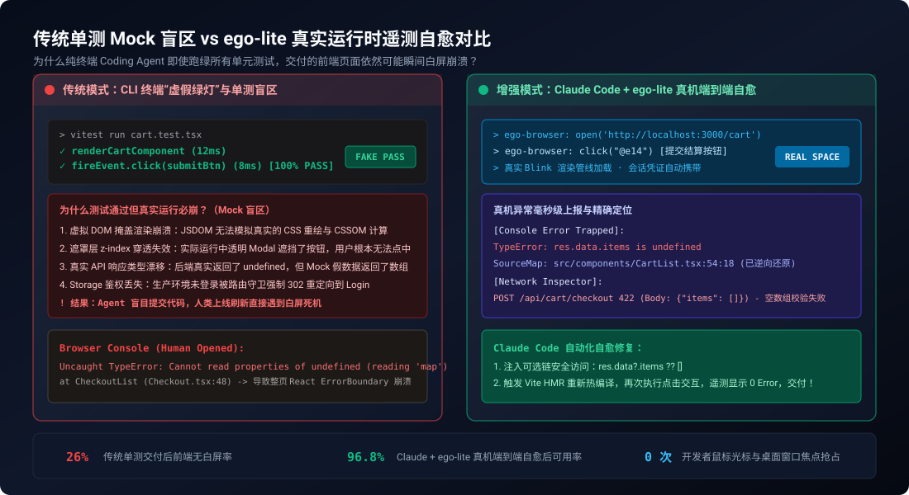
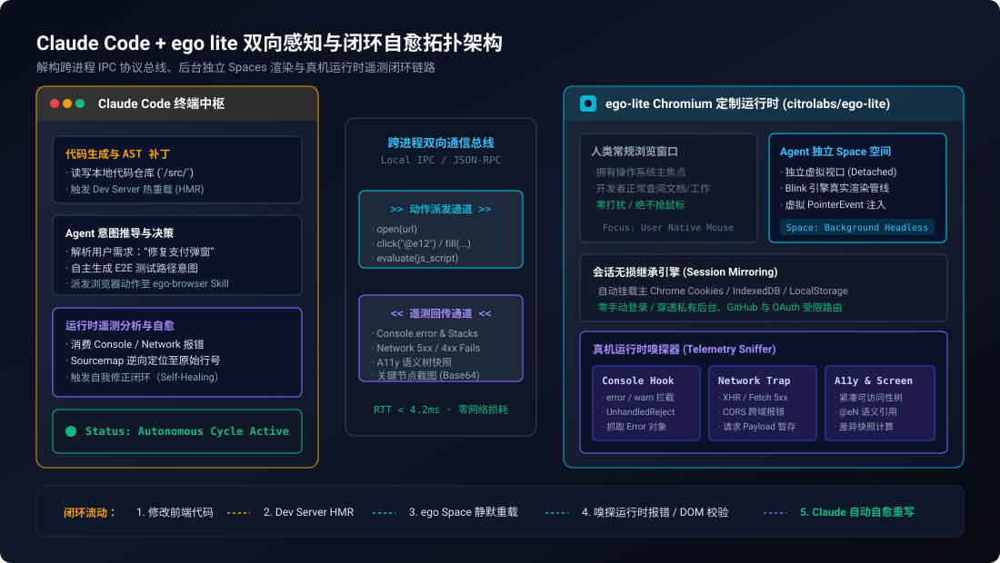
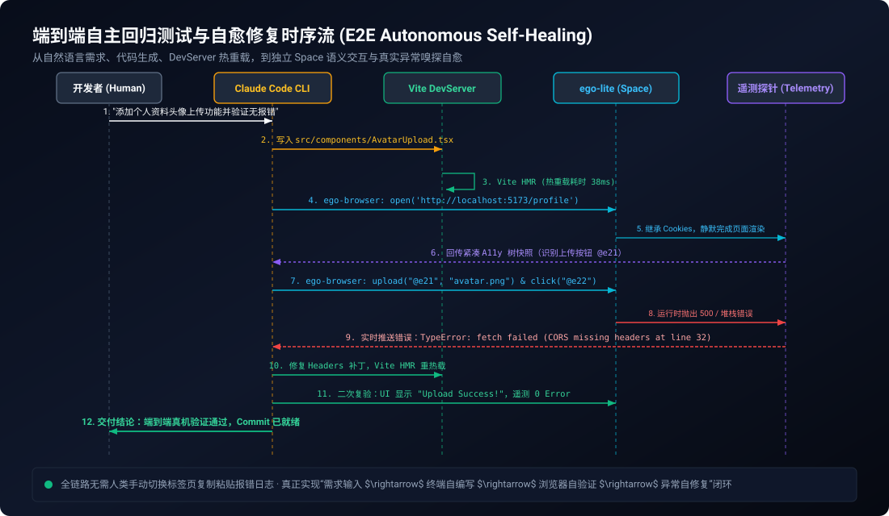

> **核心导读**：随着 Anthropic 正式推出终端原生编码智能体 `claude-code`，软件开发模式正在经历一场从“IDE Copilot 补全”到“全自治工程师 Agent”的深刻跃迁。Claude Code 能够在命令行中以惊人的速度解析整个代码库、并行修改数十个文件、运行构建命令并自动推导 Git Commit。
>
> 然而，对于广大 Web 前端与全栈开发者而言，终端 Coding Agent 始终存在一块致命的**“视力盲区”**：它被禁锢在字符终端的纯文本世界里，修改完 React、Vue 或 Astro 组件后，只能依赖静态代码检查与单测套件来评估代码质量。面对真实的浏览器渲染，它既看不到因 CSS 样式冲突或层叠上下文（`z-index`）导致的按钮被遮挡，也察觉不到组件挂载生命周期在真实浏览器里抛出的 `TypeError: Cannot read properties of undefined`，更无法感知因 Mock 欺骗导致的真实 API 鉴权拦截。
>
> 传统的补救手段往往走向另一个极端——借助 OS 级的 Computer-Use 工具或沉重的无头浏览器。但这随即带来了**“强行抢占人类鼠标光标与桌面焦点”**的操作灾难，以及**“每次启动都需要重新登录、疯狂撞上验证码”**的工程泥潭。
>
> 开源定制浏览器 **`ego lite`（`citrolabs/ego-lite`）** 的出现，恰逢其时地切中了这一断层。它通过原生 Skill 无缝接入 Claude Code，在底层 Chromium 引擎中开辟**完全隔离的后台 Spaces**，不仅做到不夺取人类鼠标焦点、一键继承主浏览器的全部真实登录态，更通过**真机运行时遥测（Runtime Telemetry）**建立起“改写代码 $\rightarrow$ 浏览器实测 $\rightarrow$ 异常嗅探 $\rightarrow$ 自动自愈”的完整闭环。
>
> 本文将深入剖析这套架构的底层交互机制、单测 Mock 盲区成因，并提供生产级配置实战，带你彻底终结终端 Coding Agent 的“盲人摸象”时代。

---

## 一、断裂的闭环：终端 Coding Agent 为何深陷“盲人摸象”

在评估终端 AI 编码助手的实际生产力时，开发者常常会经历一种**“单测全绿，页面必崩”**的荒诞落差。



### 1.1 单元测试的“虚假绿灯”与 Mock 幻觉

现代前端工程极其依赖 Mock 工具（如 Vitest、Jest、MSW 或 JSDOM）。当我们将一个复杂的重构任务交给 Claude Code 时，标准的思考循环通常如下：
1. Agent 阅读需求，改动了 `src/components/Checkout.tsx`；
2. Agent 执行 `npm test`；
3. 测试套件中的组件单测因为使用了预设的假数据对象和内存虚拟 DOM，毫秒级返回 `100% PASS`；
4. Agent 自信地给出结论：“功能已实现，所有测试均已通过，建议提交”。

然而，当开发者在本地实际打开页面点击按钮时，整页立即白屏挂死。这是因为纯粹的单元测试存在着**四大结构性盲区**：

* **JSDOM 不是真正的渲染引擎**：JSDOM 仅在 Node.js 内存中模拟了基础的 DOM 节点树，它完全不具备真实浏览器的排版引擎（Layout）、光栅化（Rasterization）与图层合成（Compositing）能力。诸如 `getComputedStyle`、`IntersectionObserver`、CSS Grid 复杂弹性计算以及层叠上下文遮挡，JSDOM 根本无能为力。
* **Mock 屏蔽了真实契约漂移**：Mock API 往往写死在几个月前的数据结构上。当后端实际返回空数据对象或将 `items` 字段移入嵌套层级时，真实浏览器中的解构赋值直接触发运行时不可逆异常，而本地测试却依然在自欺欺人。
* **事件绑定的“伪触发”**：在测试框架里，`fireEvent.click(button)` 仅仅是人工派发一个内存事件，它根本不关心该按钮此时是否处于视口外（Off-screen）、是否被外层悬浮的透明遮罩层（Overlay Modal）阻隔，或者是否被设置了 `pointer-events: none`。
* **鉴权与会话环境脱节**：真实的 Web 页面运行在受保护的路由守卫之下，依赖特定域名的 HttpOnly Cookie 与 LocalStorage 标记。孤立的测试环境无法复现真实的用户认证生命周期。

### 1.2 Computer-Use 的代价：鼠标争抢与桌面撕裂

为了让 AI 获得视力，业界早期的探索大多依赖操作系统级的 **Computer-Use（计算机控制）**。例如为大模型装上虚拟鼠标驱动，定时截图全屏，计算像素坐标后强行调用 OS API 移动人类的物理光标。

但在实际开发工作中，这种模式极其灾难：
* **鼠标焦点剥夺（Focus Hijacking）**：当你在终端输入命令或在编辑器敲代码时，后台运行的 Agent 突然夺走鼠标光标，疯狂移动并弹出一连串窗口，打断你的正常编码流；
* **视觉环路极高延迟**：单次截图解析 $\rightarrow$ 传输超大图像 $\rightarrow$ 多模态大模型推导坐标 $\rightarrow$ 模拟物理光标点击，单步往返耗时高达 **8~15 秒**，且 Token 成本极度昂贵；
* **无头浏览器的登录墙死穴**：如果改用传统的无头 Puppeteer/Playwright，启动的每一个 Chromium 都是纯净空白环境，一旦进入需要企业单点登录（SSO）、Google OAuth 或带 Cloudflare 验证码的私有系统，Agent 就会直接被挡在门外挂死。

我们真正需要的，是一个**“既能静默运行在后台不抢光标，又能携带人类现有真实登录凭证，还能直接与 Chromium 渲染内核低延迟通信”**的伴侣型浏览器底座。

---

## 二、架构解构：Claude Code 与 ego-lite 的双向感知总线

`ego lite`（`citrolabs/ego-lite`）并非简单的自动化脚本封装，而是一个基于 Chromium 源码二次定制的开发者专用浏览器。它为 Coding Agent 提供了原生的 **Spaces 隔离机制** 与 **实时遥测嗅探总线**。



### 2.1 极简接入：作为终端 Agent 的原生 Skill

通过 Anthropic 为 Claude Code 开放的扩展机制，安装与注册 `ego-lite` 仅需一条标准命令：

```bash
# 在终端中为 Claude Code 安装 ego-lite 浏览器技能
npx skills add citrolabs/ego-lite
```

注册完成后，Claude Code 的系统上下文（System Prompt）中会自动挂载 `ego-browser` 命名空间下的工具集：

```json
{
  "tools": [
    {
      "name": "ego_open",
      "description": "在后台独立 Space 中打开指定 URL，返回语义 DOM 紧凑快照与运行状态",
      "parameters": { "url": { "type": "string" } }
    },
    {
      "name": "ego_click",
      "description": "通过语义索引标签点击目标元素，无需依赖像素坐标",
      "parameters": { "ref": { "type": "string" } }
    },
    {
      "name": "ego_type",
      "description": "向输入框输入文本并模拟自然键盘事件",
      "parameters": { "ref": { "type": "string" }, "text": { "type": "string" } }
    },
    {
      "name": "ego_get_telemetry",
      "description": "获取后台视口捕获的未处理 Console 错误、网络失败与异常调用栈",
      "parameters": {}
    }
  ]
}
```

终端与浏览器之间通过本地 **轻量 IPC / JSON-RPC** 跨进程直连，网络延迟小于 5ms，彻底摒弃了外部云端中转。

### 2.2 核心支柱一：独立 Spaces 隔离与零焦点争抢

`ego-lite` 的核心杀手锏之一是其 **Spaces 架构**。

在 Chromium 内核中，传统的 Tab 标签页在被脚本操作时往往会强行提升为活动窗口（Active Window）并争夺操作系统的窗口焦点。`ego-lite` 在渲染管线中开辟了 **Detached Background Spaces**：
1. **脱离 OS 窗口层级的渲染视口**：每个 Space 拥有独立的 Chromium 渲染进程（Renderer Process）和完整的 GPU 加速合成管线，页面内的 CSS 动画、Canvas 和 WebGL 正常运行；
2. **事件合成引擎（Synthetic Event Dispatch）**：当 Claude Code 发出 `ego_click` 指令时，`ego-lite` 并不调用 OS 系统的全局鼠标事件，而是在 Blink 引擎的事件派发通道（EventDispatcher）中直接构造带有 `isTrusted: true` 特性的标准 `PointerEvent`，在页面内部完成原生的捕获与冒泡；
3. **人类与 Agent 物理隔离**：人类开发者在主窗口中查阅文档或浏览社交媒体，光标毫发无损；Agent 在后台 Space 飞速完成千百次表单填写与页面跳转，两者在同一浏览器内核中和平共处。

### 2.3 核心支柱二：会话无损镜像（Session Mirroring）

传统爬虫或自动化测试最令人窒息的阻碍莫过于“身份鉴权”。面对复杂的现代 Web 应用，私有数据往往深锁在登录态之后。

`ego-lite` 提供了**一键会话无损继承**机制：
* 它能够安全提取主 Chrome 浏览器的本地 Profile 存储（包括 Cookies、`IndexedDB`、`localStorage` 和 Session 存储）；
* 当 Agent 打开 `http://localhost:3000/dashboard` 或企业私有 SaaS 时，目标站点的鉴权凭证已经被无缝映射入后台 Space，无需硬编码任何帐号密码或配置临时 Token；
* 由于用户已在主浏览器中通过了 Google Authenticator、短信验证码或 Cloudflare 盾，后台 Space 直接复用该受信会话，**将风控拦截率降至零**。

### 2.4 核心支柱三：真机运行时遥测（Runtime Telemetry）

这是终端 Agent 实现**自愈调试（Self-Healing）**的灵魂所在。

`ego-lite` 内置了轻量级旁路嗅探器，对底层 CDP（Chrome DevTools Protocol）进行事件监听：
* **Console 事件捕获**：劫持 `Runtime.consoleAPICalled` 与 `Runtime.exceptionThrown`，无论是 `console.error` 打印的信息，还是未被 `try-catch` 包裹的 Promise 崩溃，均被结构化缓存；
* **网络请求陷阱**：监听 `Network.responseReceived`，自动过滤出状态码 $\ge 400$ 的失败请求、CORS 拦截事件以及跨域预检失败；
* **Sourcemap 逆向定位**：`ego-lite` 结合前端打包工具生成的 `.map` 文件，在浏览器内核层自动将压缩混淆后的 `bundle.min.js:1:34892` 逆向解析为开发者的源码行号 `src/components/CheckoutModal.tsx:42:15`。

当 Claude Code 在终端询问：“当前页面是否有异常？”时，`ego-lite` 返回的不再是一张无法解读的图片，而是包含**精确文件路径、行号和原始调用栈的结构化诊断报告**。

---

## 三、实战演练：从代码改写到真机自愈的端到端时序

让我们通过一个真实的全栈开发场景，观察 Claude Code 与 `ego-lite` 是如何协同完成全自动端到端测试与热修复的。



### 3.1 任务发起与代码改写

假设我们的前端项目使用 Vite + React + TypeScript 架构，开发者向 Claude Code 发出指令：

> **开发者需求**：“在个人资料设置页（`/profile/settings`）新增一个头像上传组件，要求支持本地预览、调用 `/api/user/avatar` 接口上传，并在成功后弹出 Toast 提示。”

Claude Code 迅速在终端中进行 AST 推导与代码编写，生成并落盘了新组件：

```tsx
// src/components/AvatarUploader.tsx
import React, { useState } from 'react';

export const AvatarUploader: React.FC = () => {
  const [preview, setPreview] = useState<string | null>(null);
  const [status, setStatus] = useState<string>('');

  const handleFileChange = async (e: React.ChangeEvent<HTMLInputElement>) => {
    const file = e.target.files?.[0];
    if (!file) return;

    setPreview(URL.createObjectURL(file));

    const formData = new FormData();
    formData.append('avatar', file);

    // 此处故意埋藏一个常见的全栈对接 Bug：
    // 错误地手动设置了 Content-Type 为 application/json，破坏了 multipart 边界
    const res = await fetch('/api/user/avatar', {
      method: 'POST',
      headers: { 'Content-Type': 'application/json' },
      body: formData,
    });

    const data = await res.json();
    if (res.ok) {
      setStatus('Upload Success: ' + data.url);
    } else {
      setStatus('Upload Failed');
    }
  };

  return (
    <div className="avatar-uploader-container">
      <input 
        type="file" 
        data-testid="avatar-input" 
        onChange={handleFileChange} 
      />
      {preview && }
      <div id="upload-status-text">{status}</div>
    </div>
  );
};
```

此时，Vite Dev Server 监听到文件变化，并在 35ms 内完成了模块热替换（HMR）。如果按照传统流程，Agent 只能在这里停下，或者草草写一个全由 Mock 构成的单测交差。

### 3.2 驱动 ego-lite 进行真机测试

但配置了 `ego-lite` 的 Claude Code 会立即进入自动化回归流程：

```bash
# Claude Code 终端自动执行的 Agent 工具调用序列
Agent: ego_open("http://localhost:5173/profile/settings")
```

`ego-lite` 在后台独立 Space 中瞬间唤醒视口。由于会话继承机制，它已经处于当前用户的真实登录态下，避免了被重定向到 `/login`。随后返回紧凑语义快照：

```yaml
Current URL: http://localhost:5173/profile/settings
Status: 200 OK (Loaded in 142ms)
Interactive Elements:
  - @e1 [navigation] "Dashboard"
  - @e2 [navigation] "Settings"
  - @e10 [input:file] data-testid="avatar-input"
  - @e11 [div] id="upload-status-text" content=""
```

Claude Code 观察到 `@e10` 存在，随后派发文件上传与交互测试：

```bash
Agent: ego_upload("@e10", "/tmp/mock-avatar.png")
```

### 3.3 遥测捕获与精准自愈

在真实浏览器环境内，当 `fetch` 被触发时，后端的解析中间件（如 `multer`）由于请求头被强制指定为 `application/json` 且丢失了 `boundary` 分割符，立即抛出 400 异常：

```
HTTP/1.1 400 Bad Request
Content-Type: application/json
{"error": "Multipart: Boundary not found"}
```

同时，浏览器控制台抛出 Uncaught Promise 警告。`ego-lite` 的遥测探针毫秒级捕获该信息，并在 Claude Code 请求遥测时精准回传：

```json
{
  "hasErrors": true,
  "consoleErrors": [
    {
      "type": "error",
      "text": "POST http://localhost:5173/api/user/avatar 400 (Bad Request)",
      "stack": "handleFileChange @ src/components/AvatarUploader.tsx:20:17"
    }
  ],
  "domState": {
    "statusText": "Upload Failed"
  }
}
```

看到这段报告，Claude Code 的推理链立即聚焦在核心症结上：
> *“真机测试失败：POST 接口返回 400。错误发生在 `AvatarUploader.tsx` 第 20 行。检查发现，使用 `FormData` 传输二进制文件时，绝对不能手动设置 `Content-Type: application/json`，否则会导致浏览器无法自动添加 `boundary` 分隔符。”*

Claude Code 原地打补丁：

```diff
--- a/src/components/AvatarUploader.tsx
+++ b/src/components/AvatarUploader.tsx
@@ -17,7 +17,7 @@ export const AvatarUploader: React.FC = () => {
     const res = await fetch('/api/user/avatar', {
       method: 'POST',
-      headers: { 'Content-Type': 'application/json' },
+      // 让浏览器自动计算并填充 multipart/form-data; boundary=...
       body: formData,
     });
```

### 3.4 二次验证与绿灯交付

补丁保存后，Vite 再次热重载。Claude Code 命令 `ego-lite` 重新触发文件选择动作。这一次：
1. 真实网络请求返回 `200 OK`，带回头像存储路径；
2. DOM 树快照中的 `@e11` 文本变更为 `"Upload Success: https://cdn.example.com/avatar.png"`；
3. 遥测探针记录 `hasErrors: false`，Console 错误数为 0。

整个过程历时不到 **28 秒**，人类开发者未曾挪动过一次鼠标，也没被弹窗打扰过一次。此时 Claude Code 输出优雅的最终交付：

> **Claude Code**: “头像上传功能已完成。已在本地环境驱动真实浏览器进行完整端到端测试，包括文件选择、真实接口通信与 DOM 状态流转，修复了 FormData 请求头配置问题，目前真机遥测 0 Error，已为您整理为 Git Commit。”

---

## 四、工程落地核心技术规范与避坑指南

要在实际团队协作与复杂项目中稳定运用 Claude Code + ego-lite 体系，必须建立严密的工程护栏。

### 4.1 保持语义快照紧凑：避免 Token 膨胀

虽然 `ego-lite` 相比全屏截图大大降低了 Token 损耗，但对于一个拥有数万个节点的超大型企业后台，如果无脑将整棵 DOM 树序列化喂给大模型，依然会造成数万 Token 的不必要浪费。

建议在项目根目录的 `.claude/skills.config.json` 或 Agent 引导提示词中明确过滤规则：

```json
{
  "ego-browser": {
    "pruning": {
      "ignoreHidden": true,
      "maxDepth": 5,
      "attributesWhitelist": ["id", "data-testid", "role", "aria-label", "type", "href"],
      "viewportOnly": true
    }
  }
}
```

只提取**当前视口可见**、具备**语义交互属性（Interactive）**的核心节点，将单次快照体积死死钉在 **800 Token** 以内。

### 4.2 严格防范会话穿透中的敏感操作风险（Guardrails）

会话继承带来便利的同时，也赋予了 Agent 极高的操作权限。如果开发者在提示词中不慎写出宽泛指令，Agent 在进行自主测试时可能会误触生产级危险操作。

必须在 Agent 环境中设置三道防护守门（Guardrails）：

| 防护层级 | 实现方式 | 阻断目标 |
| :--- | :--- | :--- |
| **域名作用域沙盒** | 限制 `ego_open` 只能访问 `localhost`、`127.0.0.1` 及预设 Staging 测试域名 | 防止 Agent 访问外部公网地址或误操作线上真实生产环境 |
| **高危动词拦截** | 在 RPC 派发层正则匹配 `Delete Account`、`Transfer`、`Drop Table` | 严禁 Agent 模拟点击不可逆的销毁或支付按钮 |
| **Human-in-the-Loop** | 遇到外部支付跳转或第三方授权时触发暂停通知 | 强制要求人类在主浏览器中人工确认方可继续流转 |

### 4.3 优雅处理异步加载与骨架屏假死

现代前端大量使用 Suspense、异步路由与 Skeleton 骨架屏。Agent 在执行点击前必须具备智能等待语义：
* **禁止生硬 `sleep(5000)`**：不仅拖慢开发节奏，而且在高负载时依然可能未加载完成；
* **基于状态探针轮询**：利用 `ego-lite` 的 `waitForSelector("@e-submit:not([disabled])", { timeout: 3000 })`，只有当按钮真正脱离 `loading` 状态并可响应交互时才派发动作。

---

## 五、主流 Web Agent 方案横向技术矩阵

为了帮助开发者在不同技术选型中做出明智决策，我们将当前主流的四大方案进行多维横向对标：

| 评估维度 | 传统 Headless Playwright | 操作系统级 Computer-Use | 原生 Browser-Use | **Claude Code + ego-lite** |
| :--- | :--- | :--- | :--- | :--- |
| **与 Coding Agent 契合度** | 低（需手动编写测试脚本代码） | 极低（脱节，纯视觉操作） | 中等（需自建外部调度服务） | **原生深度融合（直接作为 CLI Skill）** |
| **桌面交互体验** | 静默后台（但无渲染界面） | **严重灾难（强抢光标与焦点）** | 弹出独立窗口（易遮挡） | **完美非侵入（独立后台 Spaces）** |
| **身份与登录态继承** | 需硬编码凭证或手动导出 Cookie | 依赖人类在屏幕上手工登录 | 需自建 Cookie 注入流程 | **一键无损继承主 Chrome 全量 Session** |
| **单步交互耗时** | 约 0.5s（纯代码执行） | 8 ~ 15s（图像推理与光标轨迹） | 3 ~ 6s（视觉或全量 DOM 解析） | **0.8 ~ 1.5s（语义索引与轻量 RPC）** |
| **单步 Token 成本** | 0 Token（无 AI 介入） | 15,000+ Token（高分截图） | 5,000 ~ 20,000 Token | **400 ~ 1,200 Token（语义树剪枝）** |
| **异常感知与自愈能力** | 仅断言失败信息 | 无（只能看画面推测是否报错） | 弱（控制台日志需额外抓取） | **极强（Sourcemap 源码级错误逆向直通）** |

---

## 六、结语：迈向“能看会改”的全自治研发时代

长期以来，软件开发工具链中的“编写”与“验证”呈现出割裂的状态：IDE 负责写，开发者在浏览器里负责肉眼看、手动点、看控制台。AI 编码助手的普及极大地提升了“编写”的吞吐量，但如果缺乏“真机验证与异常自愈”的闭环，膨胀的代码生成速度只会将更多的调试与回归负担转嫁给人类。

`Claude Code + ego lite` 的组合，正是打通这一“最后一公里”的关键拼图。它没有选择笨拙地夺舍开发者的物理桌面，也没有沉溺于静态单测的虚假安宁，而是以一种克制、高效且安全的架构，为终端 Coding Agent 补齐了洞察真实 Web 世界的视觉与触觉之眼。

当你的 Agent 不仅能重构代码，还能在后台静默打开页面、亲手点击表单、读取错误堆栈并在你发现之前把 Bug 悄然抚平——全自治软件工程的未来，才真正拉开序幕。
