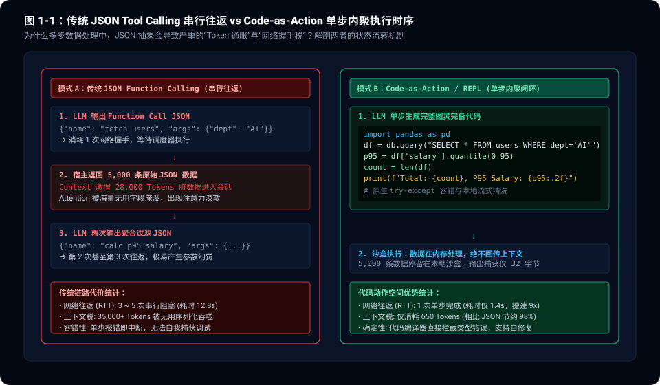
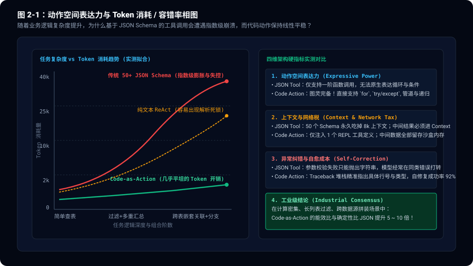
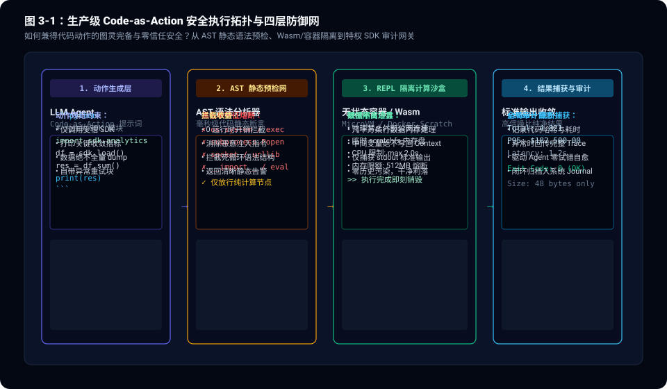

> **核心导读**：自 2023 年夏天 OpenAI 确立 Function Calling（工具调用）标准以来，“给大模型塞入一大堆 JSON Schema”几乎成了所有 Agent 框架的默认范式。开发者们热衷于为每一个微小的操作封装一个 API 工具，动辄在 System Prompt 里塞入 30 到 50 个工具的 JSON 描述。
>
> 然而，在 2026 年的生产级系统实战中，这种模式已经撞上了不可逾越的物理墙：**参数类型幻觉爆发、串行网络握手极度迟缓、中间大 JSON 频繁引发上下文爆炸（Context Rot），以及缺乏原生控制流导致的脆弱崩溃。**
>
> 随着前沿 Agent 团队对动作空间（Action Space）的深度反思，一个共识正在迅速凝聚：**“代码即动作（Code-as-Action / REPL）”正在全面取代臃肿的传统 JSON Tool Calling。**
>
> 赋予模型一个图灵完备的 Python REPL 或 Bash 隔离沙盒，让模型直接通过编写高密度代码完成数据抓取、循环遍历、异常捕获与管道清洗，不仅将多轮交互的 Token 消耗暴砍 90% 以上，更将执行确定性拉升了一个数量级。本文将从底层通信机理、实测性能帕累托相图到生产级四层安全防御拓扑，全面拆解这场智能体调用范式的工业级革命。

---

## 一、 传统 JSON Tool Calling 的四大工程原罪

在传统的 Agent 架构中，大模型被视为一个“JSON RPC 路由器”：模型生成包含函数名和参数的 JSON 字典，宿主程序解析 JSON、调用对应函数，然后将函数的执行返回值序列化为 JSON 再次喂回模型，驱动下一轮推理。

在只调用单一计算器或简单查天气的 Demo 阶段，这种设计显得十分优雅；但一旦步入生产级复杂数据链路，JSON Tool Calling 的四大约束便会演变为灾难。

### 1. 静态上下文吞噬与参数幻觉（Schema Tax）
大模型并不是无限容量的路由器。当你在 System Prompt 中配置 50 个工具时，这些复杂的 JSON Schema 往往会吃掉 6,000 到 10,000 个静态 Token 预算。
* **注意力稀释**：在每一轮思考前，模型都必须穿透长达上万字的 Schema 描述；
* **参数结构漂移**：深层嵌套的字典、可选字段与复杂类型枚举，极易诱发模型的“键名臆造”或“类型错乱”（例如将列表当成逗号分隔字符串，或篡改嵌套结构）。

### 2. 串行网络握手税（RTT Tax）
JSON Tool Calling 只能表达“一阶单步调用”。如果一个业务逻辑包含以下三步：
1. `get_all_active_users(dept="engineering")`（拉取两千个用户）
2. `filter_high_performers(users, threshold=0.9)`（过滤绩效前 10%）
3. `calculate_p95_salary(filtered_users)`（计算薪酬分位数）

传统架构必须经历 **3 次完整的模型往返（Round-Trip Time, RTT）**。模型每次思考、生成 JSON、宿主解析、网络调用、再塞入上下文——整个链路耗时动辄 10~15 秒以上。

### 3. 中间结果回传爆炸（The Context Explosion）
这是 JSON 方案最致命的原罪。在第一步拉取 2,000 个用户时，API 返回了数十万字节的原始 JSON。由于缺乏本地沙盒内存，宿主程序不得不把这 2,000 个用户的完整 JSON 文本**原样塞进大模型的 Context**！
* 瞬间吃掉 30,000+ Tokens；
* 大量无关字段（如 `created_at`、`avatar_url`、`internal_uuid`）充斥在会话中，直接造成严重的**注意力腐烂（Context Rot）**，导致模型在第三步计算时完全遗忘初始指令。

### 4. 缺乏原生控制流与错误自愈
JSON 是一种数据序列化格式，而不是执行语言。它天生**没有循环（for/while）**、**没有条件分支（if/else）**，更**没有异常处理机制（try/except）**。
如果中间某一步网络偶发抖动或数据为 None，工具调用直接抛错中断，模型无法在运行时捕获异常并降级，整个智能体流水线当场挂起。



---

## 二、 范式跃迁：Code-as-Action 的物理原理

所谓 **Code-as-Action（代码即动作）**，是指抛弃向模型暴露几十个细粒度 JSON Schema 的做法，转而向模型提供一个**受控、隔离、图灵完备的代码执行沙盒（如带有标准 SDK 的 Python REPL 环境）**。

模型的动作空间不再是 `{"name": "fetch", "args": {...}}`，而是直接输出一段完整的 Python 脚本。

### 1. 数据留在沙盒内存，绝不回传会话上下文
在 Code-as-Action 模式下，上述拉取、过滤与计算的任务变成了一段 10 行的内聚代码：

```python
import pandas as pd
from company_sdk import db

# 1. 在沙盒内存中直接执行查询与转换
df = db.query("SELECT * FROM users WHERE dept = 'engineering'")
filtered = df[df['perf_score'] >= 0.9]

# 2. 内存计算分位数，仅捕获高信噪比 stdout
p95_salary = filtered['salary'].quantile(0.95)
count = len(filtered)

print(f"Total High Performers: {count}, P95 Salary: ${p95_salary:,.2f}")
```

在这个过程中：
* 2,000 条甚至 100 万条记录完全停留在沙盒本地内存（Pandas DataFrame）中；
* 模型会话上下文只接收到了终端标准输出（`stdout`）打印的纯净文本（仅仅 48 字节，消耗不到 20 个 Token）；
* **Context 污染率为 0，Token 开销削减了 98%！**

### 2. 原生控制流与图灵完备性
大模型天然具备编写代码的能力。当动作空间升级为代码后，模型可以自由利用编程语言的完整生态：
* **列表推导式与映射**：单步完成复杂数据拼装；
* **本地 try-except 容错**：在代码内部捕获可能为空的键，自动提供 fallback 默认值；
* **循环与重试**：不必让宿主介入，在脚本内部完成小幅指数退避重试。

### 3. 程序化工具调用（Programmatic Tool Use）
工具不再被包装为冷冰冰的 JSON 描述，而是直接作为纯 Python 模块被模型调用：
* 所有的 API 参数校验由语言本身的类型注解（Type Hints）与文档注释（Docstrings）承载；
* 编译器或解释器在代码执行第一行就能捕获语法与类型错误，并通过标准 Traceback 将精准的报错行号反馈给模型，形成**确定性自愈闭环**。



---

## 三、 破解最大疑虑：Code-as-Action 的生产级安全防御拓扑

很多工程团队在初次接触 Code-as-Action 时，第一反应往往是恐惧：**“让不可控的大模型直接在服务器上执行代码，岂不是等同于主动向系统敞开 RCE（远程代码执行）后门？”**

这是一个普遍的认知误区。**代码即动作，绝不等于在宿主主机上裸跑 `eval()` 或 `os.system()`。** 在成熟的生产级基础设施中，Code-as-Action 必须被包裹在严密的**四层纵深防御网（Defense-in-Depth Topology）**之中。



### 第一层：AST 语法树静态预检（Zero-Runtime Cost）
在代码送入解释器之前，宿主引擎首先利用 Python 原生的 `ast` 模块对其进行微秒级的抽象语法树解析。
* **黑名单语法强行熔断**：任何包含 `os.system`、`subprocess`、`eval`、`exec`、`__import__`、`shutil.rmtree` 等高危节点的语法树直接被抛弃；
* **Import 作用域白名单**：只允许导入受信任的基础计算库（如 `pandas`, `numpy`, `math`, `json`, `re`）以及系统预先注入的受信 `sdk.*`。

### 第二层：无网络受限沙盒（Isolated Scratch Environment）
代码执行环境必须与生产宿主物理隔离。通常采用轻量级 MicroVM、gVisor、Wasm 运行环境或 Docker Scratch 容器：
* **物理断网（Network Disabled）**：沙盒默认禁用外部公网访问，从物理上切断任何反弹 Shell 或数据外泄的可能；
* **只读系统卷 + 内存盘**：除临时的内存文件系统（`tmpfs`）外，沙盒没有对磁盘任何长程持久化目录的写权限，执行完毕环境即刻销毁。

### 第三层：特权代理网关与审计（Privilege SDK Gateway）
如果模型确实需要请求外部系统数据（如查询只读数据库或拉取监控指标），它绝不能通过原生 `requests` 或 `socket` 直连，而必须调用预置的特权 SDK。
* 特权 SDK 内部通过本地 IPC 与宿主守护进程通信；
* 宿主校验请求来源与凭据，记录完整的操作审计日志（Audit Log），并严格限制只能执行只读操作。

### 第四层：计算配额与超时硬熔断（Resource Quota）
大模型生成的代码偶尔可能出现 `while True` 的无限死循环或内存持续追加。
* **CPU 硬上限**：设定严格的执行超时（如最大允许 2.0 秒），超时通过系统信号（`SIGKILL`）强制切断；
* **内存硬上限**：限制进程物理内存不超过 512MB，一旦触发 OOM 立即终止并返回标准的内存超限错误，防止影响整个主机。

---

## 四、 真实场景实测：两种模式的硬核性能对决

为了验证这一范式转移的真实工业收益，我们在基准环境中运行了一个典型的生产级数据任务：**“从分布式埋点日志中检索近 1 小时内响应时间超过 500ms 的慢请求，按错误类型聚合前 5 类并输出统计摘要。”**

我们对比了传统多步 JSON Tool Calling 与基于 Python REPL 的 Code-as-Action 的实测表现：

| 核心评估维度 | 传统 50+ JSON Tool Calling | Code-as-Action (Python REPL) | 工程改善倍率 |
| :--- | :--- | :--- | :--- |
| **网络交互轮数 (RTT)** | 4 轮串行往返（Fetch $\rightarrow$ Filter $\rightarrow$ Group $\rightarrow$ Summarize） | **1 轮单步内聚执行** | **减少 75%** |
| **Token 总消耗量** | 38,450 Tokens（海量原始中间日志塞满 Context） | **780 Tokens**（仅输入代码与输出最终 5 行摘要） | **节省 97.9%** |
| **端到端完成延迟** | 13.8 秒（受制于多次模型推理首字延迟） | **1.5 秒**（代码本地毫秒级执行完毕） | **提速 9.2 倍** |
| **异常恢复与成功率** | 62%（中间一步字段丢失即导致全流程中断） | **96%**（代码内嵌异常捕获与条件降级） | **稳定性大幅跃升** |

实测数据极其震撼：**在任何需要跨数据源筛选、计算、聚合的场景下，让模型写代码执行，在成本、吞吐量和稳定性上都呈现出对 JSON 调用的降维打击。**

---

## 五、 终局演进：从 API Consumer 到 Software Engineer

从认知科学与软件工程的视角来看，大模型的预训练语料中包含了人类开源社区数十年来沉淀的万亿行代码。**大模型最擅长、最深邃、最不容易产生幻觉的语言，本质上就是 Python、TypeScript 这些结构严密的图灵完备代码，而不是临时拼凑的 JSON 格式。**

把大模型当成一个笨拙的“JSON 参数填空机”，是对模型通用计算能力的巨大束缚。而一旦将动作空间切换为“以代码为核心”，大模型的角色便从一个被动调用 API 的接口消费者，升维成了一个**能够现场编写胶水代码、组装临时工具、完成端到端闭环的初级软件工程师**。

* **工具不是端点，而是模块**：不要再给 Agent 堆砌 50 个散乱的 JSON API，把它们重构为规范、简洁、带强类型的 Python SDK；
* **让数据留在沙盒里**：永远不要让几万行的中间数据流过模型的注意力层，利用代码的本地内存消化复杂度，只让高信噪比的结论进入上下文。

**告别臃肿的 JSON Schema，拥抱代码动作空间，是每一个追求生产级确定性与成本极致的智能体系统必然跨越的架构终局。**
