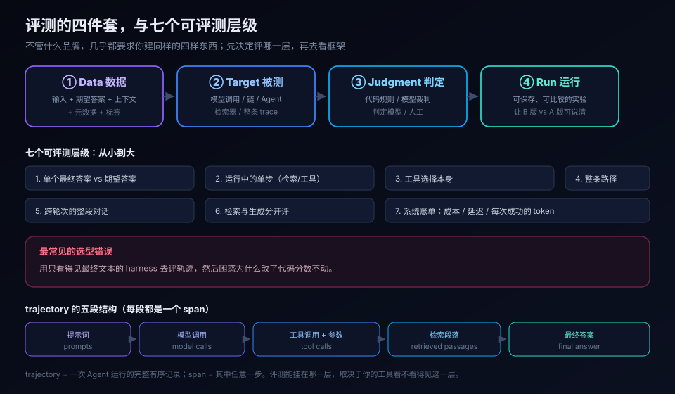
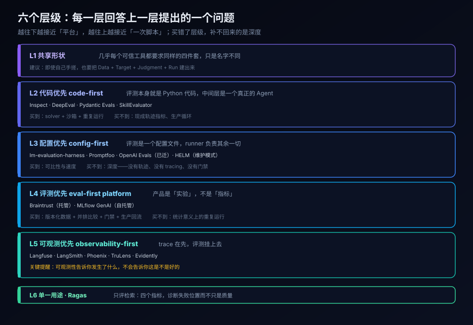
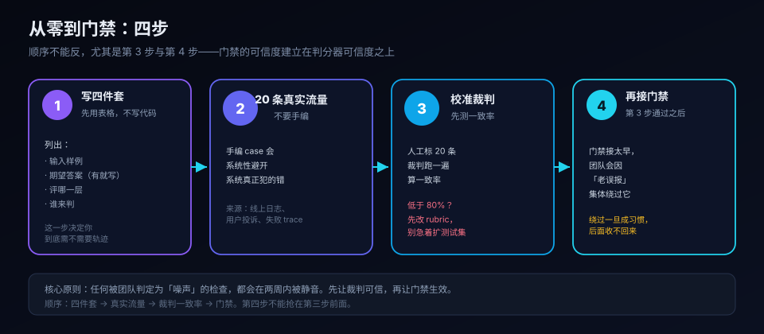

> **核心导读**：语言模型最危险的地方不是它会答错，而是它会**流畅地答错**——返回一个格式完整、语气笃定的答案，内容却是错的、不安全的、或者没有任何依据。看一条好答案不能说明下一条，看十条也不能说明第一百条。
>
> 2026 年 11 月 22 日，Sergii Makarevych 发了一篇约 4.4 万字符的 X 长文，把 16 个主流评测框架按**六个层级**拆开横评。这篇文章的价值不在「哪个框架最好」——作者明确说了不做排名、只讲适配——而在于它提出了一条大多数团队会跳过的判据：**判分器本身就是待测系统的一部分，不是中立的尺子。**
>
> 本文按原文的六层结构重讲一遍，并做三件事：第一，用 GitHub API 独立核验了各仓库的星数与维护状态，标出与原文不一致的地方；第二，把散落在正文里的「稳定性」与「门禁」两个维度抽成一张对照表；第三，指出原文自己承认的局限和它没有展开的空白。

---

## 一、先纠正一个直觉：评测不是「打分」，是可复现的比较

原文给的定义很朴素：**评测 = 在一组输入上重复运行你的系统，并对每个输出打分，使一次改动可以用数字判断，而不是用演示观感判断。**

这个定义里有两个词值得单独拎出来：

- **重复（repeatable）**：跑一次得到 0.83 不叫评测。同一个输入跑三次得到 0.81 / 0.83 / 0.79，你知道这个数字的波动范围，才叫评测。
- **比较（comparable）**：分数必须能和「上一个版本」并排放。没有基线，0.83 什么也说明不了。

原文还区分了三种使用时机，这个划分比大多数介绍文章清楚：

| 时机 | 要回答的问题 | 典型失败 |
|---|---|---|
| 上线前 | 这东西到底能不能用 | 用十几个手挑的 case 证明「能跑」 |
| 每次改动前 | 有没有把已经好的地方弄坏 | 修了 A 功能，悄悄弄坏 B |
| 上线后 | 测试集漏掉了什么 | 线上真实流量里的失败从未回流成用例 |

第三种最容易被忽略，也最贵：**上线后的评测不是监控，是把线上失败变成测试用例的管道。**

---

## 二、四件套：几乎所有框架都在让你建同样的四个东西

不管叫什么名字，一个可信的评测工具都会要求你准备四样东西：



1. **Data（数据）**：测试用例。输入 + 期望答案（存在期望答案时）+ 上下文 + 元数据 + 标签。
2. **Target（被测对象）**：一次模型调用、一个提示词加模型、一条链、一个带工具的完整 Agent、一个检索器，或者一整条 trace。
3. **Judgment（判定）**：打分器。原文把判分器分成四种形态，这个分类是全文最实用的部分之一。
4. **Run（运行记录）**：一次可保存、可比较的实验。让你能说出「在某个切片上，B 版本比 A 版本好」。

### 2.1 判分器的四种形态

| 形态 | 怎么判 | 优点 | 代价 |
|---|---|---|---|
| 代码规则 | 精确匹配、子串、正则、JSON 字段校验 | 确定、免费、可复现 | 只适用于有明确正确答案的场景 |
| 模型当裁判 | 第二个模型按评分指引打分 | 能处理开放式回答 | 有成本，且裁判本身可能偏 |
| 带类型的判定模型 | 返回一个选项 + 概率 | 输出结构化、可设阈值 | 需要训练或微调，覆盖面窄 |
| 人工 | 人来看 | 最可信 | 最慢最贵，无法规模化 |

原文强调了一句容易被当成废话的话：**grader 是你必须测试的系统的一部分，不是中立的尺子。**

这句话展开就是本文最重要的一条工程结论：**每个评测需要两个数字——产品有多好，以及判分器和人的一致率有多高。**

只报第一个数字，就是在用一个未经检验的裁判给自己发合格证。原文的原话是：「团队骗自己最常见的方式，就是一个未经检验的裁判给出的、看起来很笃定的分数。」

### 2.2 trajectory 与 span：评测的最小单位不止「最终答案」

原文把一次 Agent 运行的完整有序记录叫做 **trajectory（轨迹）**，包含五部分：提示词、模型调用、带参数的工具调用、检索到的段落、最终答案。

其中任何一步叫一个 **span**。

这个区分决定了你能评什么。原文列了从小到大七种可评测层级：

1. 单个最终答案 vs 期望答案
2. 运行中的单步（一次检索、一次工具调用）
3. 工具选择本身：选对工具、参数正确、结果被正确使用
4. 整条路径：任务完成、浪费了几步、计划是否被遵循
5. 跨轮次的整段对话
6. 检索与生成分开评
7. 系统账单：成本、延迟、每次成功消耗的 token

**先想清楚你要评哪一层，再去看品牌。** 原文把这条列为「带走的结论」之一，理由是：用只看得见最终文本的 harness 去评轨迹，然后困惑为什么改了代码分数不动——这是团队最常犯的错。

---

## 三、六个层级：从「自己写代码」到「只评检索」

原文把 16 个框架分成六层，每层回答上一层提出的一个问题。这个组织方式比按字母排序有用得多。



### 3.1 第一层：共享形状

不管什么品牌，几乎都要求同样的四件套。原文的建议是：**即使你自己手搓，也要把这四件套建出来。**

### 3.2 第二层：代码优先（code-first）

这一层的共同点是：**评测本身就是 Python 代码，中间层是一个真正的 Agent。**

代表是 **Inspect**（英国 AI 安全研究所出品）。原文用它做深度样本，因为它把「solver 层」的差异讲得最清楚。

一个 **agent solver** 是让模型在循环里运行的代码，具备六种能力：多次调用模型、使用工具、读文件、在沙箱里跑代码、跨轮次保留记忆、把任务交给子 Agent。

**沙箱**是让不可信的模型生成代码运行而不碰到你本机或密钥的隔离环境，有两种形态：隔离机器、隔离容器。

原文给了一个最小的 Inspect 评测定义：

```python
from inspect_ai import Task, task
from inspect_ai.dataset import example_dataset
from inspect_ai.scorer import model_graded_fact
from inspect_ai.solver import generate, system_message

@task
def security_guide(system="devops.txt", grader="expert.txt"):
    return Task(
        dataset=example_dataset("security_guide"),
        solver=[system_message(system), generate()],
        scorer=model_graded_fact(template=grader)
    )
```

注意两件事：被测模型**不写在任务里**，而是在运行时指定（`inspect eval security_guide.py --model <provider>/<model>`）；每次运行对每个样例评一个答案。

原文对 Inspect 的评价很克制：它买到了 **solver + 沙箱 + 重复运行**，但**没有买到现成的轨迹指标**——工具正确性和计划质量都得你自己对着 transcript 写。它也没有托管实验对比、没有生产评分循环。

同一层里还有两个「增量」：

- **DeepEval**：保留 Python 形态，但把 runner 换成 pytest，把护城河换成**指标目录**。轨迹、检索/生成分离、多轮对话都是一等公民。代价是需要它自己的 tracing，且没有沙箱、没有重复运行原语。
- **Pydantic Evals**：把数据模型换成**类型 + 报告**。每个 case 可以带自己的判分器（原文举例：一个食谱 case 要求无肉，另一个要求无麸质，共享通用检查）。轨迹检查是确定性的、基于 span 的，**完全不调用模型**。原生支持线上采样评测。

原文在这一层的结论很锋利：**这一层真正的差异是 solver 层，不是指标数量。**「需要工具 + 沙箱 + 重试就从这里开始；需要现成轨迹数字、不想写打分器，就选指标目录那一侧。为了沙箱去买指标清单，或者为了轮次指标去买沙箱，都浪费一个季度。」

还有一个值得单独说的新东西：**SkillEvaluator**（NVIDIA）。它的评测对象和上面所有框架都不同——它评的是**skill 文件夹本身**，以及这个 skill 对 Agent 行为的影响。三层可独立运行：形式与安全（schema、版本、密钥、许可证、脚本 lint、各 harness 能否加载）、重叠度（是否和其他 skill 重复，浪费上下文）、实跑对比（同一任务在有/无该 skill 的沙箱里跑，报告 skill 带来的提升和 token 成本）。

### 3.3 第三层：配置优先（config-first）

这一层的共同点是：**评测是一个配置文件，runner 负责其余一切。**

**lm-evaluation-harness** 是代表。一个任务基本就是 YAML：数据集路径、带 Jinja 占位符的提示模板、输出类型、few-shot 数量、过滤器链、指标列表。

它买到的是**可比性**：每个样本重复运行 + 多数投票平滑采样噪声；提示采样和权重随机性各有独立种子；响应与预处理提示都做缓存（「缓存让重跑便宜到你真的会去重跑」）；批量自动调优、数据并行。

它买不到的是**深度**：原生只评基础模型的最终输出，没有轨迹、工具、检索分离、多轮评分——原文说这个缺失是**设计使然**。没有裁判模型（因此也没有裁判可信度问题），但也就没有开放式质量的灵活性。没有门禁、没有 tracing、没有成本追踪、没有生产循环。

**Promptfoo** 是同一配置思路上的产品化增量：矩阵形状相同（提示词 × 提供方 × 测试用例，YAML 写，命令行跑，本地查看器看），但覆盖面宽得多——工具调用有效性、轨迹断言（工具使用、步数、目标达成）、RAG 断言、对话相关性。打分器也宽得多：几十种确定性断言 + 模型裁判 + 常见脚本语言的自定义断言，支持加权平均和派生指标。

代价是：结果留在本地，没有中心化实验历史，重复运行原语比 Inspect 的 repeats + reducers 弱。

**OpenAI Evals** 被原文明确标注为「只作为设计参考保留」：三层拆分（data + logic + config）值得抄，但托管平台在退役，Agent 支持浅，**不要用于新工作**。

我核验了这一点：OpenAI Evals 仓库 README 首行现在写的是「你现在可以直接在 OpenAI Dashboard 里配置和运行 Evals」，并给出迁移链接。仓库最后一次推送是 2026 年 4 月 14 日，已停止活跃开发。所以原文的「retiring」在方向上准确——准确的说法是**能力迁到了 Dashboard，开源仓库进入维护状态**，而不是整个产品线消失。

**HELM** 被标注为「只当检查清单，不当 runner」：它的价值是 `场景 × 适配方式 × 指标` 这个三元组，以及指标族覆盖准确率、校准、鲁棒性、公平性、毒性、效率。用它来检查你的评测**有没有漏掉某个格子**——「一个缺失的格子（比如非英语、或人机交互）是任何 runner 都补不上的缺口」。它已进入维护模式。

### 3.4 第四层：评测优先的平台（eval-first platforms）

这一层的共同点是：**产品是「实验」，不是「指标」。**

一个**实验**是一次不可变、被保存的运行：某个版本的系统在某个数据集上的全部输入、输出、分数、trace，可以和下一个版本并排比较。一个**数据集版本**是一个被钉住的快照，防止后续编辑悄悄移动靶心。

**Braintrust** 是代表。它买到的是完整闭环：版本化数据 + 并排比较 + 线上规则 + 流水线门禁。它的稳定性故事**刻意做薄**：每个实验每行只跑一次，建议「一个实验只改一个变量」，PR 上跑冒烟、合并时跑全量。

原文在这里给了一条跨平台通用的采样建议，我认为是全文最值得抄进团队文档的几条之一：

- **离线全量、线上采样**：全量离线跑能在合并前抓住回归，因为每个 case 都算数。
- **线上按风险采样，而不是均匀采样**：新提示词、新工具采样率调高，分数稳定后调低。
- **生产评分钉住一个版本，下一个版本在历史数据上测**：钉住可以避免改一次 rubric 就把上个月的分数悄悄重算。

**MLflow GenAI** 是同一形状的自托管版本：数据存在 tracking server 的 SQL 后端，内置裁判目录大得多，而且**裁判校准是可测量、有名字的**——用同一批 trace 上的人工反馈训练对齐优化器，在自动化前把一致率提到目标值。门禁是 pytest 原生的：把函数标记为回归测试，在里面跑评测，断言结果通过，构建就像单测一样失败。

### 3.5 第五层：可观测性优先（observability-first）

这一层的共同点是：**trace 在先，评测挂上去。**

原文在这里说了一句我认为最该被单独引用的话：**可观测性告诉你发生了什么，它本身不会告诉你这是不是好的。**「把显式判分器、校准和阈值挂上去，否则 trace 只是没有判决的电视。」

**Langfuse** 是代表，因为它把完整闭环写得最全：trace + session + prompt 喂给 score + dataset + experiment + monitoring。评分可以落在单个 observation、整条 trace、session、或 dataset run 上。

它买到的是**成本控制**：按规则做变量映射、evaluator 版本化并在历史上批量重评、人工与机器一致率的校准视图、采样与花费上限、跑前成本预估。

原文给了一条跨工具通用的校准习惯，值得抄：

- **先从小规模人工标注集开始，再拿每个判分器去对它测**：一致率低于团队门槛，说明 rubric 或示例要改，不是产品要改。
- **判分器变了就重评历史**，然后并排比较新旧判决：老 case 上大量翻转，通常意味着新提示词把规则收窄或放宽了。
- **把事实检查和风格检查拆成不同 evaluator**：混合 rubric 一定过不了校准，因为一个数字掩盖了两种分歧。

**LangSmith** 是托管版，对某个特定 Agent 栈最深；**Phoenix** 的特色是 evaluator 就是普通函数，内置模板覆盖 faithfulness、幻觉、完整性、检索、工具选择与调用、拒绝与摩擦、安全，轨迹与对话层级是一等公民；**TruLens** 的招牌是三段式 RAG 检查（上下文相关性 + 有据性 + 答案相关性）以及**公开的裁判基准**；**Evidently** 的单位是表格数据的一行，声称一百多个内置检查，适合表格型质量门禁。

### 3.6 第六层：单一用途的 RAG 指标

这一层回答的是：「如果我只关心检索质量，别的都不管呢？」

**Ragas** 是一个 Python 指标库，不是平台。核心思想很简单：**把检索和生成拆开，各自打分，这样修复才能落在正确的位置。**

四个核心检查，各自需要的字段不同：

| 指标 | 衡量什么 | 需要什么 | 方向 |
|---|---|---|---|
| Faithfulness（有据性） | 答案中的主张有多少被检索内容支持 | 回答 + 检索段落 | 越高越好 |
| Answer relevancy（答案相关性） | 答案是否回应了所问的问题 | 用户输入 + 回答 + 嵌入模型 | 越高越好 |
| Context precision（上下文精确率） | 好的段落是否排在前面 | 检索段落 + 参考或回答 + 裁判 | 越高越好 |
| Context recall（上下文召回率） | 检索段落覆盖了多少参考答案 | **必须有参考答案** | 越高越好 |

原文特别提醒：**RAG 指标诊断的是失败位置，不只是质量。** 精确率低说明该修搜索，有据性低说明该修生成或提示词。把检索检查和生成检查分开跑，而不是一个混合分数——「混合分数会掩盖该调索引还是该改提示词」。

Ragas 的操作性限制写得很坦白：逐样本异步评分，**没有逐样本重复、没有 pass@k、没有时间/token/成本上限、没有重试或出错即停**。同一个输入重跑可能略有不同，所以「钉住裁判模型和温度，小规模跑两次，记录离散度，再信任门禁」。

我核验时发现一个原文没提的事实：`explodinggradients/ragas` 这个仓库已经 301 重定向到 **`vibrantlabsai/ragas`**（16,403 星，Apache-2.0，2026-11-14 仍有推送）。原文只给了 `docs.ragas.io` 的文档链接，没有指出组织迁移——如果你照着旧仓库地址去装，会遇到重定向。

---

## 四、把「稳定性」和「门禁」抽出来单独看

原文把这 16 个工具的对照散在正文里，我把它整理成一张表。这两列是我认为选型时最该先看的——因为它们决定「这个框架能不能挡住一次坏改动」。

| 框架 | 怎么定义 | 评哪些层级 | 稳定性与门禁 | 主要局限 |
|---|---|---|---|---|
| Inspect | Python Task | 最终、步骤、对话、系统 | repeats + reducers + 限额；日志可重评 | 轨迹/RAG 指标要手写；无生产循环 |
| DeepEval | Python 测试 | 最终、轨迹、步骤、RAG、对话 | 可重跑、flaky 标记；pytest 门禁 | 依赖自家 tracing；无沙箱、无重复原语 |
| Pydantic Evals | 类型化 Python | 最终、工具、路径、报告、线上采样 | 可重跑；断言门禁 | 只看本地执行的工具；现成指标少 |
| SkillEvaluator | CLI + 模板 | skill 文件、加载、重叠、有无对比 | 三层可单独门禁；CI 模板 | 新、实验性、只评 skill |
| lm-harness | YAML 任务 | 仅最终输出 | repeats、种子、缓存；无门禁 | 无 Agent、裁判、tracing、生产循环 |
| Promptfoo | YAML 矩阵 | 最终、工具、轨迹、RAG、对话 | 重试、缓存；CI action | 结果留本地；重复统计弱 |
| OpenAI Evals | YAML 注册表 | 单次补全 | 仅采样；日志报告 | 已迁 Dashboard；Agent 支持浅 |
| HELM | 分类法 | 任意层级、多指标 | 标准化条件；排行榜 | 维护模式；不能当门禁用 |
| Braintrust | 代码 + 操场 | 最终、span、trace、session、成本 | 采样、重试；实验 + 规则 + CI | 无重复统计；托管为主 |
| MLflow GenAI | Python + 服务端 | 最终、工具、多轮、RAG、系统 | 对齐人工；pytest 门禁 | 需要服务端 + SQL 存储 |
| Langfuse | 点击 + 代码 | observation、trace、session、数据集运行 | 对钉住数据重跑；CI action + 告警 | 指标库薄，需配对补深度 |
| LangSmith | 代码 + 界面 | 单次、线程、session | 可重跑；pytest 适配器、断言 | 仅托管，无自托管路径 |
| Phoenix | 代码 + 界面 | span、轨迹、线程 | 可重跑；可排序表、事后挂 evaluator | 线上循环靠脚本；无原生门禁 |
| TruLens | 代码 | 检索边、Agent 行为、安全 | 可重跑；看板、排行榜 | 平台闭环薄，适合当指标提供方 |
| Evidently | Python + 报告 | 行级 + 数据集汇总 | 测试套件；可接自动化 | 无轨迹原语；靠 dataframe 调试 |
| Ragas | Python 指标 | 仅检索侧、仅生成侧 | 可重跑；门禁要手写 | 无历史、tracing、生产循环 |

星数我独立核验了一遍（2026-11-23，GitHub API），供你判断生态活跃度。注意：**星数是维护活跃度的参考，不是覆盖能力的证明**——原文自己也这么提醒。

| 仓库 | 星数 | 最近推送 |
|---|---|---|
| Langfuse | 37,742 | 2026-11-23 |
| MLflow | 28,939 | 2026-11-23 |
| Promptfoo | 27,560 | 2026-11-23 |
| OpenAI Evals | 19,784 | 2026-04-14 |
| DeepEval | 19,601 | 2026-11-23 |
| Ragas（vibrantlabsai） | 16,403 | 2026-11-14 |
| lm-evaluation-harness | 14,523 | 2026-11-04 |
| Phoenix | 12,379 | 2026-11-22 |
| Evidently | 8,077 | 2026-09-29 |
| SkillEvaluator | 4,418 | 2026-11-23 |
| TruLens | 3,667 | 2026-11-20 |
| Inspect | 3,312 | 2026-11-22 |

一个值得注意的对比：**Inspect 只有 3,312 星，但它是这一层唯一自带 solver + 沙箱 + 重复运行的框架。** 星数和能力在这件事上几乎不相关——这也印证了原文那句「把流行度当维护活跃度的平局决胜项，而不是覆盖能力的证明」。

---

## 五、按问题选，不按品牌选

原文给了一张决策表。我把它翻译成「你这周在干什么」的形式，更好用：

| 你手上的问题 | 用哪个 | 选完怎么自证选对了 |
|---|---|---|
| 哪个模型或提示词在公开集上更强 | lm-harness | 种子 + 重复次数 + 过滤器链和分数一起记录 |
| 流水线里要快速回归 + 多模型对比 | Promptfoo | 每个断言有阈值，case 有版本 |
| Agent 要调工具、跑不安全代码 | Inspect | 沙箱 + 限额 + 完整 transcript + 重复方差 |
| Python 检查要像单测一样卡住构建 | DeepEval | 指标控制在个位数、裁判钉版本、噪声检查标 flaky |
| 需要类型化契约 + 逐 case rubric | Pydantic Evals | case 专属判分器 + 报告汇总 + 线上采样 |
| 要发布历史 + 切片 + 线上失败回流 | Braintrust（可托管）或 MLflow（必须自托管） | 版本化数据集 + 校准过的裁判 + 流水线门禁 |
| 要调路径 + 监控线上流量 | Langfuse（重自托管）/ LangSmith（栈已在那）/ Phoenix（span 函数合适） | 线上无参考检查 + 离线有参考检查 + evaluator 成本上限 |
| 瓶颈是裁判质量 | TruLens 的反馈模式 + 校准配方，放进上面任一闭环 | 自动化之前先测出人机一致率 |
| 表格数据的行级质量门禁 | Evidently | 逐行阈值 + 数据集汇总接进自动化 |
| 只关心检索质量 | Ragas，放进上面任一闭环 | 精确率与有据性的分离能告诉你修搜索还是修生成 |

---

## 六、原文没有回答的问题

这篇长文的诚实度高于同类文章——它明确写了「本文没有跑任何新模型，因为各团队实践差异太大，一个走通的案例会被当成模板照抄」。这个自我限制值得尊重。但也正因为如此，它留下了几个真实空白：

1. **没有成本账**。全文反复说「裁判调用很贵」「大套件很快变贵」，但没有给出任何量级：一次模型裁判大概多少钱、一个 500 case 的套件跑一遍是什么数量级、采样率从 10% 提到 30% 成本涨多少。做预算的人拿不到数字。
2. **没有「裁判一致率」的具体门槛**。原文说「低于团队门槛就改 rubric」，但没说什么算门槛——80%？90%？不同任务类型该不该不同？
3. **没有讨论评测集本身的偏差**。全部 16 个框架都假设你的测试用例是「像真实流量」的，但怎么验证这一点、怎么发现测试集已经过时，原文没展开。
4. **多 Agent 场景基本缺席**。16 个框架里没有一个原生支持「多个 Agent 协作」的评测——而站内另一条线（多 Agent 协调基准）恰好指出，8 个 Agent 的团队比 1 个强，但主要靠随机探索，协调能力很差。这个层级的评测目前是空白。
5. **没有说清「该建多少个 case」**。从 10 个到 10,000 个，收益曲线是什么形状、什么时候该停止扩充测试集，没有指引。

第 4 条我认为最值得跟进：如果 Agent 系统正在从单体走向多体，而评测框架全部停留在单体假设上，那这个缺口会在半年内变成真问题。

---

## 七、如果要立刻开始，按这个顺序

结合原文的结论和我自己的实践判断，给一条最小路径：



1. **先用表格把四件套写出来**，不写代码。列：输入、期望答案（有就写）、评哪一层、谁来判。这一步做完，你会发现自己其实只想评「最终答案」，那就别买带轨迹功能的框架。
2. **收集 20 条真实流量**，不要手编。手编的 case 会系统性地避开你系统真正会犯的错。
3. **先建判分器的一致性基线**。人工标 20 条，再用你打算用的判分器跑一遍，算一致率。低于 80% 就先改 rubric，别急着扩测试集。
4. **只在第 3 步通过之后才接门禁**。门禁接得太早，团队会因为「这个检查老误报」而集体绕过它——一旦绕过成为习惯，后面再想收回来极难。

最后一条不是原文说的，是我在站内其他工程文章里反复见到的模式：**任何被团队判定为「噪声」的检查，都会在两周内被静音。** 所以门禁的可信度必须建立在判分器可信度之上，顺序不能反。

---

## 参考资料

**原始素材**
- Sergii Makarevych, *How to pick an eval framework that checks what you ship*, X 长文, 2026-11-22：<https://x.com/sermakarevich/status/2124210425331921148>

**框架官方文档（原文附录，已核对可访问）**
- Inspect：<https://inspect.aisi.org.uk>
- DeepEval：<https://docs.confident-ai.com/docs/metrics-introduction>
- Pydantic Evals：<https://ai.pydantic.dev/evals/evals>
- lm-evaluation-harness：<https://github.com/EleutherAI/lm-evaluation-harness>
- Promptfoo：<https://promptfoo.dev/docs/configuration/guide>
- OpenAI Evals：<https://github.com/openai/evals>
- SkillEvaluator：<https://github.com/NVIDIA/SkillEvaluator>
- HELM：<https://crfm.stanford.edu/helm>
- Braintrust：<https://docs.braintrust.dev/evaluate>
- MLflow GenAI：<https://mlflow.org/docs/latest/genai/eval-monitor>
- Langfuse：<https://langfuse.com/docs/evaluation/overview>
- LangSmith：<https://docs.langchain.com/langsmith/evaluation-concepts>
- Phoenix：<https://arize.com/docs/phoenix/evaluation/llm-evals>
- TruLens：<https://www.trulens.org>
- Evidently：<https://github.com/evidentlyai/evidently>
- Ragas：<https://docs.ragas.io/en/stable/concepts/metrics/available_metrics>

**本文独立核验**
- 星数与最近推送时间：GitHub REST API `/repos/{owner}/{repo}`，抓取时间 2026-11-23
- OpenAI Evals 状态：仓库 README 首段迁移说明 + 最近推送 2026-04-14
- Ragas 仓库迁移：`explodinggradients/ragas` → `vibrantlabsai/ragas`（HTTP 301）
