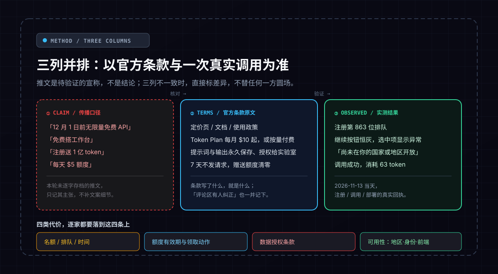
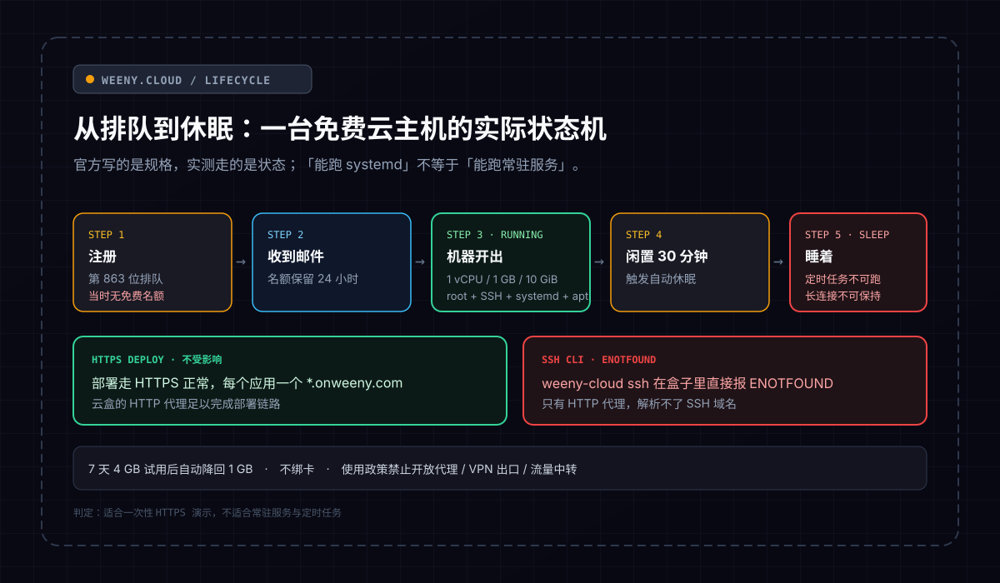
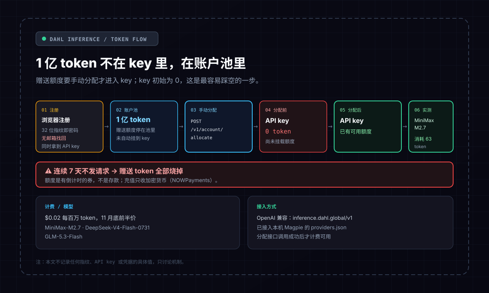
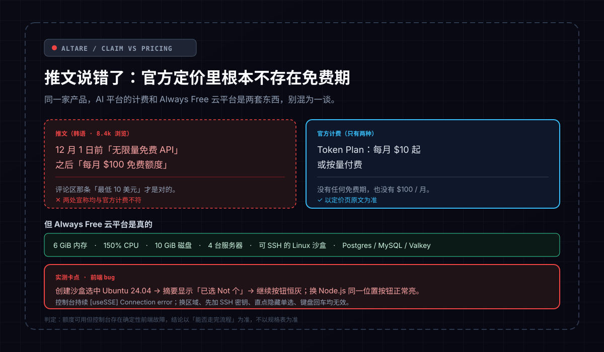
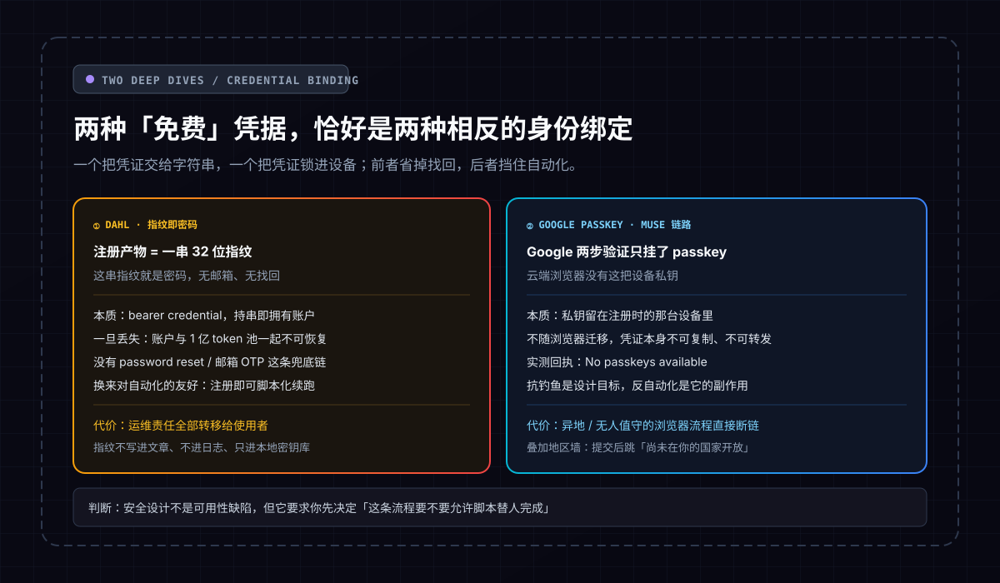
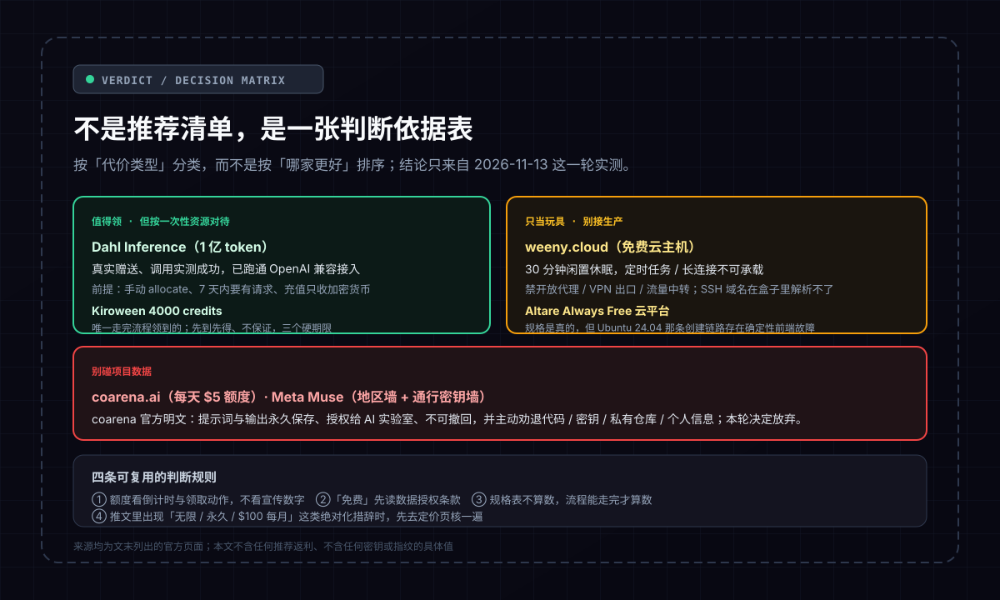

> **核心导读**：一条写着「12 月 1 日前无限量免费 API」的韩语推文，8.4k 浏览，评论区有人淡淡补了一句「最低 10 美元」。2026-11-13 这一天，我按推文把同类「免费」资源挨个领了一遍：免费云主机、注册送 1 亿 token 的推理服务、号称无限免费的 AI 平台、每天 \$5 额度的模型聚合、Meta 的免费工作台、黑客松 4000 积分。结果不是「薅到了」，而是三件事反复出现——**名额要排队、条款里明码写着代价、功能是坏的**。本文不复述任何一家的宣传口径，只做一件事：把**推文宣称、官方条款原文、当天实测回执**三列并排，差异处直接标出来，再给一套可复用的判断依据。所有数字来自这一轮实测，不补、不推、不圆场；文中不记录任何密钥、指纹或凭据的具体值。

---

## 一、先把方法钉死：三列并排，不替任何人圆场

这一轮的素材有三层，权重依次递增：

1. **X 上的一手推文**——包括那条 8.4k 浏览的韩语推文，以及它评论区里那句把官方价格说对的纠正。推文只当线索，不当结论。
2. **各家官方定价页与文档**——条款写了什么就是什么，包括写得很难看的那些。
3. **2026-11-13 当天的实测回执**——在云端沙盒里逐家注册、调用、部署，记录排队位次、按钮状态、报错文本、token 消耗。

三者不一致时，以官方原文和实测回执为准，宣传口径单独摆出来，不替它圆场。有一处需要提前讲清楚：**部分平台本轮没有逐字存档推文文案**，只记录了它对外主张的那件事（「免费云主机」「送 1 亿 token」这类），因此下表「推文宣称」一列只写主张、不补文案细节。这不是偷懒，是避免把推测写成引用。

把三列铺开之后，会发现「免费」的成本几乎不落在价格上，而是落在四类代价里：**名额 / 排队 / 时间**、**额度有效期与领取动作**、**数据授权条款**、**可用性（地区、身份、前端是否真能点下去）**。后面每一家都会被这四条各量一遍。

---

## 二、六家逐条对照：推文宣称 / 官方原文 / 实测结果

这是全文骨架，先整张摆出来。

| 平台 | 推文宣称 | 官方条款原文 | 当天实测回执 |
|:---|:---|:---|:---|
| **weeny.cloud** | 免费云主机 | 1 vCPU / 1 GB / 10 GiB 磁盘，root + SSH + systemd + apt，每应用一个 `*.onweeny.com`；7 天 4 GB 试用后自动降回 1 GB；不绑卡；**闲置 30 分钟休眠**；使用政策禁止开放代理、VPN 出口、流量中转 | 注册排在第 **863 位**、当时没有免费名额；后来收到「保留 24 小时」邮件，机器开出来了（running）；云盒里 `weeny-cloud ssh` 直接报 `ENOTFOUND`，HTTPS 部署不受影响 |
| **Dahl Inference** | 注册送 1 亿 token | 赠送额度在**账户池**里，需手动分配到 key；\$0.02 / 百万 token，11 月底前半价；**7 天不发请求，赠送 token 全部烧掉**；充值只收加密货币（NOWPayments） | 拿到 32 位指纹（即密码，无邮箱找回）与 API key；key 初始 **0 token**，调 `POST /v1/account/allocate` 分配后，实测调用 MiniMax M2.7 成功，消耗 **63 token** |
| **Altare** | 韩语推文（8.4k 浏览）：12 月 1 日前无限量免费 API，之后每月 \$100 免费额度 | AI 平台只有两种计费：**Token Plan 每月 \$10 起**，或按量付费；**没有任何免费期，也没有 \$100/月**。Always Free 云平台：6 GiB 内存、150% CPU、10 GiB 磁盘、4 台服务器、可 SSH 的 Linux 沙盒、Postgres / MySQL / Valkey | 推文与定价页直接冲突，评论区「最低 10 美元」才是对的；选中 Ubuntu 24.04 后摘要显示「已选 Not 个」、继续按钮恒灰，换 Node.js 同一位置正常亮；控制台持续 `[useSSE] Connection error`，多种绕法全无效，判定前端 bug |
| **coarena.ai** | 免费 AI 模型额度 | 每天 \$5 模型额度、30 请求 / 分钟、并发 2、22 个模型、不绑卡；**提示词与输出永久保存、授权给 AI 实验室、不可撤回**；官方自己写「只用一次性或公开的提示词，别放代码、密钥、私有仓库、个人信息」 | 条款属实，权衡后放弃 |
| **Meta Muse** | 免费搭工作台 | 只对**美国、加拿大**开放 | 账户建好了，提交后跳到「Muse 尚未在你的国家或地区开放」，加入等候名单；Google 两步验证只挂了通行密钥，云端浏览器里 `No passkeys available` |
| **Kiroween** | 免费领 4000 credits | 报名 + 填表 + Didit 身份验证（自拍 + 政府证件）；12 月 1 日截止申请、12 月 4 日兑换、12 月 31 日过期；官方注明「先到先得、不保证」 | 唯一走完流程真领到的 |

### 2.1 weeny.cloud：名额要排队，机器还会自己睡着

官方规格写得很实在：1 vCPU / 1 GB / 10 GiB，root、SSH、systemd、apt 一应俱全，不绑卡。但「免费」这两个字在实测里先变成了 **863** 这个排队位次——注册当时根本没有免费名额，直到收到「保留 24 小时」的邮件，机器才真正开出来。

开出来之后，规格表也不等于可用性。**闲置 30 分钟休眠**这一条，直接把「能跑 systemd」和「能跑常驻服务」拆成了两件事：定时任务、长连接、任何需要在没人访问时自己活着的东西，都不能放在这台机器上。使用政策又明确禁掉开放代理、VPN 出口、流量中转，等于把最常被拿来「白嫖云主机」的几种用法单独点名封了。

这里还有一个只在云端环境里才暴露出来的细节：Simular 云盒只有 HTTP 代理、解析不了 SSH 域名，所以 `weeny-cloud ssh` 在盒子里直接报 `ENOTFOUND`；而部署走 HTTPS，完全不受影响。同一台机器，两条链路的可用性取决于客户端的网络形态，不是机器本身的状态。这一点规格表里不会写，只有真去连才会撞上。

**判断**：适合一次性 HTTPS 演示，不适合常驻服务与定时任务。

### 2.2 Dahl Inference：真送 1 亿 token，但 token 不在 key 里

这是这一轮里少有的「官方说送、实测也确实拿到」的一家，但坑藏在领取动作上。

注册后拿到两样东西：一个 32 位指纹（**它就是密码，没有邮箱找回**）和一个 API key。翻文档才发现赠送的 1 亿 token 停在**账户池**里，key 初始是 **0 token**，必须显式调 `POST /v1/account/allocate` 把额度分配到 key，之后才能计费调用。分配完实测跑了一次 MiniMax M2.7，消耗 63 token，链路通了。

真正必须记住的是条款里那句：**7 天不发请求，赠送 token 全部烧掉**。这不是「额度慢慢过期」，是 inactivity 触发的一次性清零；叠加「充值只收加密货币（NOWPayments）」，意味着想把它当长期备用通道，还得先解决付款路径。计费侧 \$0.02 / 百万 token、11 月底前半价，模型列表是 MiniMaxAI/MiniMax-M2.7、deepseek-ai/DeepSeek-V4-Flash-0731、zai-org/GLM-5.3-Flash。因为走 OpenAI 兼容接口（base `https://inference.dahl.global/v1`），我把它接进了本机 Magpie 的 `providers.json`，接入成本几乎为零——但**接入便宜不等于持有便宜**。

> 关于那串指纹与 API key：本文只讨论机制，不记录任何具体值。凭据一律进本地密钥库，不进文章、不进日志、不进聊天。

### 2.3 Altare：推文说错了，官方定价里根本没有免费期

这是唯一一处**推文与官方原文正面冲突**的地方，也是整轮最值得写出来的一条。

那条韩语推文 8.4k 浏览，宣称「12 月 1 日前无限量免费 API，之后每月 \$100 免费额度」。翻开官方定价页，AI 平台的计费只有两种：Token Plan 每月 \$10 起，或按量付费——**没有免费期，也没有 \$100/月**。反倒是被埋在评论区的那句「最低 10 美元」和定价页对得上。宣传口径、评论区纠正、官方原文，三者同时摆在眼前时，该信谁不需要讨论。

但不要把「推文说错」推广成「整家都是假的」。它的 **Always Free 云平台是真的**：6 GiB 内存、150% CPU、10 GiB 磁盘、4 台服务器、可 SSH 的 Linux 沙盒、Postgres / MySQL / Valkey。问题出在能不能真的用起来：创建沙盒时选中 Ubuntu 24.04，摘要显示「已选 Not 个」，继续按钮恒灰；换 Node.js，同一位置按钮正常亮。控制台持续报 `[useSSE] Connection error`。分类筛选、搜索框、直点隐藏单选、键盘回车、底层按键事件、换区域（比什凯克 / 法兰克福）、先加 SSH 密钥，全部试过，无效——这是确定性的前端 bug，不是偶发抖动。

同一家产品，「AI 平台计费」和「云平台规格」是两套东西，推文把它们搅在一起，实测又把「规格表」和「流程能走完」拆开。三层信息不叠起来看，很容易得出完全相反的结论。

### 2.4 coarena.ai：\$5 一天是真的，代价写在条款里也是真的

每天 \$5 模型额度、30 请求 / 分钟、并发 2、22 个模型、不绑卡——这些数字本身没什么可挑的。要挑的是紧挨着的另一段条款：**提示词与输出永久保存、授权给 AI 实验室、不可撤回**。

官方甚至自己把结论写出来了：只用一次性或公开的提示词，别放代码、密钥、私有仓库、个人信息。换句话说，价格是 \$5/天，结算货币却是数据权利，而且这笔交易**不可撤回**。当厂商主动劝退你别把私有仓库放进来时，最合理的动作是听它的。这一轮最终决定放弃，不是因为额度小，是因为把私有代码送进一条不可撤回的授权链，收益和代价不在一个量级上。

### 2.5 Meta Muse：地区墙，和一道没预料到的墙

推文说「免费搭工作台」，官方实际只对美国、加拿大开放。实测里账户顺利建好，提交后跳到「Muse 尚未在你的国家或地区开放」，然后进入等候名单——地区墙是明写的，撞上不算意外。

意外在认证链路：Google 两步验证只挂了通行密钥，云端浏览器里没有这把私钥，回执是 `No passkeys available`。这一步不是密码错了，也不是网络问题，是凭证根本不在这台设备上。第三节会单独拆这个机制。

### 2.6 Kiroween 4000 积分：唯一走完流程领到的，代价是证件

Kiroween 黑客松的 4000 credits 是这一轮唯一真领到手的东西，但流程并不轻：报名、填表、Didit 身份验证（自拍 + 政府证件）。期限是硬的三道——12 月 1 日截止申请、12 月 4 日兑换、12 月 31 日过期，官方还注明「先到先得、不保证」。

把「免费」换算一下：这里付出的是**身份材料**和**三个必须记住的日期**，换来一份可能因为发完而拿不到的额度。它值得领，但只能按「一次性、有到期日、可能落空」来对待，不能进任何长期计划。

---

## 三、两个技术点：凭证绑在哪里，决定了「免费」能不能被自动化

这一轮最有价值的不是哪家便宜，而是两种几乎相反的身份绑定设计，恰好在同一天里都撞上了。它们都不该被叫成 bug，但都会直接改写你的工作流。

### 3.1 指纹即密码：省掉邮箱，也省掉了找回

Dahl 的注册产物是一个 32 位指纹，**它就是密码**，没有邮箱、没有找回入口，同时下发 API key。这在凭证模型上是 bearer credential 的极端形态：持有即拥有，账户身份与一个字符串完全等价，既没有第二因子，也没有「证明你是你」的申诉通道。

常规服务把「账户」和「密钥」分两层：密钥丢了可以登录控制台轮换，因为上面还有一个用邮箱验证过的账户。这里把两层压成了一层——指纹既是账户又是密钥，于是「重置」这个操作失去了主语。丢掉指纹，丢的不只是那 1 亿 token 的数字，而是整个账户池的取回路径；偏偏额度还停在池里、需要主动 allocate，等于**取回通道和资产绑在同一根绳上**。

换来的东西也得讲清楚：注册链路没有邮箱验证、没有 OTP，脚本可以一口气完成「注册 → 拿凭据 → allocate → 调用」，对无人值守的自动化异常友好。无摩擦和无找回，是同一处设计的两面，不是两个可以分别挑选的特性。

工程上的结论很直接：这类服务只能按**可丢弃凭据**对待——凭据进本地密钥库，不进文章、不进日志、不进聊天；并且要在 7 天活跃窗口里真的发出请求，否则额度清零时，连「账户是否还在」都无从验证。

### 3.2 通行密钥：抗钓鱼是设计目标，反自动化是副作用

Muse 那一步的回执 `No passkeys available`，值得单独看。Google 两步验证只挂了通行密钥，私钥在注册设备本地生成、不出设备，签名在本地完成，服务端只存公钥；断言绑定来源站点，钓鱼页拿不到可用签名。关键在于：**私钥不随浏览器配置、cookie 或 profile 迁移**。所以「把账号搬进云端浏览器」这个动作，对密码可行（字符串能搬运），对 passkey 天然不可行。

于是反自动化不是产品没顾上的可用性缺陷，而是抗钓鱼模型的外溢效果——两者同源，都来自「凭证不可搬走」。这也是它比密码安全的地方，同时是它把云端巡检、批量注册、定时抓取这类流程直接挡在门外的原因。

判断上要分清两件事：**这是安全设计，不是 bug**，所以别去找 headless 参数绕过；但如果一条工作流确实需要脚本替人完成登录，就不能把 passkey-only 账号放进这条链路，要么保留一个可搬运的凭证作为自动化入口并接受它的风险，要么把人放回环路。这是架构选择，不是配置技巧。

叠加 Muse 的地区墙，两道门彼此独立：过了认证未必过地区，过了地区未必过认证。**「能不能用」要按最靠里的那道门算**——这也是为什么规格表和推文都不能当结论。

---

## 四、收尾：一张判断依据表，不是推荐清单

把六家跑完，能复用的不是「哪家值得注册」，而是四条判断规则：

1. **额度看倒计时与领取动作，不看宣传数字。** 1 亿 token 要手动 allocate 才进 key，7 天不发请求清零；4000 credits 有三个硬日期且先到先得不保证。免费额度是有倒计时的券，不是存款。
2. **「免费」先读数据授权条款。** coarena 的 \$5/天对应的是永久保存、授权给实验室、不可撤回，官方自己劝退代码 / 密钥 / 私有仓库 / 个人信息。价格和数据权利必须一起读。
3. **规格表不算数，流程能走完才算数。** weeny 的 30 分钟休眠、Altare 那个恒灰的继续按钮、Muse 的地区提示，都写在「硬件 / 系统都给你了」之后。
4. **出现「无限 / 永久 / 每月 \$100」这类绝对化措辞，先去定价页核一遍。** Altare 是本轮的现成样本：8.4k 浏览的推文，被一条评论区纠正和一张定价页同时否掉。

按代价类型归档，而不是按「哪家更慷慨」排序：

| 判断档 | 对象 | 依据（全部来自本轮实测或官方条款） |
|:---|:---|:---|
| **值得领，按一次性资源对待** | Dahl Inference、Kiroween 4000 credits | 前者真送且实测调用跑通，但要手动 allocate、7 天内得有请求、充值只收加密货币；后者唯一走完流程，代价是自拍 + 政府证件与三个硬期限，且「先到先得、不保证」 |
| **只当玩具，不接生产** | weeny.cloud、Altare Always Free 云平台 | 前者 30 分钟闲置休眠、禁代理 / VPN / 中转，承载不了常驻服务，名额还要排到 863 位；后者规格属实但 Ubuntu 24.04 创建链路存在确定性前端故障 |
| **别碰项目数据** | coarena.ai、Meta Muse | 前者条款明写提示词与输出永久保存、授权给 AI 实验室、不可撤回，并主动劝退私有仓库与个人信息，本轮决定放弃；后者地区墙只对美加开放，且 passkey-only 认证让云端无人值守流程断链 |

结论只有一句：**「免费」不是一个价格标签，是一组约束条件**。名额、有效期、数据授权、地区与身份、前端是否真能点下去——这五项里任何一项不过，价格那一列的零就没有意义。把推文里的「无限」当成待验证的宣称，逐条落到官方原文和一次真实调用上，比收藏十份「免费资源合集」有用得多。

---

## 五、来源

以下为本轮逐条核对的官方页面（推文仅作线索，未在文中补写未存档的文案细节）：

- [weeny.cloud/free](https://weeny.cloud/free) — 免费套餐规格、7 天 4 GB 试用、闲置休眠与使用政策
- [inference.dahl.global/docs/tokens](https://inference.dahl.global/docs/tokens) — 赠送 token 的账户池 / allocate 机制、计费与失效条款
- [altare.gg/zh/pricing](https://altare.gg/zh/pricing) — AI 平台两种计费（Token Plan \$10 起 / 按量付费）
- [altare.gg/zh/products/inference](https://altare.gg/zh/products/inference) — AI 推理平台产品页
- [coarena.ai/docs](https://coarena.ai/docs) — 每日额度、限流、并发与数据授权条款
- [ai.meta.com/muse/](https://ai.meta.com/muse/) — Muse 可用地区说明
- [kiroween.devpost.com/resources](https://kiroween.devpost.com/resources) — 4000 credits 领取条件与三个硬期限

> 文中所有数字、状态与报错文本均来自 2026-11-13 当天的注册、调用、部署实测回执及上述官方页面；未对未实测项目做推断补足，不含任何密钥、指纹或凭据的具体值。
