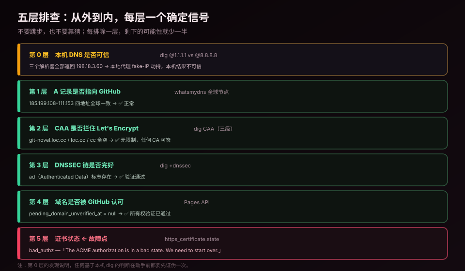
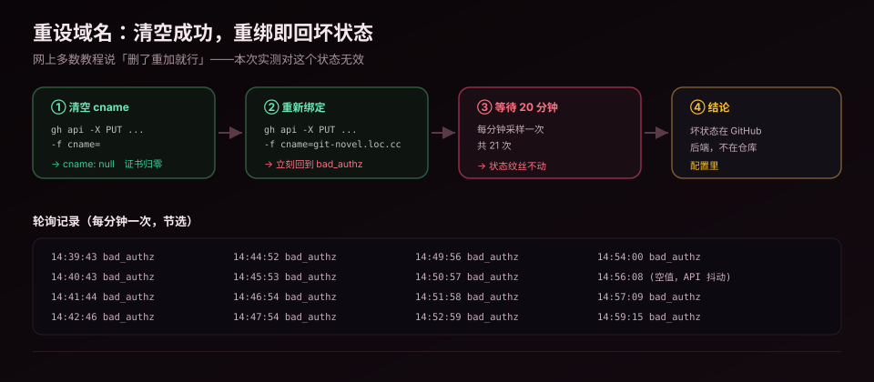
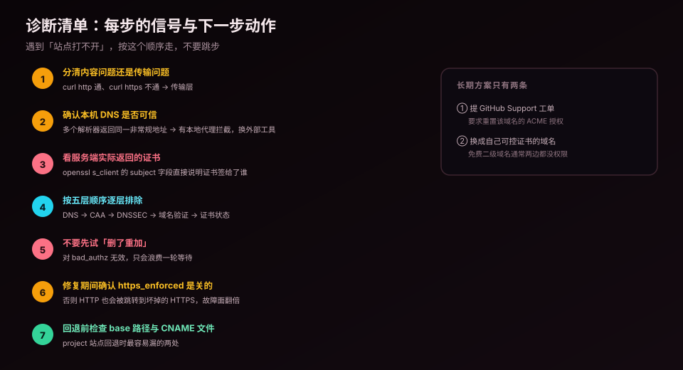

> **核心导读**：站点挂在一个免费 `.loc.cc` 二级域名上，部署流水线一直是绿的、HTTP 一直能打开，但 `https://` 从头到尾没成功过。浏览器报的不是「证书过期」，而是「证书上的名字和域名不匹配」——服务端返回的竟然是 `*.github.io` 的通配证书。
>
> 这篇是一次完整的故障排查记录：从最初的「三个地址全部 000」到最终定位 `bad_authz`，逐层排除了 DNS、CAA、DNSSEC、域名验证、部署流水线五个因素，确认只有证书签发这一环坏了；然后尝试重设自定义域名，20 分钟内状态纹丝不动；最后回退到 GitHub 原生地址。
>
> 这篇不提供「一键修复」——因为确实没有。它提供的是：**一个可以照着复现的诊断顺序**，以及一条结论：免费域名的真实成本，往往不在领它的那天，而在它坏掉、并且你发现没有权限修的那天。

---

## 一、现象：HTTP 活着，HTTPS 死了

起因很普通：刚推完一篇文章，顺手检查线上是否生效。

第一次查询就全军覆没：

```
000  https://git-novel.loc.cc/
000  https://git-novel.loc.cc/notes/eval-frameworks-16-way-comparison/
000  https://git-novel.loc.cc/notes/always-on-agents-anthropic-five-primitives/
```

`000` 是 curl 的「连接没建立起来」。这时候最容易被误导的方向是「站点挂了」，但很快就能排除：

```
curl http://git-novel.loc.cc/notes/eval-frameworks-16-way-comparison/  → 200
正文关键词匹配 → 命中
```

HTTP 完全正常，文章在线。所以问题不在内容、不在部署，在**传输层**。

继续看具体的失败原因：

```
curl -sS https://git-novel.loc.cc/
→ SSL: no alternative certificate subject name matches target host name

openssl s_client -connect git-novel.loc.cc:443 -servername git-novel.loc.cc
→ subject=CN=*.github.io
  issuer=Let's Encrypt
  Verification: OK
```

注意这里两个细节，它们决定了后面的整个排查方向：

1. 证书本身是**有效的**（`Verification: OK`，Let's Encrypt 签发，链完整）
2. 但它签给的是 `*.github.io`，不是 `git-novel.loc.cc`

也就是说：连接到了正确的服务器，服务器给了一张真证书，只是这张证书**不覆盖你的域名**。

---

## 二、正确的排查顺序：从外到内，逐层排除

这次故障的价值在于，它把「站点打不开」拆成了五个可独立验证的层。顺序很重要——**从最外层开始，每排除一层，剩下的可能性就少一半**，而且每层都能用一条命令给出确定答案。



### 第 0 层：先排除本机网络

这一步差点让我误判。最初 `dig` 返回的全是同一个地址：

```
dig +short git-novel.loc.cc        → 198.18.3.60
dig +short @1.1.1.1 git-novel.loc.cc → 198.18.3.60
dig +short @8.8.8.8 git-novel.loc.cc → 198.18.3.60
```

三个不同的解析器返回同一个地址，这本身就不正常。`198.18.0.0/15` 是保留网段，常见于本地代理工具的 **fake-IP** 模式：所有域名都被解析成一个假地址，流量再由代理转发。

结论：**本机 DNS 结果不可信**。任何基于本机 `dig` 的判断都是错的。这一步的教训很直接——在信任任何 DNS 结论之前，先确认自己拿到的是不是真解析结果。

### 第 1 层：DNS 是否指对了

绕过本机解析，用 whatsmydns 查全球节点：

```
185.199.108.153
185.199.109.153
185.199.110.153
185.199.111.153
```

四个地址，全球一致，正是 GitHub Pages 的官方 IP 段。**DNS 没问题。**

另外一个佐证：如果 DNS 指错了，浏览器根本连不到 GitHub 的服务器，也就不可能拿到 `*.github.io` 那张证书。能拿到，说明连接确实落在 GitHub Pages 上。

### 第 2 层：CAA 是否拦住 Let's Encrypt

CAA 记录用于声明「哪些 CA 可以为这个域名签发证书」。如果父域设置了 CAA 但没包含 Let's Encrypt，签发必然失败。

逐级查（CAA 沿域名树向上继承）：

```
git-novel.loc.cc  → <empty>
loc.cc            → <empty>
cc                → <empty>
```

三级全空。空意味着**没有限制**，任何 CA 都可以签。**CAA 不是原因。**

### 第 3 层：DNSSEC 是否影响验证

`loc.cc` 配了 DNSSEC：

```
DS loc.cc → 57657 13 4 27D0...  （两条 DS 记录）
```

DNSSEC 本身不会阻止签发，但如果链断了，某些验证器会直接判定解析失败。检查结果：

```
dig git-novel.loc.cc A +dnssec
→ status: NOERROR
→ flags: qr aa rd ra ad     ← ad = Authenticated Data
```

`ad` 标志存在，表示 DNSSEC 验证通过。**DNSSEC 不是原因。**

### 第 4 层：域名是否被 GitHub 认可

GitHub Pages 的自定义域名需要先完成所有权验证（通常靠一条 `_github-pages-challenge-*` 的 TXT 记录）。查 API：

```
gh api repos/{owner}/{repo}/pages
→ "pending_domain_unverified_at": null
```

为 `null`，说明**验证已通过**。如果这里是个时间戳，问题就简单了——补 TXT 记录即可。

### 第 5 层：证书本身的状态

到这一步，外部的五个因素已经全部排除。问题只能出在 GitHub 的证书签发流程里：

```json
{
  "cname": "git-novel.loc.cc",
  "https_enforced": false,
  "https_certificate": {
    "state": "bad_authz",
    "description": "The ACME authorization is in a bad state. We need to start over.",
    "domains": ["git-novel.loc.cc"]
  }
}
```

`bad_authz` = ACME 授权处于坏状态。GitHub 自己在描述里写了「需要重来」，但它并没有重来。

---

## 三、五层排查的结果表

把上面的过程压成一张表，这就是这套顺序的价值——每一层都有一个确定信号，不靠猜：

| 层 | 检查项 | 命令 / 来源 | 本次结果 | 判定 |
|---|---|---|---|---|
| 0 | 本机 DNS 是否可信 | `dig @1.1.1.1` 对比 `@8.8.8.8` | 全部返回 `198.18.3.60` | ⚠️ 本机被 fake-IP 劫持，结果不可用 |
| 1 | A 记录是否指向 GitHub | whatsmydns 全球节点 | 4 个 Pages IP 一致 | ✅ 正常 |
| 2 | CAA 是否放行 | `dig CAA`（三级） | 全空 | ✅ 无限制 |
| 3 | DNSSEC 链是否完好 | `dig +dnssec` | `ad` 标志存在 | ✅ 正常 |
| 4 | 域名所有权验证 | Pages API `pending_domain_unverified_at` | `null` | ✅ 已通过 |
| 5 | 证书状态 | Pages API `https_certificate` | `bad_authz` | ❌ **故障点** |

还有一个横向证据：部署流水线本身是好的。

```
gh run list
→ completed  success  Deploy to GitHub Pages  main  push  1m18s
```

所以「部署成功 + HTTP 200 + 证书错误」三者并存，指向的结论只有一个：**内容没问题，传输层证书没签下来。**

---

## 四、尝试修复：重设自定义域名

`bad_authz` 的官方描述是「需要重来」，那么最直接的动作就是让 GitHub 重新走一遍 ACME 流程。标准做法是移除再重新添加自定义域名：

```bash
# 1. 清空自定义域名
gh api -X PUT repos/{owner}/{repo}/pages \
  -f cname= -f build_type=workflow

# 2. 确认已清空
gh api repos/{owner}/{repo}/pages --jq '.cname'
→ null

# 3. 重新绑定
gh api -X PUT repos/{owner}/{repo}/pages \
  -f cname=git-novel.loc.cc -f build_type=workflow
```

清空这一步是成功的：`cname` 变成 `null`，证书状态也归零。然后重新绑定——**状态立刻又回到了 `bad_authz`**。

这意味着坏状态不在仓库配置里，而在 GitHub 后端。清空配置只是抹掉了「域名」这个字段，ACME 授权的坏记录并没有被一起清掉。

接下来是等待。ACME 签发通常要几分钟到几小时，所以我挂了一个轮询，每分钟查一次：

```
14:39:43 bad_authz
14:40:43 bad_authz
...
14:59:15 bad_authz
```

20 分钟，21 次采样，状态一次都没变。中途有一次返回空值，属于 API 抖动，不是状态变化。

**结论：重设域名解决不了 `bad_authz`。** 这一条值得记住，因为网上大多数教程都会告诉你「删了重加就行」。



---

## 五、回退：换回 GitHub 原生地址

既然自定义域名这一侧修不动，就先让站点恢复可用。回退到 `github.io` 原生地址分几步，其中有一处很容易漏。

### 5.1 删除 CNAME 文件

仅在后端清空自定义域名是不够的——仓库里的 `public/CNAME` 会在下一次部署时把域名重新写回去。实测确认了这一点：

```
curl -I https://tzb-loong.github.io/git-novel/
→ HTTP/2 301
→ location: http://git-novel.loc.cc/
```

原生地址被 301 到了那个 HTTPS 坏掉的域名。也就是说，**CNAME 文件让 github.io 地址变成了一个死胡同**。必须删掉它。

### 5.2 改 base 路径

GitHub Pages 的 project 站点（`<user>.github.io/<repo>/`）和自定义域名的根站点，URL 结构不一样：

| 场景 | 访问地址 | Astro `base` |
|---|---|---|
| 自定义域名 | `https://git-novel.loc.cc/` | `/` |
| 原生地址 | `https://tzb-loong.github.io/git-novel/` | `/git-novel` |

所以改回原生地址时，`base` 必须从 `/` 改成 `/git-novel`，否则所有绝对路径都会 404。

这一点在本次回退里没有造成麻烦，因为检查后发现**站内所有内部链接都走 `import.meta.env.BASE_URL`**：

```astro
const baseURL = import.meta.env.BASE_URL;
<a href={`${baseURL}notes/`}>…</a>
```

改完构建后验证产物：

```
href="/git-novel/"
href="/git-novel/_astro/index.we9wkcmA.css"
href="/git-novel/notes/"
<link rel="canonical" href="https://tzb-loong.github.io/git-novel/">
```

全部正确。**如果当初把路径写成硬编码，这次回退就要逐个文件改，而且必然漏掉几处。** 这是本次故障里唯一一个「事前做对了、事后省了事」的设计。

### 5.3 先关 HTTPS 强制，再动域名

有一个顺序问题值得单独说：`https_enforced` 在故障期间必须保持关闭。如果它在开启状态，HTTP 会被强制 301 到 HTTPS，而 HTTPS 是坏的——结果是**整个站点从「只能 HTTP 访问」变成「完全打不开」**。

本次故障里 `https_enforced` 本来就是 `false`，所以 HTTP 一直可用。如果它当初是 `true`，故障的影响面会大得多。

---

## 六、为什么免费域名更容易出这类问题

这次故障的域名来自一个免费二级域名服务。把它和这次的现象放在一起看，有几条因果关系值得记下来：

1. **你控制不了证书。** 域名的 DNS 归服务商管，证书归 GitHub 签，中间出问题时你两边都没有修复权限。付费域名至少能在 CA 层面提工单、换验证方式、加 CAA。
2. **免费域名常被集中使用。** 同一个服务商下的大量域名由同一批 NS 托管，任何一个环节的异常都会波及整批域名。付费域名通常有独立的托管配置。
3. **支持渠道缺失。** `bad_authz` 这种后端状态，唯一的解法是 GitHub Support 重置。免费域名用户往往也不是付费用户，响应优先级更低。
4. **退出成本被低估。** 这次回退花了不到 20 分钟，但那是因为 base 路径当初就写对了。如果站点规模更大、外链更多，迁移成本会成倍上升。

站内之前有一篇写这个免费域名领取过程的文章，当时的结论是「零成本，但不是你的资产」。这次故障是那条结论的续集：**资产属性缺失的代价，会在它坏掉的那天一次性结清。**

---

## 七、下次遇到同类问题，按这个顺序做



1. **先分清是内容问题还是传输问题。** `curl http://` 能通、`curl https://` 不通，就是传输层。
2. **确认本机 DNS 是否可信。** 多个解析器返回同一个非常规地址（如 `198.18.x.x`），说明有本地代理在拦截，换外部工具查。
3. **看服务端实际返回的证书。** `openssl s_client` 的 `subject` 字段直接告诉你证书签给了谁——如果是不相干的通配域名，就不是「证书过期」，而是「证书没签下来」。
4. **按 DNS → CAA → DNSSEC → 域名验证 → 证书状态 的顺序逐层排除。** 每一层都有确定信号，不要跳步。
5. **不要先试「删了重加」。** 本次验证过，对 `bad_authz` 无效，白白浪费一轮等待。
6. **修复期间确认 `https_enforced` 是关的。** 否则 HTTP 也会被跳走，故障面翻倍。
7. **回退前检查 base 路径和 CNAME 文件。** 这两个是 project 站点回退时最容易漏的两处。
8. **长期方案只有两个：** 提 GitHub Support 工单重置 ACME 授权，或者换一个你自己能控制证书的域名。

---

## 八、这次没做到的部分

诚实记录几条：

1. **没有确认 `bad_authz` 的根因。** 我只证明了「不是 DNS、不是 CAA、不是 DNSSEC、不是域名验证」，没有证明「是 GitHub 后端损坏」。这两个结论强度不同。真正的根因可能藏在 GitHub 的 ACME 日志里，外部看不到。
2. **没有提工单。** 这是唯一可能真正修复的路径，但需要账号侧操作，我没有代做。
3. **没有测试「换一个域名是否正常」。** 如果能用一个全新的自定义域名在同一仓库上跑通，就能确认问题出在 `loc.cc` 这个域名本身，而不是仓库配置。这一步能进一步收窄范围，但需要额外领一个域名。
4. **DNSSEC 那条结论要打个折扣。** 因为本机 DNS 被 fake-IP 劫持，`dig +dnssec` 的 `ad` 标志来自本地解析器，严格说不能完全代表权威链状态。

这几条留着，下次遇到同类问题可以继续收窄。

---

## 参考资料

- GitHub Docs, *Managing a custom domain for your GitHub Pages site*：<https://docs.github.com/en/pages/configuring-a-custom-domain-for-your-github-pages-site>
- GitHub Docs, *Troubleshooting custom domains and GitHub Pages*：<https://docs.github.com/en/pages/configuring-a-custom-domain-for-your-github-pages-site/troubleshooting-custom-domains-and-github-pages>
- GitHub REST API, *Pages*：<https://docs.github.com/en/rest/pages/pages>
- Let's Encrypt, *CAA*：<https://letsencrypt.org/docs/caa/>
- Astro Docs, *Configuration Reference — base*：<https://docs.astro.build/en/reference/configuration-reference/#base>

**本文一手记录**

- 排查时间：2026-11-23 至 2026-11-24
- 五层排查与 20 分钟轮询均在本机实跑，命令与输出为真实结果
- 回退后的构建产物链接与 canonical 已逐项核对
