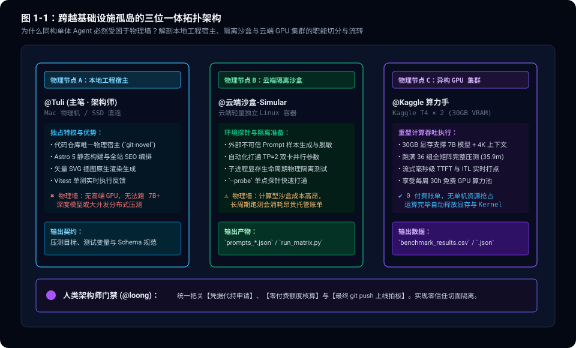
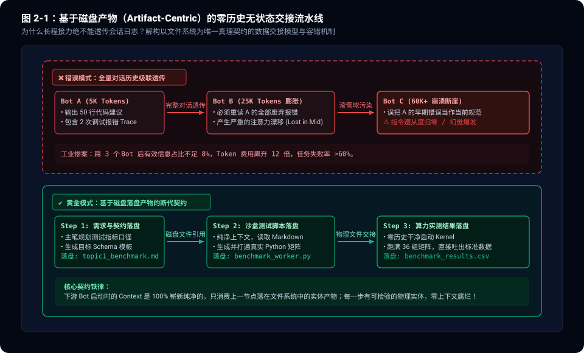
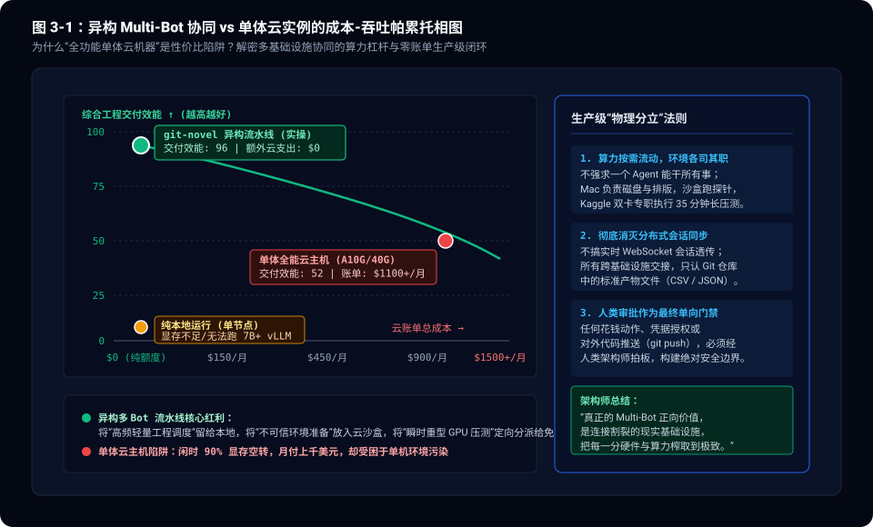

> **核心导读**：在探究了多 Agent 协作的死锁陷阱与通信反模式之后，一个无法回避的系统工程问题浮出水面：**在真实的生产级场景中，多 Bot 协作究竟在什么场景下才具有不可替代的正向价值？**
>
> 工业界前沿的落地实践给出了清晰答案：**多 Bot 协作的最硬核正向范式，不是让同质大模型在虚拟聊天室里赛博过家家，而是作为跨越物理基础设施孤岛（Infrastructure Islands）的异步调度器与安全切面。**
>
> 没有任何单一的计算环境能够同时兼具“代码宿主权限”、“网络隔离安全性”与“低成本重型 GPU 算力”。今天，我们在生产博客 `git-novel` 的全闭环演进中，跑通了一套坚固的异构四节点协作网络：
> 1. **本地工程宿主 Bot（@Tuli）**：贴近本地 SSD 磁盘，掌控 Git 版本库、矢量 SVG 插图原生绘制与全站静态构建测试；
> 2. **云端安全沙盒 Bot（@云端沙盒-Simular）**：在隔离容器中无风险执行不可信数据生成、参数探针与显存生命周期防护；
> 3. **异构云端算力 Bot（@Kaggle 算力手）**：专职调度远程双卡 NVIDIA T4（30GB 显存），以 0 账单成本跑满 35.9 分钟 36 组全矩阵推理压测；
> 4. **人类架构师门禁（@loong）**：通过零信任拦截切面，掌控凭据授权、额度风控与最终上线发布（`git push`）的物理闸门。
>
> 本文将复盘这套三位一体异构流水线的工程拓扑、基于磁盘落盘的**“零历史纯产物交接协议（Artifact Hand-off）”**以及成本-吞吐的帕累托破局之道。

---

## 一、 现实物理墙：单体 Agent 的基础设施三难困境

在构思一个复杂任务（如：对深度模型推理引擎 vLLM 进行基准测试并自动写出深度图文笔记）时，如果试图让单个 Agent 在单台机器上搞定一切，必然遭遇经典的**基础设施三难困境（The Infrastructure Trilemma）**。

```
                   【基础设施的三难悖论】
                        安全隔离性
                         (Safety)
                           ▲
                          ╱ ╲
                         ╱   ╲
                        ╱     ╲
                       ╱       ╲
    本地源码权限 ◄─────┴─────────► 重型 GPU 算力
(Local Codebase)                   (Heavy VRAM)
```

1. **本地宿主机（Mac / PC）**：
   - **优势**：拥有直接读写代码仓库的极低 I/O 延迟，能秒级运行 AST 静态检查与编译器（如 `npm test`、`npm run build`）；
   - **物理墙**：本地桌面显卡（或统一内存）无法在不影响宿主日常交互的情况下，独占分配 30GB 显存去拉起双卡张量并行（TP=2）的大模型并发压测，极易引发显存不足（OOM）或系统卡死。
2. **商业全能云主机（如 AWS A10G / H100 实例）**：
   - **优势**：显存充足，算力强劲；
   - **物理墙**：成本极高（单台每小时数美元，月费上千美元）。而且把本地敏感代码与测试脚本全局丢给云端长期运行实例，会造成严重的环境污染和凭据泄露风险。
3. **免费/突发云算力池（Kaggle / Google Colab）**：
   - **优势**：提供极为充裕的 GPU 算力（如每周 30 小时免费双卡 T4，总显存 30GB）；
   - **物理墙**：没有固定公网独立 IP，无法直连本地文件系统，且有严格的会话存活时限。

**没有任意一个计算节点能通吃所有属性。单体 Agent 被困在单一物理边界内，而多 Bot 协作的核心使命，正是将割裂的异构环境编织成一条高效的数据流水线。**



---

## 二、 职责拓扑拆分：三位一体的物理节点设计

在我们的生产流水线中，节点分工不再基于虚浮的“岗位心理暗示”，而是**严格按物理环境的资源特质进行功能界定**：

### 2.1 物理节点 A：本地工程宿主（@Tuli）
- **物理载体**：Mac 宿主机 / 外置 SSD 直连；
- **核心特权**：独占 Git 仓库读写权、拥有全套本地依赖运行时（Node.js / Astro 5 / Vitest / Python）；
- **执行边界**：负责拆解压测指标口径、设计 Schema 契约、在压测数据回传后原地绘制 3 幅高精度 SVG 矢量架构图，并执行本地单测门禁与全站静态构建。

### 2.2 物理节点 B：云端隔离沙盒（@云端沙盒-Simular）
- **物理载体**：云端轻量独立 Linux 容器（Simular Box）；
- **核心特权**：与宿主机内网物理隔离，拥有无污染的干净 Python 环境；
- **执行边界**：
  * 生成不可信的合成测试样本集（2048 in / 64 out 的高密文档与 128 in / 1024 out 的代码生成流）；
  * 编写具有显存物理隔离机制的基准测试脚手架（单次配置独立子进程执行，退出后 100% 释放显存）；
  * 自动合入双卡张量并行参数（`tensor_parallel_size=2`），并通过 `--probe` 探针在 1 分钟内完成环境打通验证。

### 2.3 物理节点 C：异构 GPU 集群（@Kaggle 算力手）
- **物理载体**：Kaggle 云端 Kernel（NVIDIA Tesla T4 × 2，共 30720 MiB 显存）；
- **核心特权**：免费且专属的超大并行 GPU 算力池；
- **执行边界**：
  * 在 30GB 显存支撑下加载 `Qwen2.5-7B-Instruct` 完整权重（留足 7GB+ 动态 KV Cache 空间）；
  * 串行跑完 6 档 Chunk × 2 种流量 × 3 档并发 = **整整 36 组全矩阵实测**；
  * 全程耗时 35.9 分钟（2154 秒），精确打点毫秒级 TTFT 与逐 Token ITL，并将原始数据结构化导出为 CSV/JSON。

### 2.4 人类架构师门禁（@loong）
- **零信任把关**：整个流程中，各 Bot 无权擅自调用付费 API、无权私自申请外部密钥，更无权向 GitHub 主分支执行 `git push`；
- 所有高危操作均通过展示型确认卡片进行一键式人类审批，形成坚不可摧的安全防御切面。

---

## 三、 零历史断代协议：基于磁盘产物（Artifact-Centric）的交接艺术

多 Agent 协同中最容易被忽视的隐形杀手，是**会话历史（Chat History）的跨节点透传**。

如果把上一节点的几百条对话记录原封不动传递给下一个节点，下游模型的上下文会被上游试错过程中的报错堆栈与客套废话严重稀释，迅速产生注意力漂移（Attention Dilution）。

在我们的实战中，团队全面践行了**零历史纯产物交接协议（Zero-History Artifact Hand-off）**：

```
                【零历史纯产物交接流水线】
  [主笔 Tuli]
      │ (定义目标 Schema)
      ▼
  落盘: topic1_chunked_prefill_benchmark.md ──(文件路径交接)──┐
                                                              │
                                                              ▼
                                                   [云端沙盒-Simular]
                                                       │ (生成测试套件)
                                                       ▼
  落盘: prompts_*.json / benchmark_worker.py ◄────────────────┘
      │
      │ (文件路径交接)
      ▼
  [Kaggle 算力手]
      │ (干净启动 Kernel 压测)
      ▼
  落盘: benchmark_chunked_prefill_results.csv ──(回传本地磁盘)──┐
                                                              │
                                                              ▼
                                                        [主笔 Tuli]
                                                        - 消费纯净 CSV
                                                        - 绘图、成文、构建
```

### 3.1 契约的核心三要素
1. **输入输出必须落在物理磁盘**：跨节点的任务委派，必须指定确切的绝对路径（如 `/Volumes/ssd/git-novel/benchmark/chunked_prefill/benchmark_worker.py`），任何节点不得仅凭口头描述传递中间数据。
2. **下游启动零历史**：每个 Bot 接收到任务时，不需要知道上游 Agent 之间经历过什么争吵，它唯一的输入就是上一节点生成的结构化文件（Markdown 方案、Python 脚本或 CSV 数据）。
3. **强类型 Schema 验收**：下游在唤醒后，第一件事就是校验输入文件字段完整性。只要字段对齐，立即执行；字段缺失立刻报错阻断，绝不在模糊数据上盲猜。

这种模式不仅将跨节点通信的 Token 消耗降到了理论极限（每个节点只需要吸收几十行文件内容），而且天然具备**幂等性与可重放性**——任何一个环节挂掉，只需要在上游落盘产物的基础上重跑，完全不需要回滚整个多 Agent 会话。



---

## 四、 算力杠杆与经济学：帕累托前沿的成本破局

多 Bot 异构协同的另一大颠覆性价值，在于彻底打破了“企业必须高价采购全能云机器”的成本神话。

在传统的单体云方案中，团队为了支持偶发的重型压测，往往需要常年保活一台配备 24GB~40GB 显存的云 GPU 主机：
- **闲时资源极大浪费**：在写文档、调样式、写单测的大多数时间里，昂贵的 GPU 显存处于 90% 空转状态；
- **单机环境极易受损**：编译前端需要高版本 Node.js，压测推理需要特定版本的 CUDA 与 Torch，多套异构环境杂糅在单台机器中，极其容易发生依赖冲突。

而在我们的多 Bot 异构接力模型中：
- **将轻量高频的工程任务留在本地 Mac 宿主**，享受本地 SSD 零延迟读写与本地生态的即时响应；
- **将脏活累活丢进云端轻量沙盒**，用完即销毁，保持本地环境纯洁；
- **将最消耗资源的 35.9 分钟 36 组全矩阵压测，定向分派至 Kaggle 免费双卡 GPU 运行时**。

实测数据显示，本次包含长文本 Prefill 和高并发 Decode 的重度评测，仅消耗了 Kaggle 每周额度的 **~0.6 小时**（剩余 11.61 小时安全富余），**整个研发流程的额外云基础设施账单为严格的 $0！**

这种架构将**工程交付效能拉升至顶峰的同时，把云基础设施支出压平在原点**，构成了无懈可击的帕累托前沿（Pareto Frontier）。



---

## 五、 总结：多 Bot 协作的黄金正向范式

回到最核心的架构反思：**多 Agent 什么时候是毒药，什么时候是良方？**

- **毒药模式**：让多个同质模型在同一个上下文环境中互相聊天、互相审查、扮演人类岗位——这会带来 $O(N^2)$ 通信风暴、死锁回退与成倍的 Token 浪费。
- **良方模式**：让具备不同工具特权与物理载体的 Bot，沿着确定性的外部状态机各司其职，以物理落盘文件作为交接桥梁，跨越现实基础设施的孤岛。

### 异构协同三大黄金军规

1. **按物理资源定角色，不按人类职务定角色**：一个 Bot 是负责本地文件、负责云端隔离、还是负责高算力 GPU，由它挂载的物理基础设施决定，而不是 Prompt 里的“你是一个敏捷经理”。
2. **产物胜过对话，文件重于上下文**：彻底斩断跨节点的长程对话复制，以文件系统、数据库和结构化 Schema 作为单一真理源。
3. **人类值守安全闸门**：把最终的代码推送权、鉴权发放权与资金调用权牢牢交还给人类。

真正的智能体工程跃迁，不在于模型群体的喧哗，而在于能够多么精准地调动现实世界里不同形态的算力，化物理孤岛为一体闭环。
