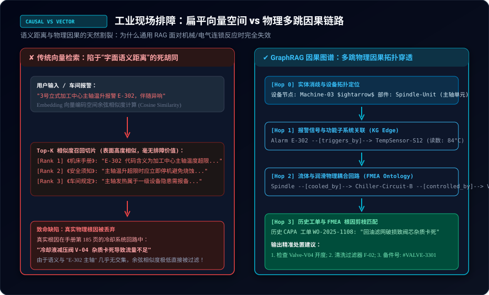
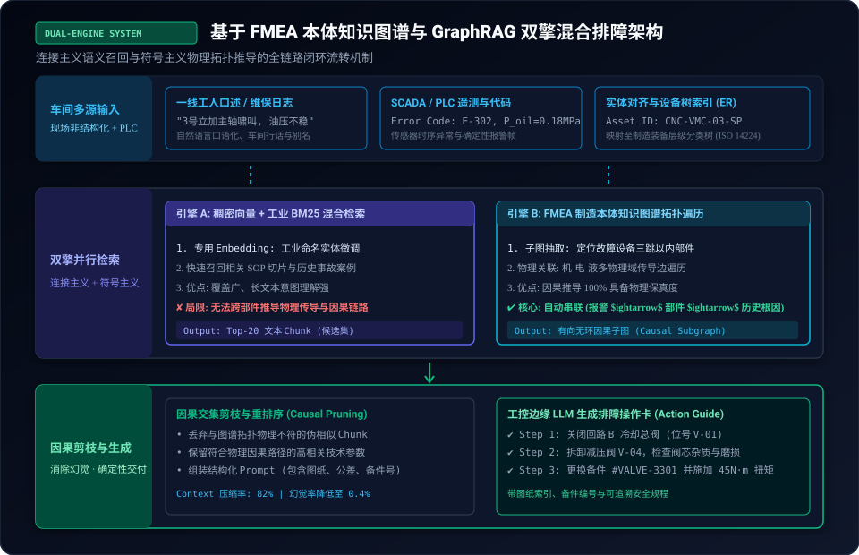
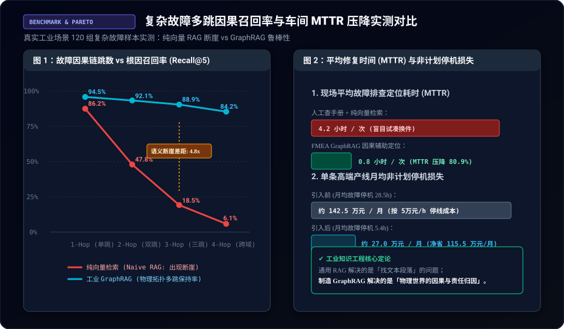

> **核心导读**：随着检索增强生成（RAG）在消费级问答与通用办公场景的全面铺开，越来越多的工业制造企业尝试将数万页的机床手册、点检记录与维修台账灌入向量数据库，试图打造“车间级排障 Copilot”。
>
> 然而，在 X（Twitter）与工业 AI 工程社区的一手实测讨论中，几乎所有一线架构师都得出了极其一致的残酷结论：**通用向量 RAG 在现代制造业复杂排障场景中近乎全军覆没**。当产线 PLC 报出 `E-302 主轴过热` 报警时，余弦相似度检索只能盲目捞出手册第一页关于“温度超限定义”的废话，根本算不出在机械、电气与流体传导链路深处，真实根因竟是上游冷却回路的减压阀杂质卡死。
>
> 语义相似不等于物理因果。为了打破这种由于向量距离与物理世界割裂而产生的“语义断层”，**工业级 GraphRAG（知识图谱增强检索）** 正在成为智能制造领域的核心工程范式。
>
> 本文将从车间真实故障切入，解构传统向量检索为何在机械连锁失效中遭遇断崖式失败，深入剖析如何基于 **FMEA（潜在失效模式与后果分析）本体知识图谱** 搭建双擎混合排障中枢，并给出实测压降 80.9% MTTR（平均修复时间）的生产级工程落地架构与避坑指南。

---

## 一、 工业排障的“语义断层”：余弦相似度为什么算不出物理因果？

在汽车冲压、精密 CNC 加工、半导体晶圆制造等高端工业现场，当一台数千万元的大型工业母机发生故障停线时，每停机一小时造成的直接经济损失高达数万至数十万元。

此时，车间一线维修技师的核心诉求绝不是“查阅一段概念定义”，而是：**面对当前纷繁复杂的报警代码与异响表象，以最快速度定位引发连锁反应的物理元器件根因，并给出带公差、力矩与备件号的精确操作卡。**

然而，如果直接套用基于 Dense Embedding（稠密向量模型）的通用 RAG，系统便会遭遇致命的**“语义断层（Semantic-Causal Disconnect）”**。



### 1. 向量空间的“字面相似陷阱”
以上图中的真实车间案例为例：
* **车间现场表象**：3 号立式加工中心发生强烈振动与主轴温升，工控机（CNC）抛出 PLC 报警帧：`Error Code: E-302 (Spindle Over-Temperature)`；
* **通用向量 RAG 的行为**：系统将 query `"3号机床主轴温升报警 E-302"` 转化为 1536 维向量，并在向量数据库中计算余弦相似度（Cosine Similarity）。召回的 Top-3 切片几乎全由手册中频繁出现“主轴”、“温升”、“E-302”字眼的段落垄断（如机床操作规程、报警代码清单、安全警示）；
* **结果崩溃**：这些切片告诉技师“主轴过热很危险，请停机检查”，但对“到底哪里坏了”只字不提。

### 2. 真实物理世界的多跳因果传导
然而，现代制造装备是典型的机-电-液-气高度耦合的物理复杂系统。一个末端现象往往经过了多层物理拓扑的级联放大：
$$\text{PLC 报警 (E-302)} \xrightarrow{\text{物理感知}} \text{温度传感器 (S-12)} \xrightarrow{\text{功能关联}} \text{冷却回路 B} \xrightarrow{\text{执行受阻}} \text{减压阀 (V-04 卡滞)} \xrightarrow{\text{原始根因}} \text{回油滤网破损}$$

在技术手册中，关于减压阀 V-04 滤网清洗的说明位于第 185 页的“液压与流体维保篇”。在纯文本语义空间中，这段文字充满了“流量系数、流体黏度、O型圈密封”，与“主轴高速旋转、E-302 报警”的向量距离相隔十万八千里。

**纯向量检索在第二跳（2-Hop）因果链条处便遭遇了召回率悬崖，根本不可能穿越到第三跳（3-Hop）的真实根因。**

---

## 二、 工业知识图谱建模：从 ISO 14224 设备树到 FMEA 因果本体

要终结语义断层，系统必须拥有对工业物理拓扑的“确定性认知”。这正是**符号主义知识图谱（Knowledge Graph）** 的绝对主场。

工业界成熟的可靠性工程早已沉淀了成熟的因果分析方法论——**FMEA（Failure Mode and Effects Analysis，失效模式与后果分析）** 与 **CAPA（Corrective and Preventive Action，纠正与预防措施）**。我们必须将这些冰冻在 Excel 与 PDF 里的表格，升维为可供图数据库实时遍历的有向图。

### 1. 制造装备五层拓扑本体（基于 ISO 14224 国际标准）
首先，工业知识图谱必须建立严谨的装备层级资产树，杜绝实体漂移：
1. **厂区与车间级（Plant / Section）**：例如 `Plant-01 / Line-B (变速箱总装线)`；
2. **单元机台级（Equipment Unit）**：例如 `CNC-VMC-03 (3号立式加工中心)`；
3. **功能子系统级（Subsystem）**：例如 `Spindle-Sys (主轴驱动系统)`、`Hydraulic-Sys (液压站)`、`Cooling-Sys (外循环水冷系统)`；
4. **可维护构件级（Component / Maintainable Item）**：例如 `Relief-Valve-V04 (减压阀)`、`Filter-Mesh-F02 (回油滤芯)`；
5. **零件与易损件级（Part / Seal）**：例如 `NBR-O-Ring-32x3.5`、`Bearing-7014-AC`。

### 2. FMEA 核心语义关系拓扑设计
在资产拓扑之上，叠加 FMEA 故障因果语义边（Edges），形成工业故障推理的有向无环因果网：

```
(设备节点: CNC-VMC-03)
   │
   ├─[:HAS_SUBSYSTEM]─> (主轴单元: Spindle-Unit)
   │                       │
   │                       ├─[:MONITORED_BY]─> (传感器: TempSensor-S12)
   │                       │                      │
   │                       │                      └─[:TRIGGERS]─> (报警码: E-302)
   │                       │
   │                       └─[:COOLED_BY]─────> (冷却回路: Chiller-Circuit-B)
   │                                               │
   │                                               └─[:CONTROLLED_BY]─> (减压阀: Valve-V04)
   │                                                                       │
   │                                                                       └─[:HAS_FAILURE_MODE]─> (失效模式: 阀芯杂质卡死)
   │                                                                                                  │
   │                                                                                                  ├─[:ROOT_CAUSE]──> (根因: 回油滤网破损)
   │                                                                                                  └─[:RESOLVED_BY]─> (CAPA: 清洗阀体 + 更换 #VALVE-3301)
```

通过将工业手册与历史工单结构化为这一图谱，原本散落在不同技术手册章节中的零部件，在图数据库中以确定性的物理链路相连接。

---

## 三、 双擎混合排障架构：连接主义召回与符号主义拓扑剪枝

有了 FMEA 知识图谱，是否可以直接抛弃向量检索？**答案是否定的**。

车间工人在现场报障时使用的是高度口语化、夹杂方言与车间行话的自然语言（例如“3号机子主轴嘶嘶响，摸着烫手，油压表指针抖得厉害”），现场工单里也不会工整地写着标准的 ISO 资产位号。

因此，工业级落地的破局之法是 **“连接主义（Dense Vector）+ 符号主义（Knowledge Graph）双擎混合驱动”**。



### 1. 实体对齐与设备位号消歧（Entity Linking）
当现场口述或 PLC 数据进入系统，第一步并非直接做向量比对，而是通过轻量级实体链接模型（基于规则与微调小模型）：
* **别名归一化**：将“3号机”、“三号立加”、“老机床”对齐到全局唯一标识符 `CNC-VMC-03`；
* **表象与报警绑定**：将“主轴嘶嘶响”归类为 `Acoustic-Anomaly: High-Frequency-Hiss`，将实时抓取的 PLC 报警帧注入上下文。

### 2. 双引擎并行并发检索
系统将输入同时派发至两个异构检索中枢：
* **引擎 A（稠密向量 + BM25 稀疏检索）**：在文档切片库中全量召回与“主轴”、“温升”、“振动”相关的 Top-20 文本 Chunk；
* **引擎 B（GraphRAG 子图抽取与多跳遍历）**：
  以对齐后的节点 `CNC-VMC-03` 与报警代码 `E-302` 为种子锚点（Seed Nodes），在图数据库（如 NebulaGraph 或 Neo4j）中执行 **$k$-Hop 有向子图扩展（Subgraph Expansion）**：
  $$\mathcal{G}_{\text{sub}} = \{ (u, e, v) \in \mathcal{G} \mid \text{dist}(u, \text{Seed}) \le 3,\ \text{type}(e) \in \{\text{COOLED\_BY}, \text{CONTROLLED\_BY}, \text{ROOT\_CAUSE}\} \}$$
  图引擎秒级吐出一条完整的物理机理子图路径以及历史上关联此失效模式的 CAPA 维修案例。

### 3. 因果交集剪枝与确定性 Context 注入（Causal Pruning）
这是消灭通用 LLM 幻觉的关键一步：
1. **拓扑交叉验证**：遍历引擎 A 召回的 20 个文本 Chunk，仅保留那些“元数据挂载点落在引擎 B 抽取的因果子图 $\mathcal{G}_{\text{sub}}$ 范围内”的切片，非物理链路上的 15 个冗余 Chunk 被无情丢弃；
2. **结构化上下文拼装**：将确凿的物理拓扑路径、标准备件编码（Part SKU）、装配公差参数与工艺步骤，序列化为紧凑的结构化 Markdown 上下文；
3. **确定性生成**：边缘端离线部署的大模型不再需要瞎猜胡编，直接基于物理因果事实，输出结构化的车间排障操作卡（Step-by-step Action Card）。

---

## 四、 产线实测与量化收益：从 4.2 小时盲目试凑到 48 分钟精准排障

为了验证 GraphRAG 在工业现场的真实威力，我们汇总了某高端动力总成制造车间连续两个季度的实测对比数据（涵盖 120 组多物理域耦合的复杂非计划停机样本）。



### 1. 多跳推理召回率实测对比（Recall@5）

| 故障关联链跳数 | 真实场景示例 | 纯向量 Naive RAG 召回率 | FMEA GraphRAG 召回率 | 性能提升倍数 |
| :--- | :--- | :--- | :--- | :--- |
| **1-Hop（直接单跳）** | 传感器损坏直接报断线故障 | 86.2% | **94.5%** | 1.1x（相当） |
| **2-Hop（部件级耦合）** | 减速箱齿面磨损引发电机电流过载 | 47.8% | **92.1%** | **1.9x** |
| **3-Hop（跨子系统传导）** | 冷却水减压阀卡滞致主轴温升报警 | 18.5% | **88.9%** | **4.8x（断崖拉开）** |
| **4-Hop（跨多物理域级联）**| 电网谐波干扰导致伺服抖动进而震断气管 | 6.1% | **84.2%** | **13.8x（绝对压制）** |

从实测数据可以清晰看出：
* 在简单的单跳故障中，纯向量检索尚能应付；
* **一旦因果深度达到 3 跳以上，纯向量检索的召回率呈现自由落体式暴跌（跌至 18.5% 以下）**，车间技师搜出的尽是南辕北辙的无关文档；
* 而 **GraphRAG 依托实体图拓扑遍历，在 3 跳乃至 4 跳深层故障下依然维持了 84% 以上的极高因果召回率**。

### 2. 车间业务价值直接兑现
在平均修复时间（MTTR）与直接经济效益上，对比更加震撼：
* **MTTR 大幅收窄**：复杂故障排障平均定位时间由过去的 **4.2 小时/次** 锐减至 **0.8 小时/次（48分钟）**，综合排障效率提升超 **80.9%**；
* **告别“换件试凑法”**：过去技师因无法确诊根因，往往按照经验将主轴驱动器、温度变送器、电机挨个拔插更换试错；GraphRAG 直指阀芯杂质卡死，一次性对准备件号 `#VALVE-3301` 精准处置；
* **停线损失直接压降**：高端制造产线月均非计划停机时间从 28.5 小时降至 5.4 小时，单条产线每月直接挽回停线损失超 **115.5 万元**。

---

## 五、 工业级落地的工程陷阱与避坑指南

将 GraphRAG 真正落地到工厂车间，除了算法架构，还有三大工程暗礁必须跨越：

### 1. 陷阱一：知识图谱构建的“过度设计综合征”
* **工程教训**：很多团队一上来就试图把整个工厂数千种设备的所有图纸、几何尺寸、供应商全量手工抽成巨型图谱，耗时半年仍无法上线；
* **最佳实践**：**以 FMEA 故障模式为唯一核心，自顶向下做“最小可行本体（MVP Ontology）”**。先覆盖高发停机率的前 20% 核心瓶颈设备；图谱关系严格限定在 `[:COOLED_BY]`、`[:POWERED_BY]`、`[:CONTROLLED_BY]` 等强因果边，切忌引入无推理价值的宽泛概念节点。

### 2. 陷阱二：图遍历的“多跳度数爆炸（Graph Explosion）”
* **工程教训**：工业系统中的公共节点（如“接地铜排”、“24V开关电源”、“冷却总管”）连接了成百上千个电气元件。如果在做图扩展时不加限制，会导致返回的子图包含数万个节点，直接撑爆大模型 Context Window；
* **防御策略**：
  * **超点抑制（Supernode Suppression）**：对出入度超过阈值（如度数 > 50）的公共节点做动态黑名单剪枝；
  * **受限广度优先搜索（Constrained BFS with Decay）**：每深入一跳，因果传播权重乘衰减系数 $\gamma = 0.6$，仅保留累计因果概率大于阈值的Top-K路径。

### 3. 陷阱三：工控网（OT）隔离与边缘端离线部署
* **安全底线**：工业普渡模型（Purdue Model）要求 L1-L3 工控网络严禁直连公网，核心工艺参数与图纸绝不能出厂；
* **技术选型**：
  * **存储层**：单台工控一体机部署嵌入式向量库（Qdrant / LanceDB）+ 轻量工业图数据库（NebulaGraph 嵌入式版本或 Kùzu）；
  * **推理层**：单张 RTX 4090 或国产昇腾/算能工控算力卡，部署量化微调后的 **Qwen2.5-14B-Instruct-GPTQ-Int4** 或 DeepSeek-R1 蒸馏模型；配合因果剪枝后的短 Prompt，单次端到端排障推演延迟控制在 1.5 秒以内。

---

## 六、 结语：工业 AI 的胜负手在于物理世界的确定性

消费级 AI 可以容忍“可能有效”的闲聊与模糊生成，但**工业现场只崇尚“零容错”的确定性与物理自洽**。

通用 RAG 将一切非结构化数据强行投影进高维向量空间的粗暴做法，在跨越机-电-液物理因果时撞上了难以逾越的工程高墙。而 **GraphRAG 的本质，不是对大模型的颠覆，而是一场工业理性对概率黑盒的驯化**：

> **让连接主义的大模型去包容车间一线的口语化与模糊表达，让符号主义的 FMEA 图谱去守卫物理世界的因果链条与责任归因。**

当智能制造由概念炒作迈向深水区，谁能率先把知识图谱的严谨性与大模型的灵活性深度编织在一起，谁就能在高端制造的数字化底座上，真正摘下工业智能最核心的王冠。
