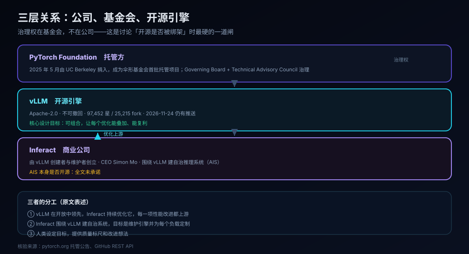
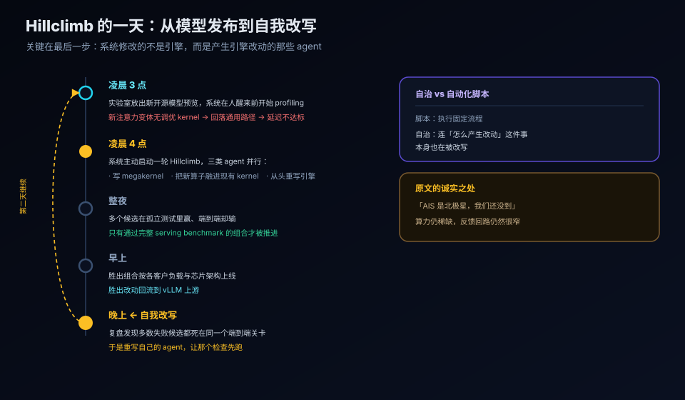
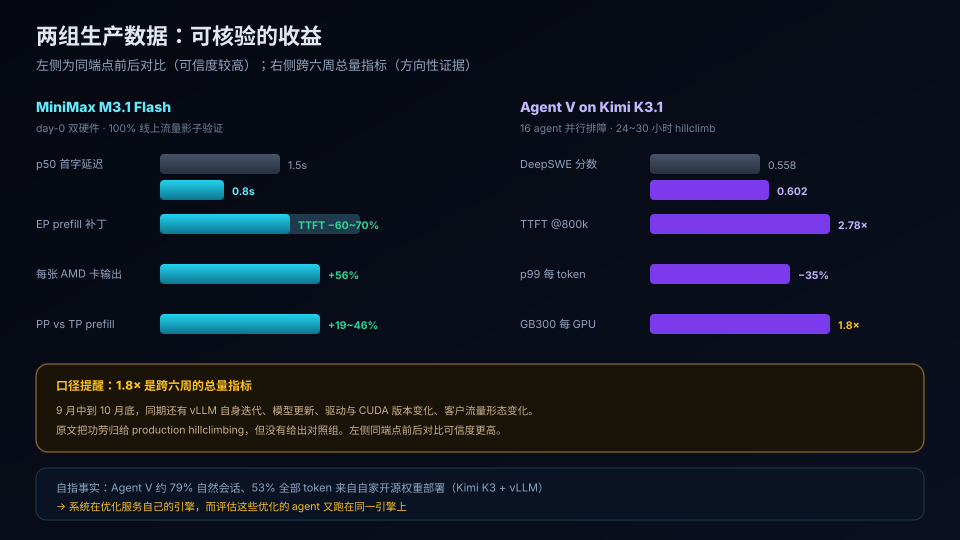

> **核心导读**：2026 年 11 月 18 日，Inferact 联合创始人兼 CEO、vLLM 维护者 Simon Mo 发了一篇《Building an Autonomous Inference System》。核心主张是：**用一套自治系统去优化推理引擎，让引擎自己改进自己**，人类只负责设定目标和质量标准。
>
> 这篇做三件事：第一，把文章里的机制和两组生产数据拆开讲清楚；第二，核对了它没写清楚的地方——尤其是「vLLM 保持开源」和「自治系统本身是否开源」这两件事被混在一起谈；第三，补上它刻意没展开的商业张力：一家公司成为某个基金会托管项目的最大贡献者，这件事本身意味着什么。
>
> 所有数字都来自原文，标注了出处；我的判断和质疑会明确写成「问题」或「我的看法」，不混进原文结论。

---

## 一、先说清楚 Inferact 是谁

这一点必须先厘清，否则后面所有讨论都会跑偏。

**Inferact 是一家公司，由 vLLM 的创建者和维护者创立。** Simon Mo 是它的联合创始人兼 CEO，同时是 vLLM 的维护者。

**vLLM 不是 Inferact 的资产。** 我核对了这一点：

| 项 | 事实 |
|---|---|
| 仓库 | `vllm-project/vllm`，97,452 星，25,215 fork |
| 许可证 | Apache-2.0 |
| 治理 | **PyTorch Foundation 托管项目**（2025 年 5 月加入） |
| 活跃度 | 2026-11-24 仍有推送 |

vLLM 2025 年 5 月由 UC Berkeley 捐给 PyTorch Foundation，成为该基金会从单项目扩展为伞形基金会后的首批托管项目之一。这意味着**治理权不在 Inferact 手里**——这是后面讨论「开源是否被绑架」时最重要的一条约束。

---

## 二、问题定义：为什么需要「自治」

原文的论证起点是一个组合爆炸：

> 5000+ 模型 × 1000+ 芯片架构 × 无限种工作负载

三条线各自以不同节奏演进：

- **模型侧**：每周都有实验室发布新架构。原文举的例子是 MiniMax M3.1——稀疏注意力 + indexer + 大 MoE + 视觉输入 + 原生 DSpark 推测解码，五个新东西叠在一起；
- **硬件侧**：芯片厂商设计新硬件时，没有配套调优好的 kernel；
- **负载侧**：客户流量会从「短对话」变成「长上下文 Agent」，再变成「decode 受限」。

任意一个新组合出现，都需要单独调优才能跑好。原文的说法是：**这个组合空间没法暴力枚举**。

这就是 vLLM 存在的理由——它要弥合这三条线之间的缝隙。但弥合的速度跟不上三条线各自演进的速度，所以 Inferact 的答案是：**让优化这件事本身自动化**。

---

## 三、什么是「自治推理系统」

原文给的定义很克制，值得逐字读：

> 自治意味着它自己运转：接受一个目标，朝它推进，主动寻找反馈，而不需要有人告诉它下一步具体做什么。

拆成五条能力：

1. **看见**它运营或获授权观察的生产负载，并从社区分享的内容中学习——**不需要访问对方的部署**；
2. **适配**新模型、新硬件，以及客户负载的变化；
3. **演化**自己的代码和「大脑」——原文把大脑定义为「每个决策背后积累的知识与工程品味」；
4. **自己推进**目标，像一支强工程组织那样绕过路障；
5. **持续优化**，对齐每个负载自己的目标。

野心写在最后一句：希望系统演化的边界**只受算力限制，逼近硬件的物理极限**。

### 3.1 一个「普通的一天」

原文用一段叙事把抽象机制具体化了，这段值得完整复述，因为它把「自治」拆成了可观察的动作：

| 时间 | 发生了什么 |
|---|---|
| 凌晨 3 点 | 实验室放出新开源模型预览，系统在 Inferact 的人醒来之前就开始 profiling。新注意力变体没有调优 kernel，回落到通用路径，延迟不达标 |
| 凌晨 4 点 | 系统**主动**启动一轮 Hillclimb：一些 agent 写 megakernel，另一些把新算子融进现有 kernel，还有一个从头重写引擎 |
| 整夜 | 几个候选在孤立测试里赢了，端到端却输了。只有通过完整 serving benchmark 的组合才被推进 |
| 早上 | 胜出的组合按各客户的负载要求和芯片架构上线，胜出的改动**回流到 vLLM 上游** |
| 晚上 | 系统复盘自己的一天，发现大多数失败候选都死在同一个端到端关卡，于是**重写自己的 agent**，让那个检查先跑 |
| 第二天 | 继续自主改进 |

最后那一步是整段里最关键的：**系统修改的不是引擎，而是产生引擎改动的那些 agent。** 这才是「自治」和「自动化脚本」的分界线。

### 3.2 飞轮：生产验证 + 开源复利

原文说这套流程依赖两个轮子：

- **生产**：单独写一个引擎或优化很容易，因为推理任务大体可验证。但孤立环境里的收益，放到生产分布上往往站不住。只有扛住真实流量的引擎才可信。
- **开源**：vLLM 的核被刻意设计成**可组合**的，所以每个优化能叠加、能复利。同时社区、学术实验室、合作伙伴构成了最大的推理需求知识库。

原文还提到一个具体用途：让自治系统**参与项目治理**——更快地 triage issue、测试 PR。这句话很轻，但含义不轻，后面会展开。

---

## 四、两组生产数据

这是全文最有价值的部分，因为它是可核验的具体数字，不是愿景。

### 4.1 MiniMax M3.1 Flash：day-0 双硬件上线

背景：M3.1 带来五个新东西（稀疏注意力 + indexer、大 MoE、视觉输入、原生 DSpark 推测解码），要求同时在 NVIDIA 和 AMD 上达到优化性能，而且负载形态一直在变——从长上下文 agentic coding，到短输入长输出，最后因为最终 checkpoint 把输出长度翻倍而变成 decode 受限。

做法：

- 开源和生产**跑在同一个分支**上；
- 切换前把 **100% 的 M3 线上流量**影子到 M3.1；
- 对着这份流量跑生产 hillclimb，改动从本地关卡逐级晋升到线上影子评测。

结果（每一项都随落地即时上游到 vLLM）：

| 指标 | 变化 |
|---|---|
| p50 首字延迟（TTFT） | 1.5 秒 → **0.8 秒** |
| expert-parallel prefill 补丁 | TTFT 降低 **60–70%** |
| pipeline-parallel prefill vs tensor parallel | 吞吐高 **19–46%** |
| 每张 AMD 卡输出 | 提升 **56%** |

另外，缺失的 kernel（MSA 注意力、indexer、NVFP4 MoE）全部上游，NVIDIA 和 AMD 都出了 day-0 镜像。

### 4.2 Agent V on Kimi K3.1：16 个 agent 并行排障

Agent V 是 Inferact 的共享 agent 基础设施——在 Slack 里提需求，它在沙箱里完成任务，原生支持 hillclimbing。

故事：Kimi K3.1 接入自家 serving 栈后，**某些 batch 的输出质量下降**。

处理：一个 **16 agent 的 hillclimb** 复现了问题，定位到一个依赖 batch 组成的注意力路由开关，修复后上线。

| 指标 | 变化 |
|---|---|
| DeepSWE 分数 | 0.558 → **0.602**（对齐模型参考精度） |
| 首字延迟（800k 上下文，GB300） | **2.78×** 更快（24 小时 hillclimb） |
| p99 每输出 token 时间 | 降低 **35%**（30 小时 hillclimb） |
| GB300 每 GPU 吞吐 | 0.77M → **1.4M** token/分钟，约 **1.8×**（9 月中到 10 月底） |

还有一个自指的事实：Agent V 主要跑在 Kimi K3 上，由 vLLM 服务——**约 79% 的自然会话和 53% 的全部 token 来自自家开源权重部署**。

---

## 五、原文没写清楚的三件事

这篇文章写得相当诚实——它明确说了「AIS 是北极星，我们还没到」。但有三处留白值得单独指出。

### 5.1 「vLLM 保持开源」不等于「自治系统开源」

原文的承诺是明确的：

> vLLM 保持开源，我们和系统构建的每一项引擎优化都改进整个社区的 vLLM。

以及：

> 我们发现的每一项性能改进都上游到 vLLM。

但我逐段核对过，**全文没有一处说自治系统本身是开源的**。

这不是文字疏漏，而是商业模式的必然。vLLM 是 Apache-2.0、PyTorch Foundation 托管，本来就无法收回；而 AIS 是 Inferact 的竞争壁垒，包含它的「大脑」（积累的知识与工程品味）和 hillclimb 编排能力。

所以准确的理解是：**引擎开源，造引擎的工厂闭源。**

这个划分本身不道德可疑——Red Hat 模式、Databricks 模式都是类似结构。但它意味着社区拿到的永远是**产物**，不是**生产能力**。原文那句「Inferact 只有在 vLLM 对所有人持续变好时才算赢」，是一个**激励主张**，不是**机制保证**。

### 5.2 1.8× 的口径需要谨慎读

「GB300 每 GPU 吞吐从 0.77M 到 1.4M token/分钟，约 1.8×，时间是 9 月中到 10 月底」——这是全文最亮眼的数字，但它的时间跨度是**约六周**。

六周里变量不止一个：vLLM 本身在迭代、模型侧可能有更新、硬件驱动和 CUDA 版本也会变、客户流量形态也在变。原文把功劳归给「production hillclimbing」，但**没有给出对照组**——比如同期不跑 hillclimb 的基线是多少。

这不是说数字有问题。MiniMax 那组的指标（TTFT 1.5→0.8 秒、EP prefill 降低 60–70%）因为是对同一个端点的直接前后对比，可信度更高。而 1.8× 这种跨六周的总量指标，只能当作**方向性证据**。

### 5.3 自指循环：谁来验证验证者

Agent V 的 79% 会话、53% token 来自自家部署——这既是效率证明，也是一个**验证闭环问题**：系统在优化服务自己的引擎，而评估这些优化的 agent 又跑在同一个引擎上。

原文自己承认了这个方向的困难：

> 我们还没法足够好地模拟世界，去测试那些从未发生过的流量，这也是 Agent V 想安全地重写自己所需要的东西。

这句话很关键。它等于说：**当前系统的自我改进，仍然依赖真实流量作为裁判**。一旦离开有真实流量的场景，自治就退化成「自我感觉良好」。

---

## 六、真正的张力：一家公司成为基金会项目的最大贡献者

这是原文完全没碰、但绕不开的问题。

事实摆在这里：

- vLLM 由 PyTorch Foundation 托管，Apache-2.0；
- Inferact 由 vLLM 的创建者和维护者组成；
- Inferact 的商业模式是围绕 vLLM 建自治系统；
- 原文计划让自治系统**参与 vLLM 的项目治理**——triage issue、测试 PR。

这四条放在一起，构成一个需要认真对待的结构：

**一个营利实体，正在成为它赖以生存的开源项目的事实主导者，并计划让自动化系统参与该项目的治理流程。**

我不认为这是恶意的。相反，原文的表述相当克制，反复强调「上游」「社区」「对所有人变好」。但善意不构成机制。

真正起约束作用的是三条外部事实：

1. **治理权在基金会，不在公司。** PyTorch Foundation 的 Technical Advisory Council 结构意味着重大方向不由单一公司决定。这是最硬的一道闸。
2. **Apache-2.0 不可撤回。** 即使 Inferact 某天改变策略，已经开源的代码可以 fork。vLLM 有 25,215 个 fork，这是实际的逃生舱。
3. **社区贡献者的存在。** 如果贡献者结构长期单一化，前两条会逐渐失效——基金会管得住章程，管不住「只有一家公司有能力维护核心」。

所以真正该盯的指标不是「有没有说要开源」，而是**贡献者集中度**。这一点原文没提，也没法由它自己提。

### 一个值得追问的细节

搜索结果里有一条来自回复区的质疑，原文没有回应：**如果一个优化对某个负载有帮助、对另一个负载有害，上游时它是否保持 opt-in？**

这不是刁难。vLLM 的核心设计是「可组合」，可组合的前提是每个优化不破坏别人的场景。而 hillclimb 的目标函数是**针对特定负载**优化——两者存在结构性张力。原文说「只有通过完整 serving benchmark 的组合才被推进」，但 benchmark 覆盖的是谁的负载分布？

这个问题没有在文中得到回答，我认为它是这套架构最实际的风险点。

---

## 七、这件事为什么值得关注

抛开公司叙事，这篇文章描述了一个可能改变基础设施行业分工的模式。

传统路径是：硬件厂商出芯片 → 框架团队适配 → 应用团队调优，每一层都靠人力，每一层都滞后。新模型发布后，等 kernel 适配、等框架支持、等调优，常常是数周。

Inferact 的路径是：**把「适配 + 调优」这一段变成可自我改进的系统**，滞后从数周压缩到一夜。

如果这条路走通，影响是双向的：

- **对开源社区**：vLLM 的迭代速度可能显著加快，因为贡献者从「人」扩展到「人 + 系统」；
- **对商业格局**：掌握这套系统的一方，会成为所有推理需求的必经节点。而系统本身闭源，意味着这个位置难以被复制。

这正好解释了为什么「引擎开源、工厂闭源」是这套模式的最优解——它同时拿到了开源生态的网络效应和闭源能力的护城河。

---

## 八、如果要跟进这件事，看这几个信号

不是结论，是观察清单：

| 信号 | 为什么重要 |
|---|---|
| vLLM 贡献者集中度变化 | 比任何公开承诺都更能说明「是否被单一公司主导」 |
| 自治系统产出的 PR 占比 | 原文说要让系统 triage issue、测 PR，这个比例会说明治理权实际流向 |
| 是否出现「对 A 有益、对 B 有害」的优化争议 | 检验可组合性承诺的试金石 |
| Agent V 是否对外开放 | 如果开放，说明生态策略更接近 Red Hat；如果不开放，就是纯商业壁垒 |
| 1.8× 这类总量指标是否出现独立复现 | 目前只有厂商自报，缺少第三方验证 |

---

## 九、我的判断

这篇文章的价值不在那些数字——数字是厂商自报，口径也有讨论空间。它的价值在于**把一个正在发生的结构性变化写清楚了**：推理优化正在从「工程手艺」变成「可自动化生产的能力」。

但同时要看清它没说的部分：

1. **开源的是引擎，不是造引擎的能力。** 这个区分决定了社区和公司的长期力量对比。
2. **自治的边界受限于真实流量。** 原文自己承认无法模拟「从未发生过的流量」，所以离真正的「全自主」还有距离。
3. **治理风险真实存在，但有对冲。** 基金会治理 + Apache-2.0 + 大量 fork 构成了三重保险，但保险的有效性取决于社区是否持续有人参与。

最值得警惕的不是这家公司想做什么，而是**如果这套模式成功，行业里会有多少推理基础设施变成「某家公司闭源系统的产物」**。到那时，「引擎开源」这句话依然成立，但它保证的东西比现在少得多。

---

## 参考资料

**一手来源**

- Simon Mo, *Building an Autonomous Inference System*, 2026-11-18：<https://inferact.ai/news/building-autonomous-inference-system>
- 同一篇的 X 版本（本文数字以官方文章为准，X 版内容一致）：<https://x.com/simon_mo_/status/2123133742063706343>

**独立核验**

- vLLM 仓库状态：`vllm-project/vllm`，97,452 星 / 25,215 fork / Apache-2.0 / 2026-11-24 仍有推送（GitHub REST API，抓取于 2026-11-25）
- vLLM 治理归属：PyTorch Foundation 托管项目，2025 年 5 月加入 —— <https://pytorch.org/blog/pytorch-foundation-welcomes-vllm/>、<https://pytorch.org/projects/vllm/>

**延伸阅读**

- Inferact 与 Google Cloud 的 TPU 合作（2026-09-14，来自 Simon Mo 时间线）
- vLLM 自主优化里程碑（2026-10-16，同上）
