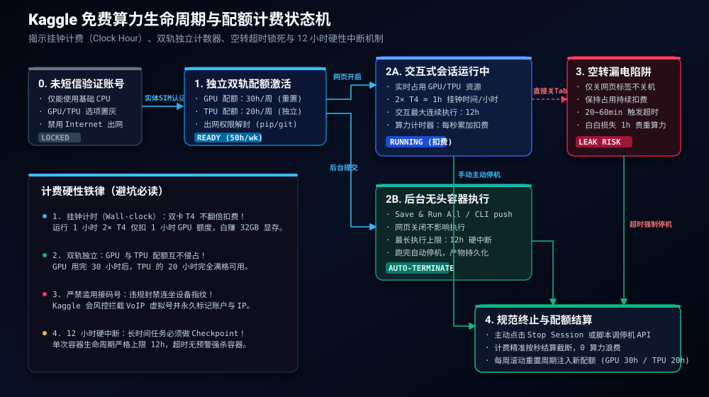
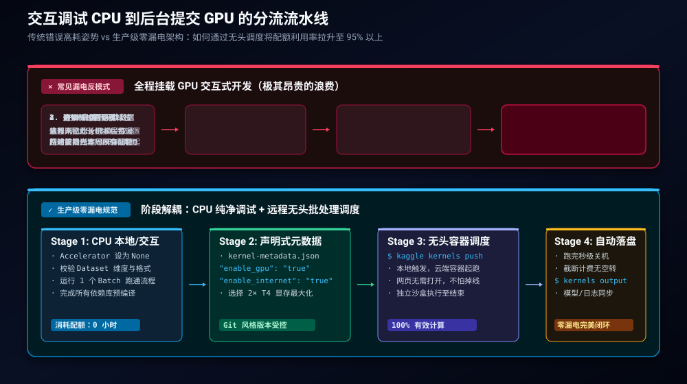
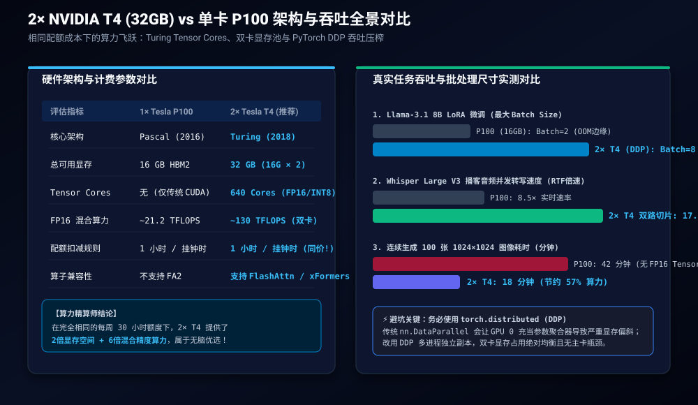

> **核心导读**：在云端算力日趋昂贵、商业显卡租赁价格水涨船高的今天，很多独立开发者、算法工程师与技术博主常常因缺少计算卡而在本地苦苦挣扎。然而，作为 Google 旗下全球最大的数据科学社区，**Kaggle 每周都在默默为通过手机验证的开发者注入近 50 小时的免费加速算力**。
>
> 遗憾的是，在 X（Twitter）与开源社区的讨论中，绝大多数人要么以为一周只有区区几小时 GPU，要么踩进“开着 GPU 调代码、关掉网页却依然漏电扣费”的昂贵陷阱，甚至因误用接码平台导致账号被瞬间封锁。
>
> 实际上，Kaggle 实行的是 **GPU（30 小时/周）与 TPU（20 小时/周）完全独立的双轨计费制**，且按照“挂钟时间（Clock Hour）”计费——这意味着运行 **2× NVIDIA Tesla T4（总显存 32GB）与单卡消耗相同的配额**！本文将从平台风控底线、生命周期状态机、无头自动化流水线到 PyTorch 双卡并行压榨，奉上一份不替官方粉饰、刀刀见血的硬核算力最大化实战手册。

---

## 一、解密 Kaggle 配额机制：50 小时的“双轨独立”与计费真相

许多初学者最容易产生的一个致命误解是：“30 小时 GPU 用完了，我的加速额度就归零了”。或者在 GPU 和 TPU 之间二选一时谨小慎微，以为它们共享同一个扣费池。

### 1.1 双轨独立计数器（Dual Isolated Counters）

在 Kaggle 的底层基础设施调度器中，**GPU 与 TPU 是两套完全物理隔离且配额独立的调度队列**：
* **GPU 独立配额**：每周 **30 小时**。可自由选择 `1× NVIDIA Tesla P100 (16GB)` 或 `2× NVIDIA Tesla T4 (16GB × 2 = 32GB)`。
* **TPU 独立配额**：每周 **20 小时**。分配的是 Google Cloud 的 `TPU v3-8`（拥有 8 个张量计算核心，合计 128GB HBM 高带宽显存）。

两者配额完全解耦，互不侵占。换言之，**每位合规开发者每周拥有的实际免费硬件加速时间约为 50 小时**。这两项配额在每周固定时间（以各区域滚动的周末时间戳为基准）全额重置。

### 1.2 挂钟计费（Clock Hour）机制的巨大红利

商业云服务（如 AWS EC2、GCP Compute Engine、Lambda Labs）通常严格按“GPU卡·时”进行计费：调用 2 张 T4 运行 1 小时，会直接扣除 2 个 GPU 时的计费单位。

但 Kaggle 采用了截然不同的**挂钟时间（Clock Hour）结算规则**：
* 启动一个搭载 `2× Tesla T4` 的容器，持续运行 60 分钟；
* Kaggle 的配额统计系统**仅扣减 1.0 小时**的每周 GPU 预算。

这意味着，选择双卡 T4 可以直接白白获得翻倍的物理显存（32GB）与两倍的流式多处理器（SM）硬件，而算力消耗速度与单卡完全持平。

### 1.3 会话时长与闲置超时门禁

天下没有真正的无限制计算，Kaggle 在提供免费算力的同时设置了极其严格的容器生命周期状态机：



1. **单次会话执行硬上限（Hard Limit）**：
   * **交互式 Notebook**：单次连续运行最长 **12 小时**（TPU 模式为 9 小时）。一旦达到 12 小时挂钟上限，平台宿主机会直接向容器发送 `SIGTERM` 并在数秒后强杀进程，未落盘的数据将永久丢失。
   * **后台无头提交（Save & Run All / API Commit）**：单次最长执行同样为 **12 小时**。
2. **闲置自动休眠（Idle Timeout）**：
   * 交互式 Notebook 在没有前端 WebSocket 交互、且后台没有活跃计算任务时，通常在 **20 至 60 分钟内**被判定为 Idle 并强制关闭。
   * **致命陷阱**：如果你在代码中写了一个无休止的 `while True: sleep(1)`，或者任务发生死锁，Kaggle 会认为该容器“正在工作”，从而**持续扣费整整 12 个小时直至配额耗尽**！

---

## 二、门禁与避坑：手机防风控认证与零封号实操

在注册 Kaggle 后，新用户会发现 GPU 与 TPU 下拉选项均处于灰色锁定状态，且 Notebook 内部无法访问外网（`ping`、`pip install` 从 GitHub 拉取源码均失败）。这是因为平台启用了严格的**电话号码身份验证（Phone Verification）**。

### 2.1 为什么必须手机短信验证？

由于云端 GPU 具备高额经济价值，历史上 Kaggle 曾遭遇过猖獗的黑产与自动化 Script 攻击（用于薅免费显卡挖矿、刷赞或无序轰炸竞赛榜单）。为此，Google 部署了反作弊风控网关：
* 未验证手机号的用户，仅能使用基本的双核 CPU 算力，且容器处于严格的出网沙盒中（Internet Disabled）；
* 只有通过短信验证码确认的自然人账户，才能解锁 **GPU / TPU 算力分配权限** 及 **容器全局出网开关（Internet Enabled）**。

### 2.2 虚拟号与接码平台的“连坐封禁”

很多开发者为了“多刷几个号搞并发”，常使用 SMS-Activate 等接码平台的临时虚拟号码或 VoIP 虚拟号（如 Google Voice、TextNow）。**这是通往 Kaggle 永久封号的最快捷径**：
1. **VoIP 号段拉黑**：Kaggle 接入了 Twilio / Telesign 等高级运营商欺诈识别库，直接在验证前端拦截绝大多数虚拟号段（返回 `Invalid phone number` 或 `Unsupported carrier`）。
2. **设备与 IP 指纹连坐**：一旦某个临时接码号码被风控系统关联到历史黑产库，与该操作绑定的浏览器 Canvas 指纹、WebGL 渲染特征以及出口代理 IP 会被立即打上高风险标签。
3. **静默封号（Shadowban）**：平台甚至不会弹窗警告，而是直接封杀该账户的 GPU 申请资格，或者在提交竞赛预测时抛出无任何详细说明的 `Submission Exception`。

### 2.3 合规过审三原则

要想长久稳定、零风险地享受每周 50 小时免费算力，必须遵守以下合规边界：
1. **使用真实物理 SIM 卡**：中国大陆（+86）、香港（+852）以及欧美常规移动运营商的实体手机卡均能稳定秒收验证码。
2. **一卡一号原则**：一个手机号切勿尝试解绑并绑定多个历史小号。
3. **严禁在单台设备多开账号同时占用 GPU**：Kaggle 对同一局域网/出口 IP 下多账号并发占用 GPU 容器的行为极其敏感，容易被风控算法直接判定为女巫攻击（Sybil Attack）。

---

## 三、杜绝算力漏电：从交互式调试到后台提交的最佳实践

在 Kaggle 社区论坛里，每周都能看到无数开发者痛心疾首的求助帖：“为什么我就写了两个小时代码，30 小时 GPU 额度就全空了？”

这就是典型的**算力漏电（Compute Leak）**。

### 3.1 最昂贵的错误：开着 GPU 写代码

很多从本地 Jupyter Notebook 转战云端的新手，习惯在创建 Notebook 时直接把 Accelerator 选为 `GPU T4 x2`。
接下来，他们会在这个开着 GPU 的会话里耗费大量时间：
* 逐行敲代码、修改打字导致的 `SyntaxError`；
* 慢吞吞地使用 `!git clone` 或 `!wget` 从外网下载数十 GB 的数据集；
* 用 Pandas 逐行清洗数据并打印数据帧信息。

在这一过程中，**GPU 利用率（GPU Utilization）全程为 0%**，但挂钟计时器在以毫秒为单位疯狂扣除你的每周配额！当你真正写到 `model.fit()` 时，配额早已所剩无几。

### 3.2 生产级零漏电工作流设计

为了彻底杜绝无谓的配额消耗，我们必须将开发流程解耦为 **“CPU 纯净调试”** 与 **“后台无头批处理”** 两大阶段：



#### 阶段 1：CPU 零成本调试
1. 进入 Notebook，确保 Accelerator 设置为 **None (CPU)**。
2. 完成数据预处理、维度校验（Tensor Shape Validation）、模型架构定义与 DataLoader 打通。
3. 仅选取测试集中的 1 个批次（Mini-batch）在 CPU 上执行一次前向（Forward）与反向传播（Backward），确保没有尺寸对不齐或显式 Bug。
4. **消耗 GPU 配额：0 秒**。

#### 阶段 2：Quick Save 保存代码
在右上角选择保存版本时，**千万不要盲目点击“Save & Run All (Commit)”**！
* `Save & Run All` 会在后台立即克隆一个全新的独立容器，从第 1 单元格无条件重新执行到末尾。如果代码里还有断点或逻辑死循环，它会直接耗尽你的 GPU。
* 调试阶段请始终选择 **“Quick Save”**，这仅仅将代码快照提交到云端，耗时仅需 1 秒，且不消耗任何计算配额。

#### 阶段 3：代码级主动自毁（Auto Power-Off）
如果确实需要在交互式环境下挂机跑长时间任务，请在 Notebook 的**最后一个代码单元格**植入会话自毁逻辑，或者在任务结束时抛出特定终止信号：

```python
import os
import time

def train_and_export():
    print("[+] 启动大规模生产训练...")
    # 执行计算逻辑
    # ...
    print("[✓] 训练完成，权重已安全写入 /kaggle/working/")

if __name__ == "__main__":
    try:
        train_and_export()
    finally:
        print("[!] 任务执行完毕，主动释放 GPU 会话，杜绝空转扣费...")
        # 强制退出内核，加速触发平台资源回收
        os._exit(0)
```

此外，训练结束后，切勿直接关闭 Chrome 标签页！必须点击顶部菜单栏的 **Session Options $\rightarrow$ Stop Session (Power Off)**，观察到页面右上角的状态圆点由绿变灰，才算真正停止计费。

---

## 四、显存最大化实战：2× NVIDIA T4（32GB）双卡吞吐榨取

当进入真正的大模型微调（LoRA / QLoRA）、高分辨率生图（Stable Diffusion / FLUX）或批量长音频转写（Whisper）场景时，显存容量往往直接决定了任务的生死。

### 4.1 硬件选型：为什么 2× T4 完胜 P100？

在 Kaggle 提供的两种 GPU 选项中，一些老教程往往会推荐 Tesla P100，理由是“P100 单精度 FP32 浮点性能更强”。但在 2026 年的现代深度学习负载下，这个建议已经彻底过时：



| 核心评估指标 | 1× Tesla P100 (16GB) | 2× Tesla T4 (推荐首选) | 架构优劣结论 |
| :--- | :--- | :--- | :--- |
| **GPU 架构** | Pascal (2016 年旧架构) | **Turing (2018 年现代架构)** | T4 具备全新整数与张量核心 |
| **总物理显存** | 16 GB HBM2 | **32 GB (16GB × 2 GDDR6)** | **物理显存空间直接翻倍** |
| **Tensor Cores** | ❌ **无**（仅传统 CUDA Core） | **640 个 Tensor Cores** | T4 原生支持高效混合精度计算 |
| **FP16 峰值算力** | ~21.2 TFLOPS | **~130 TFLOPS (双卡聚合)** | 混合精度吞吐达 P100 的 **6 倍以上** |
| **算子兼容性** | 不支持 FlashAttention-2 | **支持 FlashAttention / xFormers** | 显存优化技术栈完美兼容 |
| **配额扣减速率** | 1.0 小时 / 挂钟时 | **1.0 小时 / 挂钟时** | **扣减费率完全相同！** |

结论显而易见：在配额成本完全一致的前提下，**2× T4 带来了 2 倍的显存容量与近 6 倍的 FP16 张量计算吞吐**，是毫无争议的绝对首选。

### 4.2 避开 DataParallel 陷阱，拥抱 DDP（Distributed Data Parallel）

很多初学者在拿到双卡后，习惯在代码里直接调用：
```python
# 警告：这是严重的性能反模式！
model = torch.nn.DataParallel(model)
```

`torch.nn.DataParallel` (DP) 是单进程多线程模型。在每个 Batch 中，`cuda:0`（主卡）必须负责将输入分发给副卡，并收集所有副卡的输出计算 Loss。这会导致一个臭名昭著的问题：**主卡显存严重偏斜（Imbalance）**。主卡显存常常率先打满爆掉（CUDA OOM），而副卡却空余 40% 的显存，同时 Python GIL 锁会导致算力利用率暴跌。

在 Kaggle 容器中，**必须采用 `torch.distributed`（DDP）多进程机制**。

#### 生产级 PyTorch 双卡 DDP 训练模板

Kaggle 官方环境已经原生配置好了双卡间的虚拟环路网络，直接通过 `torchrun` 即可优雅启动双进程任务：

```python
# train_ddp.py
import os
import torch
import torch.nn as nn
import torch.distributed as dist
from torch.nn.parallel import DistributedDataParallel as DDP
from torch.utils.data import DataLoader, Dataset
from torch.utils.data.distributed import DistributedSampler

def setup_distributed():
    # Kaggle 容器内环境变量由 torchrun 自动注入
    dist.init_process_group(backend="nccl")
    local_rank = int(os.environ["LOCAL_RANK"])
    torch.cuda.set_device(local_rank)
    return local_rank

def cleanup_distributed():
    dist.destroy_process_group()

class SimpleDataset(Dataset):
    def __len__(self):
        return 10000
    def __getitem__(self, idx):
        return torch.randn(128), torch.randint(0, 2, (1,)).squeeze()

def run_training():
    local_rank = setup_distributed()
    is_main_process = (local_rank == 0)

    if is_main_process:
        print(f"[+] NCCL 集群初始化完毕，当前使用物理 GPU 数量: {torch.cuda.device_count()}")

    # 1. 构建模型并迁移至对应 GPU
    model = nn.Sequential(
        nn.Linear(128, 512),
        nn.ReLU(),
        nn.Linear(512, 2)
    ).to(local_rank)

    # 2. 包装为 DDP 模型
    model = DDP(model, device_ids=[local_rank], output_device=local_rank)

    # 3. 配置分布式采样器，确保双卡数据无重叠
    dataset = SimpleDataset()
    sampler = DistributedSampler(dataset, shuffle=True)
    dataloader = DataLoader(dataset, batch_size=64, sampler=sampler, num_workers=2, pin_memory=True)

    optimizer = torch.optim.AdamW(model.parameters(), lr=1e-3)
    criterion = nn.CrossEntropyLoss()

    for epoch in range(5):
        sampler.set_epoch(epoch)
        model.train()
        total_loss = 0.0

        for x, y in dataloader:
            x, y = x.to(local_rank, non_blocking=True), y.to(local_rank, non_blocking=True)
            optimizer.zero_grad(set_to_none=True) # 节约显存开销
            
            with torch.amp.autocast(device_type="cuda", dtype=torch.float16):
                output = model(x)
                loss = criterion(output, y)

            loss.backward()
            optimizer.step()
            total_loss += loss.item()

        if is_main_process:
            print(f"[Epoch {epoch+1}/5] 平均 Loss: {total_loss / len(dataloader):.4f}")

    cleanup_distributed()

if __name__ == "__main__":
    run_training()
```

在 Kaggle Notebook 单元格中，只需一行 Shell 命令即可拉起双卡满血执行：
```bash
!torchrun --nproc_per_node=2 train_ddp.py
```

在 DDP 模式下，双卡各自独立维护一个完整的 Python 进程，通过 NCCL 高性能通信原语在反向传播时同步梯度。两张 T4 的显存占用完全均匀（例如各占 14.2 GB），**整体 Batch Size 可以直接翻倍，训练吞吐提升 90%~95%**！

---

## 五、TPU v3-8 跨界兜底：GPU 耗尽后的“第二条命”

当你本周的 30 小时 GPU 配额完全耗尽后，**不要停下你的工作流**！你还有整整 **20 小时满格的 TPU v3-8 算力**静候调度。

### 5.1 认识 TPU v3-8 算力怪兽

很多从事自然语言处理与计算机视觉的工程师对 TPU 敬而远之，误以为只能用 TensorFlow 编写复杂的计算图。事实上，伴随 PyTorch 2.x 与 `torch_xla` 的飞速演进，将 PyTorch 代码平移至 TPU 的改造成本已压降至极低。

* **硬件拓扑**：Kaggle 分配的 TPU v3-8 包含 4 个物理计算芯片，每个芯片封装 2 个核心，合计 **8 个张量计算核心（Cores）**。
* **显存容量**：每个核心独享 16GB HBM 极速显存，整套实例的**总显存高达 128 GB**！
* **计算特性**：原生深度支持 Bfloat16（BF16）半精度矩阵乘法，单台实例算力峰值可达 **420 TFLOPS**。

### 5.2 迁移到 `torch_xla` 的核心改动

在 Kaggle 中使用 TPU 时，请选择 Accelerator 为 `TPU v3-8`，并在代码中引入 XLA 设备：

```python
import torch
import torch_xla
import torch_xla.core.xla_model as xm

# 1. 获取 TPU XLA 设备句柄
device = xm.xla_device()

# 2. 将模型与张量迁移到 XLA 设备
model = MyNeuralNet().to(device)
x = x.to(device)

# 3. 前向与反向传播
optimizer.zero_grad()
loss = criterion(model(x), y)
loss.backward()

# 4. 关键：TPU 梯度聚合与参数更新
# xm.optimizer_step 会协调 8 个 TPU 核心同步梯度并提交 XLA 计算图
xm.optimizer_step(optimizer)
```

### 5.3 避坑雷区：严禁使用动态尺寸（Dynamic Shape）

在 GPU 上，如果不同批次的文本长度参差不齐（例如 Batch 1 长度 128，Batch 2 长度 256），CUDA 能够动态分配计算网格。

但在 TPU 上，这是极度致命的性能自杀行为！
* **XLA 编译机制**：TPU 依靠 XLA（Accelerated Linear Algebra）编译器将 PyTorch 操作融合成静态机器码。
* 一旦输入 Tensor 的 Shape 发生变化，TPU 会被迫**停下计算引擎，重新发起全量 XLA JIT 编译**（每次耗时几十秒至几分钟）。
* **黄金原则**：在 TPU 数据管道中，必须使用固定填充长度（`padding="max_length"`），并将 `DataLoader` 的 `drop_last` 设为 `True`，保证每个批次的 Tensor 维度完全恒定。

---

## 六、多云平替与生产级协同思考

Kaggle 绝非孤立的算力孤岛。将 Kaggle 的免费额度与外部生态串联，才能形成高可用、全自动的数字资产生产线。

### 6.1 结合官方 CLI 打造无头算力集群

不要受制于 Web 浏览器。通过安装官方 `kaggle` CLI，你可以在本地代码库中编写规范的 `kernel-metadata.json`：

```json
{
  "id": "your-username/automated-speech-transcription",
  "title": "Automated Speech Transcription",
  "code_file": "batch_transcribe.py",
  "language": "python",
  "kernel_type": "script",
  "is_private": "true",
  "enable_gpu": "true",
  "enable_internet": "true"
}
```

在本地终端执行一键提交：
```bash
# 1. 提交任务到云端 GPU 启动静默运行
kaggle kernels push -p .

# 2. 异步轮询任务状态
kaggle kernels status your-username/automated-speech-transcription

# 3. 任务执行完成后，一键拉取生成的产物文件（模型权重 / SRT字幕）
kaggle kernels output your-username/automated-speech-transcription -p ./dist/
```

无需开启任何网页，任务在云端全隔离沙盒中全速运转，跑完自动落盘、自动销毁实例并停止计费。

### 6.2 Kaggle 免费算力守则 10 条

为了让团队和个人开发者的免费算力长期稳定运转，请将以下 10 条法则牢记于心：

1. **先短信认证**：注册后第一时间用实体手机号完成短信核身，切勿触碰虚拟接码号。
2. **两套独立池**：GPU 30h 与 TPU 20h 互不干扰，每周总计约 50 小时免费加速卡。
3. **首选 2× T4**：与单卡 P100 消耗相同的挂钟配额，直接白赚 32GB 显存与 Tensor Cores。
4. **弃用 DP 改用 DDP**：在 PyTorch 中使用 `torchrun` 与 NCCL 后端，杜绝主卡显存偏斜。
5. **CPU 负责排障**：数据预处理、语法排错和依赖安装一律在 CPU 模式下完成，0 扣费。
6. **慎用 Save & Run All**：常规代码快照选择“Quick Save”，避免无意义触发后台整本重跑。
7. **坚决主动停机**：任务结束立即点击 Stop Session，严禁直接关网页标签任由容器空转。
8. **12 小时生命线**：单次任务严禁超 12h，模型训练每隔固定 Epoch 必须落盘 Checkpoint。
9. **TPU 静态化**：将任务切换至 TPU 时，务必严格固定 Tensor Shape，防止 JIT 重复编译。
10. **代码直推云端**：由于临时磁盘仅 20GB，大文件产物应在脚本末尾直接推送 Hugging Face Hub 或外部持久化存储。

掌握了这一套工程化方法论，云端免费算力将不再是中看不中用的玩具，而是为你源源不断产出高质量模型、音视频转写与技术成果的坚固基石。
