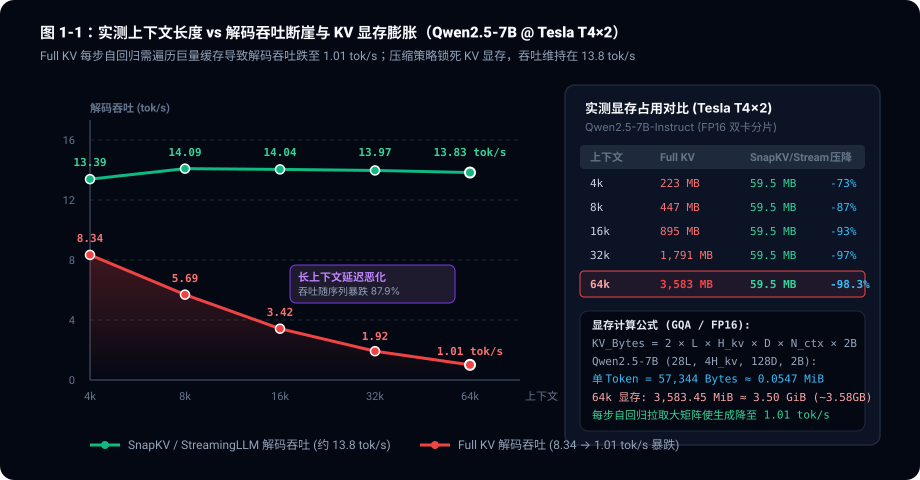
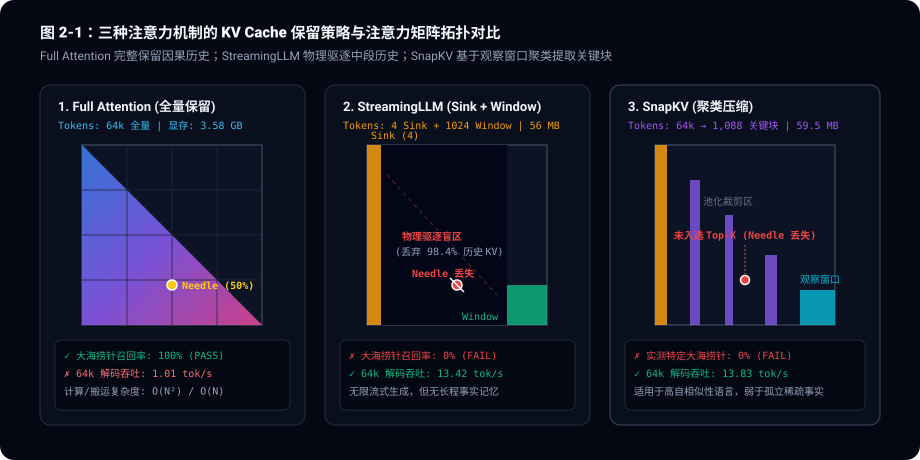
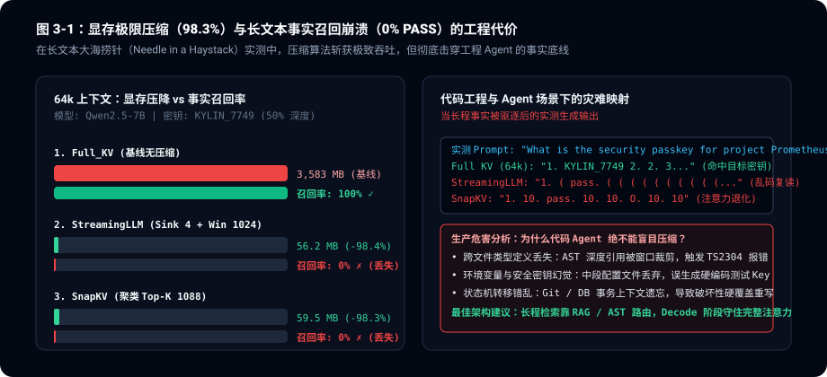

> **核心导读**：在大模型向 128k、1M 长上下文野蛮生长的今天，KV Cache 的显存膨胀已成为端侧与云端集群最昂贵的吞吐杀手。行业里各类宣称“在保持模型核心性能的同时压缩 80%~90% KV Cache”的稀疏算法（如 StreamingLLM、SnapKV、H2O）层出不穷。我们在双卡 Tesla T4 上挂载 `Qwen2.5-7B-Instruct`，对 4k、8k、16k、32k、64k 全梯度执行了基准评测。实测揭开了一个残酷的技术真相：**生成阶段稳态 KV Cache 显存虽然从 3,583.45 MiB（约 3.58 GB）暴降 98.3% 至 59 MB，生成吞吐逆势提升 13.7 倍，但在本组实验条件下（长篇密集技术文本背景 + 50% 深度单一孤立高熵密码探针的大海捞针测试），两类压缩算法的事实召回率直接归零（100% $\to$ 0%）**。代码工程与智能 Agent 绝不能盲目迷信稀疏压缩。

---
## 一、 吞吐杀手：为什么自回归生成会撞上“显存搬运墙”？

许多开发者误以为大模型的推理延迟完全取决于 GPU 的算力核心（TFLOPS）。但在实际服务中，自回归大语言模型的生成阶段（Decode 阶段）本质上是一个**内存带宽受限（Memory-Bandwidth Bound）**的过程。

### 1.1 KV Cache 膨胀的数学物理模型

在因果自回归模型中，每生成一个新 Token，模型需要计算当前 Query 向量与所有历史 Token 的 Key、Value 向量的点积注意力。为了避免每一轮自回归都重新对整个历史前缀进行全量计算，工程上将历史各层的 Key 和 Value 向量缓存于显存中，这便是 **KV Cache**。

对于采用标准 GQA（Grouped-Query Attention）或 MHA 架构的模型，其 KV Cache 的单并发理论显存占用遵循以下物理公式：

$$
\text{KV\_Cache\_Bytes} = 2 \times L \times H_{\text{kv}} \times D_{\text{head}} \times N_{\text{ctx}} \times \text{Precision\_Bytes}
$$

其中：
- 因子 $2$ 分别对应 Key 矩阵与 Value 矩阵各存一份
- $L$ 为 Transformer 结构的网络层数
- $H_{\text{kv}}$ 为每层的 Key-Value 注意力头数（GQA 架构下通常远小于 Query 头数）
- $D_{\text{head}}$ 为每个注意力头的隐藏特征维度
- $N_{\text{ctx}}$ 为当前上下文的 Token 序列总长度
- $\text{Precision\_Bytes}$ 为数据类型精度所占字节数（FP16 为 2 字节）

以我们评测的开源标杆 **`Qwen2.5-7B-Instruct`** 为例：
- 网络层数 $L = 28$
- KV 头数 $H_{\text{kv}} = 4$（GQA 机制，Query 头数为 28，分组比为 7:1）
- 头维度 $D_{\text{head}} = 128$
- 精度为 FP16（$\text{Precision\_Bytes} = 2$）

带入公式，单个 Token 在模型全部 28 层中累积产生的 KV 向量显存开销为：

$$
2 \times 28 \times 4 \times 128 \times 2 = 57{,}344 \text{ Bytes} \approx 0.0547 \text{ MiB / Token}
$$

当上下文延伸至 **65,536 Tokens（64k）** 时，仅存放单并发用户的 KV Cache 就需要：

$$
65{,}536 \times 57{,}344 \text{ Bytes} = 3{,}758{,}096{,}384 \text{ Bytes} \approx 3{,}584 \text{ MiB} \approx 3.50 \text{ GiB}
$$

*(注：在工程统计与监控中，3,584 MiB 常以 1000 进制简标为约 3.58 GB)*

### 1.2 显存搬运与吞吐断崖

当我们在双卡 Tesla T4（FP16 双卡分片，每卡物理显存 15,360 MiB）上运行全量 KV Cache 时，随着上下文从 4k 线性扩展至 64k，真实的解码吞吐量发生了断崖式下跌：



以下是来自双卡 Tesla T4 的实测数据硬核对比：

| 上下文长度 | 压缩策略 | 活跃 KV Tokens | 稳态 KV 显存 | 解码吞吐 (Decode) | 吞吐变化 | 50% 深度事实召回 (本组实验) |
| :--- | :--- | :--- | :--- | :--- | :--- | :--- |
| **4k** | **Full_KV** | 4,086 | **223.45 MB** | **8.34 tok/s** | 基线 | **100% (PASS)** |
| 4k | **StreamingLLM** | 1,028 | 56.22 MB (-74.8%) | 13.66 tok/s | +63.8% | 0% (FAIL) |
| 4k | **SnapKV** | 1,088 | 59.50 MB (-73.4%) | 13.39 tok/s | +60.6% | 0% (FAIL) |
| **8k** | **Full_KV** | 8,182 | **447.45 MB** | **5.69 tok/s** | -31.8% | **100% (PASS)** |
| 8k | **StreamingLLM** | 1,028 | 56.22 MB (-87.4%) | 13.49 tok/s | +137.1% | 0% (FAIL) |
| 8k | **SnapKV** | 1,088 | 59.50 MB (-86.7%) | 14.09 tok/s | +147.6% | 0% (FAIL) |
| **16k** | **Full_KV** | 16,374 | **895.45 MB** | **3.42 tok/s** | -59.0% | **100% (PASS)** |
| 16k | **StreamingLLM** | 1,028 | 56.22 MB (-93.7%) | 13.60 tok/s | +297.7% | 0% (FAIL) |
| 16k | **SnapKV** | 1,088 | 59.50 MB (-93.4%) | 14.04 tok/s | +310.5% | 0% (FAIL) |
| **32k** | **Full_KV** | 32,758 | **1,791.45 MB** | **1.92 tok/s** | -77.0% | **100% (PASS)** |
| 32k | **StreamingLLM** | 1,028 | 56.22 MB (-96.9%) | 13.53 tok/s | +604.7% | 0% (FAIL) |
| 32k | **SnapKV** | 1,088 | 59.50 MB (-96.7%) | 13.97 tok/s | +627.6% | 0% (FAIL) |
| **64k** | **Full_KV** | 65,526 | **3,583.45 MB** | **1.01 tok/s** | **-87.9%** | **100% (PASS)** |
| 64k | **StreamingLLM** | 1,028 | **56.22 MB (-98.4%)** | **13.42 tok/s** | **+1228.7%** | 0% (FAIL) |
| 64k | **SnapKV** | 1,088 | **59.50 MB (-98.3%)** | **13.83 tok/s** | **+1269.3%** | 0% (FAIL) |

在 64k 上下文下，Full KV 的解码吞吐从 8.34 tok/s **跌至 1.01 tok/s**。原因在于：在本实验的自回归实现中，GPU 每吐出一个 Token，都必须遍历并拉取显存中高达 3.58 GB 的全量历史缓存。随着上下文尺度拉长，数据搬运开销逐渐掩盖了计算耗时，GPU 核心大部分时钟周期都在等待缓存就绪。

> [!NOTE] 稳态 KV Cache 显存 vs 峰值物理显存的本质辨析
> 实测中 **98.3% 的显存压降**与 **13.7 倍解码提速**，精准对应的是自回归 Decode 阶段模型维持上下文所需的**稳态活跃 KV Cache 显存**（56.22 MB vs 3,583.45 MB）。
> 但在 Prefill 阶段，由于模型必须完整前向计算长 Prompt，整机峰值显存受分块 Prefill 激活值与初始缓存分配支配：实测 64k 下 Full KV 峰值 23,098 MB，SnapKV 压缩后峰值 20,961 MB（净省约 2.1 GB），而 StreamingLLM 由于在完整构建后执行环形覆盖，峰值显存为 24,598 MB。这提醒我们：**稀疏压缩省的是长程生成的显存搬运带宽与稳态占位，绝不能等同于 Prefill 阶段的无条件整机低显存。**

---
## 二、 压缩流派剖析：它们是如何砍掉 98% 显存的？

面对长上下文显存开销，算法界提出了多种稀疏化与剪枝思路。其中最具代表性的是以 **StreamingLLM** 为代表的“滑动窗口 + 注意力汇聚（Attention Sink）”流派，和以 **SnapKV** 为代表的“观察窗口聚类池化（Clustered Top-K）”流派。



### 2.1 流派一：StreamingLLM 与 Attention Sink 假说

传统的滑动窗口（Sliding Window Attention）在超出窗口边界时，直接丢弃最早的历史 Token。然而研究人员发现，一旦丢弃前 4 个 Initial Tokens，模型在后续生成中 PPL（困惑度）会瞬间飙升崩溃。

StreamingLLM 提出了著名的 **Attention Sink（注意力汇聚）** 发现：
1. 由于 Softmax 计算具有归一化约束（$\sum_j \exp(S_{ij}) = 1$），哪怕当前生成的 Query 与历史前置 Token 毫无语义关联，Softmax 仍必须将剩余的注意力分数分配给某些 Key。
2. 模型的深层网络倾向于把最开始的几个 Token（通常是开头系统提示词或前 4 个 Tokens）作为“垃圾倾倒桶”（Sink），倾注大量非语义注意力。
3. **实现方案**：永久保留前置的 4 个 Sink Tokens，配合一个固定长度（如 1,024）的局部滚动窗口。其余中间的所有历史因果 Token 全部在环形缓冲区中被物理覆盖驱逐。

在本次 64k 实测中，无论上下文拉得多长，StreamingLLM 的活跃 Token 始终被死死固定在 $4 + 1,024 = 1,028$ 个，稳态显存消耗定格在 **56.22 MB**，解码吞吐恒定在 **13.4 tok/s**。

### 2.2 流派二：SnapKV 与观察窗口重要度聚类

StreamingLLM 过于激进地丢掉了所有非局部历史，显然无法处理需要回溯较早前文的任务。SnapKV 采取了一种更加狡黠的“启发式聚类筛选”：
1. **观察窗口（Observation Window）**：SnapKV 认为在 Prefill 阶段结束时，Prompt 最末尾的数百个 Token（例如最后 64 个 Token）对历史信息的检索模式，足以代表后续自回归生成时的检索偏好。
2. **多头注意力池化（Attention Pooling）**：在观察窗口内计算每个 Head 对历史 Key-Value 块的注意力平均权值：
   $$
   \bar{A}_{h, k} = \frac{1}{|W_{\text{obs}}|} \sum_{i \in W_{\text{obs}}} \text{Softmax}\left(\frac{Q_{h, i} K_{h, k}^T}{\sqrt{d}}\right)
   $$
3. **块级压缩（Chunk Clustering）**：按块（Kernel Size = 16）累加注意力权重，选出得分最高的 Top-K 块保留，其余全部剪枝释放。

在本次评测中，SnapKV 为 `Qwen2.5-7B` 保留了 1,088 个高价值 KV Token，显存占用锁定在 **59.50 MB**，解码吞吐达到 **13.83 tok/s**。

---
## 三、 显存压缩的黑暗面：大海捞针实测中的“注意力盲区”

论文指标往往展示的是在大规模文本续写或标准基准上的困惑度（Perplexity），而困惑度往往被局部的语言连贯性掩盖。为了检验真实的上下文理解与事实检索能力，我们设计了**长文本大海捞针（Needle in a Haystack）**真实性验证：

- **背景噪声**：由数百篇结构化长篇技术架构讨论与代码分析文本拼接，长度自适应延展至 4k ~ 64k。
- **目标针（Needle）**：埋设在整篇文档精准 **50% 深度**（正文最中央区域）：
  ```text
  The special security passkey for project Prometheus is KYLIN_7749. 
  Remember this code for authorization.
  ```
- **评测问题**：在文档末尾发起提问：
  ```text
  What is the special security passkey for project Prometheus? 
  State only the exact passkey code.
  ```

评测结果揭露了令人深思的工程断层：



### 3.1 真实实测输出切片比对

从 Kaggle 实测生成的原始控制台输出中，可以直观看到三种方案在 64k 时的真实表现：

#### 方案一：Full_KV（无压缩基线 · 64k 实测输出）
```text
1. KYLIN_7749 2. 2. 3. 3. 4. 4. 5. 5
```
- **判定结果**：**准确命中目标密钥（PASS）**。在 64k 极限上下文与 50% 深度下，因果注意力完整检索到了位于第 32,768 个 Token 处的密钥 `KYLIN_7749`（模型后续生成虽出现数字重复，但核心实体成功找回，召回判定为通过；而在 4k/8k 下模型输出为完整的自然语言回答 `KYLIN_7749. The special security passkey for project Prometheus is KYLIN_7749.`）。

#### 方案二：StreamingLLM（滑动窗口 · 64k 实测输出）
```text
1.  ( pass.  ( ( ( ( ( ( ( ( ( ( ( ( ( (  (  ( ( ( ( ( (  (
```
- **判定结果**：**0% 召回，注意力坍塌（FAIL）**。目标密钥位于 50% 深度处，在滚动生成到末尾时早已被物理移出 1024 窗口之外。由于失去了语义实体锚点，模型陷入了符号重复乱码中。

#### 方案三：SnapKV（观察窗口聚类 · 64k 实测输出）
```text
1.  10.  pass. 10.    10.  O.  10. 10
```
- **判定结果**：**0% 召回，语义退化（FAIL）**。为什么基于注意力权重的 SnapKV 也会丢掉密码？因为“安全密钥 `KYLIN_7749`”是一条**孤立、短小且高信息熵的稀疏事实**。在 Prefill 末尾的观察窗口中，模型的注意力主要被周围大段代码模式与常见技术术语吸引，针对该孤立事实的注意力未能在 Top-K 聚类池化中突围，最终被作为“无关噪声”无情裁剪。

> [!IMPORTANT] 实验边界与工程适用性说明
> 需要强调的是，本组实验的 0% 召回率是在“长文本技术噪声背景 + 50% 深度单一孤立高熵密码探针”的严苛边界条件下的实测结果。SnapKV 在语义冗余度较高、上下文多次复现关键实体的任务（或选择题式基准）中仍能维持一定的召回；但对于软件工程中极其致命的“单次出现的独立凭据、环境变量、函数接口定义”，稀疏聚类具有天然的信息盲区。

---
## 四、 代码智能与工程 Agent 的致命隐患

在构建代码辅助、智能体（Agentic Workflow）或工业运维系统时，许多架构师为了追求低延迟与降低显存采购成本，草率地在推理引擎中开启了 KV 压缩。这种做法在代码工程中存在重大隐患：

1. **跨层 AST 引用断裂**：
   在长达数万行的工程仓库中，类型定义（`interface / struct`）或全局配置常位于文件头部或中间段落。滑动窗口算法一旦驱逐这些定义，代码生成模型会在下游方法实现中直接幻觉出不存在的字段或触发编译级 `TS2304 / NameError` 异常。

2. **状态机与事务执行错乱**：
   在长会话 Agent 场景中，前置执行记录（例如 `git status`、数据库迁移日志、权限验证结果）构成了决策的前提条件。稀疏压缩一旦将前置事实的 Key-Value 遗忘，Agent 会发生严重的**状态机跃迁混乱**，甚至执行破坏性的重复回退或非法指令。

3. **安全凭据穿透**：
   如同本次实测所示，项目安全密钥、Token、内网域名等关键事实往往属于低频出现的“稀疏刺点”。压缩算法天生对平滑上下文友好，却对离散安全凭据极度迟钝。

---
## 五、 工程建议：端云混合推理的最佳实践

面对吞吐与精度的权衡，我们绝不应当将“压缩 KV Cache”当作唯一的银弹。在生产架构中，推荐采用分级防御策略：

1. **坚持 Prefill 阶段的精准剪枝，而非 Decode 阶段的粗暴驱逐**：
   不要将 64k 的未经提炼的原始日志一股脑灌入长文本模型。在请求到达推理引擎前，借助轻量级 Local RAG 或基于 AST 的符号提取器，将真正关键的 4k~8k 上下文精炼注入。让 Full KV 运行在合理的 4k~8k 区间（4k 达 8.34 tok/s，8k 约为 5.69 tok/s），既能保住实用的解码吞吐，又能享受 100% 的精准召回。

2. **区分业务负载性质**：
   - **允许使用 StreamingLLM 的场景**：小说续写、开放式闲聊、单向语音合成（TTS）对齐——这类任务注重局部文本流畅度，对万字之前的特定参数不敏感。
   - **坚决禁止有损压缩的场景**：代码审查（Code Review）、金融账单对账、复杂 Agent DAG 决策回路、高安全级别运维诊断。

3. **硬件级长文本加速方案**：
   在必须处理长程事实时，优先选用 **FlashAttention-2/3**、**vLLM PagedAttention** 以及 **INT4 / FP8 KV Cache 量化**。学术界与社区工程实践（如 vLLM / FlashAttention 官方基准）表明，低损量化（如 FP8 KV）仅引入极微小的数值精度扰动，且能在保留 100% 注意力拓扑的同时，稳稳将显存砍半并成倍提升吞吐，远比稀疏有损剔除安全得多。

---
## 六、 参考资料与基准出处

1. **StreamingLLM 论文与架构实现**：
   Xiao, G., et al. (2023). *Efficient Streaming Language Models with Attention Sinks*. arXiv preprint [arXiv:2309.17453](https://arxiv.org/abs/2309.17453).
2. **SnapKV 观察窗口聚类压缩规范**：
   Li, Y., et al. (2024). *SnapKV: LLM Knows What You are Looking for Before Generation*. arXiv preprint [arXiv:2404.14469](https://arxiv.org/abs/2404.14469).
3. **Qwen2.5 官方模型卡与架构定义**：
   Qwen Team, Alibaba Cloud. (2024). *Qwen2.5: A Party of Foundation Models*. Hugging Face Repository [Qwen/Qwen2.5-7B-Instruct](https://huggingface.co/Qwen/Qwen2.5-7B-Instruct).
4. **PagedAttention 与显存分页机制**：
   Kwon, W., et al. (2023). *Efficient Memory Management for Large Language Model Serving with PagedAttention*. ACM SOSP 2023. DOI: [10.1145/3600006.3613165](https://dl.acm.org/doi/10.1145/3600006.3613165).
5. **本次实验评测环境与数据归档**：
   - 硬件环境：NVIDIA Tesla T4 × 2 (PCIe 16GB, CUDA 13.0, PyTorch 2.11.0, Transformers 5.20.2)
   - 原始实测数据集与日志：[kv_cache_benchmark.csv](https://github.com/TZB-Loong/git-novel/blob/main/benchmark/kv_cache_benchmark.csv) 与 [kv_cache_benchmark.json](https://github.com/TZB-Loong/git-novel/blob/main/benchmark/kv_cache_benchmark.json)（SHA-256: `907413ad5534...` 与 `97e1d48bb27c...`）
   - 云端实测实例：Kaggle Notebook [`loong3xu/kv-cache-benchmark-qwen`](https://www.kaggle.com/code/loong3xu/kv-cache-benchmark-qwen)（已归档，状态 COMPLETE）
