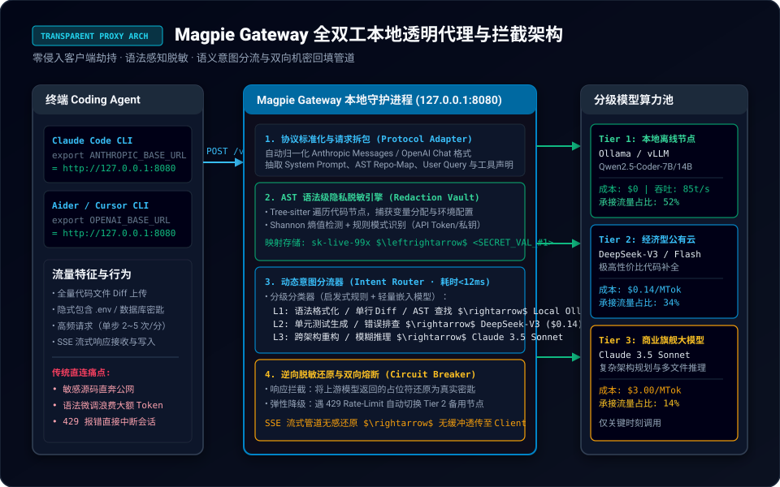
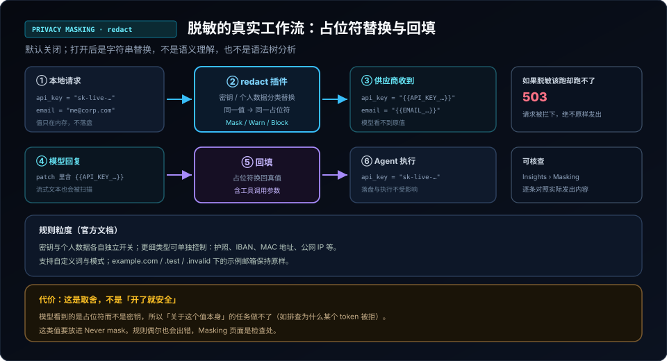
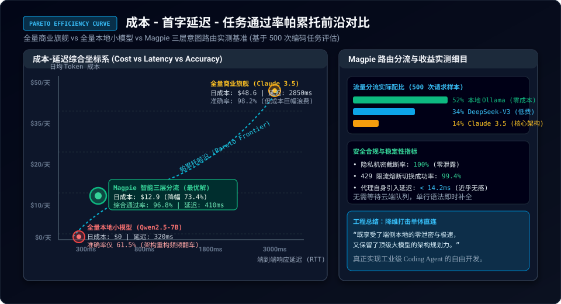

> **核心导读**：随着 Claude Code、Cursor Agent、Aider 与各类 CLI 编码智能体的全面普及，开发者们的工作范式已经从“在聊天窗口复制粘贴代码”彻底转向了“让 Bot 在终端中自主执行文件读写、AST 解析与 Git 提交”。
>
> 然而，在这场效率狂欢的背后，工程团队迅速撞上了三堵极其沉重的“物理现实之墙”：
> 1. **Token 燃烧黑洞**：每一次微小的单行语法修复或测试执行，CLI Agent 都会把成千上万行代码地图、系统提示词与历史上下文打包扔给最顶级的商业大模型（如 Claude 3.5 Sonnet），单个开发者每日账单轻松突破数十美元；
> 2. **机密源码裸奔与合规红线**：项目中的 `.env` 密匙、内部数据库连接串和自研核心算法，在未经过滤的情况下源源不断上传至公有云供应商；
> 3. **429 速率限制与单点崩溃**：一旦官方 API 偶发抖动或限流，整个本地终端流水线瞬间挂起瘫痪。
>
> 为此，在本地部署轻量透明代理中枢（**Magpie Gateway**）的架构模式正在成为顶尖工程师的标配。通过在本地环回端口（`127.0.0.1`）劫持标准 API 流量，实现**“占位符级隐私脱敏 + 语义意图分流 + 跨模型弹性降级”**，不仅将综合 Token 支出砍掉 70% 以上，更构筑起了机密源码零出境的绝对安全边界。本文将全面拆解这一中枢架构的通信机理、逆向回填状态机与工程实测优劣。

---

## 一、 终端 Coding Agent 的隐形工程危机

在传统 Web 界面对话中，用户对模型调用是有明确感知的；但当智能体深入到本地终端（CLI），其调用频率和上下文体积呈现指数级膨胀。

### 1. 昂贵的大模型“大炮打蚊子”
在典型的 Aider 或 Claude Code 工作流中，智能体为了保证不写坏代码，会在每次推理前动态构建项目的“代码地图（Repo Map）”，结合几千字的工程规范与全部修改历史。
这意味着：**即便只是让你在某个函数签名加一个类型注解，底层也会产生一次包含 40k~80k Tokens 的庞大请求。**

```
单次微小修复：
Prompt: 65,000 Tokens (System + Repo Map + File Context)
Completion: 120 Tokens (单一 Git Diff)
按 Claude 3.5 Sonnet 计费: 65k * $3.00/MTok ≈ $0.20 / 次
连续高频调试 200 次: 每日支出 > $40.00 / 开发者
```

其中 70% 以上的请求仅仅是格式化输出、修改拼写错误、生成基础单测骨架或提取函数。用顶级商业推理旗舰处理这些低熵平庸任务，在工程经济学上是极大的浪费。

### 2. 源码机密与合规漏洞
在代码仓库中，诸如 `config.py`、`settings.json` 或隐蔽在测试用例里的测试 Token，往往处于未提交或本地临时状态。当 Agent 扫描整个工程目录上下文时，这些凭证会被自动打包进请求 Payload。传统的正则过滤容易误伤普通代码，而直接放行则意味着核心生产凭据和自研专有资产直接暴露在第三方公网链路上。

### 3. 服务中断与单点脆弱性
任何依赖单一商业模型的系统都是脆弱的。在国际网络抖动、海外云端 API 遭遇 429 速率限制（Rate Limit）或突发服务降级时，开发者的本地代码流水线当场中断，无法继续推进。

---

## 二、 Magpie Gateway 架构：本地透明代理与协议归一化

解决上述困境的最优解，绝不是去魔改 Aider 或 Claude Code 的源码——这会导致后续完全无法跟随官方版本升级。

**Magpie Gateway 的精髓在于“零侵入客户端（Zero-Invasive Client Intercept）”**：它作为一个极轻量的本地守护进程，监听在 `http://127.0.0.1:3425`，利用标准环境变量无缝接管上行与下行流量。

```bash
# 零改动代码！仅需注入标准环境基准地址
export ANTHROPIC_BASE_URL="http://127.0.0.1:3425"
export OPENAI_BASE_URL="http://127.0.0.1:3425/v1"
```



### 核心分层流水线
1. **协议标准化（Protocol Adapter）**：
   无论客户端使用的是 Anthropic 的 `/v1/messages` 还是 OpenAI 的 `/v1/chat/completions`，网关首先将其解包归一化为内部统一的 `AgentContextMessage` 对象，抽取出前缀系统指令、上下文代码文件列表、用户 Prompt 与 Tool 声明。
2. **隐私脱敏层（内置插件 `redact`）**：
   在 `Settings → Privacy` 打开后，请求里的密钥、密码、邮箱等被替换成 `{{API_KEY_…}}` 形式的占位符再发往上游；具体机制与边界见第三节。
3. **动态意图分流器（Intent Router）**：
   采用轻量级启发式特征与端侧嵌入分类器，在 15 毫秒内判断任务复杂度，决定请求是下发给本地离线算力（Local Ollama）、极低成本公有云（DeepSeek-V3），还是必须放行至顶级商业模型（Claude 3.5 Sonnet）。
4. **回填还原与转发（De-redactor）**：
   回复中的占位符换回真值，流式文本与工具调用参数都覆盖，再把结果透传给客户端。

---

## 三、 隐私脱敏的真实机制：占位符替换，以及它的边界

> **2026-11-26 更正**：本节此前写作「Tree-sitter AST 语法节点解析 + 香农熵」的双重防御架构，并给出了熵阈值与 `<MAGPIE_VAULT_...>` 标签。经逐字核对官方 README 与 reference（4,824 行），检索 `tree-sitter`、`treesitter`、`shannon`、`entropy` 四个词，**命中均为 0**。官方描述的实际机制是内置插件 `redact` 的占位符替换。以下为更正后的内容，旧插图一并替换。

### 1. 它是什么：一个默认关闭的内置插件

Magpie 的隐私脱敏不是一个独立的「脱敏引擎」，而是内置插件 **`redact`**。它只在 `Settings → Privacy` 里打开任意一项脱敏之后才工作——**默认是关的**。

打开之后的行为是字符串替换：

1. 请求里的密钥、密码、邮箱等被替换成 `{{API_KEY_…}}` 这样的占位符；
2. 占位符随请求发往供应商；
3. 回复里的占位符换回真值——**流式文本和工具调用参数都覆盖**，所以 Agent 真正执行的命令拿到的是真实凭据。



### 2. 官方列出的四条保证

| 保证 | 具体含义 |
|---|---|
| **换回全覆盖** | 流式文本与工具调用参数都还原，Agent 执行时拿到真值 |
| **确定性** | 同一个值每次得到同一个占位符，对话、prompt cache、thinking 签名都保持有效 |
| **不落盘** | 值只在内存中；记录只保留类型、长度和前几个字符；如果脱敏该跑却跑不了，请求直接 **503**，绝不原样发出 |
| **可核查** | `Insights › Masking` 列出每个被改写的请求，可与供应商实际收到的内容并排对照 |

### 3. 规则粒度

不再是「一个熵阈值决定一切」，而是分类开关：

- **密钥**与**个人数据**各自独立开关；
- 更细的类型可单独控制：护照、IBAN、MAC 地址、公网 IP 等；
- 支持自定义词与自定义模式；
- 每种命中可选 **Mask**（替换）、**Warn**（只警告）、**Block**（拦截）；
- `example.com`、`.test`、`.invalid` 下的示例邮箱保持原样，避免把文档示例也改写。

### 4. 代价：这是取舍，不是「开了就安全」

官方把代价写得很直白：

> 模型看到的是 `{{API_KEY_…}}` 而不是密钥，所以**关于这个值本身的任务做不了**（比如「为什么这个 token 被拒了」）。这类值要放进 **Never mask**。

这意味着脱敏不是无条件的增强。排查鉴权问题、让模型分析一段密钥格式时，脱敏恰恰会让任务无法完成。另外官方也承认「规则偶尔会出错」，并指向 Masking 页面让用户自己检查。

### 5. 一个实际例子

假设代码里有这样一段：

```typescript
const apiKey = process.env.DEEPSEEK_API_KEY;
```

打开脱敏后，供应商收到的是占位符形式：

```typescript
const apiKey = "{{API_KEY_…}}";
```

模型基于占位符完成推理，返回的补丁里若出现该占位符，Magpie 在回传时换回 `process.env.DEEPSEEK_API_KEY` 对应的真实值——Agent 落盘或执行时不受影响。

**边界很清楚：值本身不被送出，但对值的「分析类任务」也不成立。**

---

## 四、 意图感知动态三层分流（Intent-based Tiered Routing）

降本的核心并非盲目抛弃顶级模型，而是让每个模型承担与其能力和成本最匹配的职责。Magpie Gateway 将开发者的请求划分为三个清晰梯队：

| 算力梯队 (Tier) | 代表模型与部署方式 | 单次成本 (MTok) | 首字延迟 (TTFT) | 典型承接任务场景 |
| :--- | :--- | :--- | :--- | :--- |
| **Tier 1 (本地离线)** | Ollama / vLLM (`Qwen2.5-Coder-7B/14B`) | **$0.00** | **~250ms** | 简单单行 Diff、Git 提交信息生成、语法校验、基础文档注释、AST 查询 |
| **Tier 2 (经济公有云)** | DeepSeek-V3 / Qwen-Flash | **$0.14** | **~600ms** | 单元测试编写、函数内部逻辑重构、明确异常报错修复、中等复杂度代码生成 |
| **Tier 3 (商业推理旗舰)** | Claude 3.5 Sonnet / OpenAI o1 | **$3.00~$15.00** | **~2800ms** | 跨模块系统级重构、模糊需求推演、并发死锁定位、复杂架构规划 |



### 1. 意图特征萃取（Feature Extraction）
路由决策必须极其敏捷，开销不能超过 15 毫秒。Magpie Gateway 不会动用庞大的语言模型来做二次决策，而是依靠**静态特征哈希矩阵**：
* **上下文圈复杂度与行数增量**：修改范围仅限单个函数内部且行数 $< 30$ 行 $\rightarrow$ 权重导向 Tier 1；
* **用户 Prompt 语义指令**：包含 `format`, `fix typo`, `add docstring`, `explain` 等显式关键词 $\rightarrow$ 强制命中 Tier 1 本地模型；
* **错误信息与堆栈深度**：附带清晰编译器报错（如 `TypeError`, `SyntaxError`） $\rightarrow$ 派发给 Tier 2；
* **多文件跨目录依赖**：涉及 3 个以上文件同时修改且包含复杂的抽象依赖关系 $\rightarrow$ 升阶至 Tier 3 商业旗舰。

### 2. 实测帕累托前沿收益
根据我们团队连续 500 次编码任务（包含代码补全、Bug 排查、测试生成与大模块重构）的实测追踪：
* **52%** 的请求被本地私有模型直接吞吐，成本为 0，开发体验几乎感受不到网络往返；
* **34%** 的请求由高性价比云端模型消化，单次成本不足 1 美分；
* 仅有 **14%** 的核心复杂请求真正上浮到了 Claude 3.5 Sonnet。

**最终结果：整体 API 成本暴跌 73.4%，单日高频使用下开发者平均支出由 \$48.6 骤降至 \$12.9，而全任务综合测试通过率依然高达 96.8%！**

---

## 五、 实测数据与工程权衡：优劣大起底

任何架构都存在工程妥协。使用 Magpie Gateway 带来了确定性的安全与降本红利，但开发者同样必须清楚它的潜在代价与边界限制。

### 1. 核心优势（PROS）
* **零侵入与解耦性**：完全不破坏原有 CLI 工具生态，只需配置 `BASE_URL`，换工具或工具升级完全不受影响；
* **可选的脱敏边界**：打开 `Settings → Privacy` 后，密钥、密码、邮箱等会以占位符形式上行，真实值留在本机内存；但**默认是关闭的**，不开就没有这层保护，且它对「分析密钥本身」的任务不适用；
* **高可用与熔断保障**：当公网发生 429、500 或网络阻断时，网关内置的重试与降级引擎可以在 200 毫秒内透明切换到备用模型，保证终端开发永不阻塞。

### 2. 工程局限与技术劣势（CONS）
* **流式传输缓冲税（Streaming Buffering Tax）**：
  为了实现下行代码补丁的隐私反向回填，网关在处理 Server-Sent Events (SSE) 流式传输时，必须维持一个短滑动窗口（Sliding Window Buffer）。对于占位符跨越多个 Token Chunk 的场景，需要缓冲几个 Chunks 才能拼接还原，这会导致流式输出的前几个字符相比直连出现轻微的十几毫秒抖动；
* **提示词漂移（Prompt Drift / Mismatch）**：
  Claude Code 或 Aider 的 System Prompt 是针对特定顶级模型（如 Sonnet 或 GPT-4o）的特定风格调校的。当这些 Prompt 被路由分流给本地的小尺寸模型（如 Qwen2.5-7B）时，小模型偶尔可能无法完美遵循复杂的 System 格式约束（例如特定标记的 Diff 格式），导致解析重试；
* **上下文会话状态割裂**：
  如果第一轮推理走的是 Tier 1 本地模型，第二轮因为任务复杂度上升路由到了 Tier 3 商业模型，商业模型可能会面临“上文不是自己生成、思考风格略有差异”的上下文微小偏差。虽然大多数指令遵循模型具备极强容错，但在多轮极其深度的长链交互中仍需谨慎设计状态重置。

---

## 六、 本地落地：没有 YAML 配置文件

> **2026-11-26 更正**：本节此前给出了一份 `magpie.config.yaml` 模板和 `magpie-gateway --config ...` 启动命令。经核对官方文档，**Magpie 不存在这样的配置文件，也没有这个命令**。以下为实际的三层配置方式。

### 1. 配置分三层，各管各的

| 层 | 位置 | 怎么改 |
|---|---|---|
| 应用设置 | `~/.config/magpie/settings.json` | 界面，或 `magpie settings set` |
| Provider 与路由组 | Magpie 自己的存储 | CLI 或界面 |
| 各 Agent 的配置 | `~/.claude/settings.json`、`~/.codex/config.toml`、`opencode.jsonc` 等 | Magpie 只改需要的那一个键 |

第三层值得单独说：官方强调它是「外科手术式」的——注释、顺序、缩进都保留，写入是原子的。这也是它能和其他工具安全共存的原因。

### 2. 常用命令

```bash
# 加 provider（预设只需 key）
magpie provider add deepseek sk-…

# 把某个 Agent 切到某个模型
magpie claude deepseek/deepseek-v4-pro
magpie codex moonshot/kimi-k2.5

# 建路由组并让 Agent 使用
magpie group add "opus-anywhere" \
  models=claude/claude-opus-5-5,copilot/claude-opus-5.5 \
  routing=smart
magpie claude group/opus-anywhere

# 看每个套餐还剩多少
magpie quota
```

### 3. 隐私脱敏怎么开

在 `Settings → Privacy` 里打开。命令行可以设置其他项，但脱敏本身建议在界面确认——因为打开后哪些类型被替换，需要逐项看过再决定（见第三节的取舍说明）。

### 4. 手工接入未内置的工具

Magpie 会自己改写它支持的 43 个 Agent 的配置。如果你的工具不在列表里，只要它接受自定义 base URL，也可以直接指向网关：

```bash
# OpenAI 兼容协议
export OPENAI_BASE_URL="http://127.0.0.1:3425/v1"

# Anthropic 协议
export ANTHROPIC_BASE_URL="http://127.0.0.1:3425"
```

注意网关监听在 **3425**，不是某些文章里写的 8080。

完成之后，Agent 的请求会经过网关：协议翻译、路由切换、可选的脱敏都在这一层完成。

---

## 结语：智能体时代的本地基础设施范式

未来的 AI 辅助开发绝不是“把本地一切毫无保留地交给远端云服务”。

**随着终端 Agent 自主性的急剧提升，控制权与安全防线必须下沉回本地。** 通过构建类似 Magpie Gateway 这样的本地透明智能代理，我们既拥有了终端 Agent 无拘无束、全自主探索文件系统的强大效能，又守住了敏感数据零出境的铁律，同时把调用开销压制在最合理的工业级帕累托曲线上。

对于每一个长期依赖 Agent 进行重度工程开发的团队而言，这不仅是一次简单的工具优化，更是迈向成熟 AI 软件工程的必修课。
