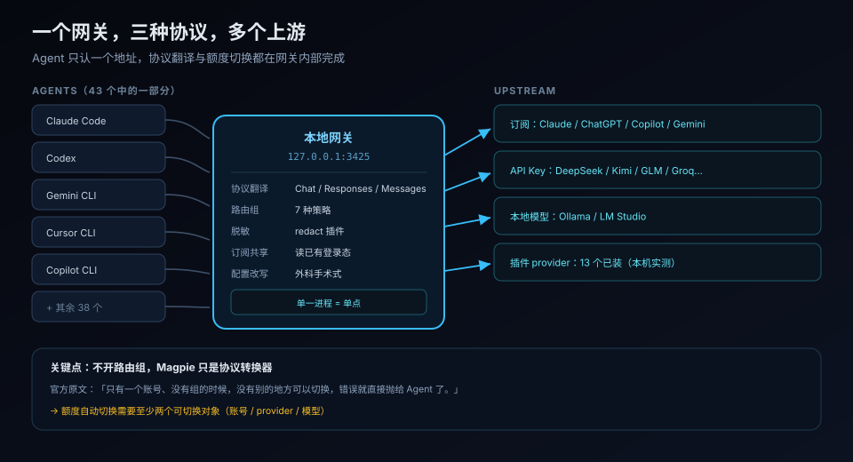
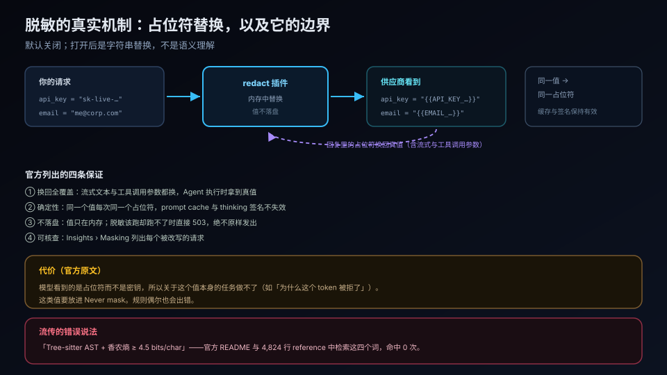
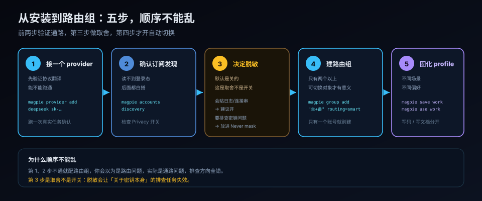

> **核心导读**：Magpie 是一个本地模型网关——让 Claude Code 跑在 Kimi 上、Codex 跑在 DeepSeek 上、Gemini CLI 跑在 GLM 上，全部从菜单栏切换。41,456 星、MIT 许可、Go 写的、支持 43 个 Agent。
>
> 这篇不写宣传稿。我基于本机实际安装的 0.1.4783 版本和官方文档，把三件事讲清楚：**它到底怎么工作**（协议翻译、路由组、订阅共享）、**它擅长什么**（三个真实场景）、**它哪里不行**（5,140 个 open issue 背后的问题、隐私脱敏的真实代价、路由失效的边界）。
>
> 另外要纠正一处流传的错误说法：网上有文章称 Magpie 的脱敏用了 Tree-sitter AST 解析和香农熵判定。我逐字核对过官方文档——**全文没有出现这两个词**。真实的机制是 `redact` 插件做的占位符替换。这个差别不小，第五节会展开。

---

## 一、问题：每个 Agent 都是一座孤岛

先说清楚它解决什么问题，否则后面所有功能都无从理解。

现在的开发机上一半人装了不止一个 Agent：Claude Code、Codex、Gemini CLI、Cursor CLI、Copilot CLI……每一个都有自己的配置文件、自己的密钥格式、自己的 base URL。

后果是三个：

1. **订阅被锁死。** 你付了 ChatGPT Plus，但那个额度只在 Codex 里能用；你付了 Claude Max，只在 Claude Code 里能用。同一份钱买不到跨工具的通用性。
2. **额度用尽就断。** 一个账号跑完 5 小时窗口，Agent 直接报错，你只能干等或者手动切。
3. **配置散落。** `~/.claude/settings.json`、`~/.codex/config.toml`、`opencode.jsonc`、`config.yaml`——格式各不相同，改一个模型要记住四套语法。

Magpie 的做法是：**在本机跑一个网关，所有 Agent 都指向它。**

```
Claude Code ─┐
Codex ───────┤
Gemini CLI ──┼──→ 127.0.0.1:3425 ──→ 各家供应商
Cursor CLI ──┤      (本地网关)
Copilot CLI ─┘
```

这个网关同时讲三种 API：OpenAI Chat Completions、OpenAI Responses、Anthropic Messages。协议之间的翻译（包括流式和工具调用）在 Magpie 内部完成，Agent 完全感知不到。



---

## 二、它怎么工作

### 2.1 一个二进制，改配置是「外科手术」

官方文档里有个说法值得引用：**「只碰你要改的那一个键」**——`settings.json`、`config.toml`、`opencode.jsonc` 里的注释、顺序、缩进全部保留，写入是原子的。

这一点在实际使用中比听起来重要。很多工具接管配置文件的方式是整体重写，结果是你的注释没了、键的顺序变了、diff 一片红。Magpie 的做法让它能安全地和其他工具共存。

体积也克制：带桌面版约 30MB（用系统 webview，不打包浏览器内核），纯终端版不到 30MB。

### 2.2 订阅共享：读你已有的登录态

这是我认为最有价值的一个设计。

你在 Claude Code 里登录过、在 Codex 里登录过、在 Copilot 里登录过——Magpie 会读这些登录态（Claude Code 和 Codex 的文件、macOS 的 Keychain），把它们变成可用的 provider。**不需要复制 token，不需要粘贴密钥。**

效果是：你付的 Claude 订阅，可以在 Cursor CLI 里用；你付的 ChatGPT 订阅，可以在 Gemini CLI 里用。

如果你不想让它读，有两个开关：`Settings → Privacy → Subscription accounts` 关掉，或者 `magpie accounts discovery off`。临时禁用可以设 `MAGPIE_NO_ACCOUNTS=1`。

### 2.3 路由组：额度用尽自动换

这是 Magpie 最核心的机制，也是最容易被误解的地方。

先说不开路由组会怎样——官方文档写得很直白：

> 只有一个账号、没有组的时候，没有别的地方可以切换，错误就直接抛给 Agent 了。

也就是说，**不开路由组，Magpie 只是一个协议转换器，不会帮你兜底。**

开了路由组之后，一个组里可以放多个成员（不同账号、不同供应商、甚至不同模型），然后选择策略：

| 策略 | 行为 | 适合场景 |
|---|---|---|
| `smart`（默认） | 在有余额的订阅里，选**额度最早重置**的那个 | 想让额度滚动起来，避免浪费 |
| `order` | 按顺序用第一个，直到它答不了再换下一个 | 有明确的主备关系 |
| `rotate` | 每轮换一个 | 分摊用量，避免单个账号跑太快 |
| `usage` | 最少使用的优先 | 均衡负载 |
| `pace` | 按周节奏，选**剩余周额度按小时折算最多**的 | 想让整周都用得上，而不是周初烧完 |
| `weight` | 按权重分配，平滑交错 | 主力账号 3 份、备用 1 份这种 |
| `fast` | 选最近**首字最快**的 | 同一个模型在多个渠道都有时，挑最快的 |

`smart` 的默认行为值得单独说：它不是「选余额最多的」，而是「选**最早重置**的」。这个选择很聪明——因为额度会过期，先用掉即将过期的才是最优解。

命令行示例：

```bash
# 建一个组，把 Claude 和 Copilot 的 Opus 放进去
magpie group add "Opus anywhere" \
  models=claude/claude-opus-5-5,copilot/claude-opus-5.5 \
  routing=smart

# 让 Claude Code 用这个组
magpie claude group/opus-anywhere
```

### 2.4 插件：provider 与 middleware 两类

本机装了 13 个插件，全部是 provider 类型，覆盖 Gemini AI Studio、Groq、Hetzner、腾讯轻帆、Packet AI 等。它们的共同特点是：**提供免费额度或低价通道**。

插件分两类：

- **Provider 插件**：新增模型来源。负责登录、列模型、发请求。
- **Gateway middleware**：拦截并改写请求/响应。钩子包括 `onRequest`、`onAccount`、`onProvider`、`onEvent`、`onResponse`。

官方明确说了一句安全设计：**不允许应用自己注册成 Agent，也不允许不经用户同意安装插件。** `magpie://import` 链接只能添加 provider。

这条限制值得肯定——它防的是「某个网页诱导你点一下就把 Magpie 变成它的代理」。

---

## 三、它擅长什么：三个真实场景

### 场景一：一份订阅，多个 Agent 共用

最直接的收益。你有 Claude Max，但习惯用 Cursor CLI——以前只能二选一，现在可以让 Cursor CLI 走 Magpie 用 Claude 的额度。

配置成本：在 Agents 页面点一下，或者一行命令。

```bash
magpie claude deepseek/deepseek-v4-pro    # Claude Code 跑在 DeepSeek 上
magpie codex moonshot/kimi-k2.5           # Codex 跑在 Kimi 上
```

### 场景二：额度滚动，不中断

开了路由组之后，一个账号的 5 小时窗口用完，自动切到下一个。Agent 侧完全无感——它看到的是网关返回的正常响应。

这对长时间跑的 Agent 任务很关键。以前跑到一半报 429，上下文全丢；现在会静默切换，任务继续。

前提是：**你确实有第二个账号或第二个 provider。** 只有一个账号时，这个功能等于不存在。

### 场景三：模型与 Agent 解耦

Claude Code 用 Kimi、Codex 用 DeepSeek 这种组合，在官方 README 里是主推的卖点。

实际价值在于：不同 Agent 的交互设计各有优劣（有人喜欢 Claude Code 的 plan mode，有人喜欢 Codex 的 sandbox），但你不必被绑定在它的原生模型上。

---

## 四、它哪里不行

这部分是我认为最有价值的内容，因为官方文档不会集中写，但实际用起来一定会撞上。

### 4.1 5,140 个 open issue，PR 不对外开放

先看数字：仓库 41,456 星、3,806 fork，但 **open issues 有 5,140 个**。这个比例说明迭代速度快、但积压也重。

更关键的是这一条，来自官方 README：

> **这个仓库不接受 pull request。** 只有维护者可以开 PR。如果你想要修复或功能，在 Discord 上描述，我们来建。

这是一个明确的产品决策，但代价也明确：**你不能自己修 bug。** 遇到问题时，你的选项只有「等」或者「fork 自己维护」。

对个人用户可能无所谓，对团队使用就是一个真实的评估项。

### 4.2 隐私脱敏：默认关闭，且有能力边界

这是最需要说清楚的一点。

**第一，它默认是关的。** 官方原话：`Settings → Privacy` 里打开才会生效。也就是说，装完直接用，你的密钥、邮箱、密码会原样发给供应商。

**第二，它的机制是占位符替换，不是语义理解。**

打开之后，一个密钥会变成 `{{API_KEY_…}}` 这样的占位符发出去，回复里再换回来。官方列了四条保证：

- 换回是全覆盖的，包括流式文本和工具调用参数——所以 Agent 真正执行的命令里是真实密钥
- 同一个值每次得到同一个占位符，所以对话、prompt cache、thinking 签名都保持有效
- 值只在内存里，不落盘；如果脱敏该跑却跑不了，请求直接 503，绝不原样发出
- `Insights › Masking` 能看到每个被改写的请求

**但代价写得也很直白：**

> 模型看到的是 `{{API_KEY_…}}` 而不是密钥，所以**关于这个值本身的任务做不了**（比如「为什么这个 token 被拒了」）。这类值要放进 **Never mask**。

这句话很重要。它意味着脱敏不是一个「开了就万事大吉」的开关——它是**用功能换取安全**的取舍。你排查一个鉴权问题时，脱敏恰恰会让问题无法排查。

**第三，规则可能出错。** 官方承认「规则偶尔会错」，并指向 Masking 页面让你自己检查。

### 4.3 关于「Tree-sitter AST 脱敏」的错误说法

这一点必须单独写，因为我核对时发现了明确的不一致。

站内 2026-11-12 那篇 Magpie 文章（以及可能还有其他流传的版本）声称：

> Magpie Gateway 采用了「Tree-sitter AST 语法节点解析 + 香农熵（Shannon Entropy）」的双重防御架构
> 对于长度超过 16 个字符、且 H(X) ≥ 4.5 bits/char 的高随机度字元，系统判定其极大概率属于加密密钥

我逐字检索了官方 README 和 4,824 行的 reference 文档：

```
tree-sitter / treesitter / shannon / entropy  →  命中 0 次
```

官方文档里描述脱敏的原话是：**「隐私脱敏是内置插件 `redact`」**，机制是占位符替换，规则的粒度是「密钥、密码、邮箱」以及「护照、IBAN、MAC、公网 IP」这类更细的分类。

也就是说：**Tree-sitter、香农熵、4.5 bits/char 这个阈值，在官方文档里找不到任何依据。**

我不确定这些说法的来源——可能是早期版本的实现，也可能是想象出来的技术细节。但既然现在文档里没有，就不该当作事实写。**这类「看起来很专业但查无实据」的技术描述，正是最容易误导读者的东西。**

如果有人能拿出源码证据证明早期版本确实这么实现，欢迎指正——但至少在当前版本（0.1.4783）的官方文档里，这个说法站不住。



### 4.4 遥测：默认开，可以关

Magpie 每天会上报一次使用情况：随机 id、版本、系统、用了哪些 Agent/provider/model（用 Magpie 自己的 id，自己加的 provider 只记作 `custom`）、装了哪些插件。

官方明确说：**不含名字、URL、账号、密钥、prompt、用量。** 可以整体关掉（`Settings → Privacy` 或 `DO_NOT_TRACK=1`）。

但有两处**无论设置如何都会经过服务器**：

- 合作伙伴的链接走 `usemagpie.ai/go/…`，会记录点击
- 插件图标走 `usemagpie.ai/api/icon`，对方看到的是 Cloudflare 的地址

官方说服务器不保留 id 或地址。这个设计是否可接受，取决于你的合规要求——但至少它写清楚了，没有藏。

### 4.5 单点：网关挂了，全部 Agent 都挂

这是架构决定的，没法避免。所有 Agent 都指向 `127.0.0.1:3425`，网关进程挂了，43 个 Agent 同时失效。

官方提到终端版的行为：**「终端版在打开时提供网关（当没有其他 magpie 在跑时），它退出时连着的 Agent 就失去连接。」**

实际影响：如果你用的是 TUI 或 CLI 版本而不是常驻的菜单栏 App，关掉终端就等于断了所有 Agent。

### 4.6 模型列表的滞后

模型列表来自供应商，名称和推理等级从 models.dev 补充，每 6 小时刷新一次。

官方原话：「今天早上发布的模型，下次刷新就在你的选择器里了。」

听起来不错，但反过来说：**如果 models.dev 没收录，或者供应商的列表有延迟，你就选不到。** 官方也承认「一个供应商提供但 models.dev 没列出的模型」是存在的边界情况。

---

## 五、和同类工具比，它的位置在哪

| 维度 | Magpie | 直接用各家 CLI | LiteLLM 这类网关 |
|---|---|---|---|
| 部署 | 本地菜单栏 App / CLI / Docker | 无需部署 | 需要跑服务 |
| 配置方式 | 改 Agent 自己的配置文件（外科手术式） | 各自配置 | 改 Agent 的 base URL |
| 订阅共享 | ✅ 读已有登录态 | ❌ | ❌ 只支持 API key |
| 额度自动切换 | ✅ 路由组 | ❌ | 部分支持 |
| 协议翻译 | ✅ 三种 API 互转 | — | ✅ |
| 隐私脱敏 | ✅ 占位符替换（默认关） | ❌ | 需自己实现 |
| 能否自己修 bug | ❌ 不接受 PR | — | ✅ |

Magpie 的差异化很清晰：**它不是给服务端用的网关，是给个人开发机用的。**

LiteLLM 那类工具解决的是「团队统一入口、集中计费、审计」，Magpie 解决的是「我一个人有五个 Agent 三个订阅，怎么不打架」。

这也解释了为什么它坚持做桌面 App、菜单栏、TUI——这些都是个人工具的形态。

---

## 六、如果你要用，按这个顺序



**第 1 步：先只接一个 provider，验证通路。**

```bash
magpie provider add deepseek sk-xxx
magpie codex deepseek/deepseek-v4-pro
```

跑一次确认能用。这一步排除掉协议翻译的问题。

**第 2 步：确认订阅发现是否读到了你的登录态。**

```bash
magpie accounts discovery          # 看读到了什么
magpie quota                       # 看每个套餐还剩多少
```

如果读不到，检查 `Settings → Privacy → Subscription accounts` 是否被关了。

**第 3 步：决定要不要开脱敏。**

- 如果只是自己写代码、密钥都在环境变量里 → 可以不开，减少排查成本
- 如果会把日志、配置、数据库连接串贴给模型 → 建议开，但要接受「关于密钥本身的问题查不了」

**第 4 步：有第二个账号或 provider 时，再建路由组。**

只有一个账号就别建，建了也没有可切换的对象。

```bash
magpie group add "主力+备用" \
  models=claude/claude-opus-5-5,copilot/claude-opus-5.5 \
  routing=smart
```

**第 5 步：用 profile 固化不同工作场景。**

```bash
magpie save work && magpie use work
```

这一步在你有「写代码」和「写文档」两套不同模型偏好时特别有用。

---

## 七、结论

**适合谁：**

- 装了 2 个以上 Agent，且被配置文件分散困扰
- 有多个订阅账号，想让它自动滚动
- 想让 Claude Code 用非 Anthropic 模型，或者反过来

**不适合谁：**

- 只有一个 Agent、一个订阅、用得挺顺——官方自己都说「你不需要它」
- 需要能自己改代码修 bug 的团队
- 对遥测零容忍的环境（虽然能关，但两处链接计数关不掉）

**我的判断：**

Magpie 解决的问题是真实的，设计也克制——它没有试图做成一个大而全的平台，而是专注在「本地、个人、多 Agent」这个缝隙里。

但它不是无痛的。5,140 个 open issue、不接受 PR、脱敏默认关闭且有能力边界、网关是单点——这些都是用之前该知道的。

最值得警惕的反而不是这些已知问题，而是**围绕它流传的、查无实据的技术描述**。我这次核对时就撞到一个：所谓的 Tree-sitter AST 加香农熵脱敏，在官方文档里一个字都找不到。工具本身没问题，但如果你基于错误的机制理解去评估它的安全性，结论一定是错的。

---

## 参考资料

**官方来源**

- GitHub 仓库 `yetone/magpie`：<https://github.com/yetone/magpie>（41,456 星 / 3,806 fork / MIT / Go，抓取于 2026-11-26）
- README：<https://github.com/yetone/magpie/blob/main/README.md>
- 完整参考手册（4,824 行）：<https://github.com/yetone/magpie/blob/main/docs/reference.md>
- 插件开发文档：<https://github.com/yetone/magpie/blob/main/docs/integrating.md>
- 官网：<https://usemagpie.ai>

**本机实测**

- 版本 0.1.4783（`CFBundleShortVersionString`）
- 已安装 13 个 provider 插件：amd-radeon、apinex、boundless、coarena、dahl、gemini-studio、groq、hetzner、leaflow、lightvela、packet-ai、runcrate、toter
- 网关监听 `127.0.0.1:3425`，插件守护进程监听 `127.0.0.1:4390`
- 配置目录 `~/.config/magpie`，插件目录 `~/.magpie/plugins`

**本文核实的一处错误说法**

- 「Tree-sitter AST + 香农熵脱敏」在官方 README 与 reference 文档中检索 `tree-sitter`、`treesitter`、`shannon`、`entropy`，命中均为 0；官方描述的真实机制是内置插件 `redact` 的占位符替换
