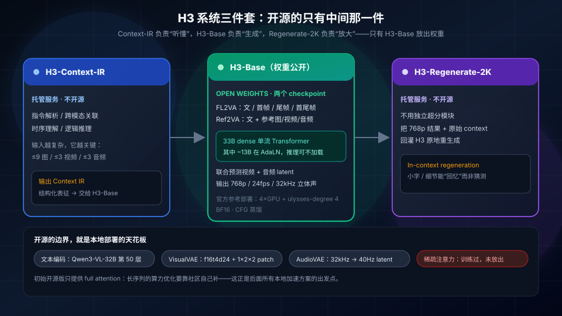
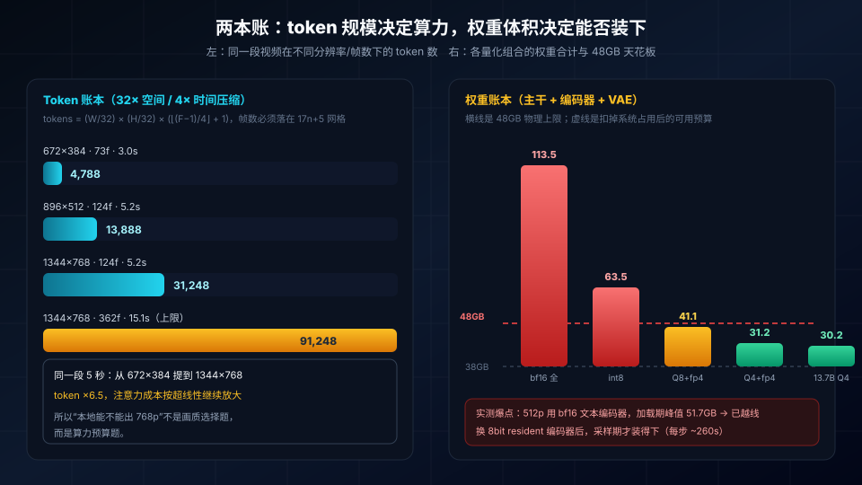
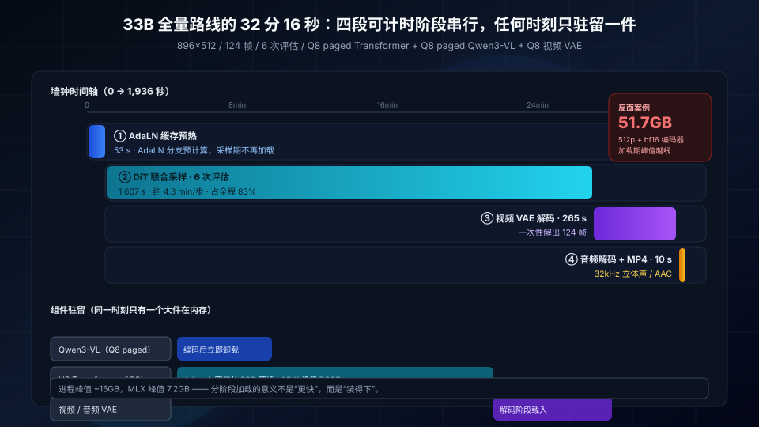
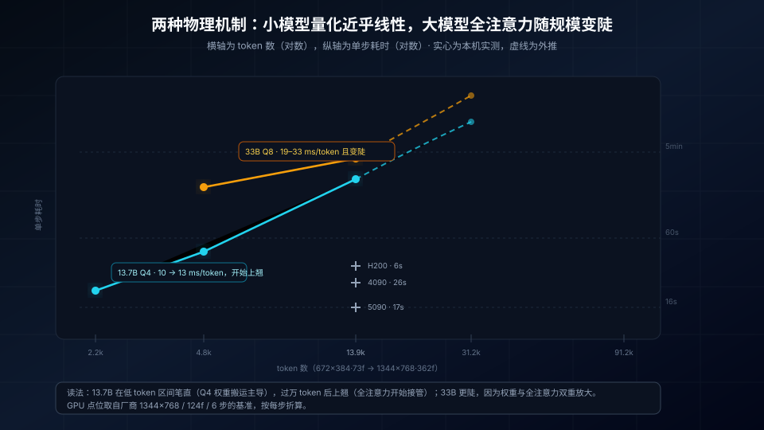
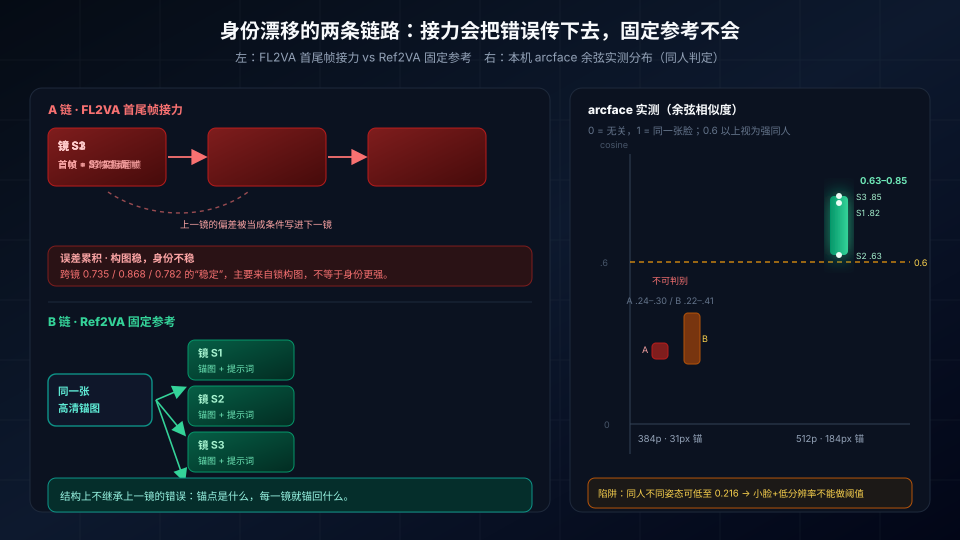

> **核心导读**：MiniMax-H3 是 2026 年最具野心的开源全模态生成系统之一——一段文字或几张参考图进去，出来的是一段**带原生 32 kHz 立体声**的视频，最长 15 秒，最高 2K。它在 Hugging Face 上一个月被拉取 600 多万次，社区一周内就攒出了 GGUF、INT8、Turbo LoRA、MLX 移植和一整套剪枝少步版本。
>
> 但"开源"两个字在这份权重上需要拆开看：完整系统由 **H3-Context-IR（指令理解）**、**H3-Base（生成主干）**、**H3-Regenerate-2K（2K 重生成）** 三件套组成，只有中间那件放了权重；官方参考部署是 `4 × GPU + ulysses-degree 4`，压根没把单卡消费级设备写进目标机型。而训练末期引入的稀疏注意力，初始开源版**只有 full attention**。
>
> 于是真正的问题不是"能不能跑"，而是"在 48GB 统一内存的 Mac 上，用哪条路线跑、代价多少、什么该放本地、什么必须上云"。本文用本机（Mac mini M4 Pro / 12 核 / 48GB）的真实日志回答这三个问题：
>
> - **全量 33B + Q8 paged + MLX**：896×512 / 5.17 秒 / 6 次评估，端到端 **32 分 16 秒**；
> - **社区剪枝 13.7B + Q4_K_M + ComfyUI MPS**：672×384 / 3 秒 / 4 步，端到端 **296.7 秒**，采样 46.6 秒/步；
> - 两条路线的单 token-步成本相差 **1.5~2.5 倍**，端到端相差 **2~3 倍**；而同样的活，RTX 4090 是 157 秒。
> - 512p 是分水岭：单步 182 秒，每 token 成本抬 35%，并把 48GB 机器推进 swap 区间。

---

## 一、先把 H3 的账算清楚：开源的到底是哪一块

社区讨论里最常见的误解，是把 `MiniMaxAI/MiniMax-H3` 当成"一个视频模型"。它不是。官方模型卡写得很清楚：H3 是一套**面向任务泛化设计的全模态生成系统**，由三个模块串成流水线。



### 1.1 三件套，只给了一件

| 模块 | 职责 | 是否开源 | 备注 |
|---|---|---|---|
| **H3-Context-IR** | 解析自由形态的多模态输入（文字/图/视频/音频），做跨模态关联、时序理解与逻辑推理，序列化成 H3 能吃的 Context IR | 否 | 托管服务，只提供 API；官方建议"接进你的生成管线"，或按 Prompting Guidance 自建 |
| **H3-Base** | 联合预测视频与音频 latent，输出 768p | **是** | FL2VA / Ref2VA 两个 checkpoint，BF16，CFG 蒸馏 |
| **H3-Regenerate-2K** | 把 768p 结果连同原始 context 回灌 H3，重生成 2K | 否 | 官方明确"模块未开源，后续发布"，现阶段只能用 API 验证 |

这个切分决定了本地部署的天花板：**你以为你在本地跑 H3，实际只跑了它的"嘴和手"，"耳朵和眼睛"还在云上。** 输入越复杂（多图、多视频、多音轨混合），Context-IR 的价值越大，而它恰恰不在本地。

### 1.2 参数账本：33B 里只有约 20B 需要驻留

H3-Omni-Transformer 是一个 **33B 参数的 dense 单流 Transformer**，但其中约 **13B 落在 AdaLN 相关分支**。官方原话是：这些 AdaLN 调制输出可以预计算并缓存，**推理部署时不需要加载**。这解释了后来社区 GGUF 为什么普遍标称 20B——它不是另一种模型，而是同一份权重去掉推理期不需要的那部分。

其余结构性事实：

- **文本编码器不是自研的**：H3-Encoder 直接使用 **Qwen3-VL-32B 的全量预训练权重**，取**第 50 层**的 hidden states 喂给 Omni-Transformer，并在 tokenizer 里加了 `<d>` 等特殊 token。这意味着 32GB 级别的编码器是硬成本，绕不开。
- **视觉 VAE**：时间因果的视频自编码器，空间压缩 **16×**、时间压缩 **4×**、24 个 latent 通道，记作 `f16t4d24`；随后按 `1×2×2` 沿 (t, h, w) 再 patchify，于是进入 Transformer 的有效空间下采样是 **32×**，时间仍是 4×。
- **音频 VAE**：左右声道共用编解码器、各自独立处理，把 **32 kHz** 音频压成 **40 Hz** 的 latent 序列——这就是"原生立体声"的实现路径，不是后期配音。
- **位置编码**：三维 MM-RoPE，覆盖 (t, h, w)。
- **稀疏注意力**：训练末期引入，用于压低长序列算力；但**初始开源版只有 full attention**，官方称稀疏实现将单独发布。

### 1.3 Token 账本：本地算力的分水岭不在秒数

把上面的压缩率代进去，视频 token 数可以精算：

$$
\text{tokens} = \frac{W}{32} \times \frac{H}{32} \times \left( \left\lfloor \frac{F-1}{4} \right\rfloor + 1 \right)
$$

其中帧数必须落在 `17n + 5` 的网格上（5、22、39、56、73、90、107、124 … 362）。

| 分辨率 | 帧数 | 时长 @24fps | token 数 | 相对 672×384 的倍数 |
|---|---|---|---|---|
| 672 × 384 | 73 | 3.0 s | **4,788** | 1.0× |
| 896 × 512 | 124 | 5.2 s | **13,888** | 2.9× |
| 1344 × 768 | 124 | 5.2 s | **31,248** | 6.5× |
| 1344 × 768 | 362 | 15.1 s | **91,248** | 19.1× |

分辨率和帧数各自线性贡献 token，但**注意力成本对序列长度是超线性的**。一张 48GB 的机器，真正决定"能不能出片"的不是分辨率的数字，而是这张表最右列。

---

## 二、48GB 的物理天花板：权重账本比参数表更重要

在 Mac 统一内存上，GPU 和 CPU 抢的是同一块 48GB。macOS 自身、浏览器、ComfyUI 前端常驻之后，留给权重的实际预算大约 38~40GB，还要再扣掉采样期的激活值。所以先看单件权重有多大：

| 组件 | bf16 | int8_convrot | nvfp4_awq / GGUF Q4 |
|---|---|---|---|
| H3 主干（33B） | ~62 GB | ~31 GB | Q8_0 19.97 GB / Q4_K_M 10.64 GB |
| Qwen3-VL-32B 文本编码器 | 51.5 GB | 27.1 GB | **15.7 GB** |
| 视频 VAE（fp16） | — | — | 4.8 GB |
| 音频 VAE（fp32） | — | — | 0.58 GB |



三档组合的可行性，用加法就能判断：

| 组合 | 权重合计 | 48GB 可行性 | 说明 |
|---|---|---|---|
| bf16 主干 + bf16 编码器 | 113.5 GB | **不可行** | 超出可用内存 3 倍 |
| int8 主干 + int8 编码器 | 63.5 GB | **不可行** | 只在 80GB+ 统一内存或双卡上成立 |
| Q8 主干 + nvfp4 编码器 | 41.1 GB | 勉强 | 必须错开驻留，激活余量不足 |
| Q4_K_M 主干 + nvfp4 编码器 | 31.2 GB | 可行 | 本机实测走的就是这档 |
| 13.7B 剪枝 Q4 + nvfp4 编码器 | 30.2 GB | 宽松 | 社区剪枝版的甜点 |

还有一条**只有真跑过才会知道**的实测结论：**峰值往往出现在加载阶段，而不是采样阶段。** 本机早前跑 FL2VA 512p 时，bf16 文本编码器一上就顶到 **51.7GB**，直接越过 48GB 天花板；换成 8bit 的 resident 编码器（26.3GB）之后，采样阶段反而装得下——每步约 260 秒，单镜 24 分钟，全流程无 OOM。

这就是本地部署最容易被忽略的一点：**你要规划的是加载序列的峰值，而不是稳态占用。**

---

## 三、路线 A：33B 全量 + Q8 paged + MLX（原汁原味，但慢）

要在 48GB 里跑全量 33B，唯一的办法是**不让它一次全部驻留**。本机这套 MLX 后端节点的做法是"分阶段加载、随时卸载"：任何时刻只有一个大组件在内存里，Transformer 按 4-block 窗口从 SSD 预读。



### 3.1 实测：896×512 / 5.17 秒 / 6 次评估

| 阶段 | 耗时 |
|---|---|
| AdaLN 缓存预热 | ~53 s |
| DiT 联合采样（6 evals，约 4.3 min/步） | ~1,607 s（26.8 min） |
| 视频 VAE 解码 | ~265 s |
| 音频解码 + MP4 封装 | ~10 s |
| **端到端** | **32 min 16 s** |

配置：896×512（512 短边）、124 帧、Staged Turbo（2 base + 4 Turbo，drbaph v4 step-600 LoRA）、Euler、seed 0、Q8 paged Transformer + Q8 paged Qwen3-VL + Q8 视频 VAE、`drop_adaln=True`、`projection_backend=mlx`。

384p 快速档对照：672×384 / Turbo 4 evals，端到端约 **15 分钟**，采样 689 秒（**2.6 min/步**）。

### 3.2 一个必须记住的非线性

H3 的注意力随帧数/分辨率**超线性**增长。本机记录里明确标注：5 秒拉到 15 秒，单步时间约 **×6–7**（M3 Ultra 参照），**不能拿 5 秒的耗时乘 3 去估 15 秒**。

这条结论直接决定排产：如果你按线性外推排一天 20 条 15 秒片，实际交付会掉到 3~4 条。

### 3.3 还能再快吗

已经用上的两步是 Turbo LoRA + 分阶段调度（把 6 次评估拆成 2 base + 4 Turbo）。社区还有 EasyCache（约 -40%）、BlockCache（约 -24%）、降 384p 草稿（约 -40%，token 线性下降）三条路，本机**未做 A/B**。另外，换编码器不解决速度问题——文本编码只占 1~2 分钟。

**路线 A 的定位很清楚：原始权重、语义最完整、适合研究或一次性出片；30 分钟一条 5 秒片，不适合迭代分镜。**

---

## 四、路线 B：13.7B 剪枝 + 低秩分解 + two-time 少步（社区改造，能用）

社区没有等官方的稀疏注意力，而是直接把模型"瘦身"了。HyperFlow H3 Flash 的做法可以拆成三层改造，每一层都对应一个明确的工程目标：

| 改造 | 具体做法 | 目的 |
|---|---|---|
| **结构剪枝** | fl2va 砍掉 50 块中的 3 块（第 6、21、22 块）；ref2va 砍 1 块（第 9 块） | 直接省掉 6% / 2% 的块级算力与权重 |
| **低秩分解** | fl2va 对 102 个线性层做分解（13.7B）；ref2va 114 层（13.9B） | 把"不到原模型一半"的参数量塞进 9.1GB 的 Q4 |
| **two-time (t, r) 条件** | 每个 token 同时接收当前噪声水平 `t` 与**本步终点** `r` | 让 4~8 步采样在 **CFG=1.0** 下成立 |

第三层是这套权重真正的"魔法"。传统少步蒸馏只告诉模型"现在是第几步"，模型不知道自己要去哪；two-time 把**终点噪声水平**显式喂进去，每一步都有一个明确的落点，于是 4 步也能收敛。

配套的三条 sigma 网格是固定的（`video_shift=12`、`audio_shift=3`），6 步的原始序列长这样：

```
1, 0.825217, 0.471725, 0.147401, 0.049626, 0.015517, 0
```

4 步（速度）和 8 步（质量）各有对应的网格，**不允许自己调**——CFG 也必须严格等于 1.0，这是蒸馏模型最容易踩的坑。Unsloth 的 GGUF 文档甚至专门写了"`--cfg-scale 1.0` 不是可选项，H3 是蒸馏且无 CFG 的，默认 7.0 会直接报错"。

### 4.1 本机实测：296.7 秒出一条 3 秒片

| 尺寸 | 帧数 | 步数 | 端到端 | 采样 | 单步 | 采样占比 |
|---|---|---|---|---|---|---|
| 256 × 256 | 5 | 4 | 67.4 s | 30 s | 7.6 s | 45% |
| 512 × 320 | 56 | 4 | 164.2 s | 90 s | 22.6 s | 55% |
| **672 × 384** | **73** | **4** | **296.7 s** | **187 s** | **46.6 s** | **63%** |
| 896 × 512 | 124 | 4 | 首步 182.0 s，未跑完 | — | **182.0 s** | — |

（同一台机器、同一套权重；前三行启动参数 `--bf16-unet --bf16-vae --bf16-text-enc`，第四行为 `--fp16-*`。加载阶段约 110 秒，其中文本编码器 14,960 MB、Transformer 8,937 MB、视频 VAE 4,966 MB。）

先排除一个变量：fp16 和 bf16 在这台机器上**没有速度差**——同尺寸 672×384 复测，fp16 首步 47.0 秒，bf16 46.6 秒，差 0.9%。

但 fp16 有个更硬的坑：那一次采样是全跑完的（287.75 秒），**MP4 封装阶段直接抛 `avcodec_send_frame() returned 22`**，一个字节都没落盘。换回 bf16 一切正常。所以至少在这台机器上，`--fp16-*` 不是可用的加速开关：它省不了时间，却会让你白等五分钟之后拿到一个异常。要加速就老老实实降分辨率或降步数。

| 尺寸 | token | 单步 | 每 token-步 |
|---|---|---|---|
| 512 × 320 / 56f | 2,240 | 22.6 s | 10.1 ms |
| 672 × 384 / 73f | 4,788 | 46.6 s | 9.7 ms |
| 896 × 512 / 124f | 13,888 | 182.0 s | **13.1 ms** |

前两点几乎落在同一条直线上，到第三点**每 token 成本抬了 35%**。这说明这条路径不是纯线性的：在 4,000~5,000 token 的区间，步时主要由 Q4 权重搬运（反量化 + GEMM）决定；越过 1 万 token 之后，全注意力的 O(n²) 开始接管。

而且 512p 这一档不只是慢，是**会挤压系统**：跑到第 2 步时机器空闲页不足 100MB、swap 已占用 3.7GB，我主动中断了这次运行。这解释了为什么社区方案都把 384p 当默认草稿档——它不是画质妥协，是内存妥协。

按三个实测点做幂律拟合（指数约 1.3）外推：1344×768 / 124 帧的单步约 8–9 分钟，4 步采样半小时起步，而且大概率先撞内存墙。**768p 在这一档不适合本地当日常档。**



### 4.2 和 GPU 差多少：一个校准用的换算

用同样的公式去对厂商数据（1344×768 / 124 帧 / 6 步 / 端到端）：

| 硬件 | 端到端 | 每 token-步 | 相对 M4 Pro |
|---|---|---|---|
| 4 × B200 | 8.7 s | 0.046 ms | 约 210× |
| 1 × H200 | 36 s | 0.19 ms | 约 51× |
| RTX 5090（GGUF Q4） | 99 s | 0.53 ms | 约 18× |
| RTX 4090（GGUF Q4） | 157 s | 0.84 ms | 约 12–16× |
| **M4 Pro 48GB（实测）** | 297 s / 182 s/步 | 9.7–13.1 ms | **1×** |

换成一句人话：**这台 Mac 的单 token-步成本大约是 RTX 4090 的 12–16 倍。** 它当然能出片，但它不是"替代 4090"，而是"不用买卡也能验证流程"。

本机也确实出过完整规格的成片：1344×768 / 124 帧 / 5.17 秒 / 32 kHz 立体声（AAC），文件 3.2MB——只是单条耗时没有留档。按 31,248 token 的幂律外推，单步约 8–9 分钟，这个数字请当成估算，不是实测。

---

## 五、身份一致性：Ref2VA 与 FL2VA 的真实差距

H3 的两个 checkpoint 不是"设置项"，是两个不同的任务形态，决定了长视频里人物会不会飘。

- **FL2VA（首尾帧）**：给首帧、尾帧或两者，锁构图最强；但镜 N+1 的首帧 = 镜 N 的实际尾帧，**上一镜的脸如果已经歪了，下一镜会把歪脸当条件继续生成**——漂移沿链累积。
- **Ref2VA（参考图）**：每镜都锚到同一张角色参考图，**不继承上一镜的错误**，结构上不累积漂移。



本机 2026-08-23/24 的 A/B 实测给出了很反直觉的结论：

| 档位 | 锚点质量 | arcface 中位 | 能否判别 |
|---|---|---|---|
| 384p / 5s / 5 步 | 31px 小脸 | A 0.24–0.30 / B 0.22–0.41 | **不能**：同人不同姿态可低至 0.216，姿态污染盖过身份差异 |
| 512p / 5s / 5 步 | 184px 高清锚 | **0.627 – 0.846** | 能：跨镜 0.735 / 0.868 / 0.782，全部进入强同人区间 |

两条关键工程结论：

1. **瓶颈是锚点质量，不是链路机制。** 人脸从 31px 提到 184px，身份中位从 0.22–0.41 直接跳到 0.63–0.85。生产上必须用高清正面肖像当锚，不能拿视频抽帧的小脸凑数。
2. **A 链的"稳定"是构图稳定，不是身份稳定。** 接力锁住的画面和姿态相似度，会被误读成身份保持。要量化身份，必须固定"高清锚 + 512p 输出"两个条件。

另有一个纯工程坑：**FL2VA 的关键帧是图像，必须用带视觉的编码器**。拿纯文本的 `q8-paged` 编码器跑 FL2VA，运行时会直接抛 `The paged H3 text encoder is text-only`。Ref2VA 用 FL2VA 权重跑则是官方标注的"实验特性"，生产前要单独验保真度。

---

## 六、长视频与工程边界

### 6.1 15 秒是硬上限，长片靠"剪辑"不靠"延长"

H3 单段最长 15 秒（362 帧），帧数被 `17n+5` 钉死。要出更长的片子只有三条路：

| 方案 | 做法 | 代价 |
|---|---|---|
| 单段 15s one-shot | 一次生成 15 秒，动作连续 | 单步时间 ×6–7，失败重跑成本极高 |
| 链式续接 | 2–4 个窗口，22 帧（≈0.92 秒）重叠 + 运动延续 + 裁重叠 | 接缝处理麻烦，漂移仍会累积 |
| **分镜工作流（推荐）** | Ref2VA 锁身份 + FL2VA 锁首尾帧，每镜单独生成再剪 | 一致性靠流程，不靠模型 |

本机用第三条路跑过 8 镜 384p：单镜约 15 分钟，合计约 2 小时，成片 41.4 秒带音轨，8/8 全部出片，角色衣着跨镜一致。这就是"本地 48GB"的真实产能：**2 小时出 40 秒**。

### 6.2 许可证：这不是 OSI 意义上的开源

权重是开源的，但许可不是通用的。MiniMax H3 Community License 的几条硬约束，落地前必须先过一遍：

- **地域**：许可范围排除 **欧盟、英国、韩国、美国**；这些地区的个人或组织需先取得 MiniMax 授权（官方给了申请表）。
- **营收**：年营收超过 **2000 万美元**的产品或服务需事先书面授权。
- **标注**：用该权重构建的产品界面必须**显著展示 "MiniMax H3"**。
- **AI 披露**：公开分发的生成内容必须明确标注为 AI 生成。
- **训练禁令**：输出不得用于训练或改进其他 AI 模型。
- **衍生品**：GGUF / INT8 属于 Model Derivative，分发时必须带上许可副本、标注修改（Section III）。

换句话说：**"能不能跑"是技术问题，"能不能用"是法律问题，而这两件事在 H3 上是分开的。**

---

## 七、选型矩阵：48GB 上该怎么排

先把"三条路线"说清楚，免得概念混着用：

| 路线 | 形态 | 定位 |
|---|---|---|
| **A · 全量档** | 33B + Q8 paged + MLX 分阶段 | 研究 / 一次性出片，语义上限最高 |
| **B · 生产档** | 13.7B 剪枝 Q4 + two-time 4~8 步 | 日常迭代，速度可用 |
| **C · 交付档** | 本地 768p + 云端 Context-IR / Regenerate-2K | 要 2K 成片时的唯一现实解 |

把上面的实测拼成一张决策表：

| 目标 | 路线 | 配置 | 预期耗时 | 主要风险 |
|---|---|---|---|---|
| 分镜草稿、快速迭代 | 13.7B Q4 + 4 步 | 672×384 / 73f | **~5 min/条** | 语义细节弱于 33B |
| 单镜头可用成片 | 13.7B Q4 + 4 步 | 896×512 / 124f | 单步 182 s，4 步约 12 min | **会进入 swap 区间**，不建议日常跑 |
| 研究原始语义 | 33B Q8 paged + 6 evals | 896×512 / 124f | **32 min/条** | 512p bf16 编码器会爆内存 |
| 2K 交付 | 本地 768p + 云端两件套 | 768p + Context-IR + Regenerate-2K | 取决于网络与额度 | 会产生 API 成本 |
| 身份稳定的长片 | Ref2VA 固定高清锚 | 512p / 5s / 分镜 | ~24 min/镜 | 锚点 <100px 就白做 |

三条工程建议，按优先级排：

1. **先定"驻留预算"，再定分辨率。** 48GB 的失败几乎都发生在加载阶段。要么用 Q4/Q8 + nvfp4 编码器把稳态压到 31GB，要么就像 MLX 路线那样分阶段加载、任何时刻只驻留一个大件。
2. **把"草稿分辨率"和"交付分辨率"彻底分开。** 384p 出构图与动作，选中了再上 512p/768p 重跑。8 镜实测证明这条流程能跑通，成本是 2 小时/40 秒。想让 512p 在 48GB 上稳，必须同时降帧数或上分块注意力，否则每 token 成本会和内存一起涨。
3. **别在同一个进程里连续换栈。** 本机反复出现的进程退出，多数不是模型 OOM，而是外部重启/换启动参数打断了权重驻留。做基准测试时，一次只跑一个栈，跑完再换。

---

## 结语

MiniMax-H3 的价值不在于"48GB 能不能跑"，而在于它把**联合音视频生成**这件事从闭源 API 拉到了可下载的权重上；代价是只给了主干，指令理解与 2K 重生成留在云端，稀疏注意力也还没放出来。

在这一堆限制之下，本地仍然有三条能走通的路：33B 全量给你语义上限（32 分钟一条），13.7B 剪枝给你迭代速度（5 分钟一条），分镜 + Ref2VA 给你长片的一致性。**48GB 的 Mac 不是 H3 的目标机型，但它足够把整条生产流程验证一遍**——这大概就是"本地部署"在 2026 年最实际的意义。

---

### 资料口径说明

- 架构、参数、VAE 压缩率、稀疏注意力状态、许可证条款：取自 [MiniMaxAI/MiniMax-H3](https://huggingface.co/MiniMaxAI/MiniMax-H3) 与 [VideoRebirthAI/hyperflow-h3-flash](https://huggingface.co/VideoRebirthAI/hyperflow-h3-flash) 官方模型卡。
- 剪枝块号、低秩层数、sigma 网格、GPU 基准（4090/5090/H200/B200）：HyperFlow H3 Flash 模型卡与厂商基准表。
- GGUF 量化档位与 `cfg-scale=1.0` 约束：Unsloth GGUF 模型卡。
- 文本编码器三档体积：Comfy-Org/MiniMax-H3 重打包说明。
- 本机实测数据：672×384/73f/4 步 = 296.7 s（46.6 s/步，加载约 110 s）；512×320/56f/4 步 = 164.2 s；256×256/5f = 67.4 s；896×512/124f 首步 182.0 s；fp16/bf16 对照 47.0 s vs 46.6 s；fp16 路径 MP4 封装报 `avcodec_send_frame() returned 22`。均为 2026-11-13 在 Mac mini M4 Pro 48GB 上的日志记录。
- 33B 路线数据（32m16s / 1607s 采样 / 51.7GB 峰值 / arcface 分布）：2026-08-23/24 本机运行记录。
- 1344×768 与 15 秒档的耗时为本机按三点幂律（指数约 1.3）外推，**非实测**，文中已标注。
- 512p 那次运行在 swap 边缘被主动中断，因此只有首步数据，没有端到端数字。