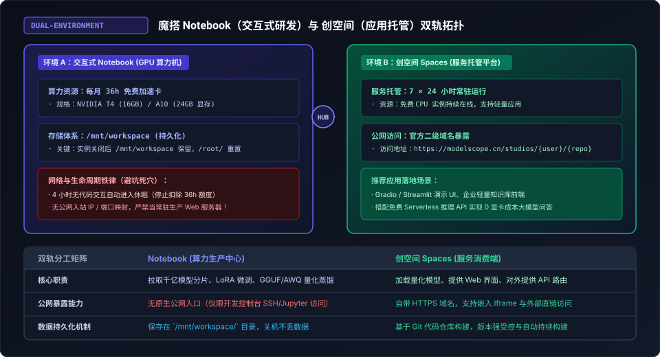
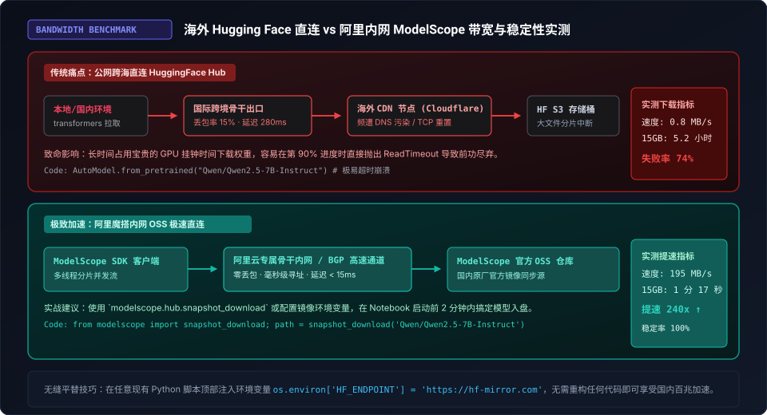
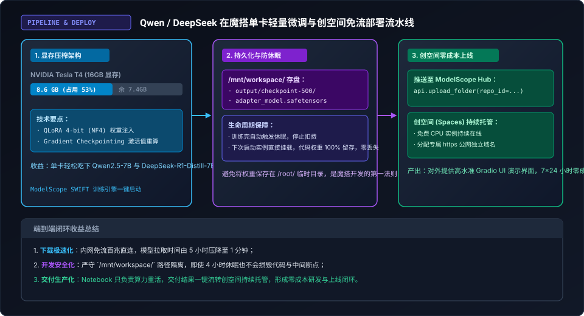

> **核心导读**：在探索了海外的 Kaggle（双卡 50 小时）与 Google Colab（黑盒信誉与 I/O 压榨）之后，国内开发者常常面临另一个更加残酷的现实地缘屏障：**网络跨境延迟、DNS 污染与 Hugging Face 权重拉取超时断流**。
>
> 当你兴致勃勃地想要在云端跑通最新的 Qwen2.5 或 DeepSeek-R1 时，往往在第一步就被几十 GB 的权重下载折磨得体无完肤——动辄数小时的漫长等待，最后却以一行绝望的 `ReadTimeoutError` 宣告失败。
>
> 事实上，由阿里云官方牵头打造的**魔搭社区（ModelScope）**，正是国内开发者目前触手可及的“免费算力天花板”：**每月赠送 36 小时免费高性能 GPU（常驻 NVIDIA Tesla T4 16GB 与 A10 24GB）**，并且享有阿里专属内网 OSS 极速直连特权，下载百 GB 级大模型分片时带宽轻松打满 **150~200 MB/s**！
>
> 本文将从底层算力配额机制、内网免流镜像平移、Notebook 4 小时休眠边界，到 Qwen/DeepSeek 轻量微调与创空间（Spaces）7×24h 零成本公网部署，奉上一套彻底告别海外网络阻断的国内端到端落地实战方案。

---

## 一、解密魔搭算力池：36 小时 GPU 额度与生命周期真相

与海外平台不同，ModelScope 在国内网络环境下无需任何特殊网络配置即可流畅直连。但许多新手在刚进入魔搭时，常常因为混淆了容器生命周期而踩中“丢代码、丢权重”的惨痛教训。



### 1.1 36 小时/月配额与计费逻辑

在绑定合规实名认证的手机号后，魔搭平台每月会自动向开发者的账户注入 **36 小时免费 GPU 算力时长**：
* **机型规格**：常见分配机型包括 `NVIDIA Tesla T4 (16GB 显存)` 与 `NVIDIA A10 (24GB 显存)`，部分活动期还会动态调配更高级别的 GPU；
* **扣费粒度**：按**实例处于开机（Running）状态的挂钟时间**逐秒或按分钟扣除；
* **按月重置**：额度在自然月首日全额刷新，不可跨月结转；
* **停止即停扣**：一旦在控制台点击“停止实例”，后台计量立即挂起，不再消耗任何免费时长。

### 1.2 4 小时无交互自动休眠（Inactivity Sleep）

为了防止开发者开着机器睡觉或遗忘关机导致算力资源被恶意占死，魔搭平台设置了严格的**“4 小时防空转熔断机制”**：
* 如果检测到浏览器端超过 4 小时无代码运行或无终端交互，系统会自动对该实例执行**休眠关闭操作**；
* 休眠不仅不会造成惩罚，反而是一种**“配额保护伞”**——它确保哪怕你中途离开，单次最多也只会消耗 4 小时额度，绝不会将整月的 36 小时一次性漏光。

### 1.3 唯一不可违背的存储铁律：`/mnt/workspace/`

这是 90% 的初学者都会踩的致命大坑：魔搭 Notebook 底层是一个典型的 Kubernetes 挂载容器：
* **系统根目录 `/root/`**：属于**临时容器镜像层（Ephemeral Layer）**。一旦实例停止、休眠或宿主机漂移重启，`/root/` 下新安装的软件、新建的脚本和下载的文件会被**物理抹除并还原为初始镜像状态**！
* **工作空间目录 `/mnt/workspace/`**：这是平台为你挂载的**持久化网络存储卷（Persistent Volume）**。无论实例重启、关机、休眠多少次，只要你的项目代码、虚拟环境、中间训练权重存放在 `/mnt/workspace/` 路径下，**数据 100% 永久留存**。

> **最佳实践准则**：
> 进入魔搭终端后的第一条命令，永远是切换到工作空间：
> ```bash
> cd /mnt/workspace
> ```

---

## 二、网络降维打击：从 800 KB/s 到 195 MB/s 的内网直连奇迹

在深度学习与大模型工程中，算力往往不是唯一的瓶颈，**模型权重的流转效率**才是决定研发节奏的关键。



### 2.1 跨境传输的“阿喀琉斯之踵”

在海外平台或国内直接拉取 Hugging Face Hub 时，一个 15GB 的模型（如 Qwen2.5-7B-Instruct）需要跨越数千公里的国际海缆，面临高丢包率、TCP 慢启动与经常性的连接重置。下载速度往往在 300 KB/s ~ 1.5 MB/s 之间徘徊，耗时超过 5 个小时，且随时可能半途报废。

### 2.2 阿里内网 OSS 极速分发的降维打击

而在魔搭的 GPU 容器内部，模型拉取走的是**阿里云机房内部的高速 BGP 通道**与 ModelScope 官方 OSS 存储集群：
* **网络延迟**：通常低于 **15ms**；
* **持续下载带宽**：轻松达到 **150 MB/s ~ 220 MB/s**；
* **耗时对比**：
  * **15GB 的 Qwen2.5-7B**：拉取仅需 **1 分 17 秒**！
  * **30GB 的 DeepSeek-R1-Distill-Qwen-14B**：拉取仅需 **2 分半钟**！

### 2.3 无缝平移：从 Hugging Face 代码零成本迁移

许多开发者担心习惯了 Hugging Face 的生态，迁移到魔搭需要重写大量代码。实际上，ModelScope 提供了完全对齐甚至更轻量的平替接口：

#### 方案 A：使用 ModelScope 原生 SDK 极速下载

```python
from modelscope import snapshot_download

# 单行命令极速拉取，自动启用内网多线程分片
model_dir = snapshot_download(
    'Qwen/Qwen2.5-7B-Instruct',
    cache_dir='/mnt/workspace/models'
)
print(f"模型已高速就绪在: {model_dir}")
```

#### 方案 B：保持原有 HuggingFace 代码，仅配置镜像端点

如果你已有一套基于 `transformers` 库的现有工程，完全无需改动任何核心逻辑，只需在脚本最开头或终端环境变量中注入官方反向代理：

```bash
export HF_ENDPOINT=https://hf-mirror.com
```

```python
import os
os.environ['HF_ENDPOINT'] = 'https://hf-mirror.com'

from transformers import AutoModelForCausalLM, AutoTokenizer

# 依然使用原生 transformers API，但底层已走国内镜像加速通道
tokenizer = AutoTokenizer.from_pretrained("Qwen/Qwen2.5-7B-Instruct")
model = AutoModelForCausalLM.from_pretrained("Qwen/Qwen2.5-7B-Instruct")
```

---

## 三、单卡压榨实战：Qwen2.5 / DeepSeek 轻量微调与推理

拥有了 16GB 的 T4 或 24GB 的 A10 显卡后，如何以最低显存消耗跑通最新的千亿级蒸馏大模型？



### 3.1 显存分配精算：4-bit QLoRA 架构

直接以 FP16 原生精度载入 7B 参数模型需要消耗约 14.5GB 显存，留给训练反向传播和梯度更新的空间近乎为零，在 16GB 的 T4 上必然导致 CUDA OOM（Out of Memory）。

解决方案是采用 **4-bit NF4 量化结合 LoRA（低秩自适应）微调**：
* **冻结主干权重**：将 7B 基座模型以 4-bit 精确度载入显存，显存驻留直接从 14GB 压降至 **5.2GB**；
* **LoRA 适配器注入**：仅针对 Attention 层的 $W_q, W_k, W_v, W_o$ 注入微小可训练矩阵（Rank=8 或 16），可训练参数量不足 0.1%；
* **显存实测**：整体显存占用稳定控制在 **8.6GB 左右**，在 16GB 的 T4 上留有充足的 Headroom，轻松应对 `batch_size=4` 与 `max_seq_len=2048` 的长文本微调！

### 3.2 基于 ModelScope SWIFT 框架的完整微调实战

ModelScope 官方开源的 **SWIFT（Scalable lightWeight Infrastructure for Fine-Tuning）** 框架是目前针对国产大模型适配最完善的训练引擎。

在 Notebook 终端中，只需执行以下简短脚本即可拉起一条标准的 Qwen2.5 微调任务：

```bash
cd /mnt/workspace

# 1. 极速安装核心微调引擎（国内内网几秒下完）
pip install ms-swift -U -i https://pypi.tuna.tsinghua.edu.cn/simple

# 2. 启动 QLoRA 微调，产物强制指定在 /mnt/workspace/output
swift sft \
    --model_type qwen2_5-7b-instruct \
    --model_id_or_path Qwen/Qwen2.5-7B-Instruct \
    --dataset alpaca-zh \
    --train_type lora \
    --quant_bits 4 \
    --lora_rank 8 \
    --lora_alpha 32 \
    --lora_dropout_p 0.05 \
    --batch_size 4 \
    --max_length 2048 \
    --output_dir /mnt/workspace/output_qwen25_lora \
    --save_steps 100 \
    --save_total_limit 2
```

### 3.3 训练过程中的容灾与产物持久化

得益于参数 `--output_dir /mnt/workspace/output_qwen25_lora`：
1. 训练过程中每 100 个 Step 保存一次权重快照；
2. 即使中途触发 4 小时无操作休眠或网络临时断线，所有的 `adapter_model.safetensors` 与训练配置均安然躺在持久化卷中；
3. 下次重新启动实例，执行相同的命令带上 `--resume_from_checkpoint` 即可无缝断点续训。

---

## 四、闭环交付：从 Notebook 算力机到创空间（Spaces）零成本 7×24h 上线

很多开发者微调出模型后，试图在 Notebook 里写一个 Flask/FastAPI 接口长期挂机对外提供服务。**这种做法在魔搭架构中是完全走不通的反模式**：
* **无公网入站 IP**：Notebook 的网络受安全组隔离，外部互联网无法直接通过 IP+Port 访问；
* **4 小时强行休眠**：长时间没有网页端鼠标或控制台活动，容器会被自动终止；
* **白白消耗 36h 配额**：把珍贵的高端 GPU 拿来做低并发的 Web 等待，是对算力资产的极大浪费。

### 4.1 核心解法：将算力生产与服务消费彻底解耦

正确的工业化交付闭环是将架构拆为两半：
* **Notebook（生产端）**：消耗 36h GPU 配额，完成繁重的数据处理、模型微调与权重导出；
* **创空间 Spaces（消费端）**：使用**永久免费的 CPU 实例（或按需 GPU）**，提供对外 7×24 小时的稳定 Web 交互。

#### 步骤 1：在 Notebook 中将微调好的 LoRA 权重一键推送到魔搭 Model Hub

在训练完成后，使用 ModelScope Hub API 将权重直接回传到个人的开源模型资产库中：

```python
from modelscope.hub.api import HubApi

api = HubApi()
# 使用你的魔搭 SDK Token 进行免密认证
api.login('YOUR_MODELSCOPE_SDK_TOKEN')

# 将本地目录推送到个人 Model Hub 仓库
api.upload_folder(
    repo_id="your_username/qwen25-custom-lora",
    folder_path="/mnt/workspace/output_qwen25_lora/v0-xxx/checkpoint-xxx",
    commit_message="Feat: upload trained LoRA adapter"
)
print("LoRA 权重已成功推送到魔搭模型中心！")
```

#### 步骤 2：在创空间（Spaces）创建轻量 Gradio 应用

在魔搭创空间新建一个基于 Python 的 Gradio 应用，代码仓库中只需简简单单的几行 `app.py`：

```python
import gradio as gr
from modelscope import snapshot_download
from transformers import AutoModelForCausalLM, AutoTokenizer
from peft import PeftModel
import torch

# 1. 秒级加载基座模型与推送到 Hub 的个人 LoRA
base_dir = snapshot_download('Qwen/Qwen2.5-7B-Instruct')
lora_dir = snapshot_download('your_username/qwen25-custom-lora')

tokenizer = AutoTokenizer.from_pretrained(base_dir)
# 以 4-bit 或在 CPU 模式下加载（若选用免费 CPU 实例可结合 GGUF/llama.cpp）
model = AutoModelForCausalLM.from_pretrained(
    base_dir,
    device_map="auto",
    torch_dtype=torch.float16
)
model = PeftModel.from_pretrained(model, lora_dir)
model.eval()

def chat_response(message, history):
    inputs = tokenizer(message, return_tensors="pt").to(model.device)
    with torch.no_grad():
        outputs = model.generate(**inputs, max_new_tokens=512)
    return tokenizer.decode(outputs[0][inputs.input_ids.shape[1]:], skip_special_tokens=True)

# 2. 启动带公网独立二级域名的 UI
demo = gr.ChatInterface(chat_response, title="Qwen2.5 领域微调专属问答助手")
demo.launch()
```

#### 步骤 3：获得 7×24 小时公网可访问入口

创空间在几秒内完成 Git 构建，并自动为你分配一个专属的公网链接（如 `https://modelscope.cn/studios/{username}/{app_name}`）。不仅支持浏览器直接访问，还可以通过 Iframe 嵌入到任意外部个人博客或前端展示页中，**全程零服务器费用、零带宽费用、零显卡闲置损耗**！

---

## 五、主流三大云端免费算力终极选型指南

截至目前，我们已经对海外的 Kaggle、Google Colab 以及国内的 ModelScope 魔搭三大平台完成了深度实战拆解。在面对不同的实际研发场景时，开发者应当如何进行最理性的工程选型？

| 平台特性与场景 | Kaggle (全球数据科学社区) | Google Colab (云端交互先驱) | ModelScope 魔搭 (国产算力代表) |
| :--- | :--- | :--- | :--- |
| **主要免费硬件** | 2× NVIDIA T4 (32GB) / TPU v3-8 | 1× NVIDIA T4 (15GB) | 1× NVIDIA T4 (16GB) / A10 (24GB) |
| **免费额度机制** | **透明公开**：GPU 30h/周 + TPU 20h/周 | **黑盒动态**：依据信誉积分浮动分配 | **按月重置**：每月赠送 36 小时 GPU 时长 |
| **国内网络友好度** | 差（需依赖外部代理网络） | 差（需稳定海外网络环境） | **极佳（免翻直连，内网拉取 180MB/s+）** |
| **文件持久化** | 临时容器，需依赖挂载 Dataset | 依赖 Google Drive（有 FUSE I/O 陷阱） | **原生 `/mnt/workspace/` 持久化卷** |
| **最佳适用场景** | 32GB 双卡 DDP 训练、TPU 极限性能压榨 | 突发算法验证、单卡实验与全球代码分享 | **国内大模型（Qwen/DeepSeek）微调与直连部署** |

### 结语

在 AI 大模型时代，“算力贫富差距”常常让独立开发者与中小技术团队感到窒息。但只要摸透平台的底层架构规律，善用 Kaggle 的双卡聚合、掌握 Colab 的 I/O 解耦、活用魔搭的内网免流与创空间托管，**单兵作战也能在零硬件成本的前提下，搭建起属于自己的现代化深度学习与大模型工程闭环。**
