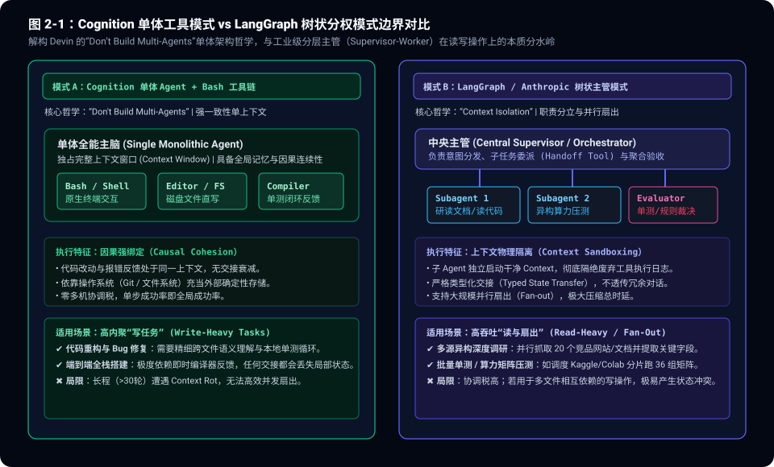
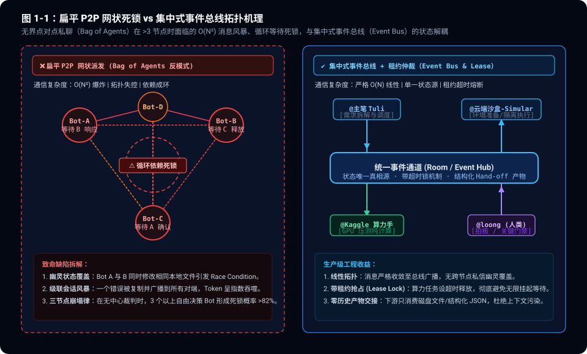
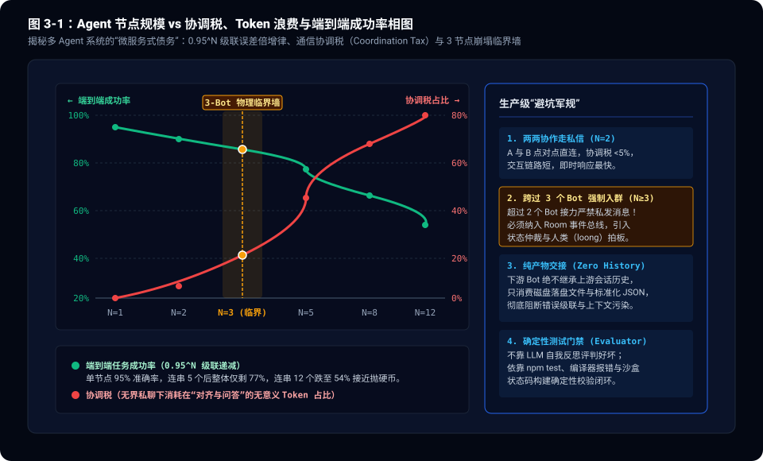

> **核心导读**：在当前生成式 AI 与自主智能体（Autonomous Agents）的狂欢浪潮中，**Multi-Agent（多智能体协作）**被大量项目包装为通往 AGI 的唯一样板戏。各种以“赛博公司”、“Agent 虚拟圆桌”、“自由协作 Swarm”为噱头的开源框架层出不穷，让几个到几十个 LLM 扮演产品经理、架构师、程序员互相自由点对点私聊、辩论、派活。
>
> 然而，在海外技术社群与 X（Twitter）前沿工程圈内，一场关于 Multi-Agent 架构本质的深度论战正全面爆发：
> 1. **Cognition（Devin 团队）的反多 Agent 宣言**：Devin 团队公开提出 **“Don't Build Multi-Agents”**，坚持单体 Agent + 本地操作系统工具链（Bash/Editor/Compiler）才是软件工程复杂任务的坚固底座；
> 2. **Harrison Chase（LangChain 创始人）的微服务隐喻**：指出业界正在犯 2015 年无脑拆分微服务的致命错误——过早将单体应用碎片化为缺乏边界的分布式网络，带来令人窒息的通信延迟与可观测性债务；
> 3. **分布式工程师痛批“Bag of Agents 反模式”**：点对点无界通信（P2P Mesh）在节点数 $\ge 3$ 时，通信复杂度呈 $O(N^2)$ 爆炸，极高概率陷入**循环依赖死锁**与**幽灵状态覆盖**，多 Agent 辩论更频繁演化为“共识幻觉”。
>
> 结合我们在生产环境中管理多异构 Bot（主笔、云端沙盒、异构算力手、人类架构师）的真实踩坑经验，本文从分布式系统、通信拓扑与因果状态机的底层视角，彻底解构多 Agent 协作的伪命题与真价值，并给出基于**集中式事件总线（Event Bus）**与**零历史产物交接（Artifact Handoff）**的生产级破局方案。

---

## 一、 论战爆发：从 Cognition 的“反多 Agent 宣言”到微服务既视感

在过去几个月里，关于“要不要拆成多 Agent”的争议在 X 上达到了白热化。最具代表性的对立阵营，恰恰来自工业界最具实战经验的两大流派。

```
              【工业界多 Agent 架构的两大派系争鸣】
  ┌─────────────────────────────────────────────────────────────┐
  │ 派系 A：Cognition (Devin 团队)   │ 派系 B：Anthropic / LangChain   │
  ├─────────────────────────────────┼───────────────────────────┤
  │ 核心观点: "Don't Build Multi-Agents" │ 核心观点: "Context Isolation" │
  │ 架构模式: 单体深度上下文 + 本地工具 │ 架构模式: 树状主管 + 隔离子 Agent │
  │ 优势场景: 高内聚长程写任务 (编程)  │ 优势场景: 高吞吐并行读任务 (调研) │
  │ 核心武器: 原生 Shell、文件系统、编译器 │ 核心武器: Typed Handoff、沙盒隔离 │
  └─────────────────────────────────────────────────────────────┘
```

### 1.1 Cognition 的冷水：单体深上下文往往胜过碎散 Agent

当许多开发者沉迷于让 5 个 Agent 模拟一个开发小组（Scrum Master、Backend、Frontend、QA、DevOps）并在群里互相打招呼时，Devin 团队的工程实践给出了截然相反的结论：**在严肃的软件工程交付中，不要构建 Multi-Agents。**

Cognition 的核心逻辑非常纯粹：
- **因果连续性（Causal Cohesion）不可割裂**：写代码不是流水线贴标签，修改一个接口涉及类型定义、调用点、单测用例和构建配置。当这些上下文分布在不同 Agent 的会话窗口中时，任何一次交接都会发生**不可逆的信息衰减（Lossy Handoff）**。
- **操作系统本身就是最坚固的外部状态机**：为什么需要两个 Agent 互相聊天确认代码写得好不好？直接调用 `npm test` 或运行编译器，看终端返回的 Exit Code 和 Stderr 日志即可。编译器和测试套件给出的确定性反馈，远比另一个 LLM 扮演的“QA Agent”靠谱千倍。

### 1.2 微服务的历史重演：把 5 行代码拆成分布式 RPC

Harrison Chase 与诸多分布式系统架构师在 X 上直言不讳地指出：**当前 AI 应用层正在重蹈 2015 年微服务（Microservices）狂热的覆辙。**

十年前，很多原本几千行代码的单体应用，被强行拆解成数十个微服务，结果业务逻辑没有变清晰，团队却把 80% 的精力花在了跨服务网络抖动、分布式事务（Saga / 2PC）、链路追踪（OpenTelemetry）和级联超时重试上。

今天的多 Agent 框架正在以惊人的一致性重复这段历史：
- 本来用一个简单的 Python 函数或单步 Prompt Chaining 就能解决的问题，非要设计成 `ResearchAgent -> AnalysisAgent -> FormattingAgent -> ReviewAgent` 的分布式网络；
- 每一个 Agent 的启动、Prompt 装载、网络 RTT、输出解析与序列化，将端到端延迟从 2 秒拉长至 45 秒；
- 成本更呈几何级数膨胀——上游传递给下游的往往是数万 Token 的完整 Raw Trace，下游为了解析一句话，先要消耗数千 Token 进行上下文重吸收。



---

## 二、 解剖反模式：“Bag of Agents” 的三大死因

在生产级工程中，最致命的不是“用了多 Agent”，而是**在缺乏拓扑约束的情况下采用了扁平的“Bag of Agents”（无序点对点私聊网络）**。

当把多个自主决策的 LLM 扔进一个无中心协调的环境中并赋予其直接给对端发消息的权限时，系统必定遭遇以下三大物理阻断。

```
                【扁平 P2P 点对点网状派发的崩塌路径】
       Bot A ──(私聊派发)──> Bot B ──(反向依赖)──> Bot C
         ▲                                           │
         └─────────────(等待确认循环死锁)─────────────┘
                                +
                     并发修改相同磁盘文件 (Race Condition)
                                +
                       Token 指数级爆炸 (O(N²))
```

### 2.1 通信复杂度呈 $O(N^2)$ 爆炸与“协调税（Coordination Tax）”

在一个允许任意节点互相沟通的 $N$ 节点 P2P 网络中，潜在的双向通信通道数量为：

$$C = \frac{N(N - 1)}{2} = O(N^2)$$

当 $N=2$ 时，只有 1 条通道，一切井然有序；  
当 $N=4$ 时，通道数激增至 6 条；  
当 $N=8$ 时，通道数高达 28 条。

在实际运行时，LLM 天生具备“过度客套”与“反复确认”的倾向。如果缺乏严格的协议规范，Bot A 会向 Bot B 询问输入，Bot B 在回答前先向 Bot C 索要上下文，Bot C 又向 Bot A 澄清需求。

这种**“协调税（Coordination Tax）”**会以惊人的速度吞噬整个系统的计算预算——实测显示，在超过 4 个自由通信的 Agent 系统中，**超过 60% 的 Token 被消耗在 Bot 之间的“礼貌问答、格式确认、状态同步”上，真正用于执行核心业务逻辑的有效 Token 不足 40%！**

### 2.2 循环等待死锁（Deadlock）与幽灵状态覆盖

分布式系统的经典死锁四条件（互斥、占有且等待、不可抢占、循环等待）在无约束多 Agent 系统中几乎是必然触发的：

1. **循环等待死锁**：Bot A 锁定了某个任务的分步分支，等待 Bot B 提供环境依赖；Bot B 发现脚本缺参数，向 Bot C 请求数据；Bot C 认为该数据属于全局架构输入，在等待 Bot A 的总体规范。三个 Agent 的会话全部陷入等待状态，没有超时，没有抢占，全流程永久挂起。
2. **幽灵状态覆盖（Lost Updates / Race Condition）**：在没有集中锁管理的情况下，若 Bot A 和 Bot B 被赋予了对同一份磁盘代码仓库（如 `/workspace/src`）的写入权，Bot A 在修改函数签名，Bot B 同时在给该函数添加单测，两者的修改在无协调状态下互相覆盖，产生不可调试的“幽灵代码冲突”。

### 2.3 伪民主投票与女巫幻觉（Sybil Hallucination）

某些框架推崇让 3~5 个 Agent 通过“多轮辩论（Multi-Agent Debate）与投票”来提升推理准确性。

然而，在多项前沿实测与学术研究中，这一机制被证实存在严重的**女巫共识幻觉（Sybil Consensus Failure）**：
- 如果基底模型共享相同的预训练知识偏差，或者输入上下文中存在微小但致命的事实错误，Agent A 的错误表述会被 Agent B 当作外部输入进一步“合理化编造”；
- 到了第 3 轮，整个 Agent 群体不仅没有纠偏，反而互相印证并达成一致共识，以 100% 的虚假自信交付一个彻底崩溃的方案。

**没有确定性外部物理地基的自由辩论，不过是一群幻觉放大器的自嗨回音壁。**



---

## 三、 临界物理墙：为什么我们把协作阈值卡在“3 个 Bot”？

在真实软件工程博客团队的协同运转中，我们沉淀出了一条近乎残酷的工程底线：

> **“派活默认走 Bot 之间私发消息，不临时建群；只有 3 个以上 Bot 接力、或中间需要 loong（人类架构师）拍板时才进对应的群。”**

这条规则看似简单，背后却蕴含着深刻的数学与系统工程物理学。

### 3.1 复合误差率倍增律：$0.95^N$ 的断崖诅咒

François Chollet 多次公开强调：在依赖自回归生成的非确定性系统中，长链条的级联误差是极其致命的。

假设每个 Agent 在执行单步任务并理解输入意图时的单步成功率高达 **95%**（在工业级 Agent 中已经是非常出色的数字）：

| 接力 Agent 数量 ($N$) | 理论整体端到端成功率 ($0.95^N$) | 实际生产表现定性 |
|:---|:---|:---|
| **$N = 1$ (单体 Agent)** | **95.0%** | 高可靠，绝大多数错误可在本地自循环中被编译器纠偏 |
| **$N = 2$ (两两私聊对碰)** | **90.3%** | 黄金交互区间，交互链路单一，沟通摩擦极小 |
| **$N = 3$ (临界物理墙)** | **85.7%** | 开始出现微小意图漂移，P2P 私信必须在此处刹车 |
| **$N = 5$ (多节点串联)** | **77.4%** | 整体成功率跌破八成，几乎每 4 次任务必翻车一次 |
| **$N = 8$ (复杂长链条)** | **66.3%** | 错误滚雪球式累积，下游完全无法理解初始目标 |
| **$N = 12$ (过度拆分的微服务)** | **54.0%** | **整体成功率逼近 50%（抛硬币）**，工程上彻底失去可用价值 |

当系统内只有 2 个 Bot（例如主笔 Tuli 与云端沙盒 Simular）协同调试一段脚本时，点对点私信响应最快、协议开销为 0。

但一旦第 3 个 Bot（例如 Kaggle 算力手）加入协同，或者需要调动 GPU 跑长周期矩阵时，**如果依然让 3 个 Bot 私下互通，系统成功率将直接沿着几何级数滑向悬崖。**

这就是为什么**跨过 3 个节点，必须强制终止 P2P 私聊，全面纳入统一事件总线（Room Session）并引入仲裁机制**。



---

## 四、 生产级破局之道：集中式事件总线与确定性裁决

如果业务场景确实需要多 Agent（例如我们既要在本地写文档、又要在云端沙盒配环境、还要在 Kaggle 上调度双卡 GPU 跑压测），如何才能彻底规避微服务反模式？

我们在真实生产中跑通了一套坚固的四层破局方案：

### 4.1 拓扑重构：集中式事件总线与租约排他机制

彻底废除网状 P2P 私聊，建立中心化的事件总线架构（Event Bus / Room）：

1. **单向事件流广播**：所有 Agent 不再私下传话，所有阶段性状态变更一律向总线发射标准事件（如 `JobFinishedEvent`、`ArtifactReadyEvent`）。
2. **带租约的排他锁（Lease-based Mutual Exclusion）**：
   - 当算力手接管 GPU 资源压测时，系统授予其固定时限的执行租约（如 30 分钟）；
   - 在租约存续期内，其他 Worker 处于静默休眠或只读状态，绝不并发争抢环境；
   - 一旦超时或发生异常，租约自动熔断释放，避免永久阻塞。

```
                    【带租约与仲裁的事件总线工作流】
  [主笔 Tuli] ────(1. 发布需求与契约)────> [ 集中式事件总线 (Room) ]
                                                   │
               ┌───────────────────────────────────┴───────────────────────┐
               ▼                                                           ▼
     [云端沙盒-Simular]                                            [Kaggle 算力手]
     - 申请环境准备租约 (Lease: 5m)                                   - 监听总线打点事件
     - 验证脚本落盘到指定路径                                           - 获取 GPU 计算租约 (Lease: 35m)
     - 发射: ArtifactReadyEvent                                     - 真跑 36 组矩阵并落盘 CSV
               │                                                           │
               └───────────────────────┬───────────────────────────────────┘
                                       ▼
                       [人类架构师 loong / 门禁拦截]
                       - 审计关键凭据、花钱与代码推送权限
                       - 绿灯放行 -> 主笔消费产物完成闭环
```

### 4.2 零历史产物交接协议（Artifact-Centric Hand-off）

**多 Agent 崩塌的第一根导火索，就是把上一轮的全部会话 Raw Transcripts 盲目复制给下一个 Agent。**

下一个 Agent 的注意力立即被成千上万行无效日志污染，陷入严重的“Attention Dilution（注意力稀释）”。

生产级最佳实践是实行**纯产物协议（Artifact-Centric Protocol）**：
- **无历史传递**：下游 Bot 启动时，上下文是 100% 干净的，绝对不读上游 Bot 的对话过程；
- **只认结构化落盘实体**：上游唯一的交付物必须是文件系统上的确定性文件（如 `benchmark_chunked_prefill_results.csv`、`topic1_chunked_prefill_benchmark.md`）；
- **强类型 Schema 验收**：下游在唤醒后，第一步用校验器核对文件字段（如 `chunk_size`、`ttft_p50`、`throughput` 是否完整），只要校验不通过立即拒收报错，绝不在半成品数据上盲猜。

### 4.3 确定性测试门禁（Evaluators over LLM Judges）

在整个流水线中，**禁止使用另一个 LLM 充当主观的“评价裁判”**。

判断代码是否合格、静态构建是否正常，必须交由物理确定性工具裁决：
- 本地单测：`npm test` 跑通全部 35 个单测套件；
- 静态编译：`npm run build` 验证全部页面与资源链接无死链；
- 运行退出码：严格校验子进程的 `Exit Code === 0`。

只要测试门禁亮红灯，流程就地阻断并抛出具体 Stderr，由负责的代码编写者重试，绝不将带病代码往下游流转。

### 4.4 零信任安全与高危动作拦截切面（Human-in-the-Loop）

当系统拥有多个自主 Agent 时，权限边界必须实现**零信任隔离**：
- **只读只跑 Worker**：算力操作手与沙盒操作手只具备受限执行权限，无权向公共主分支推送代码，更无权私自调用付费 API；
- **高危操作切面拦截**：任何涉及对外推送（`git push`）、删除核心文件、或者调用付费算力的动作，必须触发展示型确认卡片，由人类架构师（loong）亲手拍板；
- **凭据代持（Credential Proxy）**：各节点绝不硬编码明文密钥，全量依赖安全的凭据代理代持，防止日志回显造成密钥泄露。

---

## 五、 总结：架构师的终局反思与极简法则

回到最初的问题：**多 Agent 究竟是架构跃迁，还是微服务倒退？**

答案取决于你的系统设计哲学：

1. **如果你试图用一堆没有边界的 Agent 去模拟一个松散的人类公司，那它就是一场极其灾难的微服务倒退**。它会带给你 10 倍的 Token 账单、无法复现的分布式死锁、脆弱的级联崩溃和极低的端到端产出。
2. **如果你将多 Agent 严格视为一种“上下文物理隔离工具与异步异构算力分发器”，那它就是实打实的生产力跃迁**。

### 终极工程军规

在决定为你的系统新增一个 Agent 之前，请在白板上刻下这四条法则：

- **第一准则（单体优先）**：永远从单体 Agent + 强大的本地工具链（Shell / 外部数据库 / 编译器）开始。只要一个 Context 装得下，绝不引入第二个 Agent。
- **第二准则（两两私聊，过三入总线）**：2 个 Bot 协作走轻量点对点私信；一旦超过 2 个节点接力，强制切入带状态仲裁的集中式事件总线，严禁私聊网状扩散。
- **第三准则（产物断代交接）**：跨 Agent 协作绝不透传会话历史，以磁盘文件、结构化 JSON 和数据库作为唯一的交接契约。
- **第四准则（确定性重于智能）**：多用编译器和测试用例做门禁，少用 LLM 自我评判；把最终的审查切面留给人类。

真正的系统工程优雅，从来不在于连线有多繁复，而在于能够用多么克制的拓扑，驯服不确定的概率。
