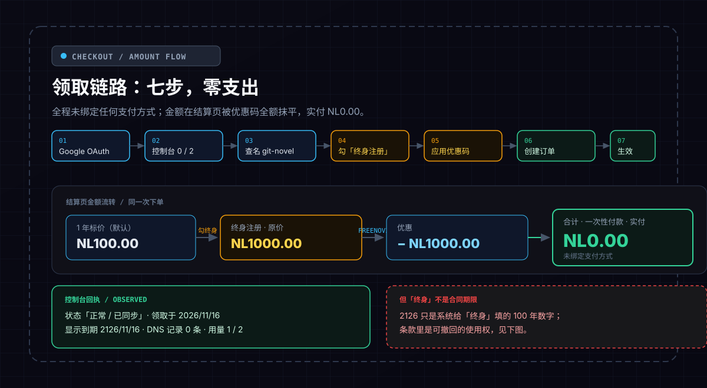
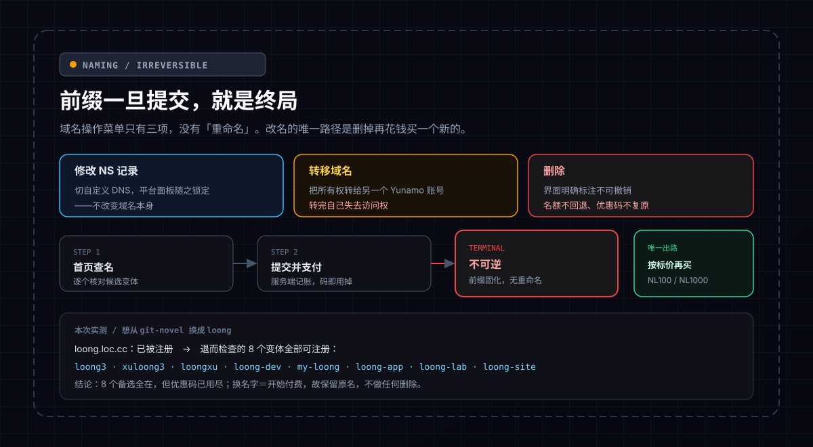
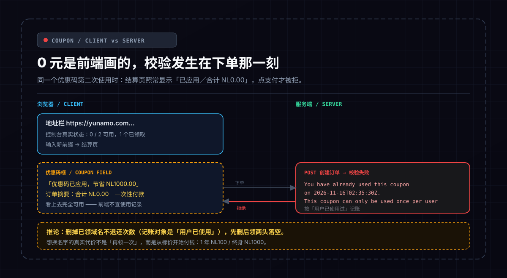
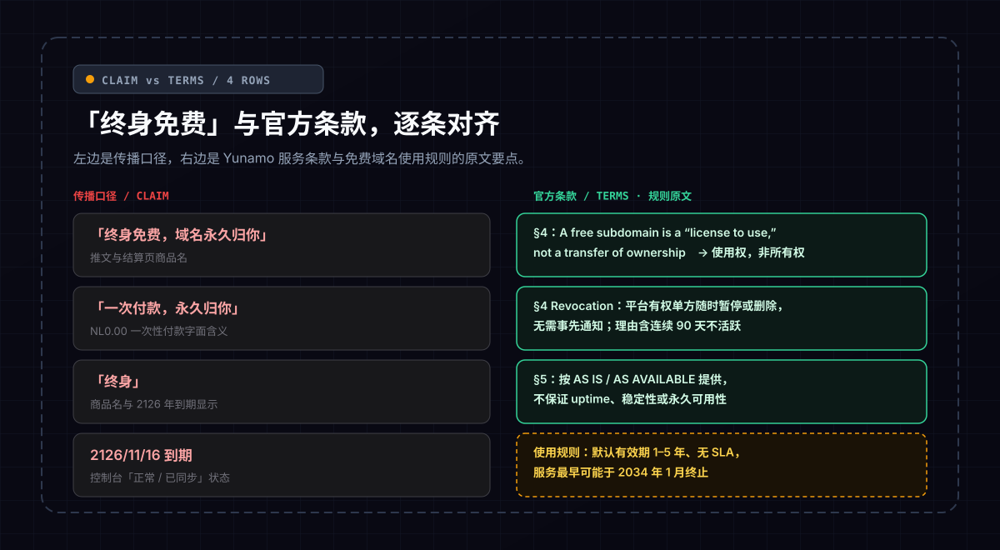
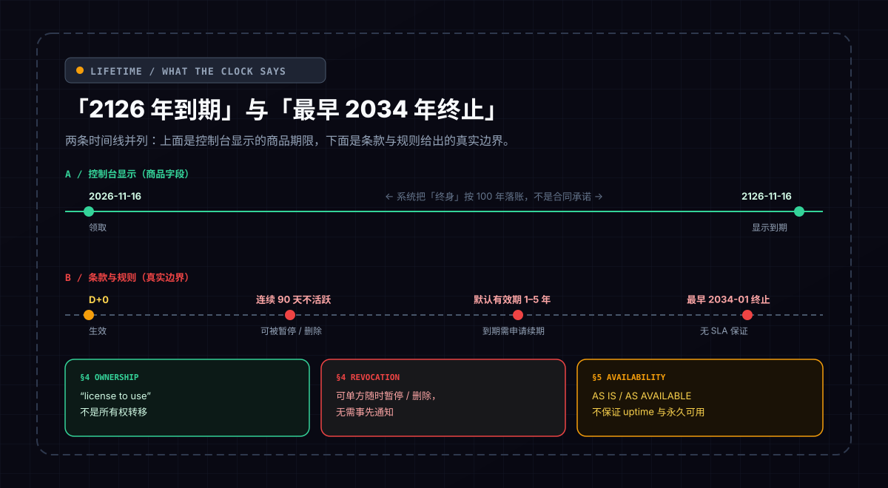
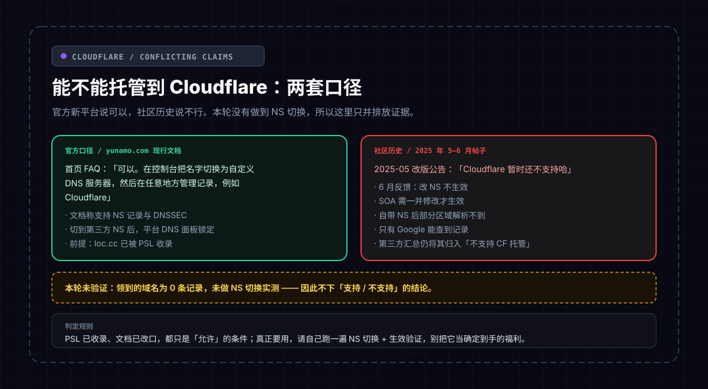
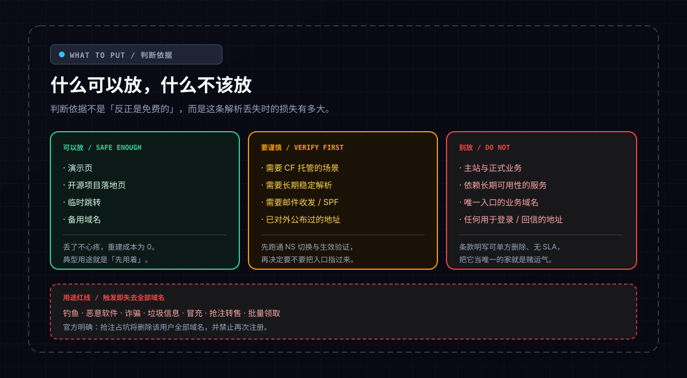

> **核心导读**：2026-11-16，按一条写着「终身免费」的推文，把 NodeLoc / Yunamo 的免费 `.loc.cc` 二级域名领了一遍。钱确实没花：原价 `NL1000.00`，优惠 `−NL1000.00`，实付 `NL0.00`，没绑支付方式。但这篇要说的不是「薅到了」，而是**零成本的另一面是零保障**——前缀一旦提交就没有改名功能，优惠码每人一次且只在服务端校验，条款里写的是「使用权」不是「所有权」，连续 90 天不活跃可被删除。全文只做一件事：把推文宣称、官方条款原文、当天实机回执三样并排，差异处直接标出来。所有数字来自这一轮实机记录，不补、不推；文中不记录账号邮箱、邀请码与完整订单号。

---

## 一、这条羊毛是什么，先核实再动手

推文（[@luckiestMax](https://x.com/luckiestMax/status/2122038939880133070)，2026-11-16）说：

> NodeLoc 免费 `.loc.cc` 二级域名又可以领了！每个账号可免费注册一个，终身免费！注册平台已经迁移至 Yunamo，使用优惠码即可免费领取！优惠码 `FREENOV2026`

配图是结算页：期限「终身」，原价 `NL1000.00`，优惠 `−NL1000.00`，合计 `NL0.00` 一次性付款。

| 核实项 | 结论 |
|---|---|
| 活动真假 | 真。NodeLoc 官方公告帖「每月福利：免费注册 loc.cc 二级域名」是长期活动，**每月 16 日全天开放**（官方未标时区），每位用户免费注册一个，本月码 `FREENOV2026` |
| 优惠码规律 | 按月轮换，8 月 `FREEAUG2026`、10 月 `FREEOCT2026`、11 月 `FREENOV2026`。别拿上个月的码来试 |
| 平台 | DNL 项目已独立为 **Yunamo**（yunamo.com，2026-10-18 公告），旧 `domain.nodeloc.com` 的账号/域名/DNS 记录保留。代码开源在 `github.com/nodeloc/yunamo`：Go + PostgreSQL + Redis + PowerDNS + Vue 3 |
| 注册门槛 | 已验证邮箱，或 GitHub / Google / NodeLoc 账号，免信用卡 |
| 额度 | 按账户等级。实测普通等级给 **2 个**域名额度（控制台显示 `0 / 2`） |
| 推文链接 | 带 `?ref=` 推广参数，直接访问 yunamo.com 即可，不必给对方带量 |

一个值得记下的历史节点：`loc.cc` 已经进入 [Public Suffix List](https://publicsuffix.org/list/public_suffix_list.dat)（由 `James <support@yunamo.com>` 提交），这是它能被 Cloudflare 当作独立域名接纳的前提。

## 二、领取实录（一步步照做）

1. 打开 `yunamo.com/register`，选「使用 Google 继续」→ 账号选择页 → OAuth 授权页（站点只请求姓名、头像、邮箱）→ 继续 → 回调登录。
2. 控制台：邮箱已验证，已用域名 `0 / 2`，账户等级「普通」。
3. 首页查名字：输入 `git-novel` → 「可以注册，`NL100 / 年起`」→ 前往结算。
4. **结算页是关键**，默认只有 1 年 `NL100.00`，另有「终身注册」复选框。按推文配图的口径勾上「终身注册」，原价变成 `NL1000.00`。
5. 优惠码框填 `FREENOV2026` 点「应用」→ 提示「优惠码已应用，节省 NL1000.00」→ 订单摘要：原价 `NL1000.00`、优惠 `−NL1000.00`、**合计 `NL0.00` 一次性付款**。
6. 点「创建订单并支付」→ 支付成功页，实付 `NL0.00`。
7. 控制台确认：域名状态「正常 / 已同步」，领取于 2026/11/16，**显示到期 2126/11/16**（系统把「终身」按 100 年落账），DNS 记录 0 条，用量 `1 / 2`。

全程没有绑定支付方式，也没有产生任何现金支出。



*图 1｜七步领取链路与金额流转。优惠码把标价全额抹平是事实，但「2126 年到期」只是系统给「终身」这个商品填的字段值。*

## 三、想改名字，才是真正踩坑的地方

领完后想把 `git-novel.loc.cc` 换成 `loong.loc.cc`，结果四连击：

**1. 名字被占了。** `loong.loc.cc` 显示「已被注册」。顺手查了 8 个变体——`loong3`、`xuloong3`、`loongxu`、`loong-dev`、`my-loong`、`loong-app`、`loong-lab`、`loong-site`——全部可注册。

**2. 平台没有改名功能。** 域名操作菜单只有三项：「修改 NS 记录」「转移域名」「删除」。其中「转移域名」是把所有权转给另一个 Yunamo 账号（自己会失去访问权），「删除」明确写着不可撤销。也就是说，**前缀一旦提交就是终局**。



*图 2｜没有「重命名」这个按钮。8 个备选前缀全在，但优惠码已用尽——换名字的第一步不是「再领一次」，而是开始付费。*

**3. 优惠码每人只能用一次，而且是服务端校验。** 这是最反直觉的一点：我在新名字的结算页再次填入 `FREENOV2026`，前端照样显示「优惠码已应用，节省 NL1000.00」「合计 NL0.00」——**看起来完全能用**。但一点「创建订单并支付」，服务端直接拒绝：

```
You have already used this coupon on 2026-11-16T02:35:30Z.
This coupon can only be used once per user
```

也就是说结算页的 0 元是假象，真正的校验在下单那一刻。删掉已领的域名也**不会**退还优惠码次数（它按「用户已使用过」记账），先删后领只会两头落空。



*图 3｜前端不查使用记录，服务端按「用户已使用」记账。这类「乐观 UI + 最终拒绝」的模式，把失败成本从浏览时刻挪到了提交时刻。*

**4. 换名字的真实价格。** 优惠码用掉之后，任何新域名都要按标价付费（1 年 `NL100` / 终身 `NL1000`，走 NodeLoc 站内积分）。想改名的代价不是「再领一次」，而是「开始花钱」。

最终决定：保留 `git-novel.loc.cc`，不做任何删除。

## 四、「终身免费」到底是不是终身

把官方条款和宣传语放一起看，差距很清楚：



*图 4｜左边四句是传播口径，右边四句是条款原文要点。四行里没有一行能支撑「永久归你」。*

| 宣传口径 | 官方条款 / 规则原文 |
|---|---|
| 终身免费、域名永久归你 | 服务条款第 4 条：**「A free subdomain is a "license to use," not a transfer of ownership」**——只是使用权，不是所有权转移 |
| 一次付款永久归你 | 第 4 条 Revocation：平台**有权单方随时暂停或删除**，无需事先通知，理由可以是违反条款或**连续 90 天不活跃** |
| 终身 | 第 5 条：服务按 **AS IS / AS AVAILABLE** 提供，**不保证 uptime、稳定性或永久可用性** |
| — | 官方「免费域名使用规则」帖：默认有效期 **1–5 年**，到期需申请续期；**不提供任何 SLA 保证，服务最早可能于 2034 年 1 月终止** |
| — | 使用规范：长期未使用（例如没有任何 DNS 记录）的域名，可能在邮件提醒后被释放；处理流程为警告 → 暂停 → 删除 |

控制台那个「2126 年到期」只是系统给「终身」这个商品填的 100 年数字，不是合同承诺。**别把它当资产，当成一个随时可能消失的备用入口就好。**



*图 5｜同一天的两套时钟。上面那条线是商品字段，下面那条线是可执行条款；后者才是解析真正会断的时刻。*

## 五、Cloudflare 托管：口径互相打架

这一点推文没提，但评论区当天就有人说「无法托管到 cf」，值得单独记：

- **官方新平台说可以**：首页 FAQ 原文「可以。在控制台把名字切换为自定义 DNS 服务器，然后在任意地方管理记录，例如 Cloudflare」；文档也说支持 `NS` 记录、DNSSEC，切到第三方 NS 后平台 DNS 面板会锁定。
- **社区历史说不行**：2025 年 5 月改版公告写「Cloudflare 暂时还不支持哈」；6 月一大批帖子反馈改 NS 不生效、SOA 要一起改、自带 NS 部分区域解析不到、只有 Google 能查到记录。第三方免费域名汇总也一直把 `loc.cc` 归在「不支持托管到 Cloudflare」一类。
- **本次没有实测到那一步**：领到的域名保持 0 条记录，没做 NS 切换验证。



*图 6｜PSL 已收录只说明「具备被当作独立域名的资格」，不等于「NS 切换已在各区域生效」。这类矛盾只有自己跑一遍才能结案。*

结论：PSL 已进、官方文档已改口，但**别把 CF 托管当成确定能拿到的福利**，真要用先自己跑一遍 NS 切换与生效验证。

## 六、四条硬约束，和一张「放什么」的表

把上面散落的事实收成四条，这也是这篇的标题所指：

| # | 硬约束 | 依据 | 后果 |
|---|---|---|---|
| 1 | **前缀终局** | 域名菜单只有 修改 NS / 转移 / 删除，无重命名；删除不可撤销 | 命名是一次性决策，选错只能按标价重买 |
| 2 | **优惠码每人一次，服务端校验** | 重复使用在下单瞬间被拒；删除不复原次数 | 前端 0 元不等于能过，先删后领两头落空 |
| 3 | **使用权，不是所有权** | 条款 §4：「license to use… not a transfer of ownership」 | 不能当资产计价、转让、抵押 |
| 4 | **可被单方回收，无 SLA** | §4 Revocation（含 90 天不活跃）、§5 AS IS、规则帖无 SLA 且最早 2034-01 终止 | 解析随时可能断，不能承载唯一入口 |

所以用法要按「丢了损失多大」来分档：



*图 7｜分档依据不是「免费」，而是这条解析消失时的迁移成本。红线部分官方写明会删除该用户全部域名并禁止再注册。*

## 七、避坑清单（下次 16 号直接照这个走）

1. **名字一次选对。** 无改名、删除不可逆、优惠码每人一次。先在首页把候选名全查一遍再进结算。
2. **别信结算页的 0 元。** 前端「优惠码已应用 / 合计 NL0.00」不代表服务端会放行，优惠码重复使用时只会在下单瞬间报错。
3. **优惠码按月换、当天有效。** 每月 16 日全天，错过等下月；本月码是 `FREENOV2026`。
4. **别走带 `?ref=` 的推广链接**，直接进 yunamo.com。
5. **别急着加解析记录。** 如果托管那侧还没绑定好，加了指向就变成「有记录但网站打不开」，反而正好撞上活跃度回收规则。要么一次配通，要么先空着。
6. **只放无关紧要的东西。** 演示页、开源项目落地页、临时跳转、备用域名。主站、正式业务、需要长期稳定解析的服务不要放上来。
7. **用途红线**：禁止钓鱼、恶意软件、诈骗、垃圾信息、冒充、抢注转售、批量领取；官方明确说抢注占坑会删除该用户全部域名并禁止再注册。
8. **记得核对额度与等级**：普通等级实测 2 个域名额度，控制台会显示；邀请码可加额度。

## 八、一句总结

这类「每月 16 号领一个」的免费域名，真实成本不是钱，是**一次不可撤销的命名决策 + 一个随时可被收回的使用权**。零成本拿一个当备用很划算，但值得花两分钟把名字想好，再点那个「创建订单并支付」。

---

### 核实来源

- [推文原文与结算页配图](https://x.com/luckiestMax/status/2122038939880133070)（2026-11-16）
- NodeLoc 官方公告：[每月福利：免费注册 loc.cc 二级域名](https://www.nodeloc.com/t/topic/51258/1227)、[Nodeloc 免费域名使用规则](https://www.nodeloc.com/t/topic/46692)
- Yunamo 官方：[首页](https://yunamo.com/) · [文档](https://yunamo.com/pages/documentation) · [FAQ](https://yunamo.com/pages/faq) · [服务条款](https://yunamo.com/pages/terms-of-service) · [使用规范](https://yunamo.com/acceptable-use) · [公告](https://yunamo.com/announcements)
- [Public Suffix List](https://publicsuffix.org/list/public_suffix_list.dat)（`loc.cc` 条目）
- 社区反馈：[NL免费域名全面改版](https://www.nodeloc.com/t/topic/46639/9)、[loc.cc 上线公告](https://www.nodeloc.com/t/topic/38256/4)、[自定义 NS 讨论](https://nodeloc.cc/t/topic/47068)
- 本次全部页面操作与控制台状态，均为 2026-11-16 实机记录

> 说明：文中已省略实测账号的邮箱、邀请码与完整订单号，避免把账户标识写进公开文稿。
