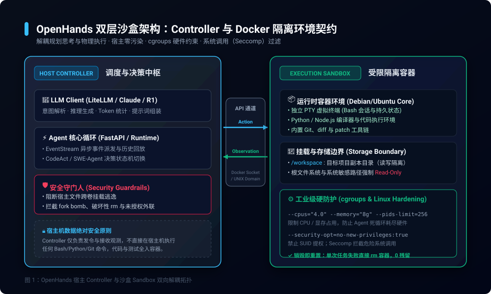
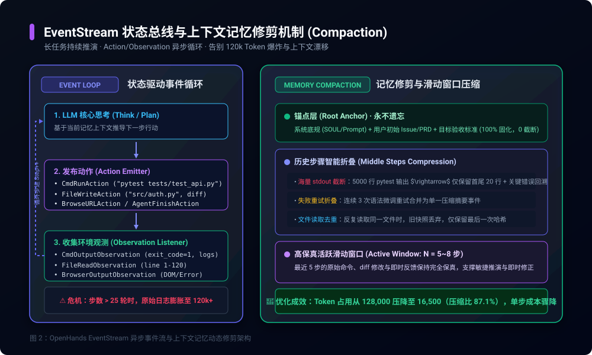
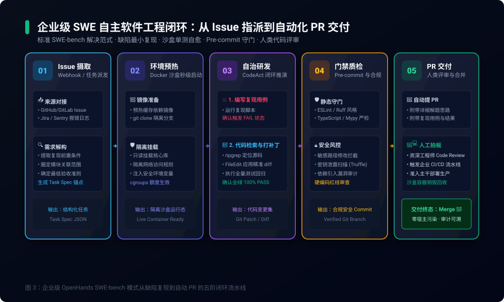

> **核心导读**：2024 年 Cognition 发布的 Devin 彻底点燃了“自主软件工程师（Autonomous Software Engineer）”的行业想象——智能体不再只是在 IDE 里补全几行代码的 Copilot，而是能够独立接单、复现 Bug、跨十几个源码文件定位修改、运行单测验证并自主提交 PR 的全功能数字雇员。作为全球最瞩目的开源平替项目，**OpenHands**（原 OpenDevin，由 All-Hands-AI 发起，GitHub 狂揽 4 万+ Star）迅速成为各大企业内网部署与落地自主工程智能体的首选底座。
>
> 然而，许多研发团队在兴冲冲地将 OpenHands 引入内网真实项目时，却迅速遭遇了三大“生产级灾难”：
> 1. **沙盒失控与宿主破坏**：Agent 误把宿主机挂载卷甚至根分区执行破坏性命令，或因缺少硬件限额引发宿主机 CPU/内存雪崩；
> 2. **EventStream 状态膨胀与上下文漂移**：面对复杂工程重构，执行步数一旦超过 20 步，累积的终端输出与文件 Diff 迅速吃爆 120k+ Token 上下文，导致模型产生严重幻觉、在错误的方向上反复“鬼打墙”；
> 3. **环境脆弱与交付失控**：Agent 在没有标准依赖约束的容器中频繁卡死在环境配置环节，甚至在未经严格门禁校验的情况下将包含隐患的代码强推至主干。
>
> 本文将剥离浮夸的宣传叙事，深入 OpenHands 核心源码与运行时机制，全面拆解其**双向 Docker 沙盒隔离契约**、**EventStream 异步事件总线与记忆修剪（Compaction）算法**，并提供一套可在企业内网无缝运转的 SWE 闭环落地实战方案。

---

## 一、从玩具 Demo 到企业生产：自主编程智能体的现实鸿沟

许多开发者在评估代码生成工具时，往往容易混淆 **“Copilot 辅助补全”**、**“交互式代码重构工具（如 Cursor / Claude Code）”** 与 **“完全自主软件工程师（如 OpenHands / Devin）”** 的本质差异。

```
┌────────────────────────────────────────────────────────────────────────┐
│                        AI 辅助研发能力的演进阶梯                        │
├─────────────────┬──────────────────────────────────────────────────────┤
│ 阶段 1: 字符补全 │ IDE 补全插件（GitHub Copilot）：单行/函数级补全，无状态 │
├─────────────────┼──────────────────────────────────────────────────────┤
│ 阶段 2: 交互重构 │ 终端/IDE Agent（Cursor/Claude Code）：人类主导，单步确认 │
├─────────────────┼──────────────────────────────────────────────────────┤
│ 阶段 3: 自主工程 │ 自主工程师（OpenHands/Devin）：给定 Issue 闭环解决并提 PR │
└─────────────────┴──────────────────────────────────────────────────────┘
```

在阶段 3 中，智能体必须拥有**完整的操作系统权限**：它可以自主执行终端命令、安装依赖、启动数据库、修改数十个源文件、编译构建并运行单元测试。如果将这种权限直接授予运行在宿主机上的进程，其风险是不可承受的：
- 模型可能在推导纠错时，执行未经意念审查的 `rm -rf /` 或递归权限篡改；
- 模型可能写出死循环的测试用例（如不断分配大内存），导致整台宿主机因 OOM 崩溃；
- 模型可能通过恶意 Prompt 注入（如第三方 Issue 中隐藏的越权指令），将内网环境的私钥或生产凭证通过外部网络悄悄外发。

因此，**“如何构建一个既能让 Agent 自由折腾代码与编译、又能对宿主机与内网形成绝对物理隔离的执行沙盒”**，是 OpenHands 迈向企业生产的第一道生死线。

---

## 二、Docker 双向沙盒解密：Controller 与 Execution Sandbox 的隔离契约

为了彻底规避执行风险，OpenHands 在底层架构上采用了严密的**“双层解耦沙盒模型”**（Dual-Layer Architecture）。



### 2.1 架构拓扑：大脑（Controller）与四肢（Sandbox）物理分离

OpenHands 将整个系统划分为两个完全隔离的运行时边界：
1. **Controller（调度中枢）**：
   - 运行在宿主机或受控后端服务容器中（基于 Python FastAPI 实现）；
   - 负责与大语言模型（LiteLLM 抽象层，可平替接入 Claude 3.5 Sonnet、DeepSeek-V3 / R1 或 Qwen-2.5-Coder）进行通信；
   - 维护 Agent 核心状态机与规划推导（Plan & ReAct 循环），记录全量事件日志；
   - **底线原则**：Controller 自身**绝不直接执行任何由 LLM 生成的 Bash 命令或脚本**。
2. **Execution Sandbox（执行沙盒容器）**：
   - 由 Controller 动态调起并管理的独立 Docker 容器；
   - 预装标准的开发运行时（如 Python、Node.js、Rust、Go 及编译工具链）；
   - 拥有独立的 PTY（虚拟终端）会话与伪文件系统，所有的命令行调用、代码文件修改与单元测试执行全部发生在此容器内；
   - 当任务结束或发生灾难性崩溃时，沙盒容器被整机销毁，**宿主机状态零污染**。

### 2.2 隔离契约与 Linux 硬防护配置

在企业内网落地时，简单的 `docker run` 并不足以抵御高级风险。OpenHands 生产级容器初始化契约必须包含严苛的 Linux 内核级限制：

```python
# OpenHands 生产级 Docker 沙盒安全启动配置示例
import docker

def spawn_hardened_sandbox(client: docker.DockerClient, repo_volume_path: str, container_name: str):
    return client.containers.run(
        image="openhands/runtime:latest",
        name=container_name,
        detach=True,
        # 1. 硬件资源强制硬限制 (cgroups)
        nano_cpus=4 * 10**9,          # 限制最多使用 4 核心 CPU
        mem_limit="8g",                # 物理内存严格限制 8GB
        memswap_limit="8g",            # 禁用额外 Swap，防止磁盘 I/O 拖垮宿主
        pids_limit=256,                # 限制最大进程数，彻底阻断 fork bomb
        # 2. Linux 权限与系统调用加固
        security_opt=[
            "no-new-privileges:true",  # 禁止子进程通过 SUID 提权
            "seccomp=unconfined"       # 生产中建议挂载定制 Seccomp 拦截危险 syscall
        ],
        cap_drop=["ALL"],              # 剥离所有 Linux 默认特权
        cap_add=["CHOWN", "DAC_OVERRIDE", "FOWNER", "SETGID", "SETUID"], # 仅保留编译必需能力
        # 3. 存储隔离：读写工作区 vs 只读核心系统
        volumes={
            repo_volume_path: {
                "bind": "/workspace",
                "mode": "rw"           # 仅 /workspace 挂载的代码副本具备写权限
            }
        },
        read_only=True,                # 容器根文件系统强制为只读，阻断系统篡改
        tmpfs={
            "/tmp": "size=1G,exec",    # 临时目录内存挂载，允许执行测试脚本
            "/var/run": "size=64M"
        },
        # 4. 网络白名单策略
        network_mode="bridge"          # 隔离网桥，生产中应配合 iptables 阻断公网出站
    )
```

通过这一层严格的契约：
- **存储逃逸防御**：除 `/workspace` 挂载目录外，沙盒内根目录是只读的，Agent 无论如何误操作都无法污染宿主或破坏基础镜像；
- **资源耗尽防御**：`cgroups` 限制彻底锁死了 CPU、内存与最大进程数，即便 Agent 陷入无休止的多进程死循环，宿主机核心服务依然稳如泰山。

---

## 三、EventStream 异步事件总线：长任务上下文修剪与 Token 熔断自愈

在解决了底层的物理安全后，第二个横亘在企业生产面前的恶疾是：**“长任务下的上下文膨胀（Context Explosion）与幻觉失控”**。

在真实的软件工程修复中，一个 Bug 往往需要经过“依赖安装 $\rightarrow$ 测试复现 $\rightarrow$ 源码检索 $\rightarrow$ 补丁修改 $\rightarrow$ 再次运行测试 $\rightarrow$ 调试打 Log $\rightarrow$ 代码规范格式化”等十几个甚至几十个轮次。



### 3.1 Action-Observation 异步事件模型

OpenHands 的核心运行逻辑建立在严格的**事件驱动架构**之上。在 Controller 内部，维护着一个持久化的 `EventStream`（事件流）。

1. **Action（智能体动作）**：
   - 由 LLM 思考后发出，表示智能体试图改变环境的意图；
   - 核心子类包括：`CmdRunAction`（执行 Bash）、`FileWriteAction`（写文件）、`FileReadAction`（读文件）、`BrowseURLAction`（访问网页）以及 `AgentFinishAction`（宣告任务完工）。
2. **Observation（环境观测反馈）**：
   - 由 Sandbox 执行 Action 后捕获并喂回；
   - 核心子类包括：`CmdOutputObservation`（终端标准输出/错误、退出码 `exit_code`）、`FileReadObservation`（读取到的行级源码内容）以及 `ErrorObservation`（语法或系统报错）。

每一次循环，系统将当前的 `EventStream` 序列化为 LLM 的输入消息上下文，驱动模型产生下一个 Action。

### 3.2 120k Token 爆炸真相与滑动窗口（Compaction）算法

随着任务深入，`EventStream` 会迅速堆积。一个致命的诱因是 **`CmdOutputObservation` 的不可预测性**：
- Agent 执行一次 `npm test`，测试框架打印了 4000 行包含堆栈回溯的日志；
- Agent 执行 `git log` 或 `find /`，刷出上万行文本；
- 仅仅经过 4~5 个轮次，上下文 Token 数量就会由 8,000 暴涨至 100,000+！

一旦上下文触及上限：
1. **API 调用成本呈指数级暴增**；
2. **模型的“大海捞针”注意力被彻底稀释**：初期的业务需求（Issue 描述）和系统的架构约束被严重挤压，模型开始出现**“上下文漂移（Context Drift）”**——忘记了最初要改什么，在终端输出的枝微末节错误里反复打转。

OpenHands 生产落地的杀手锏，在于其独特的 **三段式记忆修剪算法（EventStream Compaction）**：

```python
# EventStream 上下文修剪核心算法伪代码
class EventStreamCompactor:
    def __init__(self, max_context_tokens: int = 32000, active_window_steps: int = 6):
        self.max_tokens = max_context_tokens
        self.active_window = active_window_steps

    def compact(self, events: list[Event]) -> list[Event]:
        # 1. 锚点层：永远锁定系统提示词与初始任务 Spec
        root_anchor = events[0:2] # System Prompt + Initial User Issue
        dynamic_events = events[2:]

        if self.calculate_tokens(events) <= self.max_tokens:
            return events

        # 2. 活跃窗口：保留最近 N 步的完整高保真 Action & Observation
        # 确保当前正在执行的微观上下文完全不失真
        recent_boundary = len(dynamic_events) - (self.active_window * 2)
        middle_events = dynamic_events[:recent_boundary]
        active_events = dynamic_events[recent_boundary:]

        # 3. 中间层智能折叠 (Middle Steps Compression)
        compressed_middle = []
        for ev in middle_events:
            if isinstance(ev, CmdOutputObservation):
                # 极端长文本截断：只保留前 15 行与后 15 行，中间打上摘要标记
                trimmed_content = self.truncate_stdout(ev.content, head=15, tail=15)
                compressed_middle.append(CmdOutputObservation(content=trimmed_content))
            elif isinstance(ev, FileReadObservation):
                # 丢弃历史旧文件快照，仅保留元数据声明
                compressed_middle.append(SystemNote(f"已读文件 {ev.path}，内容已在最新变更中生效"))
            else:
                compressed_middle.append(ev)

        # 组装压降后的最终事件流
        final_stream = root_anchor + compressed_middle + active_events
        return final_stream
```

通过这一层自愈修剪：
- 冗长的终端输出被自动提炼为关键错误行；
- 初始业务目标被永久锚定，绝不丢失；
- **将动辄 120,000 Token 的无序日志稳定控制在 16,000~32,000 Token 的黄金区间**，模型推导速度提升 3 倍以上，单次任务花费直降 70%。

---

## 四、企业级 SWE-bench 落地闭环：从 Issue 指派到自动化 PR 交付

具备了稳固的沙盒与记忆机制后，如何在团队内部搭建一套真正实现**“无人值守、代码合规、人类终审”**的端到端交付流水线？

OpenHands 在工业界落地的标准路径，严格借鉴了全球大模型工程评测基准 **SWE-bench** 的解题范式。



### 4.1 五阶工业级闭环流水线

#### 第一阶段：Issue 摄取与结构化 Spec 锚定
- 当 GitHub / GitLab 产生带有 `agent-triage` 标签的 Issue，或 Sentry 上报异常监控时，Webhook 自动触发流水线；
- OpenHands 启动前，先调用轻量模型将人类含糊的自然语言解构为标准的 `Task Spec`（包含：预期行为、当前错误行为、涉及的子模块）。

#### 第二阶段：隔离沙盒秒级预热
- 调度器为该任务创建唯一的 Git 分支（如 `auto-fix/issue-1024`）；
- 从企业镜像仓库拉取预装了项目编译依赖的 Docker 镜像，挂载该代码分支副本，完成隔离沙盒的热拉起。

#### 第三阶段：SWE-bench 核心解题范式（Reproduce First 原则）
在许多团队的失败实践中，Agent 一上来就盲目改动业务代码，结果越改越乱。OpenHands 企业落地的硬性规范是 **“编写复现用例先行”**：
1. **编写最小复现测试（Reproduce Test Case）**：Agent 必须先在 `tests/reproduce/` 下编写一个能够准确复现该 Bug 的单测脚本；
2. **运行确认红灯（Assert FAIL）**：在未修改源码前运行该测试，确认其精准抛出预期的错误（退出码为 1）；
3. **定位与修补（Locate & Patch）**：利用 `ripgrep` 与 AST 定位到目标源码，使用 `FileEdit` 精准修改最小化代码行；
4. **运行全量测试回归（Assert PASS）**：不仅复现测试必须由红变绿，项目原有的全部既有单元测试与集成测试必须 100% 保持通过！

#### 第四阶段：Pre-commit 静态安全守门
在允许 Agent 提交代码前，沙盒环境强制执行本地 Git 门禁拦截：
- **静态分析与类型严检**：`ruff check`、`eslint`、`mypy` 必须零 Warning；
- **敏感文件防护（Path Shield）**：严禁 Agent 修改 `.github/workflows`、`Dockerfile`、密钥配置文件及 `package-lock.json` 等关键架构设施；
- **凭证泄露扫描**：通过集成 `trufflehog` 扫描本次变更，严防敏感 Token 被硬编码进源码。

#### 第五阶段：自动化 PR 交付与人类审查
- 所有门禁全绿后，Agent 在沙盒内提交 Commit（严格遵守 Conventional Commits 规范）；
- 自动向主仓库发起 Pull Request，PR 描述中详尽列出：
  1. 问题的根因分析（Root Cause）；
  2. 修复的具体逻辑与 Diff 说明；
  3. 最小复现单测的运行结果截图或终端输出。
- **最终拍板**：由人类资深工程师在 GitHub 上进行 Code Review，点击 Merge，触发正式发布流水线。

---

## 五、主流 Coding Agent 选型矩阵：OpenHands 身处何方？

面对市面上眼花缭乱的 AI 编程工具，架构师在技术选型时应当如何取舍？

| 对比维度 | GitHub Copilot / 补全插件 | Cursor / Claude Code | OpenHands (原 OpenDevin) |
| :--- | :--- | :--- | :--- |
| **交互定位** | 程序员的**打字加速器** | 程序员的**智能副驾（Copilot）** | 独立的**初中级数字雇员（Worker）** |
| **运行形态** | IDE 内联插件 | IDE / 本地终端 CLI | 独立后台服务 + Web 控制台 + Docker 沙盒 |
| **执行权限** | 无终端权限，仅文本建议 | 本地用户权限（单步需人类确认） | 隔离 Docker 容器内完全 Root 权限 |
| **长任务推演** | 仅单轮提示词上下文 | 短上下文交互（3~8 步） | 超长任务推演（20~50+ 步），具备事件流修剪 |
| **多文件重构** | 弱（仅限当前或关联文件） | 强（支持跨文件精准编辑） | 极强（支持全仓库检索、打补丁与依赖重装） |
| **质量闭环** | 依赖人类肉眼与手动测试 | 依赖本地单测运行 | **自主编写复现测试 $\rightarrow$ 修改 $\rightarrow$ 回归验证全闭环** |
| **内网合规性** | 闭源 SaaS，代码需上云 | 闭源商业软件，依赖官方服务器 | **100% 开源，支持全套本地模型与内网沙盒私有化部署** |

---

## 六、总结与落地建议

将 AI 引入软件工程，绝不是给开发者配一个能聊天的对话框那么简单。**从代码补全迈向完全自主交付，本质上是一场工程体系与运行时基础设施的重构。**

OpenHands 的真正价值，不仅在于它是一个高星的开源项目，更在于它为行业探索出了**自主编程智能体在企业级落地的三大工程基石**：
1. **用 Docker 沙盒隔离筑起物理安全的防火墙**，让智能体在受控的边界内肆意探索，同时保证宿主机数据的绝对稳固；
2. **用 EventStream 状态总线与智能记忆修剪克服长程任务的上下文瓶颈**，彻底破除 120k Token 带来的幻觉漂移与高昂开销；
3. **用“编写复现用例先行”的 SWE-bench 规范规范智能体的行为轨迹**，配合严格的 Pre-commit 守门，确保每一行由 AI 交付的代码都具备严密的数学与工程说服力。

对于正在规划企业级研发效能革新的技术团队而言，尽早基于 OpenHands 搭建内网代码修复沙盒与持续交付流水线，将是迈向未来“人机协同研发新常态”的最坚实一步。
