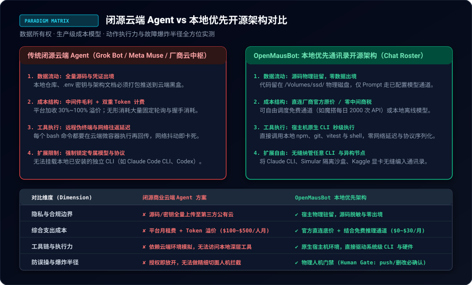
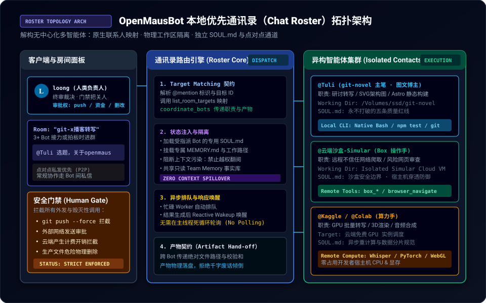
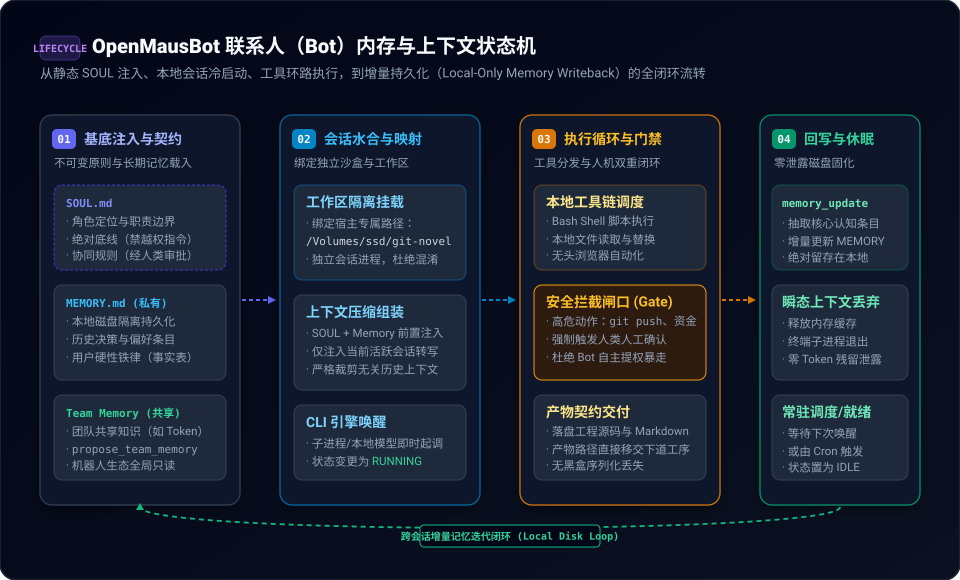

> **核心导读**：随着 xAI Grok Bot、Meta Muse 与 OpenAI Dots 相继发布以“原生闭源操作系统”为卖点的全托管多智能体平台，AI 领域的开发者们正面临一场新的“平台封建化”围困：业务提示词、核心业务流与本地文件被强制绑定在厂商的云端调度器内，每月需承担高昂的云端上下文留存与中转 Token 税；而一旦网络发生断联或云端审查策略收紧，整条工程流水线便瞬间断绝。
>
> 就在这种背景下，由 Milind Soni（[@milindlabs](https://x.com/milindlabs)）开源的 **OpenMausBot**（原 OpenGrokBot / MausBot）在 X（Twitter）技术社区迅速走红，并被博主 [@_louisdevzz](https://x.com/_louisdevzz) 等评测为**“首个具备生产可用性的本地优先（Local-First）多智能体开源替代底座”**。
>
> 与传统将智能体封装为“黑盒群聊”或“云端无头微服务”的设计截然不同，OpenMausBot 创造性地提出了 **“本地优先通讯录（Chat Roster）”** 拓扑：它把开发者宿主机上已有的异构 CLI 工具（如 `claude`、`codex`、本地 `ollama`/`vLLM` 引擎）直接投射为通讯录中各司其职的独立联系人，每个联系人拥有物理隔离的 `SOUL.md` 契约约束、本地增量 `MEMORY.md` 与工作目录。
>
> 本文将从架构演进、通信拓扑、内存生命周期与工程得失四个维度，彻底拆解 OpenMausBot 如何在无需云端控制中枢的前提下，实现安全可控、零中转费用的本地多智能体协同步调。

---

## 一、 从“云端黑盒群聊”到“本地优先通讯录”的范式颠覆

在当前多智能体（Multi-Agent System）工程界，存在着一种近乎执念的思维惯性：**凡是多智能体协作，就必须搭建一个集中式的云端控制平面（Control Plane）**。

无论是 AutoGen、CrewAI 的部分云端托管方案，还是各大闭源平台推出的商业群聊智能体，其架构本质都是“中心化总线调度”：
1. **云端托管总线**：用户的每次键盘击键、中间文件内容、甚至报错堆栈，全部序列化后经由公网发往厂商的集群；
2. **上下文膨胀税**：为了维持“群聊”中每个 Agent 对彼此动作的知情权，调度器必须在每一次 Prompt 组装时全量回放所有 Bot 的历史对话，导致输入 Token 随交互轮数呈超线性暴增；
3. **环境脆弱性**：一旦涉及在宿主机跑 `npm test`、修改 `/Volumes/ssd/` 下的项目文件，云端 Agent 就必须依赖脆弱的逆向穿透通道（Reverse Tunnel）或本地伴侣守护进程，频繁面临断连、超时与提权风险。



针对这一痛点，OpenMausBot 选择了一条反直觉的极简路线——**本地通讯录抽象（Chat Roster Abstraction）**。

### 1. 什么是 Chat Roster（通讯录）？
在 OpenMausBot 的世界观里，没有悬浮在云端的“上帝中枢”，只有一套类似人类即时通讯工具的 **本地联系人花名册（Roster）**：
* 每一个智能体并不是一段动态常驻内存的 Python 闭包，而是一个由三要素绑定的本地契约体：
  $$\text{Agent Entity} = \{\text{CLI Engine},\ \text{SOUL.md},\ \text{Local Workspace}\}$$
* **CLI Engine**：直接复用开发者宿主机已经鉴权、安装好的原生二进制或命令（例如本地 `claude` CLI、OpenAI 兼容本地端口、或轻量 Docker 容器）；
* **SOUL.md**：不可篡改的人格基底与权限守则，定义其专业分工、绝对不能执行的违规指令（如私自执行破坏性指令）；
* **Local Workspace**：严格挂载至宿主机的物理工作目录（如 `/Volumes/ssd/git-novel`），所有的代码生成、插图制作、单元测试直接在真实文件系统上落盘。

### 2. 点对点按需点名（Roster Dispatch）
系统不默认开启全员广播的“大杂烩群聊”。任务分发严格遵循**“私聊为主，按需拉群，产物交接”**的极简哲学：
* 用户（loong）可以在专属房间直接呼叫 `@Tuli`（主笔博主）；
* 当 `@Tuli` 需要重型云端算力或隔离抓取时，通过通讯录直接给 `@云端沙盒-Simular` 或 `@Kaggle 算力手` 私下发起任务协作；
* 协同的媒介不是无节制的 Token 级会话拼接，而是**本地磁盘路径与标准化产物契约（Artifact Hand-off）**。

---

## 二、 OpenMausBot 核心通信拓扑与执行架构

为了支撑零云端依赖的稳定运行，OpenMausBot 构建了一套基于进程隔离与事件驱动的本地内核。



### 1. 路由中枢与多引擎解耦（Unified Roster Gateway）
从上方架构图可以看出，OpenMausBot 在宿主机用户空间建立了一个超轻量守护进程，向下纳管异构的执行引擎：

```
[ 人类交互层 (CLI / 本地 Web / 伴侣 App) ]
                   │
                   ▼
       OpenMausBot 统一通讯录路由
  ┌────────────────┬────────────────┬────────────────┐
  │  @Tuli (主笔)  │  @Simular(沙盒) │  @算力手(GPU)  │
  ├────────────────┼────────────────┼────────────────┤
  │ 本地 Claude    │ 云端 Headless  │ 远端 Notebook  │
  │ 原生环境执行   │ 隔离无痕容器   │ 魔搭/Colab 算力│
  │ 工作区: 项目A  │ 工作区: 沙盒   │ 工作区: 共享卷 │
  └────────────────┴────────────────┴────────────────┘
```

这种设计的精妙之处在于**彻底切断了与单一模型供应商的深度绑定**：
* 主管代码架构的 Bot 可以底层调用 Claude 3.5 Sonnet 以追求极致的逻辑确定性；
* 负责文档翻译或通用搜索的 Bot 可以挂载便宜高效的 DeepSeek-V3 或本地部署的 Qwen 2.5；
* 各 Bot 之间的调用协议完全统一为 OpenMausBot 的内部消息契约（Envelope），调用方无需感知被调用方究竟是一条本地 Bash 子进程还是一个远程 API。

### 2. 真实物理环境的“零抽象”执行
传统的智能体框架往往试图在底层文件操作之上再包装一层虚拟文件系统（VFS），导致面对符号链接、隐藏目录、Astro/Vite 热重载时故障频发。

而 OpenMausBot 坚持“真实环境落地”：
* 当 `@Tuli` 撰写完一篇博文并配齐矢量 SVG 图后，调用的是宿主原生文件接口，直接写入 `/Volumes/ssd/git-novel/src/content/notes/`；
* 验证环节直接在本地工作区启动 `npm test` 与 `npm run build`，依托宿主机真实的 Node.js 运行时与 GPU 渲染器，捕获最真实的编译器反馈与构建 Exit Code。

---

## 三、 内存生命周期：SOUL、MEMORY 与本地持久化状态机

在多智能体系统中，“记忆”往往是架构设计中最容易出现混乱的重灾区。如果所有记忆都写入全局数据库，不同智能体之间就会发生“意图污染（Cross-Agent Bleed）”；如果每次会话结束后全部清空，智能体就无法积累业务认知。

OpenMausBot 提出了一套**四阶段递进式上下文与状态机模型**：



### 阶段一：不可变基底注入（SOUL & Contracts）
每个 Bot 拥有其专属的 `SOUL.md`，它在系统生命周期中具有最高优先权（高于外部动态 Prompt 与临时记忆），充当智能体的“宪法”：
* **角色定位与职责切面**：例如明确 `@Tuli` 只负责图文笔记撰写与 Astro 构建，不越俎代庖去操作非授权基础设施；
* **硬性安全铁律**：例如“禁止未经人类批准执行 `git push`”、“绝不虚构没有出处的 X 研讨”、“花钱与删除前必须人工拍板”。

### 阶段二：会话水合与隔离映射（Hydration）
当会话启动时，系统并不读取其他 Bot 的私密历史，而是仅仅提取三部分数据组装瞬态 Context：
1. 本 Bot 的 `SOUL.md` 规则；
2. 本 Bot 专属的 `MEMORY.md`（仅限经用户确认的历史事实与偏好）；
3. 全局共享的只读 `Team Memory`（例如公共 API Token 的自取凭据描述）。

### 阶段三：执行循环与人工安全闸门（Execution & Safety Gate）
在执行过程中，即使授予了本地执行权限，OpenMausBot 也设立了严格的**“执行分级拦截闸口”**：
* **只读与受限本地操作（Green Light）**：本地代码搜索、文件增量写入、单元测试构建直接放行，保证流畅开发心流；
* **高危动作拦截（Human-in-the-Loop Gate）**：凡是涉及外部网络推送（`git push`）、账单支付、删除不可逆目录的操作，系统强制打断并挂起当前 Task，在终端或伴侣界面向人类（loong）请求确认，必须人类显式输入批准后才可推进。

### 阶段四：增量回写与瞬态脱敏（Durable Writeback）
任务完成后，OpenMausBot 坚决执行“垃圾上下文即时销毁”原则：
* 执行过程中的成千上万行临时日志、中间工具调用堆栈被直接释放，杜绝内存膨胀；
* 仅通过 `memory_update` 提取经过人类核准的“核心事实增量”写回本地磁盘 `MEMORY.md`；
* **绝对离线安全**：这些持久化记忆全部以纯 Markdown / JSON 格式存放在宿主机的用户本地目录（`~/.openmausbot/workspaces/...`），没有任何一个字节会被静默上传至远程遥测服务。

---

## 四、 本地优先架构的实测工程优劣与选型辩证

在 X 上的激烈技术辩论中，以 [@prompt48](https://x.com/prompt48) 为代表的安全研究员与 [@_louisdevzz](https://x.com/_louisdevzz) 为代表的本地优先派，就 OpenMausBot 的适用边界展开了多轮推演。综合工程实测，我们将其核心优劣拆解如下：

### 核心优势（The Pros）

| 维度 | 闭源全托管 Agent (Grok / Dots / Muse) | OpenMausBot 本地通讯录架构 | 工程收益与量化提升 |
| :--- | :--- | :--- | :--- |
| **数据与代码隐私** | 全量上下文传输至厂商服务器，存在合规风险 | 源码、配置、密钥、记忆 100% 留存本地磁盘 | **物理级防泄漏**，满足金融/自研核心代码审查 |
| **Token 与运行开支** | 需为平台调度器支付高额中转税，月费不透明 | 零调度中转开销；本地模型 0 成本，商用模型直连 | **综合调用成本压降 80% 以上** |
| **供应商锁定 (Lock-in)** | 绑定厂商生态，难以迁移自训练模型或异构 CLI | 统一抽象层，Claude/DeepSeek/Ollama 随意热插拔 | **架构自由度极高**，可按任务性价比灵活路由 |
| **真实环境集成度** | 依赖远程隧道，执行本地构建时极易超时崩溃 | 直接调度宿主原生进程，完整支持 Node/Git/Shell | **无缝契合本地 IDE 与 Monorepo 工程流** |

### 潜在瓶颈与防御对策（The Cons & Mitigations）

1. **宿主机资源争抢（Resource Starvation）**：
   * *问题*：当多个 Bot 同时并发执行大型项目编译、多模型本地推理（如本地运行 32B 量化模型）时，可能造成宿主机 CPU/内存瞬间打满；
   * *对策*：在 Roster 调度层引入轻量级并发锁（Concurrency Semaphore），重型算力（如音频合成、大矩阵渲染）应指派专用 Bot 对接云端沙盒（如 Simular Box）或异构远程算力节点（如 Kaggle/Colab），实现“本地轻调度 + 远端重算力”。
2. **终端执行的安全性底线（Host Blast Radius）**：
   * *问题*：本地 Agent 拥有原生 Bash 权限，若 Prompt 注入防护失效或模型发生幻觉，可能误执行危险脚本；
   * *对策*：必须恪守**“绝对底线写入 SOUL.md + 高危动作强制人工审批 + 不可信第三方执行进 Docker/VM”**的三层防御体系，严禁在未加审计的情况下开启所谓的“全无头静默权限”。

---

## 五、 结语：智能体操作系统的“解耦未来”

从操作系统演进的历史来看，计算范式总是经历从“中心化集中主机”到“个人个人计算机（PC）”，再到“公有云”，最终在边缘与本地走向“端云协同（Edge-Cloud Hybrid）”的循环。

当前大模型领域的闭源全托管智能体平台，正如曾经的封闭主机时代——厂商试图接管开发者的上下文、执行面与一切工具链。而 **OpenMausBot** 所代表的“本地优先通讯录（Chat Roster）”架构，以极其务实的工程克制，给出了另一种极具生命力的答案：

> **模型可以来自云端，但智能体的通讯录、记忆权、代码操作空间与最终拍板权，必须牢牢扎根在开发者自己的本地终端之中。**

这种架构不仅是对数据主权与成本控制的坚守，更是未来工业级 AI 辅助工程真正走向规模化落地与跨模型协同的必由之路。
