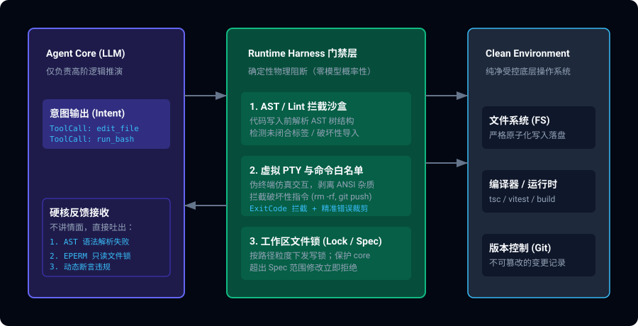

> **核心导读**：当给 Coding Agent 堆砌了上万 Token 的 System Prompt，写满了“你是一个严谨的工程师”、“请不要修改无关文件”、“请务必保持向后兼容”，模型却依然在第 5 轮会话后把关键配置文件覆写成垃圾代码——这一幕正在各大 AI 研发团队中高频重演。本文剖析“提示词软约束”在复杂工程中的物理失效，深入解构顶级 Agent 框架（如 Claude Code、Cursor、Trellis 核心线缆）如何转向以 AST 语法守卫、PTY 虚拟终端、文件只读锁为核心的 **Runtime Harness（运行时硬约束）** 架构。

---

## 一、 提示词工程的“物理天花板”

在过去的两年中，很多人把 Agent 的构建等同于编写“精巧的 Prompt”。然而在生产级代码库面前，Prompt 调优暴露出了三个不可逆的致命缺陷：

### 1.1 注意力衰减与“恳求式编程”的破产

所谓“在 Prompt 里写规则”，本质上是在**概率空间**内对模型的 Attention 权重施加软偏置。当会话轮次增加、工程上下文引入成千上万行代码时，系统提示词中的“负向约束”（Negative Constraints，如 *“不要碰 package.json”*）权重会被指数级稀释。

```
P(遵从约束) = f(Prompt 显眼度 / 上下文总长度) ≈ 随 Token 增长单调下降
```

你无法通过在 Prompt 里加三个感叹号来阻止一个 0.05% 贪心采样概率下的越权行为。在工程上，**把系统的稳定性押注在概率性建议上，本身就是反工程学的。**

### 1.2 幻觉重试的“毒化循环”

当 Agent 犯错（比如写出了缺少闭合括号的代码或者导出了不存在的模块），传统的 Prompt 做法是把错误信息塞回对话：*“你刚刚写错了，请重新检查并修复”*。

模型在接收到这种模糊的“口头责备”后，往往会产生第二层幻觉：它以为是整个函数逻辑有误，进而大动干戈地把周围 200 行本就正确的代码重写一遍，导致整个 AST 结构全面崩塌。

---

## 二、 范式转移：Runtime Harness 的三层防御体系

顶级团队不再对模型好言相劝，而是构建了一套坚不可摧的 **Runtime Harness（运行时线缆门禁）**。它的核心哲学是：**不让脏代码落盘，不让危险指令执行，用编译器的确定性报错作为最精准的 Prompt 反馈。**



### 2.1 第一道门禁：AST 预解析与语义投影（AST Guards）

传统的 Agent 工具调用是直接把字符串写入文件系统。而在现代 Harness 架构中，任何写入请求必须经过抽象语法树（AST）沙盒拦截：

```typescript
// Harness 拦截核心：在代码物理落盘前完成 AST 语法树完整性校验
import * as parser from '@babel/parser';
import traverse from '@babel/traverse';

export async function interceptedFileWrite(filePath: string, incomingCode: string) {
  // 1. 语法完整性硬检查（零概率容忍）
  let ast;
  try {
    ast = parser.parse(incomingCode, {
      sourceType: 'module',
      plugins: ['typescript', 'jsx'],
    });
  } catch (parseError: any) {
    // 立即熔断阻断！不落盘，并将精准的行列错误栈反向注入给模型
    throw new HarnessContractViolationError({
      type: 'SYNTAX_COLLAPSE',
      file: filePath,
      line: parseError.loc?.line,
      column: parseError.loc?.column,
      message: `AST 解析失败: ${parseError.message}。写入已强制阻断，底层文件未受损坏。`,
    });
  }

  // 2. 破坏性模式静态扫描（例如检测是否意外删除了核心导出）
  const exportedSymbols = new Set<string>();
  traverse(ast, {
    ExportNamedDeclaration({ node }) {
      if (node.declaration && 'declarations' in node.declaration) {
        node.declaration.declarations.forEach((d: any) => exportedSymbols.add(d.id.name));
      }
    },
  });

  verifyRequiredExports(filePath, exportedSymbols);

  // 3. 校验完全通过，执行原子化落盘
  await atomicWriteFile(filePath, incomingCode);
}
```

**为什么这比 Prompt 强一万倍？**
- 写入被物理阻断，文件系统永远保持一致性。
- Agent 收到的不是空泛的“你写错了”，而是 `第 42 行第 15 列缺少 Identifier` 的确定性编译器报错。模型对编译器报错的自愈成功率高达 95% 以上，而对自然语言责备的自愈率不足 40%。

### 2.2 第二道门禁：PTY 虚拟终端与命令白名单

在执行 Shell 时，把原始终端直接裸露给 Agent 是引发生产灾难的最大诱因。现代 Harness 在 Agent 与底层系统之间架设了一层虚拟终端（Pseudo-Terminal, PTY）：

1. **指令意图劫持**：拦截非幂等或高危操作（如 `rm -rf`、`kill -9`、无确认的 `git push --force`）。
2. **交互死循环脱困**：自动拦截阻塞式交互提示（如 `Press any key to continue` 或 `npm login`），通过 PTY 事件模拟超时中断并返回脱困引导，避免 Agent 永远挂起。
3. **ANSI 转义清洗与 Token 减负**：大型构建输出（如 Webpack / Vite 日志）动辄产生数万行无意义进度条字符。Harness 在中间层完成清洗，只提取末尾的 Exit Code 和关键 Error Trace，节省 80% 的上下文 Token。

### 2.3 第三道门禁：路径作用域与只读写锁（Spec-Scoped Locks）

在真实项目中，通常 90% 的文件是基础设施（如 `tsconfig.json`、CI 流水线配置、共享库核心），仅有 10% 是本次工单允许变更的模块。

传统的做法是在 System Prompt 强调 *“请不要修改 tsconfig.json”*。
现代 Harness 的做法是：**动态只读挂载**。
- 任务启动时，根据关联任务 PRD 计算出变更白名单（Target Scope）。
- 作用域之外的文件，在 Harness 拦截层一律标记为只读（Read-Only）。任何对其发起的编辑请求直接抛出 `EPERM: Target path outside task scope`。

---

## 三、 对比复盘：Prompt 治理 vs. Harness 治理

| 治理维度 | 纯 Prompt 方案 (软引导) | Runtime Harness 方案 (硬约束) |
|:---|:---|:---|
| **执行可靠性** | 概率性遵从，随上下文变长而劣化 | 100% 确定性物理拦截 |
| **错误恢复机制** | 自然语言纠错，极易诱发二次幻觉 | 编译器行列级报错栈，直接喂给自愈循环 |
| **TokenOps 开销** | 每次会话携带沉重的 System Prompt 规则 | System Prompt 极其轻量，约束逻辑在本地运行 |
| **安全边界** | 靠“安全提示词”防范越权 | 容器沙盒隔离 + PTY 白名单 + 路径只读锁 |
| **开发维护成本** | 永无止境的提示词调参与黑盒试错 | 经典的软件工程代码，逻辑完全可观测可单测 |

---

## 四、 结语

从“提示词工程”走向“运行时门禁工程”，是 AI Agent 走出玩具阶段、走向工业级落地的必由之路。

优秀的 Agent 系统设计者正在达成共识：**不要奢望大语言模型成为守规则的圣人，而要把环境打造成一座即使它犯错也无法逾越的安全走廊。** 把属于自然语言推演的交给模型，把属于编译器、操作系统与测试套件的确定性门禁坚决收回到 Harness 手中。
