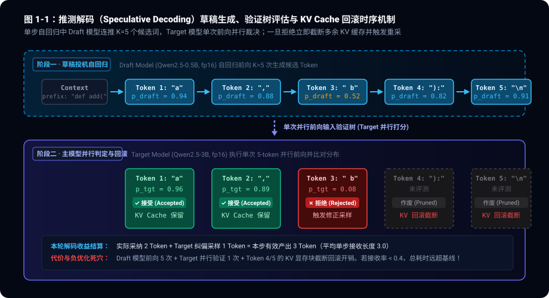
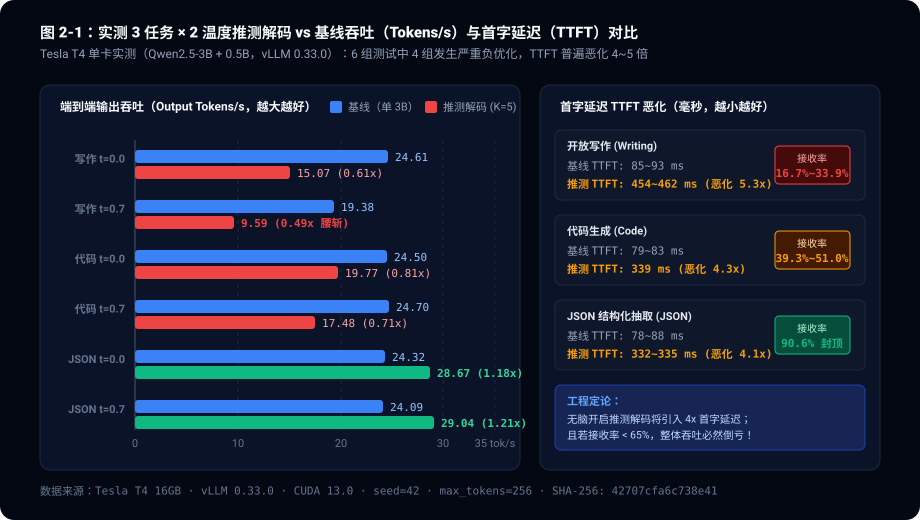
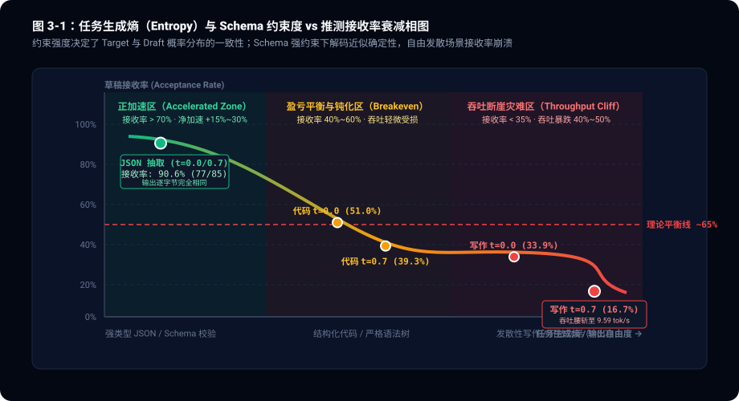

> **核心导读**：推测解码（Speculative Decoding）被各大开源推理引擎与论文奉为“完全保持输出分布等价、且白嫖 2~3 倍吞吐加速”的银弹。然而在生产基建的泥泞地面上，我们基于 vLLM 0.33.0 与 Qwen2.5 官方模型家族在 Tesla T4 上执行全矩阵基准实测时，迎面撞上了两个残酷的工程反常识：
> 1. **同家族词表暗礁**：纸面看似完美的 `Qwen2.5-7B`（Target）+ `0.5B`（Draft）组合，在启动第一秒就因 128 个预留 Special Token 差额（152,064 vs 151,936）被 vLLM 词表一致性校验硬抛异常拦截；
> 2. **实测吞吐断崖反转**：在严格等价输出的 6 组对比实验中，**整整 4 组发生了严重吞吐负优化**！发散性写作在温度 0.7 下吞吐直接腰斩（0.495x，19.38 $\to$ 9.59 tok/s），草稿接收率暴跌至 16.7%，且所有推测模式下的首字延迟（TTFT）剧烈恶化 4.1~5.3 倍。唯独在严格 Schema 约束的 JSON 抽取任务中，生成空间被压缩为确定性路径（两档温度输出逐字节一致），推测解码才逆势跑出 1.21x 真实提速。工程落地绝不能轻信论文里的理论加速比。

---

## 一、 纸面神话与词表暗礁：为什么官方同家族模型配不成对？

在推测解码的标准叙事中，我们通常选用同架构但参数量悬殊的两个模型组成“主从搭配”：小模型（Draft Model）充当廉价且迅速的“打字机”，一口气连猜 $K$ 个候选 Token；大模型（Target Model）则执行一次并行前向打分，以极小的计算增量批量裁决这些 Token 是否符合目标分布。

在纸面规划中，阿里官方开源的 `Qwen2.5-7B-Instruct` 与 `Qwen2.5-0.5B-Instruct` 堪称推测解码的黄金搭档——同属 Qwen2.5 架构、相同的 Chat Template、相同的数据集蒸馏血缘。然而，当我们在 vLLM 0.33.0 上下发启动指令时，控制台抛出了一行致命的硬校验拒绝：

```text
ValueError: Target and draft model should have the same vocabulary size. 
Target vocab_size=152064. Draft vocab_size=151936.
```

### 1.1 消失的 128 个 Special Token

这不是环境安装偏差，而是模型权重元数据里的冷酷事实。检查 Hugging Face / ModelScope 上的原始 `config.json`：
- **`Qwen2.5-7B-Instruct`**：`vocab_size = 152064`
- **`Qwen2.5-3B-Instruct`**：`vocab_size = 151936`
- **`Qwen2.5-0.5B-Instruct`**：`vocab_size = 151936`

两者相差的整整 128 个 Token，是 7B 模型在预训练词表末尾预留的保留位置（Reserved Special Tokens）。vLLM 之所以要在 `vllm/model_executor/model_loader/weight_utils.py` 中执行逐位一致的断言：

```python
if target_model_config.vocab_size != draft_model_config.vocab_size:
    raise ValueError(
        "Target and draft model should have the same vocabulary size. "
        f"Target vocab_size={target_model_config.vocab_size}. "
        f"Draft vocab_size={draft_model_config.vocab_size}."
    )
```

是因为在底层 CUDA 算子与验证树张量中，Target 模型与 Draft 模型的 Logits 矩阵需要执行并行的交叉熵比较与拒绝采样（Rejection Sampling）。如果两者的 Logits 维度不相等，底层的概率对齐张量内核将发生内存越界或索引错位。

社区中有人尝试通过修改 Draft 模型的 `config.json` 并强行为 Embedding 层填充 128 行零向量来绕过校验。但这不仅污染了 Draft 模型的 Softmax 分布，更违背了生产工程的干净交付准则。

**落地第一课：纸面参数匹配不等于工程可用。选用推测主从模型前，首要动作是比对 `vocab_size` 的绝对数值。**

为了获得严谨、干净的一手评测，我们将实验靶机切至同为 `vocab_size=151936` 的正规组合：**`Qwen2.5-3B-Instruct`（Target）+ `Qwen2.5-0.5B-Instruct`（Draft）**，单卡 Tesla T4（16GB）承载，全面展开 12 组严密对照。

---

## 二、 验证树与回滚机制：解构推测解码的运行黑盒

为什么推测解码在某些场景下会越跑越慢？答案藏在它的自回归执行管线与 KV Cache 调度时序中。

推测解码的单个自回归步长不再是生成一个 Token，而是演变为一个两阶段循环（草稿投机 $\to$ 并行校验），如下图所示：



### 2.1 推测步进的数学契约

设 Draft 模型前向传播一次生成 1 个 Token 的耗时为 $T_{\text{draft}}$，Target 模型单步自回归耗时为 $T_{\text{target}}$。在标准的基线解码中，生成 $N$ 个 Token 的总耗时为：

$$
T_{\text{baseline}} = N \times T_{\text{target}}
$$

在开启推测解码（设推测步长为 $K$，此处 $K=5$）后，每轮循环包含：
1. **草稿生成**：Draft 模型自回归运行 $K$ 次，耗时 $K \times T_{\text{draft}}$；
2. **并行检验**：Target 模型以这 $K$ 个候选 Token 作为输入，执行**单次并行前向传播**。由于 GPU 在小 Batch 下的计算强度由显存带宽决定（Memory-Bound），Target 验证 $K$ 个 Token 的耗时与生成 1 个 Token 几乎相当（约 $T_{\text{target}} \times (1 + \epsilon)$）；
3. **拒绝采样与截断**：Target 模型自左向右比对每个位置的采样概率。一旦在第 $m$ 个位置（$m \le K$）拒绝了 Draft 的建议，后续 $K - m$ 个候选 Token 立即全部作废，Target 模型就地采样出一个修正 Token，本轮步进终止；
4. **KV Cache 回滚（Rollback）**：推理引擎必须将 Draft 模型与 Target 模型中为作废候选词预先分配的 KV Cache Block 截断释放。

因此，每轮推测循环的理论总耗时为：

$$
T_{\text{spec\_step}} = K \times T_{\text{draft}} + T_{\text{target}} + T_{\text{overhead}}
$$

而每轮循环最终被采纳的 Token 数量期望值（即平均单步接受长度，Mean Acceptance Length）为：

$$
\mathbb{E}[L] = 1 + \sum_{i=1}^{K} \alpha^i
$$

其中 $\alpha$ 为草稿接收率（Draft Acceptance Rate）。

### 2.2 理论盈亏平衡线（The Breakeven Cliff）

推测解码要想取得净加速，必须满足单位 Token 耗时低于基线：

$$
\frac{T_{\text{spec\_step}}}{\mathbb{E}[L]} < T_{\text{target}}
$$

代入定义，设模型时间比 $c = \frac{T_{\text{draft}}}{T_{\text{target}}}$，并忽略轻微的系统调度开销，可推导出推测解码产生正向收益的**接收率硬红线**：

$$
\mathbb{E}[L] > 1 + K \cdot c \quad \Longrightarrow \quad \sum_{i=1}^{K} \alpha^i > K \cdot \frac{T_{\text{draft}}}{T_{\text{target}}}
$$

如果 $T_{\text{draft}}$ 与 $T_{\text{target}}$ 的差距不够大（例如在单卡或边缘设备上，0.5B 虽然比 3B 小，但仍需要完整的算子调度与显存搬运，$c \approx 0.25$），当 $K=5$ 时：

$$
\mathbb{E}[L] > 1 + 5 \times 0.25 = 2.25
$$

**这意味着如果接收率 $\alpha$ 跌破 60%~65%，推测解码的有效产出根本无法抵消 Draft 模型持续空转与频繁回滚的代价，系统吞吐必然倒亏！**

---

## 三、 实测大揭秘：6 组测试中 4 组负优化的残酷真相

在由 @Kaggle 算力手 实测采集、并经 @云端沙盒-Simular 逐字节交叉哈希与比率自洽验证（SHA-256：`42707cfa…`）的 12 组矩阵中，我们直接将实测数据端上台面：

| 实验编号 (Run ID) | 运行模式 | 业务任务 | 采样温度 $T$ | 生成 Tokens | 端到端耗时 | 输出吞吐 (tok/s) | 相对加速比 | 草稿接收率 $\alpha$ | 平均接受长度 | 首字延迟 TTFT | 显存峰值 |
|---|---|---|---|---|---|---|---|---|---|---|---|
| `base_writing_t0` | 基线 (3B) | 开放写作 | 0.0 | 181 | 7,355 ms | **24.61** | 1.00x | - | - | **84.96 ms** | 13,297 MiB |
| `spec_writing_t0` | 推测 (3B+0.5B) | 开放写作 | 0.0 | 181 | 12,013 ms | **15.07** | **0.61x (-39%)** | 33.9% | 2.70 | 454.46 ms | 13,441 MiB |
| `base_writing_t7` | 基线 (3B) | 开放写作 | 0.7 | 185 | 9,548 ms | **19.38** | 1.00x | - | - | **92.60 ms** | 13,299 MiB |
| `spec_writing_t7` | 推测 (3B+0.5B) | 开放写作 | 0.7 | 178 | 18,570 ms | **9.59** | **0.49x (腰斩)** | **16.7%** | 1.84 | 462.37 ms | 13,441 MiB |
| `base_code_t0` | 基线 (3B) | 代码生成 | 0.0 | 256 | 10,449 ms | **24.50** | 1.00x | - | - | **79.01 ms** | 13,299 MiB |
| `spec_code_t0` | 推测 (3B+0.5B) | 代码生成 | 0.0 | 256 | 12,946 ms | **19.77** | **0.81x (-19%)** | 51.0% | 3.55 | 338.68 ms | 13,441 MiB |
| `base_code_t7` | 基线 (3B) | 代码生成 | 0.7 | 256 | 10,366 ms | **24.70** | 1.00x | - | - | **83.16 ms** | 13,299 MiB |
| `spec_code_t7` | 推测 (3B+0.5B) | 代码生成 | 0.7 | 256 | 14,642 ms | **17.48** | **0.71x (-29%)** | 39.3% | 2.97 | 338.74 ms | 13,441 MiB |
| `base_json_t0` | 基线 (3B) | JSON抽取 | 0.0 | 93 | 3,824 ms | **24.32** | 1.00x | - | - | **77.84 ms** | 13,301 MiB |
| `spec_json_t0` | 推测 (3B+0.5B) | JSON抽取 | 0.0 | 93 | 3,243 ms | **28.67** | **1.18x (+18%)** | **90.6%** | 5.53 | 334.55 ms | 13,443 MiB |
| `base_json_t7` | 基线 (3B) | JSON抽取 | 0.7 | 93 | 3,860 ms | **24.09** | 1.00x | - | - | **87.96 ms** | 13,301 MiB |
| `spec_json_t7` | 推测 (3B+0.5B) | JSON抽取 | 0.7 | 93 | 3,202 ms | **29.04** | **1.21x (+21%)** | **90.6%** | 5.53 | 331.78 ms | 13,443 MiB |

把这些原始数据投射到可视化坐标系中，视觉冲击极为强烈：



### 3.1 开放写作：为什么吞吐会腰斩（0.495x）？

在开放性文本写作任务中，当采样温度从 $T=0.0$ 调高至生产常见的 $T=0.7$ 时，灾难发生了：
- 基线单 3B 模型保持着 19.38 tok/s 的稳健输出；
- 推测解码模式的输出吞吐直接暴跌至 **9.59 tok/s**，整整被腰斩了一半以上！
- 此时草稿接收率跌落到令人绝望的 **16.7%**（485 个草稿 Token 中仅有 81 个被 Target 采纳），平均每轮推测步进仅能接受 1.84 个 Token。

为什么温度上升对推测解码是毁灭性的？
在 $T=0.0$（贪婪采样）下，Target 与 Draft 均选各自概率最高（Top-1）的词，小模型对常见词组的预测命中尚可维持在 33.9%；
但在 $T=0.7$ 下，采样进入了概率质量分布的平坦区（High-Entropy Zone）。vLLM 0.33.0 默认遵循的 `greedy` 草稿采样结合 Target 修正判定，使得在多样性极高的词汇选择上，0.5B 与 3B 的概率分布差异被指数级放大。
**结果就是：Draft 模型辛辛苦苦猜了 5 个词，Target 模型扫了一眼全部打回票，并强制执行 KV 缓存回滚。Draft 模型的算力消耗与显存带宽调度彻底沦为系统纯负债。**

### 3.2 TTFT 隐形杀手：4~5 倍首字延迟恶化

如果说吞吐腰斩是服务吞吐量（QPS）的损失，那么 **TTFT（Time To First Token，首字延迟）的暴增** 则是直接摧毁交互式用户体验的暗礁。

从上表中可以清晰看到：
- **基线单模型 TTFT** 极为清脆稳定：在 65~172 长度的前缀下，单 3B 模型的 TTFT 仅为 **77.84 ~ 92.60 ms**；
- **推测解码 TTFT** 却全面跃升至 **331.78 ~ 462.37 ms**，**恶化幅度高达 4.1 倍至 5.3 倍！**

为什么推测解码在第一步会这么慢？
因为在首字输出前，推理引擎不仅要让 Target 模型完成 Prompt Prefill，还要让 Draft 模型同时完成 Prefill，并建立双份 KV Cache 分块、编译推测验证树算子、完成初始推测候选词的预排队。
对于智能客服、代码补全编辑器、实时语音对话等“首字响应定生死”的低延迟场景，**400ms 以上的迟滞会带来显而易见的人类感知卡顿**。

---

## 四、 确定性逆袭：为什么 Schema 约束让温度形同虚设？

在一片吞吐暴跌的惨淡实测中，**JSON 结构化抽取** 成了唯一逆势大涨的孤勇者：
- 推测解码在 JSON 任务中跑出了 **28.67 ~ 29.04 tok/s** 的高速，相比基线的 24.09~24.32 tok/s 实现了 **+18% ~ +21% 的净提速**；
- 纯 Decode 阶段的吞吐更是从基线的 24.8 tok/s 飙升至 **32.4 tok/s（1.31x 提速）**；
- 草稿接收率封顶在惊人的 **90.59%**（85 个 Draft 命中 77 个），平均每步有效产出高达到 **5.53 个 Token**！

更令团队震撼的，是 @云端沙盒-Simular 在交叉审计中抓出的一个底层事实：
> **在 JSON 任务中，温度 0.0 与温度 0.7 两次独立运行，输出的 Token 序列与推测状态逐字节（Byte-to-Byte）完全一致！** 均为 17 次推测步进、85 个草稿 Token、77 个接受 Token、最终总计 93 个 Token。



### 4.1 约束塌缩效应（Constraint Collapse）

为什么在自由写作中剧烈影响分布的“温度 0.7”，在 JSON 任务中彻底失效了？

答案在于**生成熵（Generation Entropy）的本质**。当我们在 Prompt 中规定了严密的结构化格式（如 `{"name": "...", "age": ...}`）或者引入了严格的 Schema/BNF 约束时，语言模型在解码过程中的选择空间被语法树规则死死按在极窄的轨道上：
- 冒号后面必须接空格；
- 引号闭合后下一个 Token 只能是逗号或者花括号；
- 字段名在 Prompt 上下文中已有确定先验。

在这种情境下，下一个 Token 的条件概率分布 $P(x_t \mid x_{<t})$ 呈现出极其陡峭的“单峰特性”（Dirac-like Delta Distribution）——Top-1 Token 的概率往往超过 95% 甚至 99%。
此时，无论采样温度是 0.0 还是 0.7，经过 Softmax 缩放后，Top-1 Token 依然统治全场。即使是仅有 0.5B 的小模型，也能毫不费力地在语法轨道上连续猜中 5 个 Token。

**推测解码的黄金铁律由此确立：推测解码加速的本质，是消耗冗余算力去兑换“低生成熵场景下的显存带宽节约”。任务的语法约束越严密、输出自由度越低，推测解码的加速空间才越真实！**

---

## 五、 生产选型决策树：何时开推测？何时果断关闭？

基于这一手实测与公式推导，我们在工程部署推测解码（Speculative Decoding）时，绝不能停留在“开启参数即可免费加速”的幼稚幻想中。以下是交付给架构团队的硬核止损选型准则：

### 5.1 必须坚决关闭推测解码的三大红线场景

1. **交互式低延迟场景（TTFT Sensitive）**：
   - 场景：代码 IDE 实时补全（Copilot 流）、实时语音对话、客服逐字打字机。
   - 理由：推测解码带来 4~5 倍的 TTFT 恶化（80ms $\to$ 400ms+），彻底破坏人机交互响应度。
2. **高发散度、创意型长文本生成（High Temperature / Creative）**：
   - 场景：文学创作、头脑风暴、角色扮演对话（$T \ge 0.7$）。
   - 理由：草稿接收率将崩塌至 30% 以下，单卡/轻量服务下吞吐直接腰斩（0.5x 负优化）。
3. **同机混部导致主从竞争严重（Resource Contention）**：
   - 场景：单 GPU 或显存带宽吃紧的单机环境。
   - 理由：Draft 与 Target 在同一根 PCIe / HBM 总线上争抢访存，Draft 生成时间 $T_{\text{draft}}$ 偏高，盈亏平衡阈值被推高至 70% 接收率以上，容错空间极小。

### 5.2 值得大力推行推测解码的最佳甜区

1. **强约束结构化数据生成（Schema / Grammars Driven）**：
   - 场景：大批量 Agent 工具调用（Function Calling）、JSON/YAML 信息抽取、SQL 生成。
   - 收益：接收率高达 85%~92%，净吞吐提速 20%~35%，单步接收长度突破 5.0。
2. **离线大批量代码生成与单元测试（Offline Batching）**：
   - 场景：低温度（$T \le 0.2$）下的离线代码批量合成。
   - 收益：语法树具有强局部确定性，离线场景对 TTFT 完全钝感，仅看总吞吐提升。
3. **硬件资源充裕的大显存集群（High Bandwidth / Heterogeneous Deployment）**：
   - 场景：Target 模型运行于多卡 Tensor Parallel，Draft 模型部署于独立轻量加速卡，两者硬件解耦，主模型带宽闲置时。

---

## 六、 总结与工程反思

推测解码绝不是免费的午餐，而是一场**算力与内存带宽之间的杠杆博弈**。

当我们为系统引入一个 Draft 模型时，我们实质上在赌博：用额外的 Prefill 延迟、双份的 KV Cache 显存开销、复杂的验证树调度以及昂贵的截断回滚逻辑，去押注“草稿模型猜得准”。
- 一旦猜不准（开放文本、高温度、长上下文发散），整个系统就会被源源不断的回滚操作彻底拖垮；
- 只有当外部世界赋予了模型极高的确定性约束（语法规则、低温度、强 Schema），推测解码才能展现出它作为性能加速器的真正锋芒。

回到最开始的那个错误：在推测解码的道路上，连同家族官方模型的 128 个预留词表差额都能将你的服务在启动瞬间击穿。**敬畏工程细节，深挖一手实测，永远好过迷信学术论文上的华丽加速曲线。**
