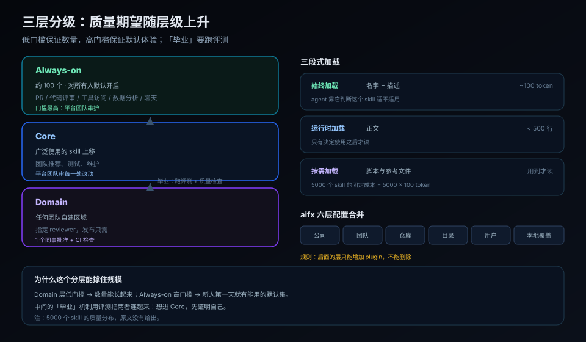
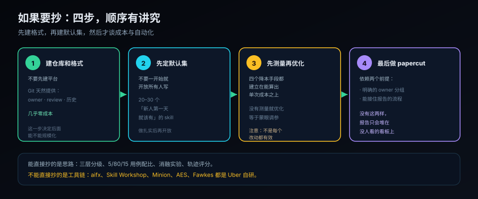

> **核心导读**：Uber 公开了他们的 Agent Skill 体系：skill 市场从 2025 年 10 月的 **1 个**增长到一年后的 **5000+ 个**，一个月内 agent 调用 skill 超过 **100 万次**。
>
> 但数字不是重点。这篇真正有价值的是三件事：**他们怎么组织 5000 个 skill 而不失控**（三层分级 + 六层配置合并）、**怎么评测**（5/80/15 的用例配比 + 轨迹评分 + 消融实验）、以及 **agent 自己报 bug 的闭环**（papercut 机制，三个月数千条、数百条已修）。
>
> 本文基于 Uber 工程博客原文与 X 长文交叉核对，所有数字标注来源；原文没说的、以及我认为需要打折扣的地方，单独成节。

---

## 一、先看规模：一年从 1 到 5000

Uber 给出的时间线很具体：

| 时间 | 数字 |
|---|---|
| 2025 年 10 月 | 1 个 skill |
| 2026 年 3 月 | 200+ |
| 2026 年 11 月 | 5300+ |
| 单月调用 | 100 万+ 次 |

这些调用发生在四个环境里：Claude Code、OpenCode、Codex，以及 Uber 内部的 agent。

一个值得注意的细节：**这些不是工程师专用。** 原文说，工程师用 skill 做根因分析、实验读数；其他团队用它取指标、准备文档初稿、帮客户经理回答商户支持问题。

这解释了为什么能到 5000 个——如果只有工程场景，不需要这么多。



---

## 二、Skill 到底是什么：一个 Markdown 目录，三段式加载

原文的定义很朴素：**一个 skill 就是一个 workflow 的封装**。可以短到「编辑一个 Linear issue」，也可以长到「完整的根因分析」。

在磁盘上，它是一个目录，里面有 `SKILL.md`（名字、描述、指令正文），还可以有脚本和参考文件。

关键在于**加载方式**——这决定了为什么几千个 skill 不会把上下文撑爆：

| 阶段 | 加载什么 | 成本 |
|---|---|---|
| 始终加载 | 名字 + 描述 | 约 **100 token** |
| skill 运行时加载 | 正文 | 控制在 **500 行**以内 |
| 按需加载 | 脚本与参考文件 | 只有用到的那一步才读 |

这个设计的含义：**5000 个 skill 的固定成本，是 5000 × 100 token 的描述**。agent 靠描述判断这个 skill 适不适用，不适用就完全不读正文。

这是一个很聪明的取舍——把「知道有什么」和「知道怎么做」分开计价。

---

## 三、怎么管住 5000 个：三层分级

原文的标题叫「Organizing the Madness」（整理混乱），这个措辞很诚实。

他们的做法是把市场分成三层，**质量与效率的期望随层级上升**：

| 层级 | 谁能发 | 审核强度 | 规模 |
|---|---|---|---|
| **Domain** | 任何团队自建区域 | 1 个同事批准 + CI 检查，指定 reviewer | 长尾 |
| **Core** | 广泛使用的 skill 上移 | 团队推荐、测试、维护，平台团队审每一处改动 | 中间层 |
| **Always-on** | 平台团队 | 对所有人默认开启 | 约 **100 个** |

Always-on 那 100 个覆盖什么？原文列了：拉 PR、代码评审、工具访问、数据分析、聊天。

这个分层的核心思路是**默认值与自由度并存**：新人第一次运行就有 100 个可用 skill（不需要自己找），同时任何团队都能在自己的 Domain 里快速发布（不需要等中心团队）。

「毕业」机制是关键：一个 skill 从 Domain 升到 Core，要跑他们的评测系统，通过一组质量与有用性检查。

### 3.1 aifx：一个 CLI 抹平所有 agent 的差异

支持多种 agent 是策略，也是麻烦——每个 agent 定义和安装 skill 的方式都不一样。

Uber 的做法是写了一个 CLI 叫 **aifx**，最初只是启动 agent 和存配置，后来扩展到 skill 管理、MCP 调用、可观测性。

用法：

```bash
aifx plugin add data-analyst   # 装一组 skill（plugin）
aifx skill add analyze          # 装单个 skill
```

它把选择记录在一个配置文件里，然后应用到下一个启动的 agent。所以一个工程师在 Claude Code、Codex、OpenCode 之间切换，skill 保持不变。

**六层配置合并**是另一个值得抄的设计：

1. 公司默认
2. 团队 / 项目
3. 仓库
4. 工作目录
5. 用户
6. 本地覆盖

规则是：**后面的层只能增加 plugin，不能删除。** 所以一个仓库可以声明「在这里工作的人都需要这些 plugin」，而个人无法悄悄把它关掉。

这条规则看起来很小，但它解决了一个真实问题：团队约定的工具链，不该因为某个人的本地配置而失效。

---

## 四、怎么评测：5 / 80 / 15

这是全文技术含量最高的部分。

### 4.1 用例配比

Uber 推荐的评测套件构成：

| 类型 | 占比 | 特征 |
|---|---|---|
| **Golden cases** | 约 **5%** | 固定输入、固定期望输出、工具 mock |
| **真实 prompt** | 约 **80%** | 按**轨迹**评分 |
| **作者判定** | 约 **15%** | 作者自己看 |

**轨迹（trajectory）** 的定义很明确：agent 有没有按正确顺序用正确的 skill 和工具——**不看最终答案，看过程**。

这个配比值得注意：只有 5% 是传统的「标准答案」测试。剩下 95% 都不是精确匹配，因为 skill 的输出本来就难以精确匹配。

### 4.2 一个反直觉的结论：70–90% 通过率比 100% 更有用

原文原话：

> 我们的经验是，通过率 70%–90% 的评测，比通过率 100% 的评测更有用。

理由：答案会变，裁判也会变。**100% 通过可能意味着这个评测根本没检测到答案的实质变化。**

这一条我认为是整篇文章最值得抄进团队规范的一句。大多数团队看到 100% 会高兴，Uber 看到 100% 会怀疑评测本身。

### 4.3 三个运行环境

评测跑在三个地方：

- **Minion**：后台 agent 平台
- **AES**：托管 agent 沙箱
- **devpods**：远程开发机

为什么要在远程跑？原文给的理由很实在：**干净环境能抓住对作者本机的依赖。** 有些 skill 默认某些文件路径、缓存文档、或者特定操作系统的工具存在——「在我机器上能跑」在 skill 世界里同样成立。

### 4.4 消融实验：少即是多

这是我认为最有说服力的部分。

做法：同一批真实 prompt，**一次带 skill、一次不带**，让一个盲裁判选哪个答案更好。

结果：**大多数情况下，带 skill 的会话更成功、成本更低。**

最大的收益来自哪类 skill？原文说得很清楚：**给 agent 提供了它本来不容易找到或理解的东西**——比如内部文档的访问、或者跑数仓查询的能力。

一个具体案例（数仓查询 skill）：

| 指标 | 不带 skill | 带 skill |
|---|---|---|
| 工具调用次数 | 多 **13%** | — |
| 工具错误 | **6 倍** | — |
| 耗时 | 长 **31%** | — |
| 盲测胜率 | — | **87%** |

还有一个反向发现：**模型变强之后，skill 里的某些词反而会降低表现。** 所以他们也在测「删掉部分文字」的效果。这解释了为什么他们要定期做 skill 的退役判断。

---

## 五、成本：怎么算，怎么降

### 5.1 一个 skill 到底花多少钱

Uber 的算法很直接：

1. agent 会维护一个「本会话已花多少」的累计值，遥测定期上报快照；
2. 取调用 skill 前的最后一个快照，和调用后的第一个快照，相减；
3. 按天累加，除以调用次数，得到单次调用成本。

这个数字包含：模型读 skill、后续轮次、以及那个窗口里的其他工具调用。

**注意它的口径**：这是「调用前后会话总成本的差」，不是 skill 本身的 token 数。所以它天然包含了连带影响——这是优点（反映真实成本），也是缺点（一个 skill 变便宜可能是因为别的地方变贵了）。

### 5.2 四个降本手段

| 手段 | 效果 |
|---|---|
| 用代码替代 LLM（Code Mode） | 见下 |
| 把 skill 放进 worker，用更便宜的模型跑 | 某个 tracing skill 单次成本降 **46%** |
| skill 加载时直接跑脚本，把结果塞进 prompt | 某搜索 skill 从 4 轮降到 3 轮，平均成本降 **32%** |
| 把轮询移出主会话 | 20 个最高花费会话里，通知轮询约占 **1/3** 花费 |

原文还特别提醒了一句：**不是每个改动都有效。** 一个 deployment skill 改完之后第一周**没有任何下降**。所以他们要求每个 skill 改完都要重新测量。

### 5.3 Code Mode：100 个工具定义就是 5–7 万 token

这是全文最具体的一个成本数字：

> 默认的 MCP 安装方式会把每个工具的完整描述加载到每次调用里。工具超过 100 个时，这些定义在用户还没输入任何东西之前就占掉 **50,000–70,000 token**。

Uber 的做法（受 Cloudflare Code Mode 启发）：把这些流程搬进工具脚本，通过他们的 gateway 调工具。这样不用预加载工具定义，agent 只读它需要的那部分结果。

效果：原文给了一个对比——**50 行的查询，1.4M token vs 900 token**。注意原文标注这是估算值。

他们还做了一件很强硬的事：**在 skill 和 plugin 里禁止 `.mcp.json` 文件**（这种文件会安装工具服务器）。等于从制度上堵死了「随手挂个 MCP 把上下文撑爆」这条路。

---

## 六、Agent 自己报 bug：papercut 机制

这是我认为整套体系里最有意思的设计。

### 6.1 问题的提出

一个 skill 可能因为一千种原因失效：模型升级改变了它读指令的方式、工具的 flag 变了、agent harness 改了运行方式。

而 agent **知道自己卡住了**——它花了 100 轮在跟一个奇怪的错误搏斗，它看到帮助文本里列了某个 flag 但工具拒绝它，它看到命令在出错时返回 0，它看到查询本该有结果却返回空。

问题是：agent 通常会自己找个绕路办法，然后**把这些 token 和上下文白白烧掉**。

### 6.2 解法：一个永远在线的 skill

Uber 加了一个叫 `log-papercut` 的 always-on skill。agent 遇到摩擦就写一份结构化报告，不用人要求。

报告包含四件事：**它试了什么、它期望什么、实际发生了什么、什么能修好。**

所有报告进一个看板，按 skill 分组。

原文提到一个附带好处：这个机制**对发生 bug 的那次会话本身也有帮助**——因为 agent 知道「有时东西就是坏的」，它会更快识别出自己正在挣扎，甚至能查别人怎么绕过。

### 6.3 结果

**三个月，数千条 papercut，数百条已修复。**

原文举了四个已修的例子，每一个都很具体：

1. 一个 PR skill 把 commit message 写到共享临时文件，导致两个并发会话互相改对方的 PR；
2. 一个 deployment skill 让 agent 传 epoch 秒，而 API 期望毫秒；
3. 一个配置查询 skill 在 key 不存在时返回了另一个属性，而且不报错；
4. 一个 PR skill 在没有 CI 的仓库上等 CI 检查，重复 404 直到超时。

这四类 bug 有共同特征：**静默失败**。它们不会让 agent 立刻崩，而是让它在一个错误的方向上继续跑。这类问题人很难在 code review 里发现，但 agent 在实跑中一定会撞上。

---

## 七、原文没说的，和需要打折扣的地方

### 7.1 5000 个 skill 的质量分布没有给

原文说「数百条已修复」，但没说 5000 个 skill 里有多少是「能用的」。三层分级里 Domain 层只需要一个同事批准加 CI 检查——这个门槛很低。

一个合理的推测：**长尾质量可能相当参差**，而 always-on 的那 100 个才是真正被反复验证过的。但这是推测，原文没有数据。

### 7.2 成本数字的口径问题

前面说过，单次调用成本是「前后快照相减」。这个口径会把同一窗口里的其他开销算进来。

更关键的是：原文给了「降 46%」「降 32%」，但**没有给绝对金额**。所以无法判断这些优化的量级——一个从 0.02 美元降到 0.01 美元的 skill，和一个从 2 美元降到 1 美元的 skill，意义完全不同。

### 7.3 「70–90% 比 100% 好」需要限定条件

这句话在原文语境里成立，但它有一个隐含前提：**这个评测本身是有效的**。

如果评测设计得不好，70% 通过率也可能只是噪声。原文没有讨论「怎么判断一个评测本身是不是有效」——这恰好是站内另一篇《16 个评测框架的横评》里提到的「判分器需要自己被测」。

两篇可以对照着读：Uber 这篇讲的是**怎么在企业里跑评测**，那篇讲的是**评测框架本身怎么选、判分器怎么校准**。

### 7.4 没有提失败案例

全文的叙事是成功的：从 1 到 5000、100 万次调用、数百个修复。但没有说：

- 有多少 skill 被下架或退役？
- 有没有 skill 造成了生产事故？
- papercut 机制有没有被滥用（agent 乱报）？

这些对想复制这套体系的人来说，可能比成功数字更有用。

---

## 八、如果要抄，按这个顺序



**第一步：先建仓库和格式，不要先建平台。**

Uber 的关键判断是「最好的地方是 Git 仓库」——因为版本控制天然给了每个 skill 一个 owner、一次 review、一段历史。这一步几乎零成本。

**第二步：先定 always-on 的最小集合。**

不要一上来就开放所有人写。先选 20–30 个「新人第一天就该有」的 skill，把它们做到能用，再开放 Domain 层。

**第三步：先做成本测量，再做成本优化。**

Uber 的四个降本手段都建立在「能算出单次调用成本」之上。没有测量就优化，等于蒙眼调参。

**第四步：最后才做 papercut。**

这个机制很吸引人，但它依赖两个前提：有明确的 owner 分组、有能接住报告的流程。没有这两样，agent 报的 bug 只会堆在一个没人看的看板里。

---

## 九、结论

Uber 这套体系最值得学的不是任何一个具体工具，而是三个判断：

1. **skill 的加载要分段计价**——100 token 的描述 + 500 行的正文 + 按需的脚本，让规模成为可能；
2. **评测要看轨迹，不要只看答案**——80% 的用例是轨迹评分，因为 skill 的输出本来就难精确匹配；
3. **让 agent 自己报 bug**——静默失败是人类 review 抓不到的，但 agent 天天在撞。

同时要看清它的边界：这是**一家公司内部的体系**，建立在自研的 aifx、Skill Workshop、Minion、AES、Fawkes 之上。外部团队能直接抄的是**思路和配比**（三层分级、5/80/15、消融实验），不是工具链。

最后一个观察：原文结尾列了「下一步」——A/B 测试 skill、按模型编译 skill、skill 推荐、任务路由。这四项都指向同一个方向：**从「人写 skill」转向「系统管理 skill」**。这和站内《推理引擎开始自己改自己》里描述的趋势是同一个：基础设施正在从「被优化」变成「自我优化」。

---

## 参考资料

**一手来源**

- Uber Engineering, *How Uber Evals 1 Million Agent Skill Invocations a Month*：<https://www.uber.com/us/en/blog/optimizing-ubers-agent-skills/>
- 同一篇的 X 版本（本文数字以 Uber 博客为准，两处一致）：<https://x.com/UberEng/status/2125008806249930999>

**本文交叉核对**

- X 长文 22,509 字符全文抓取后与 Uber 博客逐项对照，关键数字一致
- 额外核到的数字：50 行查询 1.4M vs 900 token（原文标注为估算值）
- 原文标注：封面图由 ChatGPT 生成；引用来源为 Shyam Sankar 在 Stratechery 的访谈（2026-10-29）
